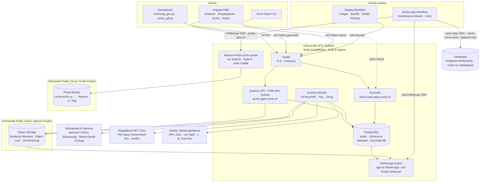
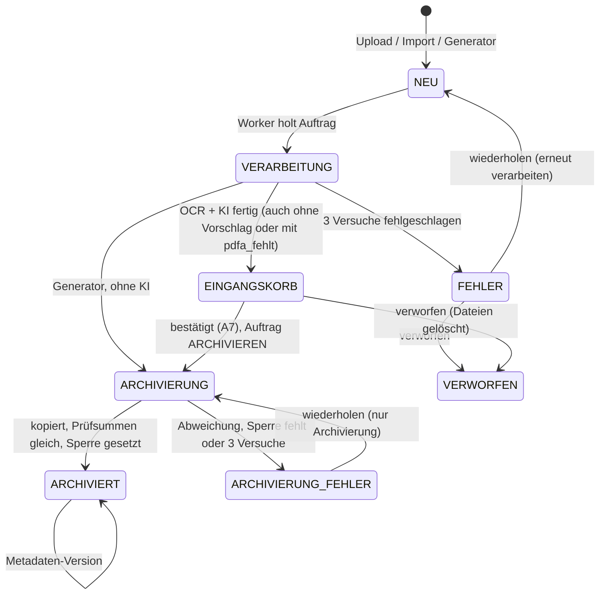
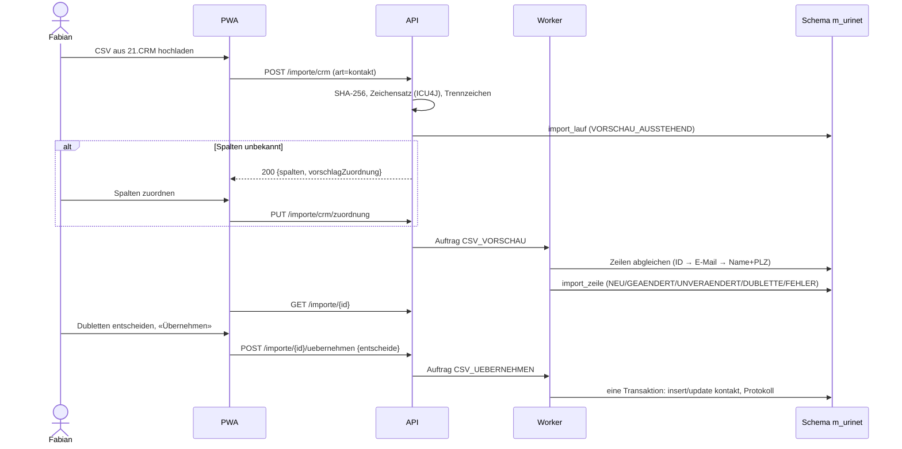

# Design Document — 01 Archiv-Kern

## Overview
Ein Quarkus-Dienst (Java 25) in zwei Laufarten: **API** (REST für Web-App, Handy-App, Generatoren
und Drive-Import; liefert die Angular-PWA über Quinoa im selben Artefakt aus) und **Worker**
(Verarbeitung aus der Auftragsschlange). Er läuft hinter Traefik, zuerst auf der bestehenden Infomaniak-VPS
(Stufe A, nur Testdaten), ab dem Wechsel vor der Übernahme in Welle 5 auf einer eigenen Infomaniak-VPS (Stufe B).
Daten liegen pro Mandant in einem eigenen PostgreSQL-Schema und einem eigenen Bucket im Infomaniak
Object Storage (eigenes Public-Cloud-Projekt). Die PWA dient für Erfassung, Eingangskorb, Suche,
Import und Verwaltung.

Nummern: «Req x.y» verweist auf `requirements.md`, «A1–A14» auf die Rechtematrix (Req 2.6; A15–A19 ergänzt Spec 04, Req 12.1),
«P1–P19» auf die Prüfentscheide in `docs/umsetzungsplan.md` (P20–P22 ergänzt Spec 04), «Konzept-Entscheid E1–E5» auf das Konzept.

Leitentscheide (ADRs in `docs/adr/`):
- ADR-001 Eigenbau statt Paperless-ngx (Konzept Variante B, Konzept-Entscheid E2).
- ADR-002 Schema pro Mandant statt Mandantenspalte; Schemaänderungen nur über Liquibase mit den Changelogs `db/public` (gemeinsame Tabellen) und `db/mandant` (je Mandant), Hibernate nur `validate` (Req 1.5, 1.7).
- ADR-003 Auftragsschlange in PostgreSQL statt Message-Broker.
- ADR-004 Zweistufige Ablage: `eingang/` ohne Sperre, `archiv/` mit Object Lock GOVERNANCE, gesperrt nur bei Arten mit `gesetzliche_pflicht` (P12).
- ADR-005 Handy zuerst als PWA (Konzept-Entscheid E3); keine native Hülle (D8 gestrichen, entschieden von Fabian am 09.11.2026: nur Web-App).
- ADR-006 KI nur für Vorschläge; Bestätigung durch Menschen; Generatoren ohne KI.
- ADR-007 Unveränderbarkeit (P2): Dokumente unter `archiv/` in GOVERNANCE statt COMPLIANCE, damit Fehlarchivierungen und Löschbegehren nach revDSG lösbar bleiben; Manifeste unter `manifest/` in COMPLIANCE (Req 6.11). Jedes Manifest trägt einen RFC-3161-Zeitstempel (Pflicht): bevorzugt massgeblich der ZertES-qualifizierte Stempel der TSA der Swiss Government PKI, dazu ein zweiter Stempel desselben Hashes bei einem zweiten Dienst, der bei Wegfall des Hauptdiensts massgeblich wird (Req 15.3, 15.11; vorgeschlagen 12.11.2026, entschieden mit dem Merge von PR #86). Nach Spike 0.2 gilt Option B (entschieden 09.11.2026; ADR-007, Nachtrag 09.11.2026): Einen App-Schlüssel ohne `s3:BypassGovernanceRetention` gibt es im selben Projekt nicht; die Anwendung setzt den Bypass-Header nie und verkürzt keine Sperre (Req 6.5). GOVERNANCE schützt die Dokumente damit gegen Fehler der App und Versehen. Eine Manipulation mit gestohlenem App-Schlüssel verhindert es nicht; sie fällt über das gesperrte, zeitgestempelte Manifest und den Prüflauf auf (Req 15.5), und bereits gesicherte Dateien lassen sich aus der Zweitkopie wiederherstellen (ADR-008). Der Inhaber-Zugang (Schlüssel ausstellen, Korrekturen) liegt nur offline (Req 6.10).
- ADR-008 Sicherung (P4): Zweitkopie von Datenbanken und Bucket bei einem zweiten Schweizer Anbieter (bestehendes Hostpoint-Webhosting, restic nur anhängend; ADR-008, Nachtrag 12.11.2026) über den zentralen Sicherungs-Workflow (GitHub Actions, maintenance-Muster). Der Server verschlüsselt vorher asymmetrisch, der Runner sieht nur Chiffrat (Req 16.7, 16.8). Die Zweitkopie trägt keine Object-Lock-Sperren; die Unveränderbarkeit nach GeBüV tragen Bucket und Manifeste (ADR-007).
- ADR-009 Rollen eng nach Rechtematrix (P3, Req 2.6). Unsichtbare Dokumente antworten mit 404 vor 403, damit die Antwort nicht verrät, dass ein Dokument existiert.
- ADR-010 Plattform (P1, geändert 08.11.2026): Infomaniak-VPS mit Traefik, Deploy nur über GitHub Actions (SSH-Bundle, Health-Prüfung, Rollback), in zwei Stufen: Stufe A auf der bestehenden VPS (nur Test- und anonymisierte Daten, Speicherbudget, ohne Leistungsziele), Stufe B auf einer eigenen, grösseren VPS spätestens vor echten Belegen (Req 16.15–16.19). Keycloak bleibt (P5).
- ADR-011 Hexagonale Struktur je Fachbereich (`domain`, `application`, `adapter`) mit Driven Ports und Dev-Stubs für Ablage, KI, OCR und Integration, durch ArchUnit erzwungen (Req 16.13).
- ADR-012 Lokales Sprachmodell über LM Studio nur im Profil `lokal` auf dem Entwicklerrechner, nur an `localhost`; nie für Gate 0, Golden-Lauf, Abnahmen, CI oder Betrieb; Startprüfung der KI-Basis-URL (P19, Req 16.20–16.22).

## Architecture



API und Worker sind dasselbe Artefakt; `archiv.rolle=api|worker` schaltet REST-Endpunkte bzw.
den Auftrags-Poller ein. Aus einem Build entstehen zwei Images: `archiv` (API mit PWA) und
`archiv-worker` (zusätzlich `ocrmypdf`, `tesseract-ocr-deu`, `img2pdf`, `libheif-examples`,
`ghostscript`, `poppler-utils`). In Stufe A laufen beide Rollen in einem Container
(`archiv.rolle=api,worker`, Image `archiv-worker`, weil es die OCR-Werkzeuge enthält).

### Betrieb auf der VPS (Req 16.1, 16.4, 16.10, P1)
- `deploy/infomaniak/compose.yml` mit den Diensten `archiv-api`, `archiv-worker`, `archiv-db` (PostgreSQL 17 mit `pgvector`), `archiv-keycloak` und `archiv-sicherung` (täglicher Export, siehe «Sicherung»); in Stufe A ohne eigenen Dienst `archiv-worker` (siehe «Stufen»). Limits, `cap_drop: ALL`, `no-new-privileges` und numerische uid gemäss Compose-Policy (tech.md); die Fremd-Images werden unter dem App-Namen als `archiv:db-…` und `archiv:kc-…` umgetaggt (bis Aufgabe 1.9 hier `archiv-db:<version>` und `archiv-keycloak:<version>`; geändert nach der Policy «mehrere Images je App» des Infra-Repos) und im Infra-Repo der VPS eingetragen.
  - Umsetzung Stufe A (Aufgabe 1.9, nach der Policy des Infra-Repos, PR #5 «mehrere Images je App», auf `main` seit 10.11.2026): Compose-Dienste `api`, `db` und `kc` im Projekt `archiv` (Container `archiv-api-1`, `archiv-db-1`, `archiv-kc-1`); `archiv-sicherung` folgt in Welle 5. Images: `archiv:<sha7>` (App), `archiv:db-<version>-<sha7>` und `archiv:kc-<version>-<sha7>`; `compose.yml` nennt nur `archiv:current`, `archiv:db-current` und `archiv:kc-current`, die `deploy-app.sh` setzt. Jedes Bundle trägt alle drei Images; ein Rollback setzt sie gemeinsam zurück, die Volumes nicht.
  - Abgeleitete Images unter `deploy/infomaniak/`: `db/Dockerfile` (pgvector/PostgreSQL 17 per Digest) legt beim ersten Start mit leerem Volume die Datenbanken `archiv` und `keycloak` und die Rollen `archiv_owner`, `archiv_app` und `keycloak` an (`10-archiv-rollen.sh`, Passwörter nur als SCRAM-Verifier aus den Dateien `*_scram`; `archiv_app` ohne CREATE in `public`; `revoke all` auf `archiv` und `keycloak` und `revoke connect` auf `postgres` für `public`, danach `connect` auf `archiv` nur für `archiv_app`; die Extensions `vector` und `pg_trgm` legt das Init an). Der Superuser `postgres` meldet sich nur über den Socket im Container an: Das Init fügt `host all postgres all reject` vor die allgemeine Regel `host all all all scram-sha-256` in `pg_hba.conf` (Loopback im Container bleibt wie vom Image `trust`; andere Container erreichen `postgres` nicht). Ein Passwortwechsel und eine Änderung an `pg_hba.conf` brauchen danach Handarbeit (`ALTER ROLE`), weil das Init nur bei leerem Volume läuft. `keycloak/Dockerfile` (Keycloak per Digest, `kc.sh build` mit PostgreSQL, Health, lokalem Cache) bringt den Realm-Export mit; der Wrapper `start.sh` liest `keycloak_db` und `keycloak_admin` aus `/run/secrets/` und startet mit `--import-realm`. Keycloak läuft als uid 1000 mit `read_only` und tmpfs für `data/tmp`.
  - Dieselben Basis-Images nennt `application.properties` für die Dev Services; Dependabot pflegt nur die Dockerfiles, `DeployImagesTest` erzwingt den Gleichstand.
- Traefik-Labels nur an `archiv-api` und `archiv-keycloak`; nur diese beiden hängen zusätzlich am Netz «web» von Traefik. Datenbank, Worker und Sicherung hängen nur im eigenen internen Docker-Netz des Archivs. Die API ist nur über Traefik erreichbar (kein veröffentlichter Port), deshalb ist `X-Real-Ip` vertrauenswürdig.
- Router `archiv.apps.urinet.ch`: alle Pfade ausser `/q/*`, dazu ein eigener Router nur für `/q/health/live` (schlanker Health-Pfad ohne Details). `/q/health/ready` und `/q/metrics` bleiben im internen Netz für das Monitoring der VPS (Anbindung in Welle 5).
- Router `archiv-auth.apps.urinet.ch`: nur `/realms/` und `/resources/`; die Admin-Konsole ist nicht öffentlich.
- Deploy nur über `.github/workflows/infomaniak-deploy.yml` (Aufgabe 1.9; Name nach dem Muster der VPS, Req 16.10 entsprechend angepasst): Images bauen, Bundle (Images, `compose.yml`, Secret-Dateien aus GitHub-Secrets) per SSH an den Deploy-Befehl der VPS, danach Health-Prüfung über `/q/health/live` und die interne Readiness; schlägt sie fehl, Rollback auf das Vorgänger-Image. Weil Migrationen rückwärtskompatibel sind (Req 16.11), läuft das Vorgänger-Image auf dem neuen Schema.
  - Auslöser nur `workflow_dispatch` und Tags `v*` auf `main`, nie jeder Push (ein Bundle trägt drei Images); ohne Repo-Variable `INFOMANIAK_HOST` läuft nichts. Der Commit muss auf `main` liegen (`git merge-base --is-ancestor` gegen `origin/main`, Checkout mit ganzer Historie); ein Tag auf einem Commit ausserhalb von `main` bricht ab. Statt `mvn verify` verlangt der Workflow einen grünen CI-Lauf für denselben Stand und baut mit `-DskipTests` (`.github/scripts/pruefe-ci-nachweis.py`; grün heisst: Lauf und jeder seiner Jobs erfolgreich). Nachweis ist ein grüner Lauf von `ci.yml` auf dem Commit selbst. Solange Push auf `main` ohne CI läuft (Entscheid Fabian 11.11.2026, PR #50), gilt bis zum 30.11.2026 (`PR_CI_BIS`) auch der grüne PR-Lauf des Squash-Merges, aber nur, wenn der Kopf des PR den Vorgänger des Commits auf `main` enthält und denselben Tree hat; dann hat die PR-CI genau den deployten Stand geprüft (Auftrag PR #42 vom 11.11.2026, Review PR #42 Runde 2, S1). Hat sich `main` vor dem Merge bewegt oder fehlt der Nachweis, bricht der Deploy ab und nennt den Weg: CI auf `main` von Hand starten (`gh workflow run ci.yml --ref main`), nach grünem Lauf den Deploy neu auslösen. Ab dem 01.12.2026 gilt nur noch der Lauf auf dem Commit. Nachweis `CiNachweisTest`.
  - Kein GitHub-Environment mit Required Reviewer vor dem Deploy (entschieden von Fabian am 11.11.2026, PR #42 P42-2): Der Schutz bleibt der Auslöser – `workflow_dispatch` oder ein Tag `v*` – nur auf einem Commit aus `main` mit grüner CI. Er schützt vor Versehen, nicht vor Absicht: GitHub nimmt bei einem Tag die Workflow-Datei des getaggten Commits, bei `workflow_dispatch` die der gewählten Ref; ein Commit mit geänderter `infomaniak-deploy.yml` umgeht die Prüfungen. Das ist ohne Environment (Free-Plan) das hingenommene Restrisiko (Review PR #42 Runde 2, K4).
  - Vor dem Bundle: Speicherbudget aus `compose.yml` (`.github/scripts/pruefe-speicherbudget.py`, Summe `mem_limit` und `cpus` gegen tech.md; darüber gilt Req 16.18 und es wird nicht deployt), Secrets und Variablen vorhanden, Health der anderen Apps (`INFOMANIAK_ANDERE_APPS_HEALTH`, fail closed).
  - Bundle mit `umask 077` nur im Runner; je Secret eine Datei `secrets/<name>`, dazu SCRAM-Verifier `*_scram` für die Datenbank (`.github/scripts/scram-verifier.py`, Fehlermeldung nennt den Namen des Secrets); nach dem Senden gelöscht. Logs nennen nur Namen. Secrets darf nur dieser Workflow nutzen und nur über `secrets.<NAME>` aus einer festen Liste; das Szenario `@req-16.7` weist jedes andere Vorkommen ab (`secrets.*`, `secrets: inherit`, `secrets[…]`, `toJSON(secrets)`, unabhängig von Gross- und Kleinschreibung), erlaubt sind daneben nur Pfade `…/secrets`.
  - Nach dem Deploy: alle drei Container `healthy` (Readiness der API: Datenbank und OIDC-Tenant, siehe «Teststrategie»; Keycloak hat einen eigenen Healthcheck; die Wartezeit von 10 Minuten deckt die Frist des OIDC-Wächters mit Takt und Zeitlimit, einen Neustart der API und ihren Healthcheck, damit sich ein beim Start noch nicht erreichbares Keycloak (z. B. erstes Zertifikat für `archiv-auth`) auch während des Deploys heilt (Review PR #42 Runde 2, K3, bisher 7.5 Minuten); ein falsch konfiguriertes Keycloak endet im Rollback, der Schritt nennt dann die Zahl der Meldungen `OIDC_NICHT_BEREIT` im Log, keine Inhalte), öffentlich `/q/health/live` und Realm 200, `/api/v1/…` ohne Anmeldung 401, `/q/health/ready`, `/q/openapi`, Keycloak `/admin/` und Realm `master` 404. Der Deploy prüft so Host und Realm von Keycloak, nicht Client-ID, Audience oder Rollen-Mapper (dafür bräuchte er ein echtes Token und ein weiteres Secret); die erste Anmeldung prüft Fabian bei 1.10 (Review PR #42 Runde 2, K5). Danach, nach einer Minute Betrieb, Speicherabbrüche des Archivs und Health der anderen Apps (Req 16.18). Speicherabbrüche zeigen sich als Neustart (`restart: unless-stopped`): `.github/scripts/pruefe-container.py` merkt sich bei «Container gesund» die Laufzeit aus `compose ps` und verlangt danach alle drei wieder `healthy` und keinen kürzer laufend, als seither vergangen ist (Docker rundet die Laufzeit, gezählt wird mit Spannen, damit die Rundung keinen Neustart vortäuscht); dazu `OutOfMemoryError`/`terminated by signal 9`/`oom-kill` im Log, nur gezählt (kein blosses `Killed`, Review PR #42 K2). `RestartCount` und `OOMKilled` liefert der Befehl `status` der VPS nicht. Speicherabbrüche anderer Apps sieht der Deploy-Befehl nicht; die prüft Fabian (Nachweis 16.18 manuell).
  - Keycloak in der Readiness der API, mit Selbstheilung (entschieden von Fabian am 11.11.2026, PR #42 P42-1; Review PR #42 M1, Vorschlag b). Alt: «Keycloak nicht in der Readiness der API … Darum `quarkus.oidc.health.enabled=false`: Ohne Keycloak bleibt die API bereit». Neu: `quarkus.oidc.health.enabled=true`; ein fehlendes oder falsch konfiguriertes Keycloak macht die API unhealthy, der Deploy rollt zurück. War Keycloak beim Start der API nicht erreichbar, bleibt der OIDC-Tenant «Not Ready», bis eine angemeldete Anfrage ihn neu aufbaut. Startet die VPS neu, startet Docker die Container mit `restart: unless-stopped` ohne `depends_on`, `api` meist vor `kc`, und Traefik leitet nicht an einen unhealthy Container, also käme diese Anfrage nie an. Darum prüft der `OidcBereitschaftWaechter` (`gemeinsam/adapter/in/health`) alle `archiv.oidc.waechter.intervall` (15 s) den OIDC-Health-Check, jede Prüfung mit Zeitlimit `archiv.oidc.waechter.zeitlimit` (10 s) auf einem eigenen Thread: Nimmt Keycloak Verbindungen an, antwortet aber nicht, zählt die Prüfung als «nicht bereit», und solange die vorige noch hängt, startet keine weitere (Review PR #42 Runde 2, K1; `BegrenzterAufruf`). Die Readiness-Abfragen des Docker-Healthchecks laufen ohne dieses Zeitlimit im Health-Check von Quarkus und binden bei einem hängenden Keycloak je einen Worker-Thread, bis Keycloak antwortet oder der Wächter die API neu startet (bekanntes Restrisiko). Ist der Tenant `archiv.oidc.waechter.frist` (5 min) durchgehend nicht bereit, loggt er `Fehler <ID>: fehlercode=OIDC_NICHT_BEREIT` (ohne Adressen) und beendet die API mit Exit-Code 75 (EX_TEMPFAIL); `restart: unless-stopped` startet sie neu, und der neue Start baut den Tenant auf, sobald Keycloak erreichbar ist. Schleifenschutz: Zähler und Frist (`Bereitschaftsfrist`, Domain) beginnen mit jedem Start neu, die Frist ist mindestens 1 Minute (kürzer bricht den Start ab), also höchstens ein Neustart je Frist; einen persistenten Backoff gibt es nicht (`/tmp` ist tmpfs, kein Volume dafür). Ohne Keycloak antworten angemeldete Anfragen 401, API-Tokens gelten weiter, sobald die API bereit ist. `depends_on: kc: service_healthy` regelt nur die Startreihenfolge beim Deploy. Im Kommando-Modus (Tenant aus) prüft der Wächter nichts. Das gilt auch im Betrieb (Review PR #42 Runde 2, K2): Fällt Keycloak aus, meldet die Readiness DOWN, Traefik leitet nicht mehr an die API, und das Archiv ist nicht erreichbar, auch nicht für API-Tokens (P1, in Kauf genommen); dauert der Ausfall länger als die Frist, startet die API je Frist einmal neu, laufende Aufträge brechen ab und die Auftragsschlange wiederholt sie. Nachweis `OidcNichtErreichbarTest`, `OidcBereitschaftTest`, `OidcFalschKonfiguriertTest`, `BereitschaftsfristTest`, `BegrenzterAufrufTest`.
  - Rollback (`rollback archiv`) nur, wenn der Server den neuen Stand übernommen hat und die Health des Archivs fehlschlägt; tritt 16.18 ein, gilt das Abbruchkriterium aus 1.10 (stoppen, kein Rollback). Der Workflow wertet den Exit-Code des Rollbacks aus: Fehlt `archiv:previous`, meldet er «erster Deploy: kein Rollback möglich», sonst bei Fehler «Rollback ebenfalls fehlgeschlagen». Einen Stop-Befehl hat der Deploy-Befehl nicht; Stoppen ist ein Schritt für Fabian.
  - Migrationen, die das Vorgänger-Release brechen (Tabellen oder Spalten entfernen, umbenennen, Typ ändern, `NOT NULL` nachträglich), weist das Szenario `@req-16.11` statisch ab. Braucht es so eine Änderung, ist das ein Entscheid von Fabian und läuft zweistufig über zwei Releases (erst nicht mehr nutzen, dann entfernen). Schon gemergte Changesets, die das Muster treffen, den Vorgänger aber nachweislich nicht brechen, stehen mit Begründung und SHA-256 ihres Inhalts in `MigrationSchritte` (Changesets werden nie geändert, Regel 11): bisher nur `005-auftrag-mandant-pflicht` (PR #41, `NOT NULL` auf `auftrag.mandant`; der Stand davor schreibt nicht in `auftrag`).
  - Stufe in der CI (Erkenntnis aus dem ersten Deploy am 12.11.2026, PR #73: ohne `ARCHIV_STUFE` brach der Start auf der VPS mit dem Präfix der Stufe A ab): `DeployStufeTest` liest die Umgebung von `api` aus `compose.yml`, legt sie wie Docker als Umgebungsvariablen über `application.properties` (Profil `prod`) und prüft sie mit `Stufenregel` wie die Startprüfung `AblageStufenPruefung`. Ohne `ARCHIV_STUFE` gelten die Regeln der Stufe B; mit `ARCHIV_STUFE=A` verlangt der Test zusätzlich die Werte von Req 6.11, die die Startprüfung nur als Warnung kennt: Präfix `urinet-archiv-a-` und Höchstfrist für `archiv/` und `manifest/` von höchstens 1 Tag. Die Startprüfung selbst bleibt unverändert.
  - Liquibase-Sperre mit Sitzungsbindung (Erkenntnis aus dem ersten Deploy am 12.11.2026: Die API startete wegen der fehlenden Stufe 28-mal neu, dabei blieb `public.databasechangeloglock` gesetzt, und jeder weitere Start wartete auf «Waiting for changelog lock», brach nach 5 Minuten ab und startete neu). `LiquibaseSitzungssperre` (`mandant/adapter/out/persistence`, über `META-INF/services/liquibase.lockservice.LockService` für PostgreSQL registriert) gilt für `db/public` und jedes Mandanten-Schema und hält zusätzlich zur Tabellensperre auf der Verbindung der Migration eine Sitzungssperre `pg_try_advisory_lock(0x4C42, hashtext(<Sperrtabelle>))`; PostgreSQL gibt sie frei, sobald die Verbindung endet, auch nach einem Absturz. So läuft nach diesem Verfahren nie mehr als eine Migration je Sperrtabelle. Ist die Tabellensperre trotzdem gesetzt, gibt der Start sie nur frei, wenn ausser der eigenen keine Sitzung derselben Rolle in der Datenbank offen ist (`pg_stat_activity`; eine laufende Migration, auch eines älteren Release ohne Sitzungssperre, hält ihre Verbindung offen), und nur genau die gelesene Sperre (Vergleich auf `lockgranted`); das Log nennt `fehlercode=LIQUIBASE_SPERRE_VERWAIST`. Sitzungen, die nach diesem Verfahren auf die Sperre warten, zählen dabei nicht mit (Review PR #74, S1): Ab dem ersten Versuch bis `releaseLock` hält jede Instanz die geteilte Teilnehmersperre `pg_try_advisory_lock_shared(0x4C54, 0)`, und Sitzungen mit dieser Sperre (`pg_locks`) werden nicht gezählt. Ausgenommen sind nur Teilnehmer ohne exklusive Advisory-Sperre im Namensraum `0x4C42` (gleich welcher zweite Schlüssel; Review PR #74, S2): Wartende lösen ihre Sitzungssperre nach jedem Fehlversuch, eine laufende Migration hält sie bis zum Ende. So bleibt eine aktive Migration auch geschützt, wenn ein späteres Release die Schlüsselbildung ändert (`NAMENSRAUM`, `hashtext(<Sperrtabelle>)`, Quoting von `escapeTableName` nach einem Liquibase-Update, `quarkus.liquibase.*-schema-name`). Preis: Ein Start wartet, solange ein anderer Prozess gerade ein anderes Schema migriert (z. B. `mandant anlegen` parallel); das ist endlich und die sichere Richtung. Ohne die Ausnahme blockierten sich mehrere Starts, die gleichzeitig auf eine verwaiste Sperre warten (z. B. ein eigener Worker-Dienst auf Stufe B oder `mandant anlegen` parallel zu einem Start), gegenseitig, und die Selbstheilung fiele aus. Sitzungen ohne Teilnehmersperre (älteres Release, Handarbeit) zählen weiter. Grenze (Review PR #74, K1): Gezählt werden nur Sitzungen derselben Rolle; eine Migration nach altem Verfahren (nur Tabellensperre) unter einer **anderen** Rolle wäre nicht geschützt. Darum migrieren in prod nur Prozesse mit `archiv_owner` (Quarkus-Start und `EigentuemerVerbindung`), und Migrationen von Hand mit einer anderen Rolle oder mit einem Werkzeug ohne `LiquibaseSitzungssperre` sind nicht zulässig. Ist eine andere Sitzung offen, bleibt die Sperre unangetastet, Liquibase wartet wie bisher und bricht nach 5 Minuten ab; das Log nennt einmal `Fehler <ID>: fehlercode=LIQUIBASE_SPERRE_BELEGT` mit Anleitung, ohne `lockedby` (Hostname, Adresse). In prod migriert `archiv_owner`, die Anwendung nutzt `archiv_app`; offene Sitzungen von `archiv_owner` sind also Migrationen oder Handarbeit. In dev und Tests ist der Migrationsbenutzer zugleich der Benutzer des Pools, dort wird eine verwaiste Sperre darum nie selbst freigegeben. `releaseLock` gibt die Tabellensperre nur frei, wenn die Instanz sie hält (Quarkus ruft nach `update` ein zweites Mal `releaseLock`); `release-locks` (`forceReleaseLock`) gibt wie bisher ohne Bedingung frei. Anleitung bei `LIQUIBASE_SPERRE_BELEGT`: Läuft eine Migration (zweite API, Admin-Kommando), abwarten; sonst die offene Sitzung von `archiv_owner` beenden – nur eine Sitzung im Zustand `idle` ohne Advisory-Sperre mit `classid` `0x4C42` (19522) oder `0x4C54` (19540) in `pg_locks`, denn eine Sitzung mit einer dieser Sperren folgt dem neuen Verfahren und kann eine laufende Migration sein –, der nächste Start (Neustart durch Docker oder neuer Deploy) gibt die verwaiste Sperre selbst frei. Die Sperre nie von Hand löschen, solange eine Sitzung offen ist. Der Schritt «Container gesund» nennt im Fehlerfall die Zahl der Meldungen «Waiting for changelog lock» und `LIQUIBASE_SPERRE_BELEGT`, keine Inhalte. Die Codes stehen nicht im Enum `Fehlercode` (keine HTTP-Antwort, wie `OIDC_NICHT_BEREIT`). Bricht Liquibase nach der Wartezeit ab, nennt seine eigene `LockException` weiterhin `lockedby` (Hostname, Adresse; Liquibase 4.33.0, `StandardLockService.waitForLock`); das Log bleibt auf dem Server, der Workflow zählt nur (Review PR #74, K5). Nachweis `LiquibaseSitzungssperreTest` (künstlich gesetzte Sperre mit und ohne offene Sitzung, zwei gleichzeitige Starts, zwei gleichzeitig auf eine verwaiste Sperre wartende Starts, Teilnehmer mit Sitzungssperre unter anderem Schlüssel, Migration einer anderen Rolle nach diesem Verfahren, Absturz, doppeltes `releaseLock`).

### Stufen der Plattform (Req 16.1, 16.15–16.19, P1)
- **Stufe A** (Welle 1 bis zum Wechsel, bestehende VPS, Werte in `tech.md`): dieselbe `compose.yml` und derselbe Deploy-Workflow wie Stufe B; die stufenabhängigen Werte (ein App-Dienst statt zwei, Limits, Speicher-Einstellungen) liegen versioniert unter `deploy/infomaniak/`, nie von Hand auf dem Server.
  - `archiv-api` mit Image `archiv-worker` und `archiv.rolle=api,worker`; `archiv.stufe=A`; `archiv.worker.parallel=1`; OCRmyPDF seitenweise nacheinander (`--jobs 1`).
  - Speicherbudget: Summe der `mem_limit` aller Archiv-Dienste ≤ 900 MiB (geändert 10.11.2026, Entscheid Fabian; bisher 700 MiB), `cpus` zusammen ≤ 0.75; JVM-Heap, `shared_buffers`/`work_mem` von PostgreSQL und der Heap von Keycloak knapp gesetzt. Im JVM-Heap der API reserviert sind `archiv.api-token.parallele-pruefungen` × 19 MiB für gleichzeitige Argon2-Rechnungen der API-Tokens, Prüfen und Anlegen zusammen (Standard 2 × 19 MiB = 38 MiB, Aufgabe 1.5; Anlegen seit 2.1). Die Werte sind Richtwerte und werden in Aufgabe 1.10 gemessen.
  - Erste Messung (Aufgabe 1.9, lokal mit Docker, Gerüst ohne Upload und OCR, synthetische Last): Spitzen api 309 MiB, db 66 MiB, kc 358 MiB; Keycloak braucht schon im Leerlauf rund 318 MiB (Native Memory Tracking: rund 340 MB committed, davon Heap 117, Metaspace 112). Mit Serial GC, C1 und knappem Heap stehen in `compose.yml` api 320m (Heap 112m), db 100m, kc 400m (Heap 96m), zusammen **820 MiB** bei 0.75 CPU, über dem bisherigen Budget von 700 MiB; mit tieferen Limits wurde Keycloak vom cgroup-OOM beendet. Fabian hat das Budget am 10.11.2026 auf 900 MiB angehoben (Req 16.18, `tech.md`); das Abbruchkriterium bleibt: Speicherabbrüche oder kranke andere Apps beenden den Deploy.
  - Arbeitsverzeichnis und Plattenplatz (Entscheid Review PR #53, P1; Alt: «Uploads: Quarkus legt Multipart-Uploads unter `/tmp` ab, auf Stufe A ein tmpfs, das zum Speicher des Containers zählt. Mit der Erfassung (2.x) Upload-Grenze und Ablageort festlegen.»). Neu: Uploads (bis 50 MB je Datei, Req 3.6), OCR-Läufe und Zwischenkopien der Ablage liegen unter `archiv.arbeit.verzeichnis` (Standard `/var/lib/archiv/arbeit`), im Container das benannte Volume `archiv_arbeit` auf der Platte, nicht im RAM. Darunter je ein Unterordner: `upload/` (`quarkus.http.body.uploads-directory`), `ocr/` (`archiv.ocr.arbeitsverzeichnis`), `ablage/` (`archiv.ablage.zwischenablage`); alle drei sind einzeln konfigurierbar. `/tmp` bleibt ein tmpfs von 16 MB (bisher 64 MB) nur für die JVM selbst (hsperfdata, Cache von Vert.x); das tmpfs zählt zum `mem_limit`, das Volume nicht. Das Image legt den Mountpunkt mit Besitzer 10001 und Rechten 700 an (`Dockerfile.jvm`, ohne `VOLUME`-Befehl), ein neues, leeres Volume übernimmt beides.
    - Aufräumen: Jeder Lauf löscht seine Dateien im `finally` (Quarkus am Ende jeder Anfrage mit `delete-uploaded-files-on-end`, `OcrMyPdfAdapter`, `VerarbeitenHandler`, `S3Ablage`). Beim Start legt `ArbeitsverzeichnisAufraeumen` (`gemeinsam/adapter/in/start`) das Verzeichnis an, prüft, dass es beschreibbar ist (sonst bricht der Start ab), und löscht Dateien und leere Ordner unterhalb der ersten Ebene, die älter als `archiv.arbeit.rest-alter` (1 h) sind; jüngere bleiben, weil beim Deploy der Vorgänger noch laufen kann. Das Log nennt nur Anzahlen. Profile: `dev` unter `java.io.tmpdir`, `test` unter `target/arbeit`, `lokal` unter `~/.cache/urinet-archiv/arbeit` (Colima bindet `/var/folders` nicht ein).
    - Prod-Build ausserhalb des Images (Erkenntnis PR «CI: Prod-Start im Browser-Job», 11.11.2026): Ohne Volume darf ein Prozess ohne Root `/var/lib/archiv/arbeit` nicht anlegen, und der Start bricht ab, schon bevor `ArbeitsverzeichnisAufraeumen` läuft: RESTEasy Reactive legt beim Einrichten der Formular-Verarbeitung `upload/` an und meldet nur `AccessDeniedException: /var/lib/archiv`. Der CI-Job `browser` setzt darum `ARCHIV_ARBEIT_VERZEICHNIS` auf ein Verzeichnis des Runners; prod bleibt unverändert streng.
    - Plattenplatz Stufe A: 20 GB Disk, rund 15 GB frei (`tech.md`). Gleichzeitig belegt sind höchstens die laufenden Anfragen (je bis `archiv.upload.max-anfrage`, 500 MB) und ein OCR-Lauf (`archiv.ocr.jobs=1`, Quellen, PDF/A und Zwischendateien von Tesseract und Ghostscript, die `TMPDIR` im Laufverzeichnis nutzen). Das Volume hat keine eigene Grössengrenze (die Compose-Policy der VPS lässt keine `driver_opts` zu); Restrisiko: viele gleichzeitige grosse Uploads füllen die Platte der VPS. Abgemildert durch die Anmeldepflicht (nur eigene Benutzer und Tokens laden hoch) und die Grenze je Anfrage; eine Drosselung in Traefik ist eine Möglichkeit für Stufe B. Nachweis: Szenario «Drei gleichzeitige Uploads von je 50 MB …» (`upload.feature`), `ArbeitsverzeichnisAufraeumenTest`, `S3AblageTest`, Compose-Policy der VPS lokal geprüft (PR #55).
    - Sicherung: `archiv_arbeit` ist flüchtig und gehört nicht in die Sicherung (diese umfasst PostgreSQL und den Bucket, Welle 5). `backup-gate.sh` der VPS erwartet heute genau ein Volume je App mit Eintrag in `backup-apps`; das Archiv steht dort noch nicht. Bei der Anbindung der Sicherung (Welle 5) `archiv_arbeit` ausnehmen.
  - Nur Test- und anonymisierte Daten (Req 16.15); Leistungsziele gelten nicht (Req 16.16); Sicherung nur als Funktionstest (Req 16.19).
- **Stufe B** (eigene VPS, K5): `archiv-api` (`archiv.rolle=api`) und `archiv-worker` (`archiv.rolle=worker`) getrennt, beide mit `archiv.stufe=B`, Parallelität und Limits nach dem Speicherbudget unten; hier gelten die Leistungsziele.
  - K5 (vorgeschlagen 12.11.2026, entschieden mit dem Merge von PR #86; ADR-010, Nachtrag 12.11.2026): eigene Infomaniak VPS Lite mit 4 vCPU, 4 GB RAM und 80 GB Disk nur für das Archiv, CHF 9.00/Mt. bei Jahresbindung (CHF 108 im Voraus, Stand 12.11.2026). Bestellt wird erst zu Beginn von Aufgabe 5.11; vorher laufen die Lastskripte einige Stunden auf einer stundenweise abgerechneten Infomaniak-Public-Cloud-Instanz ähnlicher Grösse. Verfehlt die Messung auf der VPS (Req 16.26) ein Ziel, wird sie an Ort auf 4 vCPU / 8 GB / 160 GB aufgerüstet (CHF 18.00/Mt.; bei VPS Lite lassen sich Ressourcen nur erhöhen, der Schritt ist nicht umkehrbar).
  - Speicherbudget Stufe B (Startwerte für 4 GB, mit der Messung in 5.11 nachzuführen): `.github/scripts/pruefe-speicherbudget.py` prüft heute nur das Budget der Stufe A; Aufgabe 5.11 erweitert es auf das Budget je Plattform, gewählt nach dem Zielhost des Deploys und nicht nach `archiv.stufe` (die Messung nach Req 16.26 läuft mit `archiv.stufe=A` auf der neuen VPS und fällt unter das Budget der Stufe B), und auf `deploy/probe/compose.yml`. Startwerte: `api` 640m / 1.0 CPU (Heap knapp wie Stufe A, Datasource-Pool 16), `worker` 1024m / 2.0 CPU (`archiv.worker.parallel=1`, OCR `--jobs 1`, Pool 8), `db` 768m / 0.75 CPU (`max_connections` 50, `shared_buffers` und `work_mem` knapp), `kc` 512m / 0.5 CPU, `archiv-sicherung` 256m / 0.25 CPU; Summe `mem_limit` höchstens 3'200 MiB, `cpus` zusammen höchstens 4.5 (Limits sind Obergrenzen, keine Reservationen). Der Rest bleibt für Betriebssystem, Docker, Traefik und Monitoring; er bezieht sich auf das gemessene `MemTotal` der VPS, nicht auf 4'096 MiB (auf Stufe A blieben von 2 GB rund 1'140 MB verfügbar). 5.11 misst `MemTotal` und den Verbrauch von Betriebssystem, Docker, Traefik und Monitoring und kürzt die Startwerte, wenn die Reserve dafür nicht reicht. Die Restore-Probe läuft nachts mit angehaltenem Worker (Container gestoppt, nicht nur eingefroren, damit sein Speicher frei wird) in dessen Anteil; sie zählt zum Budget: Die Limits je Dienst in `deploy/probe/compose.yml` ergeben zusammen höchstens den Anteil des Workers (1'024 MiB), die Wiederherstellung (`age`, `pg_restore`, Upload in den Probe-Bucket) läuft, bevor API und Keycloak der Probe starten. `probe-gate.sh` stoppt den Worker vor der Probe und startet ihn bei jedem Ende wieder (`trap`, auch bei Abbruch und Zeitüberschreitung). 5.11 misst einen Probe-Lauf neben den übrigen Diensten der Stufe B; reicht der Anteil nicht, gilt das wie ein verfehltes Ziel (Aufrüsten auf 4/8). Verbindungen: api 16 + worker 8 + kc 8 + Migration, `pg_dump` und 3 reservierte bleiben unter `max_connections`.
  - Wechselkriterien zu VPS Cloud (an Ort aufrüstbar, mit SLA und Snapshot): auch 4/8 verfehlt ein Ziel; die Vektoren aus Spec 02/04 brauchen mehr Speicher; Spec 03 (öffentliche Schnittstelle, Chatbot, zweiter Mandant) hebt die Last über die Annahme von höchstens fünf Benutzern; Fabian will SLA, Snapshots oder Support. Restrisiko VPS Lite: keine SLA, keine Snapshots, ausgehend kein Port 25 (Alarm-Mails über Submission 587/465); die Daten schützen Object Lock, Zweitkopie und Restore-Probe.
- **Wechsel** (Aufgabe 5.11, Req 16.17, 16.18): neue VPS nach dem Muster einrichten, Leistung auf der neuen VPS messen (Req 16.26, Mess-Mandant `last` mit Bucket `urinet-archiv-a-last`, danach verworfen) und eine Restore-Probe mit diesen Messdaten (Req 16.3), dann Deploy-Ziel im Workflow umstellen (Host und Zugang nur als GitHub-Secrets), DNS beider Domains umstellen, Stufe B leer starten (Datenbanken und Realm-Benutzer der Stufe A werden nicht übernommen), Archiv-Dienste auf Stufe A entfernen (geändert 12.11.2026: bisher «Leistungsmessung auf Stufe B» nach dem Leerstart; vorgeschlagen 12.11.2026, entschieden mit dem Merge von PR #86).

### Secrets und Konfiguration (Req 16.9)
- Alle Secrets liegen als Dateien unter `/run/secrets/` (Compose `secrets:` mit `file:` aus dem Bundle), Quelle sind die GitHub-Secrets des Repos; nie `environment` oder `env_file`. Quarkus liest sie über die File-System-Config-Source (`smallrye.config.source.file.locations=/run/secrets`, Dateiname = Konfigurationsschlüssel). PostgreSQL nutzt `POSTGRES_PASSWORD_FILE`, Keycloak einen Einstiegs-Wrapper, der die Dateien liest.
- Dateien: `archiv_db_postgres` (Superuser `postgres`, nur `db`), `archiv_db_app` (DB-Rolle `archiv_app`), `archiv_db_owner` (DB-Rolle `archiv_owner`, nur für Liquibase), `keycloak_db`, `keycloak_admin`, dazu die SCRAM-Verifier `archiv_db_owner_scram`, `archiv_db_app_scram` und `keycloak_db_scram` (nur `db`, im Workflow aus den Passwörtern berechnet), `s3_app_zugang_id` und `s3_app_zugang_geheimnis` (App-Schlüssel, aufgeteilt in Schlüssel-ID und Geheimnis; hat technisch das Bypass-Recht, die Anwendung setzt den Bypass-Header nie, Req 6.5; ADR-007, Nachtrag 09.11.2026), `infomaniak_ai_token`, `archiv_manifest_key` (Ed25519, PKCS#8), `archiv_data_key` (AES-256-GCM für Zugangsdaten in der DB, ab Spec 02), `smtp_zugang`, `tsa_zugang` (nur falls ein konfigurierter Zeitstempeldienst einen verlangt; Hauptdienst und FreeTSA brauchen keinen, Req 15.11).
- Restore-Probe (Req 16.23, vorgeschlagen 12.11.2026, entschieden mit dem Merge von PR #86): `s3_probe_zugang_id` und `s3_probe_zugang_geheimnis` (S3-Schlüssel des Probe-Projekts, GitHub-Secrets des App-Repos, nur dem Projekt `archiv-probe` gemountet; kein Zugriff auf das Projekt des Archivs). Der private Probe-Schlüssel entsteht auf der Stufe-B-VPS und verlässt sie nie: Datei nur für root lesbar, in keinen Container eingehängt (Compose ohne Swarm hängt `secrets: file:` mit Besitzer und Rechten des Hosts ein, ein Container mit uid 10001 könnte sie nicht lesen). Entschlüsselt wird nur in `probe-entschluesseln` (Infra-Repo), das `probe-gate.sh` über eine sudo-Regel genau für dieses Programm als root aufruft; es liest Chiffrat von stdin und streamt den Klartext an die Wiederherstellungsschritte im Projekt `archiv-probe`, nie auf die Platte. Passwörter von Datenbank und Keycloak-Admin der Probe sind je Lauf neue Zufallswerte auf tmpfs, nie die der Produktion.
- S3-Zugang (entschieden am 10.11.2026, Nachbesserung PR #29): `%prod.quarkus.s3.aws.credentials.static-provider.access-key-id=${s3_app_zugang_id}` und `…secret-access-key=${s3_app_zugang_geheimnis}`, ohne Default. Der Browser-Job der CI startet das Archiv mit Platzhalter-Dateien, nicht mit Umgebungsvariablen.
- Dateien lesen (Nachbesserung 2 zu PR #29, 10.11.2026): `smallrye.config.source.file.locations` wirkt nur mit der Abhängigkeit `io.smallrye.config:smallrye-config-source-file-system` (Version aus dem Quarkus-BOM). Ein abschliessender Zeilenumbruch in der Datei fällt weg, eine leere Datei gilt als fehlender Wert. `quarkus.datasource.password` und `quarkus.liquibase.password` lesen `${archiv_db_app}` bzw. `${archiv_db_owner}` ohne Default; weil Quarkus die Passwörter optional mappt, hielte ein fehlender Wert allein den Start nicht auf (der Worker liefe weiter). Darum prüft `SecretPruefung` (`sicherheit/adapter/in/start`) fail closed: Jeder Schlüssel aus `archiv.secrets.pflicht` (`archiv_db_app`, `s3_app_zugang_id`, `s3_app_zugang_geheimnis`) muss aus einer Datei kommen und darf nicht leer sein, `archiv.secrets.pflicht-migration` (`archiv_db_owner`) nur, wenn beim Start migriert wird (API, Admin-Kommando; der Worker braucht den Eigentümer-Zugang nicht). Ein Wert aus einer Umgebungsvariable zählt nicht. Sonst bricht der Start mit den Namen der fehlenden Dateien ab, ohne Werte. Die Listen gelten nur in `prod`.
- Zeitpunkt der Prüfung (Aufgabe 1.4, Review PR #29): `SecretPruefung` ist ein `ConfigSourceInterceptor` (registriert wie `MigrationNachRolle`) und prüft in der Konfigurationsphase, sobald Quarkus in RUNTIME_INIT einen der Zugänge `quarkus.datasource.password`, `quarkus.liquibase.password`, `quarkus.s3.aws.credentials.static-provider.access-key-id` oder `…secret-access-key` liest – also vor Liquibase, Agroal und dem S3-Client. Beim `StartupEvent` wäre es zu spät: Ohne `archiv_db_owner` migrierte Liquibase `db/public` ersatzweise mit dem App-Zugang (die Tabellen gehörten danach `archiv_app`), und die Meldung nennte die fehlende Datei nicht. Zusätzlich muss jeder dieser Zugänge selbst aus seiner Datei stammen (direkt oder genau als `${<datei>}`); ein per Umgebungsvariable oder Systemproperty übersteuerter Zugang bricht ab. Beim Build (Augmentation) prüft der Interceptor nicht. Nachweis: `SecretPruefungTest`, `SecretEigentuemerFehltTest` (DB-Devservice, kein `public.databasechangelog`).
- Nicht geheim: der öffentliche Sicherungsschlüssel und der öffentliche Probe-Schlüssel (Empfänger der Export-Verschlüsselung) und der öffentliche Manifest-Schlüssel unter `docs/`.
- Weder auf dem Server noch in GitHub: der Inhaber-Zugang zum Public-Cloud-Projekt des Object Storage (Zugangsdaten, mit denen Schlüssel ausgestellt und Korrekturen ausgeführt werden; unter Option B tritt er an die Stelle des «einzigen Bypass-Schlüssels», weil jeder Schlüssel des Projekts bypassen kann; ADR-007, Nachtrag 09.11.2026) und der private Sicherungsschlüssel; sie liegen in den Notfallunterlagen (Req 6.10, 16.12). Manifest- und Datenschlüssel (`archiv_data_key`) liegen zusätzlich im Passwort-Manager.
- Nicht auf dem Server: der restic-Schlüssel und die beiden SSH-Schlüssel der Zweitkopie (täglich nur anhängend als GitHub-Secret des Sicherungs-Workflows, für das Ausdünnen nur in den Notfallunterlagen); auch nicht auf der Stufe-B-VPS für die Restore-Probe (Req 16.2, 16.12, 16.23).

## Components and Interfaces

### Mandant (`mandant`)
- `MandantTenantResolver implements TenantResolver` (`@PersistenceUnitExtension`): liest `mandant` aus `SecurityIdentity` (OIDC-Claim oder API-Token-Principal). Ohne Mandant → `ForbiddenException`.
- Worker setzt den Mandanten über `MandantKontext.mit(mandant, () -> …)` (ThreadLocal + `@ActivateRequestContext`), der Resolver liest dort, wenn keine Identität vorhanden ist.
  - Umsetzung (Aufgabe 1.4): `quarkus.hibernate-orm.multitenant=SCHEMA`. `MandantTenantResolver` (`@RequestScoped`) fragt `MandantAufloesung` (application); den Mandanten liefert der Port `MandantAusAnmeldung`, umgesetzt von `AnmeldungMandantAdapter`: zuerst das Identitäts-Attribut `mandant` (Anschluss für den API-Token-Principal `token:<id>` aus 1.5, ohne Umbau), sonst der JWT-Claim `mandant`. Gültig ist nur genau ein Text, der `MandantCode` erfüllt (`^[a-z0-9]+(-[a-z0-9]+)*$`, höchstens 40 Zeichen; den Bucket-Namen `<präfix><code>` prüft `MandantCode.bucket` zusätzlich nach den S3-Regeln, 3–63 Zeichen); fehlend, leer, mehrwertig (JSON-Array) oder anders → ungültig. Den Schemanamen liefert immer `public.mandant.schema_name` (`JdbcMandantVerzeichnis`, `… where code = ? and aktiv`, ohne Cache, damit ein Deaktivieren sofort greift), nie der Claim-Text. Ungültig, unbekannt oder inaktiv → `MandantVerweigert` → 403 ohne Inhalt (Req 1.3). Ohne Anmeldung und ohne Kontext ist der Tenant `public` (dort gibt es keine Mandanten-Tabellen, ein Zugriff scheitert); in einem Thread ohne Request-Kontext liefert Hibernate keinen Tenant und bricht ab.
  - `MandantKontext.mit` aktiviert den Request-Kontext selbst (`RequestContextController`), setzt das ThreadLocal und räumt in `finally` auf. Ein verschachteltes `mit` mit anderem Mandanten bricht ab (`IllegalStateException`), mit demselben läuft es durch. Ist schon ein Request-Kontext aktiv, muss die Anmeldung genau diesen Mandanten tragen, sonst Abbruch: Eine offene Session könnte sonst den Tenant der Anfrage behalten (fail closed). Der Worker ruft `mit` darum aus seinem eigenen Thread ohne Request-Kontext auf. Ein neuer Kontext darf auch nicht in einer laufenden JTA-Transaktion beginnen: Die Hibernate-Session hängt an der Transaktion und behielte den Mandanten des ersten `mit`, ein zweites `mit` mit anderem Mandanten in derselben Transaktion läse im fremden Schema. `mit` bricht darum ab (`IllegalStateException`), wenn `TransactionManager.getStatus()` nicht `STATUS_NO_TRANSACTION` ist; die Transaktion gehört in den Block (`mit(code, () -> QuarkusTransaction.requiringNew().call(…))`). Ein verschachteltes `mit` mit demselben Mandanten bleibt erlaubt. Hinweis für 2.5: Quarkus aktiviert in `@Scheduled`-Methoden immer einen Request-Kontext; der Poller übergibt den Auftrag darum an einen eigenen Executor ohne Context Propagation und ruft `mit` erst dort auf. Pool-Verbindungen behalten kein Mandanten-Schema: Agroal setzt ein per `setSchema` geändertes Schema bei der Rückgabe nicht zurück, darum stellt der `AgroalPoolInterceptor` `PublicSchemaBeimAusleihen` jede ausserhalb einer Transaktion ausgeliehene Verbindung auf `public`, bevor Hibernate den Mandanten setzt (Nachweis `MandantVerbindungTest`). Innerhalb einer Transaktion liefert Agroal die Verbindung, die an der Transaktion hängt, mit dem Schema der Session. Widersprechen sich Kontext und Anmeldung beim Auflösen, bricht `MandantAufloesung` ebenfalls ab.
  - Quarkus setzt beim Tenant-Wechsel nur `Connection.setSchema` und beim Zurückgeben der Verbindung nicht zurück; `PublicSchemaBeimAusleihen` stellt beim Ausleihen ausserhalb einer Transaktion wieder `public` ein; innerhalb einer Transaktion trägt die Verbindung das Schema der Session. Rohes JDBC (Agroal) qualifiziert Tabellen darum immer mit Schema (`public.mandant`, `m_<code>.zugriff_protokoll`), unabhängig vom Zustand der Verbindung.
  - Mandanten-Entitäten tragen `@Table` ohne Schema (z. B. `DokumentartEintrag`), gemeinsame Tabellen `@Table(schema = "public")`.
- `MandantProvisionierung`: legt Schema `m_<code>` an, führt den Liquibase-Changelog `db/mandant/changelog.xml` mit `defaultSchemaName=m_<code>` aus, erstellt Bucket `<archiv.ablage.bucket-praefix><code>` (Standard `urinet-archiv-<code>`, Stufe A `urinet-archiv-a-<code>`) mit `ObjectLockEnabledForBucket=true` und Versionierung (ohne Standard-Aufbewahrung) und setzt die Bucket Policy mit Deny auf `s3:BypassGovernanceRetention` (siehe «Ablage»), spielt die Dokumentarten aus `seed/<code>/dokumentarten.json` ein (für `urinet`: `backend/src/main/resources/seed/urinet/dokumentarten.json`, siehe «Stammdaten der Dokumentarten»).
  Spec 05 ergänzt (Spec 05, Req 1.6; umgesetzt in Spec 05, Aufgabe 17.7): An die Stelle von `seed/<code>/dokumentarten.json` tritt `seed/<code>/konfiguration.json`; das Archiv spielt sie zusammen mit dem Seed-Teil `_alle` als Konfigurationsversion 1 mit Quelle `SEED` ein.
  - Umsetzung (Aufgabe 1.3): Das Admin-Kommando `archiv mandant anlegen <code> [--name <name>] [--geschaeftsjahr-ende MM-TT]` ist der Einstiegspunkt `ArchivMain` derselben Anwendung (ohne Argumente startet der Server), also `java -jar quarkus-run.jar mandant anlegen <code>`; auf der VPS in einem Wegwerf-Container des Dienstes `api` (`docker compose run --rm --no-deps api`, gleiche Secrets und `JAVA_OPTS_APPEND`), nie per `exec` im laufenden Container: Eine zweite JVM sprengt dessen `mem_limit` (Erkenntnis 12.11.2026, Keycloak so zweimal beendet; README «Admin-Kommandos auf der VPS», auch für `token erstellen` und `kcadm.sh`). Mit Argumenten setzt `ArchivMain.main` vor dem Start `archiv.rolle=kommando`, `quarkus.http.host-enabled=false` und `quarkus.oidc.tenant-enabled=false`: kein HTTP-Server (kein Port-Konflikt mit dem Dienst), keine OIDC-Verbindung, keine Start-Migration der Mandanten; `db/public` migriert das Kommando (nur neue Changesets), damit es auch vor dem ersten Start der API läuft. Exit-Code 0 ok, 1 `MandantFehler`, 2 falscher Aufruf, 3 technischer Fehler, auch wenn schon der Start der Anwendung abbricht (z. B. falscher Zugang `archiv_db_owner`, fehlende Secret-Datei); `ArchivMain` gibt dann «Start fehlgeschlagen: <Ursache>» aus. Den Aufruf prüft `ArchivMain` vor dem Start: ein falscher Aufruf endet mit 2 und der Aufrufhilfe, ohne Quarkus zu starten und ohne Migration. Ein Startfehler des Dienstes (ohne Argumente) endet weiter mit 1. Felder im Seed, deren Name mit `_` beginnt, gelten als Kommentar und fallen weg; unbekannte Felder brechen ab, ebenso ein fehlendes oder nicht boolesches `gesetzliche_pflicht` und ein `aufbewahrung_jahre`, das weder Zahl noch ausdrücklich `null` ist (`SEED_UNGUELTIG`). Gibt es die Rolle `archiv.db.app-rolle` (Standard `archiv_app`), erhält sie im Mandanten-Schema nur DML-Rechte (auch für künftige Tabellen), keine auf `databasechangelog*`; Liquibase läuft mit `archiv_owner` über eine eigene Verbindung, die nach der Migration auf `autoCommit` zurückgesetzt wird (Liquibase lässt sie sonst in einer offenen Transaktion, und die Rechte gingen beim Schliessen verloren). Zugangsdaten nur als Dateien unter `/run/secrets` (`archiv_db_app`, `archiv_db_owner`, `s3_app_zugang_id`, `s3_app_zugang_geheimnis`; Startprüfung siehe «Secrets und Konfiguration»). Die Rechte (GRANT, ALTER DEFAULT PRIVILEGES, REVOKE auf `databasechangelog*`) vergibt eine eigene Transaktion nach dem Commit der Migration; bricht sie ab, wird sie ganz zurückgerollt, und `archiv_app` hat nie DML auf `databasechangelog*`. Die Rollenliste `archiv.rolle` lesen Start-Migration und Interceptor gleich (`Rollen.lesen`, getrimmt).
- Beim Start führt die API mit der DB-Rolle `archiv_owner` zuerst `db/public`, dann `db/mandant` für jedes aktive Mandanten-Schema aus (nur neue Changesets); danach prüft Hibernate mit `validate` (Req 1.7). Der Worker migriert nie und meldet sich erst bereit, wenn der erwartete Changelog-Stand erreicht ist.
  - Umsetzung (Aufgabe 1.3): `quarkus.liquibase.migrate-at-start` hängt an `archiv.rolle` (`MigrationNachRolle`, ein Config-Interceptor): `db/public` migrieren nur `api` und das Admin-Kommando, die Mandanten-Schemas nur `api`; der Worker braucht darum `archiv_db_owner` nicht. Fehlt das Schema eines aktiven Mandanten (z. B. nach unvollständiger Wiederherstellung), bricht der Start mit `SCHEMA_FEHLT` ab und loggt nur den Code des Mandanten; `create schema` bleibt der Provisionierung vorbehalten. Die Bereitschaft des Workers erst ab dem erwarteten Changelog-Stand folgt mit dem Worker (Aufgaben 2.5/2.6); bis dahin startet ein Worker vor der Migration nicht, weil Hibernate `validate` scheitert.
  - Umsetzung (Aufgabe 1.4, Reihenfolge Migration → Prüfung): Die Persistence Unit startet vor der Mandanten-Migration und prüft beim Start mit `validate` nur die Tabellen mit ausdrücklichem Schema (`public`); dafür sorgt der Schema-Filter `MandantSchemaFilter` (`hibernate.hbm2ddl.schema_filter_provider`). Nach der Migration aller aktiven Mandanten prüft `MandantMigration` jedes Mandanten-Schema ausdrücklich (`HibernateMandantSchemaPruefung`: `SchemaManager.forSchema(m_<code>).validateMappedObjects()`, Filter nur auf dieses Schema); eine Abweichung bricht den Start mit `SCHEMA_ABWEICHUNG` ab; das Log nennt den Code des Mandanten, die Ausnahme Schema, Tabelle und Spalte, keine Inhalte. Der Worker (ohne `api`) migriert nicht, prüft aber jedes aktive Mandanten-Schema genauso (`aktivePruefen`) und startet bei einer Abweichung nicht. Die Provisionierung per Admin-Kommando prüft das neue Schema nach Migration und Seed ebenso (`MandantProvisionierung` → `MandantSchemaPruefung`), vor Bucket und Register-Eintrag; eine Abweichung bricht mit `SCHEMA_ABWEICHUNG` ab, ohne aktiven Mandanten. Welche Laufart beim Start migriert oder nur prüft, entscheidet `MigrationBeimStart.entscheiden` (Nachweis `MigrationEntscheidTest`).
- Mandanten-Einstellungen in `public.mandant`: `geschaeftsjahr_ende` (Monat-Tag, Standard `12-31`, Req 9.6), `eigene_arten` (Arten, die der Mandant selbst ausstellt; `urinet`: `AUSGANGSRECHNUNG`, `OFFERTE`, `LOHNABRECHNUNG`, Req 8.9, 11.3), `kennungen` (eigene UID und IBANs, Req 7.5). Pflege über `GET/PATCH /mandant/einstellungen` (nur `inhaber`).
  Spec 05 ergänzt (Spec 05, Req 2.2, 9.1): Ab Spec 05 liest das Archiv `eigene_arten` nicht mehr; selbst ausgestellt sind die Arten mit `selbst_ausgestellt = ja`, die die Migration aus `eigene_arten` übernimmt. Die Spalte bleibt bestehen (bestehende Changesets unverändert), `GET/PATCH /mandant/einstellungen` führt sie nicht mehr (umgesetzt in Spec 05, Aufgabe 17.3).

### Sicherheit (`sicherheit`)
- Keycloak-Realm `urinet-archiv` unter `archiv-auth.apps.urinet.ch`; Benutzerattribut `mandant` als Token-Claim; Realm-Rollen `inhaber`, `mitarbeiter`, `treuhaender`, `geschaeftsstelle`; TOTP Pflicht. Realm-Export ohne Secrets in `deploy/keycloak/realm-export.json`.
- Realm-Export (Stufe A und B, Aufgaben 1.2 und 1.8): keine Benutzer, keine Secrets und keine Identity Provider (geprüft von `RealmExportTest`); Selbstregistrierung aus (`registrationAllowed=false`). Die Anmelde-Bindungen (Browser, Direct Grant, Reset Credentials) verlangen TOTP als `REQUIRED` ohne Bedingung: Browser-Flow `browser-totp-pflicht` (Cookie oder Passwort und TOTP), Direct-Grant-Flow `direct-grant-totp-pflicht` (Benutzername, Passwort, OTP) und Reset-Credentials-Flow `reset-credentials-totp-pflicht` (Benutzer, E-Mail, OTP, neues Passwort); `CONFIGURE_TOTP` ist Standardaktion für neue Benutzer. Kein Client hat Direct Grant oder Implicit Flow, auch die eingebauten nicht (`account`, `account-console`, `admin-cli`, `broker`, `realm-management`, `security-admin-console`); sie stammen aus dem Keycloak-Export der verwendeten Version, ohne IDs und Secrets, und werden bei einem Keycloak-Upgrade gemeinsam nachgeführt. `archiv-pwa` ist öffentlich, nur Standard Flow mit PKCE S256, und trägt einen Audience-Mapper auf `archiv-api`; `archiv-api` ist bearer-only ohne Flows, die API verlangt `aud=archiv-api` (`quarkus.oidc.token.audience`). Attribut `mandant` im Benutzerprofil nur für Admins sicht- und änderbar, Claim `mandant` über einen Attribut-Mapper. Den importierten Export prüft `RealmExportKeycloakTest` (kein Token ohne TOTP über irgendeinen Client, keine überschriebene Flow-Bindung ohne TOTP, keine Identity Provider, Tokens ohne Audience abgelehnt).
- Anmeldung mit Google (Req 2.25–2.29, Option O.8, Auftrag Fabian 12.11.2026; gilt erst nach dem Entscheid in O.8, bis dahin bleibt der Realm ohne Identity Provider):
  - Identity Provider `google` (`providerId=google`, eingebaut, Endpunkte fest), `trustEmail=false`, `storeToken=false`, `syncMode=IMPORT` (Google überschreibt nie Name oder E-Mail des Keycloak-Benutzers), keine Mapper.
  - `firstBrokerLoginFlowAlias`: eigener Flow `google-nur-verknuepft`, der unbekannte Google-Konten ablehnt («Deny Access»), statt «Review Profile», «Create User If Unique» oder «Automatically set existing user» (Req 2.26).
  - `postBrokerLoginFlowAlias`: Flow `google-totp-pflicht` mit OTP-Form `REQUIRED` (Req 2.28); er entfällt nur bei einem Entscheid für eine Ausnahme in 2.1.
  - Verknüpfen nach 2.27: im Kontoportal `/realms/urinet-archiv/account` («Verknüpfte Konten»; unter `/realms/`, über den bestehenden Router erreichbar). Bei «nur Admin»: `manage-account-links` aus dem Composite `manage-account` entfernen (Benutzer erhält 403 auf die Verknüpfung) und per `kcadm.sh` im Wegwerf-Container verknüpfen (`create users/<id>/federated-identity/google`); die Google-Kennung `sub` steht im Ereignis `IDENTITY_PROVIDER_FIRST_LOGIN_ERROR` eines abgelehnten Versuchs. Lösen: Kontoportal oder `delete users/<id>/federated-identity/google`, danach `create users/<id>/logout`.
  - Ereignisse: `eventsEnabled=true` mit mindestens `IDENTITY_PROVIDER_LOGIN`, `IDENTITY_PROVIDER_LOGIN_ERROR`, `IDENTITY_PROVIDER_FIRST_LOGIN_ERROR`, `FEDERATED_IDENTITY_LINK`, `REMOVE_FEDERATED_IDENTITY`; `adminEventsEnabled=true`; Speicherung in der Keycloak-Datenbank (Schweiz); Aufbewahrung [offen: Aufbewahrung der Keycloak-Ereignisse – Entscheid in Aufgabe O.8].
  - Geheimnis: GitHub-Secret `GOOGLE_CLIENT_SECRET` → Secret-Datei `google_client_secret` (Deploy und Pflichtprüfung im Workflow wie die übrigen Secrets). Im Realm-Export steht `clientSecret: "${GOOGLE_CLIENT_SECRET}"`, `start.sh` setzt die Variable aus der Datei. `--import-realm` legt den Realm nur beim ersten Start an: Auf einer bestehenden Instanz (Stufe A) legt O.8 Identity Provider, Flows und Ereignisse einmalig per `kcadm.sh` im Wegwerf-Container an, ein neues Geheimnis setzt `update identity-provider/instances/google -s config.clientSecret=…`; der Realm-Export bleibt die Quelle für Stufe B.
  - Tests: Mit O.8 lassen `RealmExportTest` und `RealmExportKeycloakTest` genau den Identity Provider `google` mit diesem Platzhalter und `firstBrokerLoginFlowAlias=google-nur-verknuepft` zu. Die Szenarien laufen gegen einen `oidc`-Test-IdP in einer eigenen Testdatei, nicht gegen Google.
  - Datenschutz: Google erfährt Google-Konto, Zeitpunkt, IP-Adresse und Gerät der Anmeldung sowie den Client, nie Archivdaten (Ausnahme zu Req 16.7, Req 2.25); ab Stufe B nennt das Archiv Google als Empfänger der Anmeldedaten im Verzeichnis der Bearbeitungen und im Datenschutzhinweis (Aufgabe O.8, Teil [Fabian]).
- Test-Realm `deploy/keycloak/realm-test.json` (nur `dev` und Tests): der Export plus Testbenutzer je Rolle in den Mandanten `urinet` und `vhf-gsk`, die öffentlichen Clients `archiv-test` (Direct Grant, Audience `archiv-api`) und `archiv-test-fremd` (Direct Grant, ohne Audience) sowie `http://localhost:8080` für `archiv-pwa`. Automatisierte Tests holen das Token über `archiv-test` mit Passwort und TOTP aus einem bekannten Test-Secret; TOTP bleibt damit auch in Tests Pflicht. `RealmExportTest` prüft, dass der Test-Realm ohne Testanteile dem Export gleicht.
- `ApiTokenAuthMechanism implements HttpAuthenticationMechanism`: `Authorization: Bearer ua_<id>_<geheimnis>`; Lookup über `<id>` in `public.api_client`, Argon2id-Vergleich; Principal `token:<id>` mit `mandant` und Scope. Scope `generator` erreicht nur `POST /dokumente/generator`, Scope `import` nur `POST /dokumente` (Quelle `DRIVE`); jeder andere Endpunkt antwortet 403 (Req 2.5).
  - Umsetzung (Aufgabe 1.5):
    - Token `ua_<id>_<geheimnis>`: `id` 12 Zeichen `[a-z0-9]` (Schlüssel in `public.api_client`, auch für Liste und Widerruf), Geheimnis 32 Byte aus `SecureRandom`, Base64url ohne Padding (43 Zeichen). `ApiToken.toString()` maskiert das Geheimnis. Gespeichert wird nur der Argon2id-Hash als PHC-String (`$argon2id$v=19$m=19456,t=2,p=1$<salt>$<hash>`, Bouncy Castle `bcprov-jdk18on`); m=19 MiB, t=2, p=1 ist das OWASP-Minimum und hält das Speicherbudget von Stufe A ein. Beim Prüfen gelten die Parameter aus dem gespeicherten String; unplausible Werte (p < 1, m < 8·p, m > 256 MiB, t < 1, Hash < 16 Byte) gelten als «passt nicht». Kein Cache: jede Anfrage rechnet Argon2 einmal.
    - Sperre gegen Erschöpfen des Heaps (Review PR #37): Jede formal gültige Anfrage `Bearer ua_…` rechnet Argon2id mit 19 MiB, auch ohne Anmeldung und an `/q/health/*` (proactive auth). Darum laufen in `ApiTokenPruefung` höchstens `archiv.api-token.parallele-pruefungen` Vergleiche gleichzeitig (`Semaphore`, Standard 2), auch der gegen die Attrappe (gleicher Weg, gleiches Timing). Wer innerhalb von `archiv.api-token.wartezeit` (Standard 200 ms) keinen Platz erhält, bekommt ohne Argon2 503 `UEBERLASTET` mit `Retry-After: 1`; Health und OIDC-Anfragen bleiben erreichbar. Die Attrappe entsteht beim Start (`StartupEvent`) mit den Parametern des Hashers. Seit Aufgabe 2.1 (Kann-Punkte aus dem Review von PR #37) liegt die Sperre in `HashSperre`, die auch `ApiTokenVerwaltung.erstellen` für den Hash des neuen Geheimnisses nutzt; ist kein Platz frei, antwortet auch das Anlegen mit `UEBERLASTET`. Eine negative `archiv.api-token.wartezeit` bricht den Start ab wie `parallele-pruefungen` < 1 oder > 16 (Obergrenze seit Review PR #40 Nacht, damit ein Tippfehler nicht n × 19 MiB Heap freigibt), weil die Attrappe beim Start ihren Hash über die `HashSperre` rechnet und sie dadurch erzeugt (Review PR #40, `WartezeitNegativStartTest`, `KeinPlatzStartTest`); `0` ist erlaubt und heisst «nicht warten». Scheitert das Nachführen von `zuletzt`, loggt `ApiTokenPruefung` nur ID und Ursachen-Kette (`Ursachen.kette`: Klassennamen, SQLState, keine Meldungen).
    - IP-Drosselung in Traefik (Aufgabe 1.9, Middleware `ratelimit` je Client-IP) auf allen öffentlichen Routern des Archivs: `/api/*` und PWA (10/s, Spitze 50), der öffentliche `/q/health/live` (2/s, Spitze 10), Keycloak (10/s, Spitze 50). Nicht nur `/api/v1/dokumente*`: Ein Token erreicht zwar nur diese Endpunkte, die Argon2-Prüfung läuft aber auf jedem Pfad, sobald `Bearer ua_…` mitkommt (proaktive Anmeldung).
    - Restrisiko: Die Drosselung gilt je IP. Bis zu ihrer Grenze können Unangemeldete mit vielen `Bearer ua_…`-Anfragen die Plätze der Sperre belegen und Token-Clients mit 503 aussperren; OIDC-Benutzer trifft das nicht (kein Argon2). Clients wiederholen bei 503 nach `Retry-After`.
    - `ApiTokenAuthMechanism` (Priorität 2000, vor OIDC): ohne Bearer oder ohne Präfix `ua_` nicht zuständig (OIDC übernimmt); das Präfix gilt in jeder Schreibweise (`UA_`, `Ua_`), damit kein Geheimnis per Introspection an Keycloak geht; Präfix mit falschem Aufbau (auch `UA_…`) → 401 ohne Weitergabe an OIDC. `ApiTokenIdentityProvider` prüft blockierend über `ApiTokenPruefung` (application): unbekannte ID → Vergleich gegen einen Attrappen-Hash (gleiche Laufzeit, kein Orakel für gültige IDs); widerrufen oder falsches Geheimnis → 401. Die Identität trägt den Principal `token:<id>`, die Rolle `api-token:<scope>` und die Attribute `mandant` (für `MandantAufloesung`, ohne Umbau aus 1.4) und `api-token-scope`. `zuletzt` wird höchstens einmal pro Minute und Token nachgeführt; ein Fehler dabei bricht die Anmeldung nicht ab.
    - Scope-Bindung zweifach: `@RolesAllowed` der Scope-Endpunkte nennt die Rolle `api-token:<scope>`, und `ZugangFilter` lässt eine Token-Identität nur an Methoden mit `@ErlaubtScope(<scope>)` durch, sonst 403 `NICHT_ERLAUBT` mit Protokolleintrag `VERWEIGERT` (Benutzer `token:<id>`, Rolle leer). `EndpunktWaechterTest` erzwingt: `@ErlaubtScope` nur an `POST` mit A1 auf dem Pfad des Scopes, und die Methode erlaubt genau die A1-Rollen plus die Scope-Rolle.
    - Ein Token läuft nicht ab, es gilt bis zum Widerruf (`aktiv = false`, die Zeile bleibt für das Protokoll; entschieden von Fabian am 10.11.2026). Ungenutzte Tokens nach `zuletzt` anzeigen und ein optionales `gueltig_bis` stehen als Option O.7 in tasks.md. Ein deaktivierter Mandant sperrt seine Tokens sofort (403 `MANDANT_FEHLT` aus 1.4).
    - Verwaltung `/api/v1/api-tokens` (A14, nur `inhaber`): `GET` Liste des eigenen Mandanten ohne Geheimnis und Hash; `POST` → 201 mit dem Token genau einmal und `Cache-Control: no-store`; `DELETE /{tokenId}` → 204, fremde oder unbekannte ID → 404. Kommando `archiv token erstellen <mandant> <name> <scope>`: Token nur auf stdout, ID, Mandant und Scope auf stderr; im Kommando-Modus gehen das Log (`quarkus.log.console.stderr=true`) und alles andere, was auf `System.out` schreibt (Konsolenausgabe von Liquibase), auf stderr, die Meldungen der Liquibase-Migration ins Log (`LoggerUIService`; seit 2.1 auch für die public-Migration beim Start über den Wurzel-Scope in `ArchivMain`, die Zusammenfassung über `liquibase.command.showSummaryOutput=log`, abgesichert in `TokenKommandoStartTest`; den Wurzel-Scope setzt `ArchivMain` auch im Dienst-Modus, Review PR #40); Exit 0/1/2/3 wie `mandant anlegen`. Logs nennen nur ID, Mandant und Scope.
    - Bis 2.4 und 3.x die fachlichen Endpunkte bringen, stehen Probe-Endpunkte unter src/test (`ProbeTokenResource`, `POST /dokumente` und `POST /dokumente/generator`); die echten Endpunkte übernehmen `@ErlaubtScope` und die Rollen. Seit 4.7 gibt es beide echten Endpunkte; `ProbeTokenResource` ist entfernt, und `api-tokens.feature` prüft die Scope-Bindung an `DokumentUploadResource` und `DokumentGeneratorResource`.
- Lokale Clients (`tools/archiv_client.py`, `tools/drive_import`) lesen das Token aus einer Datei mit Rechten 600: Standard `~/.config/urinet-archiv/token`, anderer Pfad über `ARCHIV_TOKEN_DATEI`; nie das Token selbst aus einer Umgebungsvariable (tech.md Regel 7).
- `Berechtigung` (application) setzt die Rechtematrix (Req 2.6) um. Reihenfolge bei Endpunkten mit `{id}`:
  1. Dokument über `VertraulichkeitFilter` laden; fremder Mandant oder unsichtbar → 404 `NICHT_GEFUNDEN` (Req 1.4, 2.3).
  2. Recht der Aktion (A5–A10) prüfen → 403 `NICHT_ERLAUBT`.
  3. `If-Match` prüfen → 428 `VERSION_FEHLT` bzw. 412 `VERSION_KONFLIKT` (Req 10.4, 10.6).
  4. Status prüfen → 409 `STATUS_KONFLIKT`.
  5. Inhalt prüfen → 422.
  Fälle 1 und 2 werden mit Aktion `VERWEIGERT` protokolliert (Req 10.7). Endpunkte ohne Dokumentbezug (A1, A11–A14) prüfen per `@RolesAllowed` bzw. Scope.
- Umsetzung (Aufgabe 1.4):
  - Die Rechtematrix A1–A14 ist eine Domain-Regel (`sicherheit/domain/Rechtematrix`: `Rolle` × `Aktion` → `Ergebnis` mit `ERLAUBT`, `VERBOTEN`, `NICHT_SICHTBAR`, `NUR_EIGENE`, `NUR_LESEND`, `NUR_SELBST_ERFASSTE`); A15–A19 (Spec 04) kommen als weitere `Aktion`-Werte dazu. `geschaeftsstelle` A11–A14 = 403 (Fussnote ¹). `RechtematrixSpecTest` liest die Tabelle aus `requirements.md` und vergleicht jede Zelle und die Spalte «Aktion» (ohne Backticks) mit `Aktion.bezeichnung()`; unbekannter Zellentext, fehlende oder zusätzliche Zeilen und jede Tabellenzeile ausser der Trennzeile, die nicht mit `| A<n> |` beginnt (z. B. `| B1 |`, `|A15|`), machen ihn rot.
  - Rollen kommen aus `realm_access/roles` (`quarkus.oidc.roles.role-claim-path`). Ohne Archiv-Rolle → 403 (fail closed). Hat ein Benutzer mehrere Archiv-Rollen, gilt nur die stärkste in der Rangfolge `inhaber`, `geschaeftsstelle`, `mitarbeiter`, `treuhaender` (`Rolle.ausRealmRollen`); die Rechte werden nicht vereinigt (Req 2.2, Entscheid Fabian 10.11.2026). Die Benutzer-ID ist der Claim `sub` (Keycloak-ID, `quarkus.oidc.token.principal-claim=sub`), nie der Benutzername: `erstellt_von` und `person_benutzer` steuern die Sichtbarkeit von `PERSONAL`, und ein Benutzername kann neu vergeben werden. Der Benutzername dient nur zur Anzeige. Fehlt `sub`, gibt es keinen Zugang (403). Nachweis `BenutzerIdTest`.
  - Jede Ressourcen-Methode trägt genau eine Erklärung: `@ErfordertAktion(Aktion.Ax)`, `@AlleArchivRollen` (alle vier Rollen, z. B. Stammdaten lesen) oder `@Oeffentlich` (`@PermitAll`, ohne Mandant und Rolle). `@RolesAllowed` bleibt: bei dokumentbezogenen Aktionen (A2–A10, `Aktion.dokumentbezogen()`) alle vier Archiv-Rollen, damit der Filter 404 vor 403 prüfen kann; bei A1 und A11–A14 genau die Rollen, für die die Aktion nicht 403 ist. Eine dokumentbezogene Aktion mit Pfad-Parameter führt das Dokument als `{id}`, sonst fiele die Sichtbarkeitsprüfung weg. `EndpunktWaechterTest` prüft das für alle konkreten Klassen, in deren Hierarchie ein `@Path` steht: HTTP-Verb und Methoden-`@Path` dürfen aus Interface oder Oberklasse stammen, die Sicherheitsannotationen gelten an der Implementierung; eine Methode mit `@Path` ohne HTTP-Verb (Sub-Resource-Locator) ist ein Verstoss. `quarkus.security.jaxrs.deny-unannotated-endpoints=true` sperrt Methoden ohne Sicherheits-Annotation.
  - Der `ZugangFilter` (`@ServerRequestFilter`) prüft bei jeder nicht öffentlichen Methode Mandant (`MandantAufloesung.pruefen`), Archiv-Rolle (die stärkste gilt), Benutzer-ID und die Aktion über `Berechtigung`. `@RolesAllowed` greift vor dem Filter; bei A1 und A11–A14 antworten Rollen ohne Recht darum schon dort mit 403, bei A2–A10 lässt es alle Rollen durch. Hat eine dokumentbezogene Aktion den Pfad-Parameter `id`, ruft der Filter `Berechtigung.dokumentAktion` auf; eine `id`, die keine UUID ist, gilt als nicht vorhanden (404 `NICHT_GEFUNDEN`, `Berechtigung.unbekanntesDokument`). `Berechtigung.dokumentAktion` fragt zuerst den Port `Sichtbarkeit` (seit 2.2 `DokumentSichtbarkeit` mit dem `VertraulichkeitFilter`) → 404 `NICHT_GEFUNDEN`, erst danach das Recht → 403 `NICHT_ERLAUBT`. Jede Verweigerung geht an den Port `VerweigerungMelder` (heute nur ein Log mit IDs; 1.6 schreibt `VERWEIGERT` ins Zugriffsprotokoll). Antworten ohne Inhalt; Problem Details folgen mit 1.6.
  - Probe-Endpunkte für die Szenarien liegen nur unter `src/test` (`ch.urinet.archiv.probe`; die festen Probe-Dokumente `NORMAL` und `INTERN` im Mandanten `urinet` liegen seit 2.2 als Zeilen in `dokument`, angelegt per JDBC über `Testdokumente`); `ArchitekturTest` verbietet das Paket in `src/main`, und die OpenAPI-Datei schliesst es aus (`mp.openapi.scan.exclude.packages`).
- `VertraulichkeitFilter` hängt an jede Dokumentabfrage (Liste, Suche, Zähler, Einzelabruf) die Sichtbarkeit nach A2–A4. Ohne bestätigte Art wirkt `PERSONAL` (Req 2.21):

```sql
-- v_eff = case when d.bestaetigt is null then 'PERSONAL' else d.vertraulichkeit end
-- inhaber, geschaeftsstelle: keine Einschränkung
-- treuhaender (nur lesend, A2–A4):
d.bestaetigt is not null
-- mitarbeiter:
v_eff = 'NORMAL'
or (v_eff = 'PERSONAL' and ((d.bestaetigt is not null and d.person_benutzer = :benutzer)
                            or (d.bestaetigt is null and d.erstellt_von = :benutzer)))
```
  Umsetzung 2.2: Die Regel je Rolle steht framework-frei in `Sichtregel` (`sicherheit/domain`, aus der Rechtematrix abgeleitet), der `VertraulichkeitFilter` (`dokument/adapter/out/persistence`) übersetzt sie in ein HQL-Prädikat, gleichwertig zum SQL oben. Ein unbestätigtes Dokument sieht ein `mitarbeiter` nur, wenn er es selbst erfasst hat; eines, das ein anderer erfasst hat, sieht er nicht, auch wenn `person_benutzer` er selbst ist (Req 2.21, Fussnote ²; P45 = nein, entschieden von Fabian am 11.11.2026). `person_benutzer` wirkt erst nach der Bestätigung (`Sichtregel.Unbestaetigt.ERFASSTE`).
- Eingangskorb (A5): `mitarbeiter` zusätzlich nur `d.erstellt_von = :benutzer` (Req 2.24); `treuhaender` 403 (Req 2.11).
- `vertraulichkeit` und `person_benutzer` ändern nur Aktion A8 (`PATCH`, `bestaetigen`) und die Generator-Metadaten (Req 2.23); ein `PATCH` mit diesen Feldern ohne A8 antwortet 403 als Ganzes.

### Dokument (`dokument`)
REST `DokumentResource` (alle Pfade unter `/api/v1`):

Rollen nach Rechtematrix (Req 2.6); `inhaber` und `geschaeftsstelle` haben A1–A10, A11–A14 nur
`inhaber`. Ändernde Aufrufe mit `{id}` verlangen `If-Match` (Req 10.4, 10.6).

| Methode | Pfad | Zweck und Antworten | Recht |
| --- | --- | --- | --- |
| POST | `/dokumente` | Upload (siehe unten) → 202 mit Ergebnis je Datei; 413, 415, 422, 503 | A1; Token `import` |
| POST | `/dokumente/generator` | PDF + `metadaten` (JSON) → 202, 200 (gleiche SHA-256), 409 `BELEGNUMMER_VERGEBEN`, 422 | Token `generator` |
| GET | `/dokumente` | Suche/Liste mit Filtern (Req 14), nur sichtbare | A2–A4 |
| GET | `/dokumente/{id}` | Metadaten, Status, Versionen, Warnungen; `ETag`; 404 | A2–A4 |
| GET | `/dokumente/{id}/datei?variante=pdfa\|original\|arbeitsfassung&nr=` | 302 auf vorsignierte URL der gespeicherten Versions-ID (5 Min.); mit `Accept: application/json` 200 `{url, gueltigBis}` (Aufgabe 4.6) | A2–A4 |
| GET | `/dokumente/{id}/vorschau?seite=1` | PNG-Vorschau (im Worker erzeugt) | A2–A4 |
| PATCH | `/dokumente/{id}` | Metadaten ändern; bei `ARCHIVIERT` `grund` Pflicht; 412, 428, 422 `ZUSATZ_UNGUELTIG` | A6 (Vertraulichkeit A8) |
| POST | `/dokumente/{id}/bestaetigen` | bestätigte Metadaten inkl. Vertraulichkeit → 202, Status `ARCHIVIERUNG`; 409 `STATUS_KONFLIKT` (nicht `EINGANGSKORB`), `BELEGNUMMER_VERGEBEN`, `FRIST_ABGELAUFEN`; 422 `PFLICHTFELD_FEHLT`; 412, 428 | A7 (+A8) |
| POST | `/dokumente/{id}/verwerfen` | `{grund}` → 204; 409 bei `ARCHIVIERUNG`, `ARCHIVIERUNG_FEHLER`, `ARCHIVIERT`; 412, 428 | A9 |
| POST | `/dokumente/{id}/wiederholen` | `FEHLER` → `NEU`, `ARCHIVIERUNG_FEHLER` → `ARCHIVIERUNG` → 202; sonst 409; 412, 428 | A10 |
| GET | `/eingangskorb` | Status `EINGANGSKORB`, `FEHLER`, `ARCHIVIERUNG_FEHLER`, neueste zuerst | A5 |
| GET | `/dokumentarten` | aktive und inaktive Arten (Auswahllisten) | alle Rollen |
| POST, PATCH | `/dokumentarten`, `/dokumentarten/{code}` | anlegen, ändern, `aktiv=false`; 422 `ZUSATZ_UNGUELTIG` bei ungültigem Schema | A11 |
| DELETE | `/dokumentarten/{code}` | 204; 409 `DOKUMENTART_IN_GEBRAUCH` | A11 |
| GET | `/protokoll?von=&bis=&benutzer=&dokument=` | Zugriffsprotokoll, paginiert (Req 10.5) | A13 |
| GET, POST, DELETE | `/api-tokens`, `/api-tokens/{tokenId}` | Tokens anlegen (Geheimnis nur einmal angezeigt), auflisten, widerrufen; `{tokenId}` statt `{id}`, weil `{id}` für Dokument-IDs reserviert ist (404 vor 403 im `ZugangFilter`) | A14 |
| GET, PATCH | `/mandant/einstellungen` | Geschäftsjahresende, eigene Arten, Kennungen | wie A11 |

Spec 05 ergänzt diese Tabelle (Spec 05 design.md, «REST-Schnittstelle»): `POST`, `PATCH` und `DELETE` auf
`/dokumentarten` nehmen die neuen Attribute der Art an und verlangen ab Spec 05 ebenso wie
`PATCH /mandant/einstellungen` `If-Match` mit der Konfigurationsversion; jede Antwort trägt die neue Version als
`ETag` (Spec 05, Req 7.6). `GET/PATCH /mandant/einstellungen` verliert `eigene_arten` (Spec 05, Req 2.2).
`PATCH /dokumente/{id}`,
`POST /dokumente/{id}/bestaetigen` und `POST /dokumente/generator` nehmen `klassifikationen` mit Code an (Spec 05,
Req 3.5, 8.7). Die neuen Endpunkte für Klassifikationen, Regeln, KI-Texte, Konfiguration und Versionen, den
Lückenbericht und `GET /mandant/funktionen` stehen in Spec 05 design.md, «REST-Schnittstelle» (umgesetzt in Spec 05,
Aufgaben 17.2 bis 17.7 und 18.2).

**Upload** (`POST /dokumente`, Req 3, 4.7):
- Multipart: `dateien[]` (Originale); von der Handy-App zusätzlich `arbeitsfassungen[]` in derselben Reihenfolge (Seite n ↔ Datei n); `zusammenfassen=true` (Handy immer); `hinweis` (Drive-Import: Ordnerpfad).
- Grenzen: 50 MB je Datei (413 `DATEI_ZU_GROSS`); Anfrage gesamt höchstens `archiv.upload.max-anfrage` (Startwert 500 MB, darüber 413 für die ganze Anfrage).
- Je Datei, vor der Antwort: in eine temporäre Datei streamen und dabei SHA-256 berechnen → Typ per Tika am Inhalt (415 `DATEITYP_UNBEKANNT`) → leer oder nicht lesbar (422 `DATEI_UNGUELTIG`) → Dublettenprüfung über den Index auf `dokument_datei` → `dokument_datei` schreiben, Ablage unter `eingang/` → Auftrag `VERARBEITEN`. Der Messpunkt von Req 3.2 liegt zwischen vollständig empfangener Anfrage und Antwort.
- Antwort 202, sobald mindestens eine Datei angenommen oder als Dublette erkannt ist (P8, Req 3.4, 3.8):

```json
[ {"datei": "scan1.pdf", "id": "…", "status": "NEU"},
  {"datei": "scan2.pdf", "status": "DUBLETTE", "vorhandenId": "…"},
  {"datei": "foto.heic", "status": "DUBLETTE", "meldung": "bereits vorhanden"},
  {"datei": "notiz.docx", "status": "ABGELEHNT",
   "fehler": {"status": 415, "fehlercode": "DATEITYP_UNBEKANNT", "detail": "…"}} ]
```
  `vorhandenId` fehlt, wenn das vorhandene Dokument für den Benutzer unsichtbar ist (Req 2.3). Sind alle Dateien abgelehnt, antwortet das Archiv mit dem Status der ersten Ablehnung als Problem Details und der Erweiterung `ergebnisse` (gleiche Liste).
- `zusammenfassen=true`: Die angenommenen Dateien bilden ein Dokument in der gesendeten Reihenfolge (alle Einträge tragen dieselbe `id`); Dubletten fallen heraus. Sind alle Originale Dubletten, entsteht kein Dokument; die Handy-App löscht den Eintrag (Req 4.5).
- Umsetzung 2.4 (Erkenntnisse):
  - `DokumentUploadResource` (REST, Recht A1, Protokoll `ERFASSEN` einmal je Anfrage) → `DokumentErfassen` (eine Transaktion, Zeitgrenze `archiv.upload.transaktion-zeitgrenze`, Startwert 600 s). Quarkus schreibt die Teile als temporäre Dateien unter `${archiv.arbeit.verzeichnis}/upload` (nie ganz im Heap, nie im tmpfs; geändert mit PR #55, bisher `${java.io.tmpdir}/archiv-upload`, siehe «Betrieb auf der VPS», Arbeitsverzeichnis und Plattenplatz) und löscht sie am Ende jeder Anfrage. Die ArchUnit-Regel `dateienNieGanzImHeap` verbietet in `dokument` und `ablage` (ausser in den Stubs) `readAllBytes`, `toByteArray`, `getObjectAsBytes` und `asByteArray` (Review PR #53, K1). Die SHA-256 entsteht beim Lesen dieser temporären Datei, vor jeder anderen Prüfung (Regel 3).
  - Reihenfolge je Datei: Prüfsumme → Grösse (413) → leer (422, vor Tika) → Typ am Inhalt mit dem Tika-Detektor (nur `tika-core`, keine Parser; 415) → einfache Strukturprüfung an Anfang und Ende (`Dateipruefung`, z. B. `%%EOF`, JPEG-Endmarke, PNG `IEND`; 422; die tiefe Prüfung folgt beim Normalisieren in 2.6) → Dublette. Die Dublettenprüfung sperrt die Prüfsumme mit `pg_advisory_xact_lock` bis zum Commit, damit zwei gleichzeitige Uploads derselben Datei nicht zwei Dokumente anlegen.
  - Spur jeder empfangenen Datei (Regel 3, Req 6.1; Review PR #53): Zuerst berechnet das Archiv für alle Dateien der Anfrage die SHA-256 und loggt je Datei `Datei empfangen: mandant=… rolle=… sha256=… bytes=…` (INFO), auch wenn danach die ganze Anfrage abgelehnt wird (z. B. Hinweis zu lang). Nach dem Entscheid folgt je Datei eine Zeile mit `ergebnis=` `ANGENOMMEN` (mit Dokument-ID und Seite), `DUBLETTE` (mit ID des vorhandenen Dokuments) oder dem Fehlercode. Das Log nennt nie Dateinamen oder Inhalte. Rollt die Anfrage danach zurück (503), meldet das Log den Fehler der Anfrage; «angenommen» heisst dann nicht gespeichert.
  - Abgelehnte Dateien hinterlassen sonst nichts (kein Dokument, keine Zeile in `dokument_datei`, nichts in der Ablage). Fällt der Object Storage aus, rollt die ganze Anfrage zurück, schon abgelegte Dateien unter `eingang/` werden gelöscht, und die Antwort ist 503 `SPEICHER_NICHT_ERREICHBAR` mit `Retry-After: 30`.
  - Grenzen: `archiv.upload.max-datei` (50 MB, je Datei, 413 im Ergebnis der Datei), `archiv.upload.max-anfrage` (500 MB, ganze Anfrage, 413 als Problem Details ohne `ergebnisse`) und `archiv.http.max-anfrage` (10 MB für alle übrigen Anfragen). Quarkus prüft nur die grösste Grenze; `ProblemFehlerRoute` prüft die kleinere am `Content-Length`, je nach `Content-Type`. Anfragen ohne `Content-Length` (chunked) begrenzt weiter Quarkus selbst: Über der Grenze bricht Quarkus die Verbindung ab, und der Client sieht keine 413 (Review PR #53, K3). Clients des Archivs (PWA, `tools/last/upload.py`, später Drive-Import und Generator-Client) senden darum immer `Content-Length`.
  - Dateiname (`DateiName`): ohne Pfadanteile, höchstens 255 Zeichen; Steuerzeichen, Zeilen- und Absatztrenner und unsichtbare Formatzeichen (Req 3.10: Cc, Cs, Zl, Zp, Cf ausser U+200C/U+200D) → Datei abgelehnt (400 `ANFRAGE_UNGUELTIG`). Der Name wird im Ergebnis angezeigt und in `dokument.dateiname` gespeichert (Abschnitt «Dateiname», Req 3.9–3.14), nie geloggt; S3-Schlüssel bestehen nur aus IDs (geändert 13.11.2026, entschieden von Fabian; bisher «nur zur Anzeige im Ergebnis … Der Name wird weder gespeichert noch geloggt»).
  - Dublette ohne Leserecht (Req 3.4, 2.3): nur `meldung: "bereits vorhanden"`, ohne `vorhandenId`. Auch über ein API-Token (ohne Benutzer) gibt es keine ID.
  - `quelle`: `UPLOAD` (PWA), `SCAN` (mit `arbeitsfassungen`, Handy-App) und `DRIVE` (API-Token mit Scope `import`). Die Arbeitsfassung ist nur als JPEG zulässig (`<nr>-arbeit.jpg`, Abschnitt «Ablage»). `hinweis` höchstens 1'000 Zeichen und ohne Steuerzeichen, auch ohne Zeilenumbruch. Textteile der Anfrage hält Quarkus im Speicher bis `quarkus.http.limits.max-form-attribute-size=4K` (Standard 2'048 Bytes); 4K deckt 1'000 Zeichen zu je höchstens 4 Bytes in UTF-8, sonst endete ein gültiger Hinweis mit Umlauten oder «€» mit 413 (Review PR #53, S1).
  - `VERARBEITEN` wird in derselben Transaktion eingereiht und vom `VerarbeitenHandler` (2.6, Teil b) abgearbeitet; das Szenario «Nach dem Upload verarbeitet der Worker das Dokument …» in `upload.feature` prüft den Weg Upload → `VERARBEITUNG` mit PDF/A → `KI_VORSCHLAG` mit echten Werkzeugen. Bis zum `KiVorschlagHandler` (3.2) gibt es im Prod-Build keinen Handler für `KI_VORSCHLAG`; das Dokument geht dann nach der Verarbeitung ohne Vorschlag in den Eingangskorb (`VerarbeitungSpeichern.ergebnisSpeichern`).
  - PWA: `HttpUploadService` nutzt den generierten Client (`DokumenteService.apiV1DokumentePost`, Fortschritt über `reportProgress`). Die Browser-Szenarien `upload-pwa.feature` laufen ohne `@attrappe` gegen das echte Archiv im Testmodus (`BrowserBackendTest`, nur mit `-Darchiv.browser-backend=true`: Dev Services, Test-Realm, MinIO). Die PWA kommt weiter aus dem Prod-Build mit der Keycloak-Attrappe. `frontend/e2e/schritte/upload.mjs` leitet `POST /api/v1/dokumente` an das Testarchiv weiter und tauscht dabei das Token der Attrappe gegen ein echtes Token desselben Testbenutzers (Password Grant mit TOTP über den Client `archiv-test`, nur Test-Realm).
  - Lastskript `tools/last/upload.py` (Req 3.2): synthetische PDFs, parallel; misst ab vollständig gesendeter Anfrage bis zur Antwort und gibt p50, p95 und Maximum aus. Das Token kommt aus einer Datei mit Rechten 600 (Regel 7). Anzahl, Parallelität und Grösse sind Pflichtparameter, weil die Messbedingungen offen sind. Der Nachweis folgt auf Stufe B in 5.11.
  - Prüfung «nichts gespeichert» in `upload.feature` (wackelige Dubletten-Szenarien nach PR #48): `empfangen` setzt die Uhr der JVM, die Datenbank im Container hat eine eigene Uhr, die gemessen bis rund 40 ms vor- oder nachgeht. Der Schritt verglich `empfangen` mit `now()` der Datenbank vor dem Senden; ging die Datenbank nach, galt die Zeile des vorab hochgeladenen Originals als neu, und die vier Dubletten-Szenarien mit diesem Schritt wurden rot. Der Schritt vergleicht darum je gesendeter Prüfsumme die Zeilen in `dokument_datei` vor und nach dem Upload, ohne Uhr. Im Produkt kein Fehler: Nur der Upload legt Zeilen in `dokument_datei` an, die Dublettenprüfung sperrt die Prüfsumme (siehe oben), und der eindeutige Index `dokument_datei_dublette_ux` sichert zusätzlich. Regel für Tests: Zeitpunkte aus der JVM nicht mit der Uhr der Datenbank (oder eines anderen Containers) vergleichen.

**Generator-Pfad** (`POST /dokumente/generator`, Req 11, P7):
1. Synchron vor der Antwort: Scope `generator`, PDF-Prüfung wie beim Upload, Metadaten gegen die Art: Pflichtfelder (422 `PFLICHTFELD_FEHLT` mit Liste, Req 11.6), `partner.crmId` bekannt (422 `PARTNER_UNBEKANNT`, Req 11.7), `vertraulichkeit` und `personBenutzer` nach Req 11.10, `zusatz` gegen `zusatz_schema` (422 `ZUSATZ_UNGUELTIG`).
2. Gehört die SHA-256 schon zu einem nicht verworfenen Dokument: 200 mit `{id, status}` des vorhandenen Dokuments, nichts Neues (Req 11.8).
3. Eigene Art und Belegnummer schon in `belegnummer_eigen` reserviert: 409 `BELEGNUMMER_VERGEBEN` (Req 11.3); der Client verschiebt die Datei nach `archiv-konflikt/` (Req 11.9).
4. Sonst: Dokument mit `quelle = GENERATOR`, `bestaetigt` gesetzt, Belegnummer reserviert, Auftrag `VERARBEITEN` mit `ohneKi = true` (Prüfsumme, PDF/A, Volltext, Vorschau, `aufbewahren_bis`) → Status `ARCHIVIERUNG`, Auftrag `ARCHIVIEREN` → `ARCHIVIERT`.
- **Antwort 202** `{id, status: "NEU"}` mit `Location`. Begründung: PDF/A und Archivierung laufen im Worker mit eigenen Zeitgrenzen; eine synchrone 201 nach Abschluss würde den Generator minutenlang blockieren und bei Zeitüberschreitung doppelte Sendungen auslösen. Der Client wertet 200 und 202 als Erfolg. Scheitert die spätere Verarbeitung, steht das Dokument in `FEHLER` bzw. `ARCHIVIERUNG_FEHLER` im Eingangskorb, und Req 16.5 alarmiert.
- Umsetzung (Aufgabe 4.7, Erkenntnisse):
  - `DokumentGeneratorResource` (REST, Multipart mit den Teilen `datei` und `metadaten`) → `DokumentGenerator` (application, eine Transaktion, Zeitgrenze `archiv.upload.transaktion-zeitgrenze`). Annotationen wie beim Upload: `@ErfordertAktion(A1)`, `@ErlaubtScope(GENERATOR)`, `@RolesAllowed` mit den A1-Rollen und `api-token:generator` (Regel von `EndpunktWaechterTest`), Protokoll `ERFASSEN`. Nur API-Tokens: Eine Benutzer-Anmeldung erhält 403 `NICHT_ERLAUBT` mit Protokolleintrag `VERWEIGERT` (Req 11.1). Der Endpunkt ersetzt den Probe-Endpunkt aus 1.5.
  - Reihenfolge, jeder Fehler legt nichts an: PDF prüfen wie beim Upload, Prüfsumme zuerst (Regel 3; das JSON der Metadaten wird erst danach gelesen) → JSON lesen (400 `ANFRAGE_UNGUELTIG` bei ungültigem JSON, unbekanntem Feld, ungültigem Wert oder unbekannter Art) → Pflichtfelder (422 `PFLICHTFELD_FEHLT`, Feldnamen wie bei «Bestätigen» in snake_case, z. B. `person_benutzer`; fehlt `art`, nur `["art"]`) → Werte (400) → `partner.crmId` (422 `PARTNER_UNBEKANNT`) → `zusatz` (422 `ZUSATZ_UNGUELTIG`) → Dublette (200) → Belegnummer (409 `BELEGNUMMER_VERGEBEN`) → Frist (409 `FRIST_ABGELAUFEN`) → anlegen.
  - Felder wie in den Beispielen oben, dazu `vertrag` (`gueltigAb`, `gueltigBis`, `kuendigungsfrist`, `naechsteFrist`) und `geschaeftsjahr`. Der Partner kommt nur über `partner.crmId` (`KontaktRegister.mitCrmId`); `partner.name` dient dem Skript nur zur Lesbarkeit und wird nicht ausgewertet, der Name im Dokument ist der des Kontakts.
  - `erstellt_von` und `bestaetigt_von` sind der Principal des Tokens (`token:<id>`), `bestaetigt` der Zeitpunkt der Annahme. `geschaeftsjahr` (sonst Vorschlag aus Belegdatum und Geschäftsjahresende) und `aufbewahren_bis` berechnet das Archiv schon bei der Annahme wie beim Bestätigen (`Aufbewahrung.berechne`), nicht erst in `VERARBEITEN`; eine bereits abgelaufene Frist ergibt 409 `FRIST_ABGELAUFEN`, weil das Bestätigen trotz abgelaufener Frist (Req 9.8) ein Entscheid des Inhabers ist.
  - 409 `BELEGNUMMER_VERGEBEN` gilt nur für eigene Arten (`mandant.eigene_arten`) der Gruppe `finanz` mit Belegnummer, wie beim Bestätigen (Reservation in `belegnummer_eigen`). Verwerfen gibt die Reservation frei (3.4), ein Neusenden derselben Nummer wird angenommen (Req 11.11); die Dublettenprüfung übergeht verworfene Dokumente, darum wird auch dieselbe PDF neu angenommen.
  - `personBenutzer` wird als `sub` übernommen und nicht gegen Keycloak geprüft (wie beim Bestätigen).
  - Worker: `VerarbeitungSpeichern.ergebnisSpeichern(…, ohneKi)` setzt für Generator-Dokumente `ARCHIVIERUNG` und reiht `ARCHIVIEREN` ein (bei `pdfa_fehlt` `EINGANGSKORB`; der Inhaber bestätigt dann mit `ohnePdfa`, Req 5.9).
  - Client `tools/archiv_client.py`: nur Python-Standardbibliothek (`urllib`) statt `requests`, damit er ohne Installation in jedes Generator-Skript passt; Einbau-Beispiele und Verhalten in `tools/README.md`. `archiv-ausstehend/` und `archiv-konflikt/` liegen im Ordner des PDFs (Parameter `ordner`); ausstehend wird eine Kopie samt `.json` abgelegt, bei 409 das PDF verschoben. 5xx und Zeitüberschreitung gelten als «nicht erreichbar». Tests `tools/test_archiv_client.py` (unittest gegen lokalen HTTP-Server) laufen in der CI im Job «Frontend». Zusätzlich rufen die Szenarien `@req-11.4`, `@req-11.5`, `@req-11.6` und `@req-11.9` in `generator.feature` den Client per `python3` gegen den Testserver auf (Job «Backend», `python3` des Runners). Den Fehlercode liest der Client aus `fehlercode` der Problem Details (`ArchivFehler.code`). Adresse nur `https://`, `http://` nur für `localhost`, `127.0.0.1` und `::1`; Weiterleitungen (3xx) folgt er nicht, damit das Token an keine andere Adresse geht (Review PR #69).
  - Grenze der Metadaten: Der Multipart-Teil `metadaten` unterliegt `quarkus.http.limits.max-form-attribute-size=4K` (aus 2.4, Hinweis); darüber folgt 413 `DATEI_ZU_GROSS` wie bei einer Datei über 50 MB. Eine Rechnung braucht weniger als 1 KB, darum bleibt die Grenze; sie steht in OpenAPI und `tools/README.md`.
  - Tests: Szenarien `features/dokument/generator.feature` (echter Worker mit OCR und Archivierung in MinIO), `api-tokens.feature` (Scope-Bindung), `VerarbeitenHandlerTest` (Generator ohne KI zur Archivierung, bei `pdfa_fehlt` in den Eingangskorb ohne `ARCHIVIEREN`; `ohneKi` bei anderer Quelle bleibt Fehlversuch).

**Dateiname** (Req 3.8–3.14, 4.9, 8.11, 11.12, 12.9, 14.8–14.10; Aufgabe 4.10; ergänzt 13.11.2026, entschieden von Fabian):
- Zweck: Ein Dokument, das noch verarbeitet wird (`NEU`, `VERARBEITUNG`) oder ohne Vorschlag im Eingangskorb liegt (Req 7.3, `FEHLER`, `pdfa_fehlt`), hat meist keinen Titel. Damit man es in Suche, Eingangskorb und Dokumentansicht wiedererkennt, speichert das Archiv den Namen der empfangenen Datei. Er ist eine Herkunftsangabe, kein Titel: Der Titel wird nie mit ihm vorbelegt, die App zeigt ihn nur als Ersatz, wo der Titel fehlt.
- Speicherung: Spalte `dokument.dateiname text null` (1–255 Zeichen). Gespeichert wird der bereinigte Name (NFC, nur der Teil nach dem letzten `/` oder `\`, höchstens 255 Zeichen, längere gekürzt, aussen ohne Leerraum). Fehlt der Name im Multipart-Teil oder ist er nach dem Bereinigen leer, `.` oder `..`, bleibt die Spalte `null`; der Ersatz `datei` (`DateiName.ERSATZ`) steht nur im Ergebnis des Uploads und wird nie gespeichert. Dafür liefert `DateiName` neben `anzeige` den speicherbaren Namen als eigenen Wert (`speicherbar()`, `Optional<String>`, leer, wenn der Ersatz greift oder der Name ungültig ist); die Umsetzung vergleicht nie mit dem Text `datei`, eine echte Datei namens `datei` wird gespeichert.
- Abgelehnte Zeichen (Req 3.10): Ein Name mit Zeichen der Unicode-Kategorien Cc, Cs, Zl, Zp oder Cf ausser den Verbindern U+200C/U+200D (Emoji) führt beim Upload zu 400 `ANFRAGE_UNGUELTIG` für diese Datei. Cc, Cs und Cf galten schon bisher; Zl und Zp (U+2028, U+2029) kommen hinzu, weil der Name jetzt auch anderen Rollen angezeigt wird und ein Zeilentrenner die Anzeige umbräche (geändert 13.11.2026, vorgeschlagen 13.11.2026, entschieden mit dem Merge des Spec-PR; bisher nur Cc, Cs und Cf). Private und nicht vergebene Zeichen (Co, Cn) bleiben zulässig, sie zeigen höchstens ein Ersatzsymbol. Richtungsumkehr und ähnliche Zeichen gelangen so nie in die Anzeige; starke Zeichen von rechts nach links isoliert die Anzeige (Abschnitt «Frontend», Titel-Platzhalter).
- Quellen:
  - Upload (`UPLOAD`): Name des Teils `dateien`. Bei `zusammenfassen=true` gilt der Name der ersten angenommenen Original-Datei in der gesendeten Reihenfolge; Dubletten und abgelehnte Dateien fallen vorher heraus (Req 3.5, 3.8), Arbeitsfassungen zählen nie.
  - Handy-Erfassung (`SCAN`, Req 4.9): Die PWA hält beim ersten Auslösen einer Erfassung den Zeitpunkt im Eintrag der Warteschlange fest (`aufgenommen`, ISO-Zeitpunkt) und sendet als Dateinamen aller Originale dieser Erfassung `Aufnahme TT.MM.JJJJ HH:MM`, ohne Endung. Die Funktion setzt den Text aus `Intl.DateTimeFormat('de-CH', {timeZone: 'Europe/Zurich', day: '2-digit', month: '2-digit', year: 'numeric', hour: '2-digit', minute: '2-digit', hourCycle: 'h23'}).formatToParts(…)` zusammen (Teile `day`, `month`, `year`, `hour`, `minute`), weil `format` selbst «13.11.2026, 08:15» mit Komma liefert; Ergebnis z. B. genau `Aufnahme 13.11.2026 08:15`. Massgeblich ist die Aufnahme, nicht der Upload: Ein Eintrag, der erst am nächsten Tag aus der Warteschlange geht, trägt den Zeitpunkt der Aufnahme. Der Doppelpunkt ist kein Pfadtrenner und zulässig. Die Arbeitsfassungen behalten ihre technischen Namen; gespeichert wird nach der Regel oben ohnehin nur der Name des ersten Originals.
  - Generator (`GENERATOR`, Req 11.12): Name des Teils `datei` (`tools/archiv_client.py` sendet `pdf.name`), bereinigt mit `DateiName` und als `speicherbar()` an `generatorAnlegen` übergeben. Anders als beim Upload lehnt der Generator ein PDF wegen seines Namens nicht ab: Er prüfte den Namen bisher nicht, und ein gültiger Beleg soll nicht im Client liegen bleiben; ein Name mit Zeichen nach Req 3.10 ergibt `dateiname = null`. `tools/archiv_client.py` ersetzt vor dem Senden jedes Zeichen, das der Server nach Req 3.10 verwirft, durch `_` (bisher nur `"`, CR und LF), damit der Name normalerweise erhalten bleibt. Bei 200 (gleiche SHA-256, Req 11.8) speichert das Archiv nichts, auch keinen Namen am vorhandenen Dokument.
  - Drive-Import (`DRIVE`, Req 12.9): Das Werkzeug sendet seit Aufgabe 4.8 nur `OrdnerHinweis.sauber(datei.getFileName())`, also ohne Ordner; der Ordnerpfad bleibt allein im `hinweis`. Das Archiv kürzt zusätzlich jeden Pfadanteil weg (`DateiName`).
  - Dublette (Req 3.4) und abgelehnte Datei: kein Dokument, kein Name. Die Meldung zu einer Dublette ohne Leserecht nennt weder ID noch gespeicherten Namen des vorhandenen Dokuments; `datei` im Ergebnis ist der Name der eben gesendeten Datei.
  - Verwerfen und Wiederholen ändern den Namen nicht; ein `VERWORFEN`-Datensatz behält ihn wie die übrigen Metadaten.
- Nicht änderbar (Req 3.11, 3.14): `PATCH /dokumente/{id}` und `POST /dokumente/{id}/bestaetigen` lehnen einen Körper mit dem Feld `dateiname` mit 400 `ANFRAGE_UNGUELTIG` ab (beim Bestätigen ausdrücklich, auch wenn der Körper sonst unbekannte Felder übergeht); die Generator-`metadaten` lehnen ihn wie jedes unbekannte Feld ab. Bestätigen und Ändern lassen die Spalte unverändert; die Fassungen in `dokument_version` enthalten sie wie die übrigen Spalten von `dokument`, ihr Wert ändert sich nie.
- Sichtbarkeit (Req 3.11, 2.3, 2.21): Der Name steht in derselben Zeile wie die übrigen Metadaten und folgt derselben Sichtregel (`VertraulichkeitFilter`); ein unsichtbares Dokument liefert ihn weder im Dokument noch in Treffern, Auszügen oder Zählern, und eine Suche nach seinem Namen findet es nicht (Req 14.5).
- Nie nach aussen (Req 3.12, 16.7): Die Spur des Uploads loggt weiter nur SHA-256 und Bytes, Mails nennen nur IDs, Problem Details nur Fehlercodes (den Namen nur als `datei` in `ergebnisse` des Uploads, wie bisher), `zugriff_protokoll.details`, die Nutzlast der Aufträge (nur UUIDs, Ganzzahlen, Wahrheitswerte), `DateiSchluessel` (nur IDs), das Manifest und der Status der Restore-Probe enthalten ihn nicht. Auch der Download (Req 14.6) bleibt ohne ihn: Die vorsignierte URL trägt keinen Parameter `response-content-disposition` mit dem Namen, und keine Antwort setzt ihn in einen Header (z. B. `Content-Disposition`), sonst stünde er in den Zugriffslogs von S3 und Traefik; heruntergeladen wird unter dem Namen aus `DateiSchluessel`. Die Sicherung enthält ihn als Teil der Datenbank, verschlüsselt wie diese (Req 16.8).
- KI unverändert (Req 3.12, 7.1): Der `MetadatenExtraktor` erhält weder den Dateinamen noch einen daraus abgeleiteten Text; Prompt, Text- und Bildweg und Antwortschema bleiben wie im Gate-Lauf (Prompt `v6-7a39224f2f5e`, Nachbearbeitung `nb-2026-11-12`, Aufgabe 3.8), es braucht darum keinen neuen Golden-Lauf. Der `hinweis` (Ordnerpfad des Drive-Imports) bleibt, was er war. 4.10 erweitert den WireMock-Test zum Request aus 3.2: Der Request enthält den Dateinamen des Testdokuments nicht.
- Andere Sprachmodelle und `/public/v1` (Req 3.13): `SuchePort` bildet den Auszug wahlweise ohne Dateinamen (Schalter `mitDateiname`, für `GET /dokumente` der PWA `true`). Die Werkzeuge von Chat und Wissensbasis (Spec 02, 04: `dokumente_suchen`, Feld `auszug`) und die öffentliche Schnittstelle (Spec 03: Suche, Details mit Auszug, öffentlicher Chat) nutzen die Variante ohne Dateinamen und geben auch das Feld `dateiname` nicht weiter. So muss beim offenen Entscheid (Open Points) nichts umgebaut werden.
- API (Req 14.9): `DokumentDto.dateiname` (jede Antwort mit `DokumentDto`: `GET /dokumente/{id}`, `GET /eingangskorb`, Antworten von `PATCH` und Bestätigen) und `SuchtrefferDto.dateiname`, je `nullable`, nur lesend; OpenAPI und generierter Client werden nachgeführt.
- Migration (Req 1.7, 16.11): neues Changeset in `db/mandant` mit der nächsten freien Nummer (z. B. `012-dokument-dateiname`), bestehende Changesets unverändert: (1) `alter table dokument add column dateiname text null` mit `check (dateiname is null or char_length(dateiname) between 1 and 255)`; (2) Hilfsfunktion `archiv_dateiname_text` (Abschnitt «Suche»); (3) `alter table dokument alter column volltext_tsv set expression as (…)` mit dem neuen Ausdruck (PostgreSQL 17; schreibt die Tabelle neu und baut `gin(volltext_tsv)` neu auf, unter einer exklusiven Sperre von `dokument` und rechnet jeden `tsvector` neu; in Stufe A und vor der Übernahme (Aufgabe 5.8) dauert das wenige Sekunden. 4.10 geht darum vor 5.8 in Betrieb; geht es später in Betrieb, wird die Dauer der Sperre vorher auf einer Kopie des Bestands gemessen). Rückwärtskompatibel: Das Vorgänger-Release kennt die Spalte nicht, Hibernate `validate` stört eine zusätzliche Spalte nicht, seine Inserts ergeben `dateiname = null`, `volltext_tsv` behält Name, Typ und Index, seine Abfragen bleiben gültig; ein Rücksprung braucht keinen Rückbau. Bestehende Dokumente bleiben ohne Namen (er wurde nie gespeichert), es gibt kein Nachtragen.
- Anzeige: Abschnitt «Frontend», Titel-Platzhalter.

Statusmodell (Req 5, 6, 8):



- `bestaetigen` setzt `bestaetigt`, `bestaetigt_von`, `geschaeftsjahr`, `aufbewahren_bis`, reserviert bei eigenen Arten die Belegnummer und reiht `ARCHIVIEREN` ein, alles in einer Transaktion. Die bestätigten Metadaten bleiben bei `ARCHIVIERUNG_FEHLER` unverändert (Req 6.4, 6.8).
- Bestätigen eines Dokuments mit `pdfa_fehlt` verlangt `{ohnePdfa: true}` und archiviert nur Original und Arbeitsfassung (Req 5.9).
- Warnungen im Eingangskorb (Req 8.10): gibt es bei einem Fremdbeleg schon ein nicht verworfenes Dokument mit gleicher Belegnummer, gleichem Partner und gleicher Art, liefert `GET /dokumente/{id}` `warnungen: [{code: "BELEGNUMMER_BEKANNT", vorhandenId}]` (ohne ID, wenn unsichtbar); die Bestätigung bleibt erlaubt.
- Port `DokumentEreignisse` in `dokument/application` (Spec 04 ergänzt, umgesetzt in Spec 04, Aufgabe 14.1; Spec 04, Req 5.1, 15.1): `archiviert(id, art)` meldet der Handler `ARCHIVIEREN` beim Wechsel auf `ARCHIVIERT`, `geaendert(id, felder)` melden `PATCH` (auch A8) und jeder Statuswechsel, jeweils synchron in derselben Transaktion wie der Statuswechsel bzw. die Metadaten-Version. Grund: Asynchron ginge ein Folgeauftrag (z. B. `WISSEN_INGEST`) bei einem Absturz verloren, und andere Fachbereiche erreichen `dokument` nur über `application` (ADR-011).

- Umsetzung 2.2 (Erkenntnisse):
  - Changeset `005-dokument` legt `dokument`, `dokument_datei`, `dokument_finanz`, `belegnummer_eigen`, `dokument_vertrag` und `dokument_version` an (bestehende Changesets unverändert). `volltext_tsv` ist eine generierte Spalte über Titel, Partner, Tags (Funktion `archiv_tags_text`, immutable) und Volltext. `vertraulichkeit` hat den Standard `PERSONAL`; `partner_id` hat noch keinen Fremdschlüssel, weil `kontakt` erst mit Welle 4 kommt.
  - `dokument_version` ist nur Einfügen: Trigger gegen `UPDATE`, `DELETE` und `TRUNCATE` (Meldung «nur Einfügen erlaubt»), `archiv_app` nur `INSERT`/`SELECT` (`LiquibaseMandantDatenbank.NUR_EINFUEGEN`). `grund` ist in der Tabelle nullable; Pflicht ist er bei `ARCHIVIERT`, das prüft der Anwendungsfall (422 `PFLICHTFELD_FEHLT`). Die Fassung enthält `dokument` ohne `volltext`/`volltext_tsv` sowie `dokument_finanz` und `dokument_vertrag` als JSON.
  - Dublettenindex `dokument_datei_dublette_ux` auf `sha256` nur für Originale, die nicht verworfen sind; der Status `VERWORFEN` wird beim Verwerfen in `dokument_datei.status` gespiegelt (3.x), weil ein Partial Index nicht über Tabellen greift.
  - REST, produktiv schon jetzt nur lesend: `GET /dokumente/{id}` (A2–A4, `ETag` = `version`, wirksame Vertraulichkeit: unbestätigt `PERSONAL`) in `DokumentResource` (Klassenpfad `/dokumente`) und `GET /eingangskorb?seite=&groesse=` (A5, `seite` ab 0, `groesse` 1–100, sonst 400 `ANFRAGE_UNGUELTIG`; sortiert nach `eingang` und `id` absteigend; Gesamtzahl mit demselben Filter) in `EingangskorbResource`. Ein Klassenpfad `/` neben einer Klasse mit `/dokumente` findet die Methoden unter `/dokumente/…` nicht (Klassen werden vor Methoden zugeordnet), darum zwei Klassen.
  - `DokumentZusatzSpeichern` prüft Zusatzwerte gegen das Schema der Art (ohne Art keine Zusatzwerte, 422 `ZUSATZ_UNGUELTIG`), Version (412 `VERSION_KONFLIKT`) und bei `ARCHIVIERT` den Grund, und sichert die vorherige Fassung. Bis `PATCH /dokumente/{id}` (3.5) rief ihn nur der Probe-Endpunkt `PATCH /probe/dokumente/{id}/zusatz` unter `src/test` auf (Teilnachweis für 9.5 und 10.1); seit 3.5 übernimmt `DokumentAendern` diese Prüfungen, `DokumentZusatzSpeichern` und der Probe-Endpunkt sind entfernt.
  - Testdokumente entstehen bis zur Erfassung (Welle 3) per JDBC (`Testdokumente`) und werden nach jedem Szenario gelöscht; Fristen (`aufbewahren_bis`, `sperre_bis`, `frist_abgelaufen`) sind nur Spalten, ihre Berechnung folgt mit 2.3.

- Umsetzung (Aufgabe 3.4, 11.11.2026):
  - Anwendungsfälle in `dokument/application`: `DokumentBestaetigen`, `DokumentVerwerfen`, `DokumentWiederholen` (Ports `DokumentStatusPort`, `VerwerfenProtokollPort`, `DokumentArchivierungPort`); der Handler `ArchivierenHandler` mit `ArchivierungSpeichern` und dem Port `InhaberBenachrichtigung` liegt in `verarbeitung/application`. `@RolesAllowed` nennt an allen drei Endpunkten alle vier Rollen; die Rechtematrix (`@ErfordertAktion` A7, A9, A10) entscheidet im `ZugangFilter` (404 vor 403 `NICHT_ERLAUBT`).
  - `If-Match` liest die Resource vor dem Anwendungsfall (nach dem `ZugangFilter`): fehlt → 428 `VERSION_FEHLT`; nur ein starkes ETag `"<version>"` passt, sonst 412 `VERSION_KONFLIKT` (wie bei den Kontakten, 3.1). Die Antworten 202 tragen das neue `ETag`.
  - Bestätigen, Reihenfolge der Prüfungen: Dokument sichtbar (404) → Version (412) → Status `EINGANGSKORB` (409 `STATUS_KONFLIKT`) → `art` fehlt (422 `PFLICHTFELD_FEHLT`, `felder: ["art"]`) → Art unbekannt oder inaktiv (400 `ANFRAGE_UNGUELTIG`) → Pflichtfelder der Art (422 mit allen fehlenden Feldern in der Reihenfolge der Art; Zusatzfelder aus dem gespeicherten `zusatz`) → bei `pdfa_fehlt` ohne `ohnePdfa: true` 422 mit `felder: ["ohnePdfa"]` → Wertebereiche (Vertraulichkeit, Richtung, Währung, Geschäftsjahr, Betrag `NUMERIC(12,2)`; 400) → Partner unbekannt (422 `PARTNER_UNBEKANNT`) → eigene Art mit vergebener Belegnummer (409 `BELEGNUMMER_VERGEBEN`) → `aufbewahren_bis`; liegt es in der Vergangenheit und fehlt `fristAbgelaufenAkzeptiert: true`, setzt das Archiv `frist_abgelaufen` in einer eigenen Transaktion (ohne neue Version) und antwortet 409 `FRIST_ABGELAUFEN` (Req 9.8).
  - Der Body ist flach (Felder von `dokument`, `dokument_finanz`, `dokument_vertrag`) und ersetzt die Grundfelder ganz; `waehrung` muss als Pflichtfeld mitkommen, `CHF` gilt erst beim Speichern, wenn das Feld nicht Pflicht ist. Ohne `vertraulichkeit` gilt die Standard-Vertraulichkeit der Art (Req 2.22); eine eigene Prüfung von A8 gibt es nicht, weil nach der Rechtematrix nur Rollen mit A8 auch A7 haben. Bestätigen schreibt keine Fassung in `dokument_version` (es gibt noch keine archivierte Fassung). Eigene Arten: `public.mandant.eigene_arten`, solange leer `archiv.mandant.<code>.eigene-arten` (Pflege per `PATCH /mandant/einstellungen` folgt).
  - `ARCHIVIEREN` (Nutzlast `{"dokumentId": …}`): archiviert Original(e), Arbeitsfassungen und PDF/A in dieser Reihenfolge über `AblageService.archivieren` (2.3); die Sperre setzt `Sperrfrist` nur bei `gesetzliche_pflicht` und ohne `frist_abgelaufen` (fehlt die Art, gilt die Pflicht). `sperre_bis` ist der letzte gesperrte Tag in Europe/Zurich. `ARCHIVIERT`, Versions-IDs und `sperre_bis` hält eine kurze Transaktion nach `anspruchSichern` fest, danach löscht der Handler `eingang/` (alle Versionen und Löschmarken). Bricht die Ablage mit `ArchivierungAbgebrochen` ab (Prüfsumme, Sperre), setzt der Handler sofort `ARCHIVIERUNG_FEHLER` mit «… (Fehler-ID <uuid>).», benachrichtigt den Inhaber und endet ohne neuen Versuch; andere Fehler (Netz, 5xx) laufen über die Wiederholungen der Auftragsschlange, nach dem letzten Versuch ebenfalls mit `ARCHIVIERUNG_FEHLER` und Benachrichtigung. Steht das Dokument bei einem neuen Versuch schon auf `ARCHIVIERT`, räumt der Handler nur `eingang/` auf.
  - Benachrichtigung (Req 6.4): `MailInhaberBenachrichtigung` über Quarkus Mailer an `archiv.benachrichtigung.empfaenger.<mandant>`; Betreff und Text nennen nur Dokument-ID und Fehler-ID. Ohne Empfänger oder bei einem Mail-Fehler bleibt es beim Log-Eintrag mit IDs; der Status bleibt `ARCHIVIERUNG_FEHLER`.
  - Verwerfen (A9, `grund` 1–1'000 Zeichen, fehlt → 422 `PFLICHTFELD_FEHLT` mit `felder: ["grund"]`, zu lang → 400): nur aus `EINGANGSKORB` und `FEHLER`, sonst 409 `STATUS_KONFLIKT` ohne Löschen; setzt `VERWORFEN`, spiegelt den Status in `dokument_datei`, gibt eine reservierte Belegnummer frei, schreibt je Datei (Originale, Arbeitsfassungen, PDF/A) einen Eintrag `VERWERFEN` mit SHA-256 und Grund (zusätzlich zum Eintrag des Interceptors) und löscht als letzte Schritte der Transaktion die Vorschaubilder und `eingang/`. Scheitert das Löschen, rollt alles zurück; ein erneuter Aufruf löscht, was noch da ist. Bekannte Grenze (Review PR #57, K1): Scheitert erst der Commit nach dem Löschen (z. B. Verbindungsabbruch zur Datenbank), sind die Dateien unter `eingang/` weg, Status und Protokoll aber zurückgerollt; das Dokument steht dann ohne Dateien im Eingangskorb, bis ein erneuter Aufruf es verwirft (die Einträge `VERWERFEN` nennen die SHA-256 aus der Datenbank). Ein Löschen erst nach dem Commit (eigener Auftrag) schliesst dieses Fenster; offen für eine spätere Aufgabe. Zeilen in `dokument_finanz` und `dokument_vertrag` bleiben.
  - Wiederholen (A10): `FEHLER` → `NEU` mit `VERARBEITEN`, `ARCHIVIERUNG_FEHLER` → `ARCHIVIERUNG` mit `ARCHIVIEREN`, jeweils `fehler` geleert, Metadaten unverändert; sonst 409 `STATUS_KONFLIKT`.
  - Warnungen (Req 8.10): nur bei Dokumenten in den Status des Eingangskorbs und nur für Arten, die nicht zu `eigene_arten` gehören; `GET /dokumente/{id}` und `GET /eingangskorb` liefern `warnungen`. `vorhandenId` fehlt, wenn das vorhandene Dokument für den Leser unsichtbar ist.
  - Der Port `DokumentEreignisse` (Spec 04) ist nicht Teil von 3.4 und folgt mit Spec 04, Aufgabe 14.1. `SPERRE_KONFLIKT` und Änderungen nach `ARCHIVIERT` (A6) folgen mit 3.5 (siehe «Umsetzung (Aufgabe 3.5)»).
  - Nachweise: `features/dokument/bestaetigen.feature`, `verwerfen.feature`, `wiederholen.feature`, `features/verarbeitung/archivieren.feature` (Schritte `BestaetigenSchritte`; die Mail prüft das Szenario über Mailpit), JUnit `DokumentBestaetigenTest`, `ArchivierenHandlerTest`.

- Umsetzung (Aufgabe 3.5, 12.11.2026):
  - `PATCH /dokumente/{id}` (A6, `@Protokolliert(AENDERN)`) mit dem Anwendungsfall `DokumentAendern` (Ports `DokumentAenderungPort`, `SperrKonfliktProtokollPort`; Adapter `PanacheDokumentAenderung`, `ZugriffSperrKonfliktProtokoll`). Ersetzt `DokumentZusatzSpeichern` und den Probe-Endpunkt aus 2.2; die Szenarien zu 9.5 und 10.1 laufen über den echten Endpunkt.
  - Body (Merge-Semantik): nur die mitgesandten Felder ändern sich, `null` leert ein Feld. Felder wie beim Bestätigen (flach: `dokument`, `dokument_finanz`, `dokument_vertrag`), dazu `zusatz` (ersetzt alle Zusatzwerte, Objekt oder `null`) und `grund` (höchstens 1'000 Zeichen). Unbekannte Felder, ein leerer Body, `vertraulichkeit: null`, eine unbekannte oder inaktive Art und Finanz- bzw. Vertragsfelder für eine Art ohne die Gruppe → 400 `ANFRAGE_UNGUELTIG`. Enthält der Body `vertraulichkeit` oder `personBenutzer`, prüft die Resource zusätzlich A8 (403 `NICHT_ERLAUBT`, Eintrag `VERWEIGERT`); nach der heutigen Rechtematrix haben genau die Rollen mit A6 auch A8.
  - Reihenfolge: sichtbar (404) → A6 und, falls der Körper `vertraulichkeit` oder `personBenutzer` nennt, A8 (403) → `If-Match` (428 `VERSION_FEHLT`, 412 `VERSION_KONFLIKT`, auch nach Zeilensperre `FOR UPDATE`) → Status `EINGANGSKORB`, `FEHLER` oder `ARCHIVIERT`, sonst 409 `STATUS_KONFLIKT` → Körper lesbar und ohne unbekannte Felder (400) → bei `ARCHIVIERT` Grund (422 `PFLICHTFELD_FEHLT`, `felder: ["grund"]`) → Wertebereiche wie beim Bestätigen (400), Partner (422 `PARTNER_UNBEKANNT`), Zusatz gegen das Schema der Art (422 `ZUSATZ_UNGUELTIG`). Den Körper liest erst der Anwendungsfall nach Version und Status (`Supplier<Aenderung>`); für A8 sieht die Resource nur nach, ob ein lesbares JSON-Objekt eines der beiden Felder nennt. Ein ungültiger Körper ohne `If-Match` ergibt darum 428, mit veralteter Version 412 und in einem nicht änderbaren Status 409 (Review PR #67, S1).
  - Nur bei `ARCHIVIERT`: vorherige Fassung nach `dokument_version` (mit Grund und Benutzer), kein Pflichtfeld der Art darf neu fehlen (422 mit den Feldern; was schon vorher fehlte, blockiert nicht; nach einem Artwechsel gelten alle Pflichtfelder der neuen Art), und ändern sich Belegdatum, Art, Geschäftsjahr oder `gueltig_bis`, rechnet `Aufbewahrung.berechne` die Frist neu. `Aufbewahrung.entscheiden`: später oder unbefristet → `aufbewahren_bis` neu und `sperreVerlaengern` auf alle Dateien unter `archiv/`; früher bei Art mit gesetzlicher Pflicht (alt oder neu) oder vorhandener Sperre → Frist und Sperre bleiben, Eintrag `SPERRE_KONFLIKT` mit `details.frist {bisher, neu}` und dem Benutzer der Anfrage in derselben Transaktion; sonst gilt das frühere Ergebnis (Entscheid 10.11.2026). Wechselt die Art auf eine mit Pflicht und fehlt die Sperre, wird sie gesetzt. `sperre_bis` folgt dem letzten gesperrten Tag aus `sperreVerlaengern`. Das Geschäftsjahr wird beim Ändern nicht aus dem Belegdatum abgeleitet. Bei `ARCHIVIERT` lässt sich das Geschäftsjahr nicht leeren (`geschaeftsjahr: null` → 400 `ANFRAGE_UNGUELTIG`, wie `art: null`), weil das Bestätigen es immer setzt und die Frist davon abhängt (Review PR #67, K3).
  - In `EINGANGSKORB` und `FEHLER` keine Fassung, keine Pflichtfeld- und Fristprüfung (das macht das Bestätigen). Finanz- und Vertragszeilen bleiben bei einem Artwechsel erhalten.
  - Der S3-Aufruf `sperreVerlaengern` läuft in der Transaktion vor dem Commit: Scheitert er, rollt die Änderung zurück; scheitert erst der Commit, bleibt eine längere Sperre ohne neue Frist in der Datenbank (unschädlich, die Sperre wird nur verlängert).
  - Antwort 200 mit dem Dokument wie `GET /dokumente/{id}`, `warnungen` und neuem `ETag`.
  - Nachweise: `features/dokument/aendern.feature` (Schritte `BestaetigenSchritte`), `features/dokument/datenmodell.feature` (umgehängt auf den PATCH), JUnit `DokumentAendernTest`, `ProtokollDetailsTest`.

### Ablage (`ablage`)
- `AblageService` (application) nutzt den Driven Port `AblagePort` mit dem Adapter `S3Ablage` (`adapter/out/s3`, App-Schlüssel aus `s3_app_zugang_id` und `s3_app_zugang_geheimnis`; setzt nie `x-amz-bypass-governance-retention` und verkürzt keine Sperre, Req 6.5) und einem Dev-Stub im Dateisystem. Operationen: `ablegenEingang(mandant, docId, rolle, nr, stream)`, `archivieren(…)`, `loeschenEingang(…)` (alle Versionen), `sperreSetzen(…)`, `sperreVerlaengern(…)`, `vorsignierteUrl(schluessel, versionId, 5 min)`.
- `archivieren` (Auftrag `ARCHIVIEREN`, Req 6.3), je Datei (Originale, Arbeitsfassungen, PDF/A):
  1. CopyObject `eingang/…` → `archiv/…`, Versions-ID der Kopie speichern. Fehlt sie in der Antwort (Ceph RGW 20.x,
     tracker.ceph.com/issues/77796), gilt die aktuelle Version des Ziels laut HeadObject, nur wenn ihr ETag zum
     Ergebnis der Kopie passt; sonst Abbruch ohne Löschen, neuer Versuch über den Auftrag.
  2. SHA-256 vergleichen: `x-amz-checksum-sha256`, falls Infomaniak ihn liefert (Spike Object Storage, Aufgabe 0.2, Req 0.4), sonst die Kopie über ihre Versions-ID erneut lesen und hashen.
  3. Nur bei `gesetzliche_pflicht`: `PutObjectRetention(mode=GOVERNANCE, retainUntil)` und Kontrolle per `GetObjectRetention`.
  4. Erst wenn alle Dateien kopiert, geprüft und gesperrt sind: `dokument.archiviert = now()`, `sperre_bis`, Status `ARCHIVIERT` und in derselben Transaktion `DokumentEreignisse.archiviert(id, art)` (siehe «Dokument»); danach die `eingang/`-Objekte mit allen Versionen löschen (der Bucket ist versioniert, ein einfaches Löschen liesse Altversionen liegen).
- Abweichende Prüfsumme oder nicht gesetzte Sperre → sofort `ARCHIVIERUNG_FEHLER` ohne weiteren Versuch, Benachrichtigung an den Inhaber (Req 6.4); Netz- oder 5xx-Fehler → Wiederholung nach der Auftragsregel, nach 3 Versuchen ebenfalls `ARCHIVIERUNG_FEHLER`. Ein neuer Versuch übernimmt eine vorhandene, korrekte Kopie (gleiche SHA-256) statt erneut zu kopieren; eine fehlerhafte, ungesperrte Kopie löscht er über ihre Versions-ID erst nach geprüfter Quelle unter `eingang/` (siehe «Umsetzung»), damit unter `archiv/` keine fremden Versionen entstehen (Req 15.10).
- `retainUntil`, Prüfung in dieser Reihenfolge: (1) Art ohne `gesetzliche_pflicht` → keine Sperre, Prüfsummen und Manifest gelten trotzdem (Req 6.12), auch wenn das Dokument unbefristet ist; (2) «Frist abgelaufen» → keine Sperre (Req 9.8); (3) unbefristet → heute + 10 Jahre, der Prüflauf verlängert (Req 6.9, 15.9); (4) sonst Ende des Tages `aufbewahren_bis` (Europe/Zurich, als UTC).
- Sperre bei Metadatenänderung (Req 9.7): Ergibt die Neuberechnung ein späteres `aufbewahren_bis` oder «unbefristet», verlängert `sperreVerlaengern` alle Dateien. Bei einer Art mit `gesetzliche_pflicht` oder einem Dokument mit Sperre (`sperre_bis` gesetzt) ändert ein früheres Datum oder ein Datum statt «unbefristet» die Frist und die Sperre nicht, `aufbewahren_bis` und `sperre_bis` bleiben, und der Konflikt wird mit Aktion `SPERRE_KONFLIKT` protokolliert. Bei einer Art ohne `gesetzliche_pflicht` und einem Dokument ohne Sperre gilt das neue Ergebnis, auch wenn es früher liegt (entschieden von Fabian am 10.11.2026). Wechselt die Art auf eine mit `gesetzliche_pflicht`, wird die Sperre jetzt gesetzt. Verlängern geht in GOVERNANCE ohne Bypass-Header, Verkürzen und Löschen nicht [T 3b, 3c]; die Anwendung setzt den Bypass-Header nie (Req 6.5; ADR-007, Nachtrag 09.11.2026).
- Verwerfen (Req 6.6): löscht alle Versionen unter `eingang/` und `vorschau/`, setzt `dokument_datei.status = 'VERWORFEN'` und protokolliert SHA-256 und Grund. Hat das Dokument eine Zeile in `belegnummer_eigen` (nur möglich bei Generator-Dokumenten, die schon beim Eingang reservieren und danach in `FEHLER` oder mit `pdfa_fehlt` im Eingangskorb landen), wird sie in derselben Transaktion gelöscht (Req 11.11).
- Schlüssel (`<yyyy>` = Jahr des Eingangs): `eingang/<yyyy>/<docId>/<nr>-original.<ext>`, `eingang/<yyyy>/<docId>/<nr>-arbeitsfassung.jpg`, `eingang/<yyyy>/<docId>/pdfa.pdf`, unter `archiv/<yyyy>/<docId>/` dieselben Namen, `vorschau/<docId>/<seite>.png` (ohne Sperre, regenerierbar), `importe/<laufId>.csv`, `manifest/<yyyy-mm-dd>.json` mit `.sig`, je Zeitstempeldienst ein `.tsr` und dessen Prüfdaten (siehe «Manifest»).
- Bucket ohne Standard-Aufbewahrung (sonst wäre `eingang/` gesperrt); Sperre nur pro Objekt.
- Bucket Policy mit Deny auf `s3:BypassGovernanceRetention` (entschieden von Fabian am 09.11.2026): `MandantProvisionierung` setzt sie auf jedem Mandanten-Bucket. Sie schützt nur gegen Versehen, ein Aufruf mit Bypass-Header scheitert [T 6c]; gegen einen gestohlenen Schlüssel schützt sie nicht, weil jeder Schlüssel des Projekts sie löschen oder überschreiben kann [T 6b–7g]. Eine Korrektur mit dem Inhaber-Zugang muss sie vorher entfernen.
- Endpunkt (Spike 0.2): Ceph-Dienst von Infomaniak, nicht das veraltete «S3 over Swift» (kein Object Lock). `quarkus.s3.endpoint-override=https://s3.gva2.infomaniak.cloud`, `quarkus.s3.path-style-access=true`, `quarkus.s3.aws.region=gva2`, `quarkus.s3.aws.credentials.type=static`; der Schlüssel kommt aus `s3_app_zugang_id` und `s3_app_zugang_geheimnis` (siehe «Secrets und Konfiguration»). Einen Schlüssel ohne Bypass-Recht gibt es im selben Projekt nicht [T 6b–7g]; es gilt Option B (ADR-007, Nachtrag 09.11.2026; Open Points).
- Umsetzung (Aufgabe 2.3, 10.11.2026):
  - Port `AblagePort` mit Schlüssel `DateiSchluessel(jahr, docId, rolle, nr, endung)` und Bucket aus dem Mandanten. Operationen: `ablegenEingang`, `archivieren`, `sperreVerlaengern`, `loeschenEingang`, `vorsignierteUrl` und zusätzlich `ablegenManifest` für Aufgabe 5.2. `sperreSetzen` ist Teil von `sperreVerlaengern` (Ergebnis `GESETZT`, wenn noch keine Sperre bestand). Die Vorgabe zur Sperre kommt als Wert `Sperrvorgabe` (Pflicht, `aufbewahren_bis`, Frist abgelaufen) und hängt nicht an `dokumentart`.
  - `archivieren` kopiert, prüft und sperrt nur. `AblageService.archivieren` übergibt das Ergebnis dem Festhalten (Versions-IDs, Status; Handler `ARCHIVIEREN` in Aufgabe 2.6) und löscht `eingang/` erst danach. Scheitert das Festhalten, bleibt `eingang/` erhalten.
  - SHA-256 der Kopie: Der Adapter liest die Kopie immer über ihre Versions-ID neu und hasht sie. `x-amz-checksum-sha256` wird nicht genutzt, denn eine CopyObject-Antwort von Ceph mit SHA-256 ist nicht nachgewiesen (Open Points).
  - `ablegenEingang` schreibt den Datenstrom zuerst in eine temporäre Datei und berechnet dabei die SHA-256. So kann das SDK einen Versuch mit demselben Inhalt wiederholen.
  - `GetObjectRetention` ohne Sperre: MinIO antwortet mit 400 und `NoSuchObjectLockConfiguration` (in den Tests geprüft). Ceph antwortet laut Quelltext (`rgw_common.cc`, `ERR_NO_SUCH_OBJECT_LOCK_CONFIGURATION`) mit 404 und `ObjectLockConfigurationNotFoundError`; gegen Infomaniak nicht live geprüft (Open Points). Nur diese beiden Fehlercodes gelten als «keine Sperre». `NoSuchKey` und `NoSuchVersion` (Objekt oder Version fehlt) und jeder andere Fehler werden weitergereicht, nie als «keine Sperre» gewertet.
  - Neuer Versuch (Req 15.10, Nachbesserung 10.11.2026): Fehlerhafte, ungesperrte Versionen unter `archiv/` löscht der Adapter erst, nachdem er die Quelle `eingang/…?versionId=<eingangVersionId>` gelesen und ihre SHA-256 mit der erwarteten verglichen hat. Fehlt die Quelle (`NoSuchKey`, `NoSuchVersion`) oder weicht ihre SHA-256 ab, bricht er mit `ArchivierungAbgebrochen(PRUEFSUMME)` ab und löscht nichts, auch wenn daneben eine korrekte Kopie liegt; die Kopie unter `archiv/` könnte die einzige sein. Löschmarken allein entfernt er ohne Prüfung der Quelle (sie enthalten keine Daten). Fehlt die Quelle beim Kopieren, gilt ebenfalls `PRUEFSUMME`.
  - Mehrere korrekte Kopien (gleiche SHA-256, z. B. nach zwei Versuchen; Review PR #43, S1): Der Adapter übernimmt die mit der längsten aktiven Sperre, ohne Sperre die neueste. Weitere korrekte, ungesperrte Kopien entfernt er ohne Prüfung der Quelle, weil eine gleiche Kopie bleibt; weitere gesperrte Kopien bleiben mit einer Warnung im Log (Entfernen ginge nur mit Bypass). Eine gleiche Kopie ist nie ein Grund für `PRUEFSUMME`. Vorbedingung für den Handler `ARCHIVIEREN` (Aufgabe 2.6): `archivieren` nur für Dokumente mit Status ungleich `ARCHIVIERT` und nie parallel für dasselbe Dokument aufrufen; sonst kann ein Lauf die ungesperrte Kopie des anderen entfernen, und dieser bricht beim Sperren mit `SPERRE` ab.
  - Sperre im Ergebnis (Review PR #43, S2): Eine übernommene Kopie trägt ihre bestehende aktive Sperre, auch wenn die Vorgabe inzwischen keine verlangt (Art ohne Pflicht, Frist abgelaufen). `ArchiviertesDokument.sperreBis` ist die späteste Sperre der Dateien (für `dokument.sperre_bis`), leer nur, wenn keine Datei gesperrt ist; mit Pflicht liegt sie nie vor `retainUntil`.
  - Manifest schon vorhanden (gleiche SHA-256): gilt nur als abgelegt, wenn die Version im konfigurierten Modus gesperrt ist. Eine kürzere Sperre verlängert der Adapter auf die verlangte Frist (nie kürzer); fehlt die Sperre oder hat sie einen anderen Modus, bricht er ab (`IllegalStateException`).
  - `vorsignierteUrl` signiert nur `GET` mit `versionId`. Die Gültigkeit kommt aus `archiv.ablage.url-gueltigkeit` (Standard `PT5M`); einen Wert über 5 Minuten lehnt `AblageEinstellungen` ab (Req 14.6).
  - Startprüfungen:
    - `AblageStufenPruefung` (API und Worker) prüft die Regel `Stufenregel` mit `archiv.stufe` (fehlt der Wert, gilt `B`). Ab Stufe B bricht der Start ab bei einem Sperrmodus von `manifest/` ungleich COMPLIANCE, einer Höchstfrist von `manifest/` oder `archiv/` oder dem Präfix `urinet-archiv-a-`.
    - `AblageStufenPruefung` warnt in Stufe A, wenn die Höchstfrist für `archiv/` fehlt oder über 1 Tag liegt oder der Präfix nicht `urinet-archiv-a-` ist (nur Warnung, weil dev und test mit `archiv.stufe=A` und dem Präfix `urinet-archiv-` laufen; die Werte der Stufe A setzt Aufgabe 1.10; Review PR #43, K2).
    - Stufe P für die Restore-Probe (Req 16.24, vorgeschlagen 12.11.2026, entschieden mit dem Merge von PR #86; umgesetzt in 5.5): `archiv.stufe=P` bricht den Start ab, wenn der Präfix nicht `urinet-archiv-p-` ist, eine der Höchstfristen für `archiv/` und `manifest/` fehlt oder über 1 Tag liegt oder der Modus von `manifest/` nicht COMPLIANCE ist; ab Stufe B bricht der Start zusätzlich beim Präfix `urinet-archiv-p-` ab (Req 6.11). `MandantCode` lehnt dann auch Codes mit `p-` am Anfang ab, aus demselben Grund wie bei `a-`.
    - Was Stufe P abschaltet (Req 16.24; Konfigurationstest in 5.5): kein Auftrag `MANIFEST` im Zeitplan und keiner beim Start; Startprüfung der Zeitstempeldienste ausgesetzt (`archiv.tsa.dienste` darf leer sein); der Worker startet nur `PRUEFLAUF` (wiederhergestellte Aufträge `KI_VORSCHLAG`, `ARCHIVIEREN`, `VERARBEITEN`, `CSV_UEBERNEHMEN` und andere bleiben in der Probe-DB liegen); `infomaniak_ai_token` und `smtp_zugang` sind weder Pflicht noch eingehängt, der KI-Port darf in P auf den Dev-Stub fallen (Ausnahme in `PortAuswahlPruefung` nur für P); der Prüflauf verlängert keine Sperren nach Req 15.9, sondern zählt sie nur (in P liefe sonst jede Sperre unter 12 Monaten und würde verlängert, und das Aufräumen müsste auf die letzte Verlängerung warten).
    - Stufe P nur in der Probe: `DeployStufeTest` weist `ARCHIV_STUFE=P` in `deploy/infomaniak/compose.yml` ab und prüft `deploy/probe/compose.yml` nur mit `P`. So bekommt die Produktion keine Sperren von 1 Tag, auch wenn jemand dort den Präfix `urinet-archiv-p-` setzt.
    - `PortAuswahlPruefung` bricht in `prod` ab, wenn ein Port auf den Dev-Stub fällt (Req 16.13). KI, OCR und Integration tragen `folgtMit` (3.2, 2.6, Spec 02/03) und melden bis dahin nur eine Warnung; die jeweilige Aufgabe entfernt `folgtMit` in `KiAuswahl`, `OcrAuswahl` bzw. `IntegrationAuswahl`, damit danach ein fehlender Adapter den Start abbricht (Review PR #43, K3). `OcrAuswahl` ist seit Aufgabe 2.6 (Teil a) ohne `folgtMit`.
    - dev und test laufen mit `archiv.stufe=A`, `P1D` und GOVERNANCE. Die Stufenwerte unter `deploy/infomaniak/` folgen mit Aufgabe 1.9.
  - Bypass-Header im Betrieb (Req 6.5): Der `ExecutionInterceptor` `BypassVerbot` hängt in allen Profilen am S3-Client (`quarkus.s3.interceptors`) und bricht jeden Aufruf mit Bypass-Header ab, bevor er gesendet wird (fail closed). `S3Ablage` prüft beim Anlegen, dass `BypassVerbot` am Client hängt; zusätzlich prüft `BypassVerbotPruefung` das beim Start am S3-Client der Anwendung, den auch `S3MandantBucket` nutzt, und bricht sonst den Start ab (Review PR #43, K1). `BypassVerbotTest` prüft das ohne Netz und stellt sicher, dass der Header-Text in `src/main` nur in `BypassVerbot` steht und kein Aufruf `bypassGovernanceRetention(` vorkommt.
  - Nachweis Req 6.5 in Tests: Der `ExecutionInterceptor` `KeinBypassInterceptor` (nur `%test`, vor `BypassVerbot`) hält jeden Aufruf mit Bypass-Header fest und lässt ihn nicht hinaus; ein Test prüft am Schluss, dass die Liste leer ist. Aufräumen und die COMPLIANCE-Gegenprobe laufen über einen eigenen Verwaltungs-Client ohne Interceptor.
  - Mandant-Codes mit `a-` am Anfang lehnt `MandantCode` ab: Auf Stufe B ergäbe ein Code `a-<x>` den Bucket `urinet-archiv-a-<x>`, also den Bucket der Stufe A von Mandant `<x>`.
  - Nachweis: Die Tests laufen in der Standard-CI gegen MinIO und zusätzlich nicht blockierend gegen Ceph RGW (Workflow `ceph.yml`, siehe «Teststrategie»). Der Lauf gegen Infomaniak mit dem Java SDK (Spike 0.2) ist der manuelle Smoke-Test `InfomaniakAblageSmokeIT`, von Fabian am 12.11.2026 bestanden (Anleitung in `backend/README.md`, Open Points).

### Dokumentart und Aufbewahrung (`dokumentart`)
- `Aufbewahrung.berechne(art, belegdatum, eingang, geschaeftsjahr, gueltigBis, gjEnde)` ist reine Domain-Logik (JUnit-Tabellentests), Req 9.3:
  - Geschäftsjahr-Vorschlag: das Geschäftsjahr, in das das Belegdatum fällt, ohne Belegdatum das Eingangsdatum (Europe/Zurich); bezeichnet nach dem Kalenderjahr seines Endes. Beispiel GJ-Ende `06-30`: Beleg 15.08.2026 → GJ 2027.
  - `aufbewahrung_ab = GESCHAEFTSJAHR`: Ende des bestätigten Geschäftsjahres + `aufbewahrung_jahre` (Beleg 2026, GJ-Ende `12-31` → 31.12.2036).
  - `aufbewahrung_ab = GUELTIG_BIS`: `gueltig_bis` + `aufbewahrung_jahre`; ohne `gueltig_bis` unbefristet.
  - `aufbewahrung_jahre = null`: unbefristet, `aufbewahren_bis = null`.
  - Ergebnis vor heute: `frist_abgelaufen = true` (Req 9.8).
  - Testfälle: 29.02., GJ-Ende ungleich `12-31`, fehlendes Belegdatum, Vertrag ohne Ende, Änderung der Art.
  - Spec 05 ergänzt (Spec 05, Req 4.1 bis 4.6; umgesetzt in Spec 05, Aufgabe 17.4): Fristbezüge zusätzlich
    `BELEGDATUM` (ohne Belegdatum das Eingangsdatum) und `FELD` (Datumsfeld der Zusatzfelder in `aufbewahrung_feld`;
    leeres Feld → unbefristet mit Warnung); die Signatur wird zu einer Schnittstelle `Fristbezug.datum(dokument)`.
    Die Neuberechnung unten gilt auch bei Änderung des Bezugsdatums; Sperren, «unbefristet» und «Frist abgelaufen»
    bleiben unverändert.
- «Frist abgelaufen» (Req 9.8): Die erste Bestätigung antwortet 409 `FRIST_ABGELAUFEN`, das Dokument bleibt mit Kennzeichen im Eingangskorb. Der Inhaber bestätigt erneut mit `{fristAbgelaufenAkzeptiert: true}` (archiviert ohne Sperre) oder verwirft.
- Neuberechnung bei Änderung von Belegdatum, Art, Geschäftsjahr oder `gueltig_bis` (Req 9.7, entschieden von Fabian am 10.11.2026): `Aufbewahrung.entscheiden(bisher, neu, gesperrt)` (Domain, JUnit-Tabellentests) ergibt `GLEICH`, `VERLAENGERN` (späteres Datum oder «unbefristet»), mit Sperre `KONFLIKT` (früheres Datum oder ein Datum statt «unbefristet»: Frist und Sperre bleiben, `SPERRE_KONFLIKT`) und ohne Sperre `FRUEHER_UEBERNEHMEN` (das neue, frühere oder befristete Ergebnis gilt). `gesperrt` heisst: die bisherige oder die neue Art hat `gesetzliche_pflicht`, oder das Dokument trägt schon eine Sperre; das bestimmt der Aufrufer (2.2/2.3). Sperren siehe «Ablage».
- Regel einer Art ändern (Req 9.10, entschieden von Fabian am 10.11.2026): Jahre und «ab» dürfen sich auch ändern, wenn die Art schon Dokumente hat. Die neue Regel gilt für neue Dokumente und für jede Neuberechnung nach Req 9.7; bestehende Sperren werden nur verlängert, nie verkürzt. `gesetzliche_pflicht` ist wie die übrigen Werte einer Art per `PATCH` änderbar (Endpunkt-Tabelle). Auch eine gesetzlich pflichtige Art darf gesenkt werden (`gesetzliche_pflicht` auf «nein», weniger als 10 Jahre); das Archiv verhindert das nicht, die Änderung wird nur protokolliert (entschieden von Fabian am 11.11.2026, Req 9.10). Folge: Neue Dokumente einer so gesenkten Art erhalten keinen Object Lock bzw. eine kürzere Frist; bestehende Sperren bleiben. Jede Änderung, die mindestens einen dieser drei Werte ändert, schreibt `REGEL_AENDERN` ins Zugriffsprotokoll, ohne `dokument_id`, mit `details = {"dokumentart": <code>, "alt": {aufbewahrungJahre, aufbewahrungAb, gesetzlichePflicht}, "neu": {…}}` (nur Werte der Regel, keine Werte eines Dokuments; `null` heisst unbefristet). Eine Neuberechnung bestehender Dokumente löst die Regeländerung nicht aus; sie folgt mit 2.2/2.3.
- Zusatzfelder: `zusatz_schema` ist JSON Schema (Draft 2020-12). Validiert werden die Werte beim Speichern und das Schema selbst beim Anlegen einer Art; Fehler → 422 `ZUSATZ_UNGUELTIG` (Req 9.5). Pflichtfelder in Zusatzfeldern heissen `zusatz.<feld>`.
- Löschen einer Art mit Dokumenten (auch verworfenen) → 409 `DOKUMENTART_IN_GEBRAUCH`; erlaubt bleibt `aktiv = false` (Req 9.4).
- Umsetzung 2.1 (Erkenntnisse):
  - Schema-Prüfung mit `com.networknt:json-schema-validator` (Draft 2020-12, Apache-2.0) hinter dem Port `ZusatzSchemaPruefer`. Keine Remote-Referenzen (`fetchRemoteResources(false)`), der Schema-Lader lädt nur die eingebauten Meta-Schemas 2020-12 (`allow`, siehe unten); `$ref`, `$dynamicRef` und `$recursiveRef` nur lokal (`#…`); `$id`, `$anchor`, `$dynamicAnchor`, `$recursiveAnchor` und `$vocabulary` abgelehnt; `$schema` nur 2020-12. Die Wurzel ist ein Objekt mit `type: object`. Grenzen: Schema höchstens 16 KiB und 10 Ebenen tief, Werte höchstens 64 KiB. Doppelte Schlüssel und Zeichen nach dem JSON-Wert sind ungültig. Das Schema wird gegen das Meta-Schema geprüft und vollständig vorkompiliert (z. B. ungültiges `pattern`, fehlendes `$ref`-Ziel → 422). Pflichtfelder `zusatz.<feld>` müssen unter `properties` stehen. `format` wird geprüft.
  - json-schema-validator 3.x (ersetzt Dependabot-PR #52, 12.11.2026): Die Bibliothek arbeitet ab 3.0 mit Jackson 3 (`tools.jackson`, 3.1.8) neben dem Jackson 2 von Quarkus; die Schnittstellen des Prüfers (Dialekt-Builder, `fetchRemoteResources(false)`, eigene `RegularExpressionFactory`, Hülle um die Schlüsselwörter) bleiben gleich, nur die Knotentypen wechseln. Gelesen und vorgeprüft (strenger Leser, Grenzen, verbotene Schlüssel, Kreise) wird weiter mit Jackson 2; `Jackson3Baum` überträgt den Baum danach mit gleichen Knoten- und Zahlentypen (ein `double` bleibt `DoubleNode`), damit die Bibliothek dieselben Werte sieht wie mit 2.0.8. Eine Sonde mit 111 Schemas und Werten (ergänzt im Review PR #83) und eine Vergleichssonde mit 347 Fällen (Nachprüfung PR #83) zeigen: Die Formate `date` und `uuid` der Seeds sind unverändert. Bei der Annahme von Schemas weicht 3.x in zwei Punkten ab: Schranken mit unendlichem Wert (`maximum`, `minimum`, `exclusiveMaximum`, `exclusiveMinimum`, z. B. `{"maximum":1e400}`, `{"exclusiveMinimum":-1e400}`) werden jetzt abgelehnt (strenger, bleibt so); `{"enum":[1e400]}` wird jetzt angenommen, bisher abgelehnt (lockerer; `const`, `default` und `examples` mit `1e400` sind in beiden Versionen gültig). Bei Werten weicht 3.x nach seinen Korrekturen ab: `date-time` und `time` nach RFC 3339 (z. B. Leerzeichen statt `T` abgelehnt, `-00:00` angenommen), `email`/`idn-email` ohne geschütztes Leerzeichen, `idn-hostname` ohne leere Labels, `uri-template` mit Apostroph, `uniqueItems` vergleicht Zahlen nach Wert (`[1,1.0]` abgelehnt), grosse Ganzzahlen gelten nach Wert (eine 900-stellige Ganzzahl besteht `minimum: 0.1, multipleOf: 0.01`), `uniqueItems` auch verschachtelt (`[{"a":1},{"a":1.0}]`, `[[1],[1.0]]`, `[0,-0.0]`, `[1e2,100]` abgelehnt), `const`/`enum` vergleichen Zahlen auch in Objekten nach Wert (`const: {"x":1}` mit `{"x":1.0}` jetzt gültig, bisher ungültig; auf oberster Ebene war `1` = `1.0` schon gleich), `multipleOf` rechnet mit grossen `long` genau (`multipleOf: 2` mit `9007199254740993` jetzt ungültig, 2.0.8 rechnete über `double`), grosse Ganzzahlen gelten nach Wert (eine 900-stellige Ganzzahl besteht `minimum: 0.1, multipleOf: 0.01`), Grenzen über dem `int`-Bereich gelten für alle Zähl-Schlüsselwörter: `maxLength`, `maxItems`, `maxProperties` und `maxContains` (z. B. 3'000'000'000 oder `maxItems: 10^900` mit `[1,1.0]`) nehmen jetzt an (bisher jeder Wert abgelehnt), `minLength`, `minItems` und `minProperties` mit 3'000'000'000 lehnen jetzt richtig ab (2.0.8 nahm durch den Überlauf jeden Wert an, strenger), `minContains` unverändert. Nicht endliche Zahlen in Zusatzwerten (`1e400`, `-1e400` als `DoubleNode(±Infinity)`) lehnt der Prüfer unabhängig vom Schema ab (`ZUSATZ_UNGUELTIG`, `Jackson3Baum.wert`; NaN lehnt schon der strenge Leser ab). Das ist eine neue, strengere Regel, nicht die Rückkehr zu 2.0.8: 2.0.8 nahm `1e400` mit `type: number`, ohne Schranke und mit `minimum` an und lehnte es nur bei `maximum`, `multipleOf` und `const` ab; 3.x allein liesse es auch gegen `maximum`, `multipleOf` und `const` durch (vorsichtigere Auslegung, Review PR #83). Die Regel gilt nur für Werte, die als JSON-Zahl beim Prüfer ankommen: Der REST-Weg (`DokumentResource`, `DokumentGeneratorResource`) liest den Body mit Jackson 2 und reicht `zusatz.toString()` weiter, dabei wird `1e400` schon vorher zur Zeichenkette `"Infinity"` (vorbestehend, auch mit 2.0.8; mit `type: number` abgelehnt, sonst als Zeichenkette gespeichert). Das Ablehnen auf dem REST-Weg ist eine eigene Aufgabe, nicht Teil dieses Updates. `fetchRemoteResources(false)` lädt auch ohne die eigene Vorprüfung weder `http:` noch `file:` (Test mit lokalem Port, 0 Verbindungen). Den `classpath:`-Weg sperrt `fetchRemoteResources(false)` nicht: Der `SchemaLoader` liest jede IRI mit `classpath:` oder `resource:` und jeden Pfad unter `json-schema.org` aus dem Klassenpfad (z. B. `$ref: "classpath:seed/urinet/dokumentarten.json"`); gesperrt war das nur durch die eigene Vorprüfung. Seit dem Review PR #83 (Kann 2, umgesetzt 13.11.2026) lässt der Schema-Lader des Prüfers mit `allow` nur die neun eingebauten Meta-Schemas des Dialekts 2020-12 zu (`https://json-schema.org/draft/2020-12/schema` und `…/meta/core`, `applicator`, `unevaluated`, `validation`, `meta-data`, `format-annotation`, `format-assertion`, `content`, genau diese IRIs); jedes andere Ziel, auch `classpath:`, `resource:`, `jar:`, `file:`, `http(s):`, `http://json-schema.org/…` und andere Entwürfe wie `draft-07`, scheitert in der Bibliothek selbst mit `InvalidSchemaException` (Test ohne die eigene Vorprüfung, Registry wie im Prüfer). Die Vorprüfung bleibt die erste Sperre, der Lader ist die zweite. Metaspace nach dem Aufwärmen rund 4 MiB und 566 Klassen mehr (gemessen im Unit-Test, 12.11.2026).
  - Die Zahl der Dokumente einer Art liefert der Port `DokumentZaehlerPort`; seit 2.2 zählt `DokumentZaehler` die Zeilen in `dokument` (auch `VERWORFEN`, ohne Sichtbarkeitsfilter).
  - Löschen ist physisch (`DELETE`), nur ohne Dokumente. `PATCH` ohne `ETag`/`If-Match`, weil `dokumentart` keine Spalte `version` hat und nur der `inhaber` ändert. Spec 05 ergänzt (Spec 05, Req 7.6): Ab Spec 05 verlangen Änderungen an `/dokumentarten` `If-Match` mit der Konfigurationsversion (Endpunkt-Tabelle, umgesetzt in Spec 05, Aufgabe 17.2).
  - `POST` verlangt `code`, `name`, `vertraulichkeit` und `gesetzlichePflicht`. Ohne `aufbewahrungJahre` gilt der Standard von 10 Jahren (Req 9.3), ohne `aufbewahrungAb` dann `GESCHAEFTSJAHR`; ausdrücklich `"aufbewahrungJahre": null` heisst unbefristet (entschieden im Review von PR #40). Ohne `zusatzSchema` gilt `{"type":"object","properties":{},"additionalProperties":false}`. Doppelter Code → 409 `DOKUMENTART_EXISTIERT` (Review PR #40). Doppelte Schlüssel oder Zeichen nach dem JSON-Wert im Body → 400 `ANFRAGE_UNGUELTIG` (gleicher strenger Leser wie für das Schema).
  - Rechenzeit (Review PR #40): Ein Aufruf der Prüfung hat zusammen höchstens `archiv.dokumentart.muster-zeitgrenze` (Standard 50 ms), danach → 422 `ZUSATZ_UNGUELTIG`. Gemessen wird die CPU-Zeit des prüfenden Threads (`ThreadMXBean.getCurrentThreadCpuTime`), die Wanduhr nur, wenn die JVM sie für den Thread nicht messen kann (virtueller Thread, abgeschaltet); die Wahl gilt je Aufruf. Grund (Stufe A, 12.11.2026): Unter `cpus: 0.3` wartet ein Thread in einer CFS-Periode von 100 ms bis rund 70 ms, ohne zu rechnen; mit der Wanduhr brach `mandant anlegen urinet` mit `SEED_UNGUELTIG … OFFERTE … (ZUSATZ_UNGUELTIG)` ab. Nachgestellt im Container mit `--cpus 0.3` und kalter JVM: 2 von 440 Seed-Prüfungen abgelehnt, bis 91 ms Wanduhr bei höchstens 2 ms CPU je Art (ganzer Seed `urinet` 5–8 ms CPU); mit CPU-Zeit 0 von 880. Der Schutz bleibt gleich stark, weil er die Rechenzeit begrenzt; die Wanduhr eines Abbruchs kann unter Drosselung länger sein. Das Ablesen der CPU-Zeit ist unter Linux ein Systemaufruf (`CLOCK_THREAD_CPUTIME_ID` läuft nicht über vDSO; gemessen 0.2 µs, unter `--cpus 0.3` rund 0.6 µs) und zählt selbst gegen die Frist; vor jedem Schlüsselwort gelesen, frass es bei einem gültigen Wert von 64 KiB (rund 66'000 Fristprüfungen) unter `--cpus 0.3` rund 40 der 50 ms, 3 von 30 Prüfungen wurden abgelehnt (Review PR #81, S1). Darum liest die Frist zuerst die Wanduhr (`System.nanoTime`, günstig): Für einen Thread gilt CPU-Zeit ≤ Wanduhr, solange die Wanduhr den Rest der Frist nicht überschritten hat, kann auch die CPU-Zeit es nicht. Erst dann liest sie die CPU-Zeit und schiebt die nächste Ablesung um den Rest der Frist hinaus. Ungedrosselt kostet die Prüfung damit so viel wie mit der Wanduhr allein, und der Abbruch kommt wie bisher bei der ersten Fristprüfung, nachdem die CPU-Zeit die Frist überschritten hat (bis dahin ist die Wanduhr seit der letzten Ablesung um mehr als den Rest gelaufen). Die Wanduhr eines Aufrufs ist bewusst nicht begrenzt (Review PR #81, K1): Die Prüfung blockiert nicht (keine Ein- und Ausgabe, keine entfernten Ressourcen, nur die kurze Sperre des Caches), Wartezeit wird also nie zu Rechenzeit; eine zweite Grenze nach der Wanduhr brächte die Fehlalarme unter Last zurück. Unter Drosselung belegt eine Prüfung einen Worker-Thread entsprechend länger (gemessen bis 392 ms Wanduhr bei `--cpus 0.3` und einer Anfrage); die Aufrufer sind angemeldet (Inhaber bzw. API-Token `generator`). Läuft die Prüfung einmal in virtuellen Threads, misst die JVM dort keine CPU-Zeit; dann gilt die Wanduhr, und die Fehlalarme unter Drosselung kehren zurück (Review PR #81, K2; heute nutzt das Archiv keine virtuellen Threads). Der Seed eines Mandanten (Admin-Kommando, Quelle im Repo, `SeedPruefung`) hat die eigene Frist `archiv.dokumentart.seed-zeitgrenze` (Standard 2 s CPU): rund 1'000-mal der gemessene Bedarf je Art, begrenzt aber ein versehentlich rechenlastiges Schema. Anlegen und Ändern von Arten und das Speichern von Zusatzwerten über die API behalten 50 ms. Eine Konfigurationsdatei über die API (Spec 05, Req 6) ist keine Seed-Quelle und prüft mit `muster-zeitgrenze`. Den Seed-Weg sichert `ArchitekturTest.seedFristNurImSeed` (Review PR #81, S3): Nur `MandantProvisionierung` ruft `SeedPruefung.pruefen`, nur `SeedPruefung` ruft `DokumentartPruefung.seedPruefen`, und nur diese ruft `ZusatzSchemaPruefer.seedSchemaPruefen`. Die Frist gilt beim Prüfen der Werte für die ganze Prüfung; beim Anlegen wird das Schema nur gegen das Meta-Schema geprüft und kompiliert, ohne Probelauf mit Werten. Geprüft wird sie vor jedem Schlüsselwort des Dialekts ausser `format` (eigene Hülle um die Validatoren; auch `$ref` und `allOf`, damit ein Verweis-Graph ohne Kreis, aber mit 2^k Pfaden abbricht), vor dem Kompilieren jedes regulären Ausdrucks (auch Werte mit `format: regex` und die Muster, die das Meta-Schema über `format: regex` prüft; das Schlüsselwort `format` selbst hat keine Hülle, Auftrag 40), vor jeder Musterprüfung (viele kurze Treffer) und alle 1'024 Zeichenzugriffe während einer Musterprüfung (ein einzelnes rückfallreiches Muster; Review PR #40 Nacht, S1 und S2). Ein regulärer Ausdruck (Schema-Muster wie Wert mit `format: regex`) hat höchstens 1'000 Zeichen, sonst → 422; das Kompilieren selbst lässt sich nicht unterbrechen (`Pattern.compile` rund 0.4 s für ein Literal von 48'000 Zeichen, die Ersetzungen der Bibliothek quadratisch bei vielen offenen `\p{`), darum greift die Grenze vor beidem. Beim Start wärmt sich der Prüfer mit einem Beispiel-Schema über dieselben Wege wie eine Anfrage auf (Meta-Schema, Kompilieren, gültige und ungültige Werte, die Schlüsselwörter und Formate der Seeds wie `format: date`, Uhr der Frist), mit einer Frist von einer Stunde, damit Klassenladen und JIT nicht in die Frist der ersten Anfrage fallen (gemessen am 11.11.2026: erste Prüfung nach dem Start 3 ms auf dem Entwicklerrechner; am 12.11.2026 mit `--cpus 0.3` Aufwärmen rund 0.65 s CPU bzw. 5 s Wanduhr, erste Prüfung danach höchstens 2 ms CPU). Reguläre Ausdrücke (`pattern`, `patternProperties`, `pattern` unter `propertyNames`) laufen in JDK-Syntax (nicht ECMA-262, siehe tech.md) über eine eigene `RegularExpressionFactory`. Verweise (`$ref`, `$dynamicRef`, `$recursiveRef`) müssen `#` oder ein JSON Pointer `#/…` in dieses Schema sein; ein Kreis ohne Fortschritt in den Daten (über Verweise, `allOf`, `anyOf`, `oneOf`, `not`, `if`/`then`/`else`, `dependentSchemas`, z. B. `{"type":"object","$ref":"#"}`) ist ungültig; Rekursion über `properties` oder `items` bleibt erlaubt. Ein `StackOverflowError` beim Prüfen gegen das Meta-Schema, beim Kompilieren oder beim Prüfen der Werte ergibt ebenfalls 422. Geprüfte und kompilierte Schemas hält ein kleiner Cache (32 Einträge, Schlüssel ist der Schema-Text). Die Uhren der Frist sind im Adapter austauschbar (Konstruktor im Paket mit Wanduhr und Rechenzeit, in der Anwendung `System.nanoTime` und die CPU-Zeit des Threads, siehe oben; ein Test lässt den prüfenden Thread über den Konstruktor der Anwendung an der Sperre des Caches warten und belegt so, dass Wartezeit nicht zählt); die Tests prüfen den Abbruch mit einer stellbaren Uhr statt mit der Wanduhr, damit das Ergebnis nicht vom Tempo des Rechners abhängt (CI-Befund PR #40).
  - Seed-Prüfung (Review PR #40): `MandantProvisionierung` prüft jede Vorlage des Seeds mit den Domain-Regeln von `Dokumentart` und dem `ZusatzSchemaPruefer` (`DokumentartPruefung`), bevor sie das Schema des Mandanten anlegt; ein Fehler bricht mit `SEED_UNGUELTIG` ab. `SeedPruefungTest` lässt alle Seeds unter `seed/*/` durchlaufen.
  - Eine gespeicherte Art, die die Domain-Regeln verletzt, ist ein Serverfehler (500), keine ungültige Anfrage.
  - Regeländerung (Req 9.10, entschieden von Fabian am 10.11.2026): `DokumentartVerwaltung.aendern` vergleicht Jahre, «ab» und `gesetzliche_pflicht` (entschieden von Fabian am 11.11.2026; Senken einer pflichtigen Art erlaubt, Code unverändert) und ruft bei einer Änderung den Port `RegelProtokollPort` auf (Adapter `ZugriffRegelProtokoll` in `dokumentart/adapter/out/protokoll`: Benutzer und Rolle aus der Anmeldung, IP aus `X-Real-Ip`, Port `ZugriffProtokoll`). Er schreibt in der Transaktion des `PATCH`; scheitert der Eintrag, ist die Änderung zurückgerollt und die Antwort 500 (Req 10.8). Die Aktion `REGEL_AENDERN` kommt mit dem Changeset `004-protokoll-regel-aendern` in den Check `zugriff_protokoll_aktion_ck` (002 bleibt unverändert). Die Wirkung auf bestehende Dokumente (Neuberechnung, Sperren) ist Teil von 2.3; bis dahin ist 9.10 ein Teilnachweis (seit 2.2 mit echten Zeilen in `dokument`).

#### Stammdaten der Dokumentarten (Req 9.2, P6)
Massgeblich ist der Seed `backend/src/main/resources/seed/urinet/dokumentarten.json`; die Tabelle
spiegelt ihn. `DokumentartSeedTest` liest die Tabelle zwischen den Markierungen und vergleicht sie
Feld für Feld mit dem Seed (Felder mit `_` am Anfang ausgenommen). Werte entschieden von Fabian am
10.11.2026. Alle Arten `aktiv`; `zusatz_schema` steht nur im Seed. `VERTRAG` bleibt `PERSONAL`, damit
Arbeitsverträge geschützt sind; einen Kundenvertrag stellt der `inhaber` bei der Bestätigung per A8 auf
`NORMAL`, wenn ihn Mitarbeitende sehen sollen (keine eigene Art für Kundenaufträge). Anpassungen, entschieden von
Fabian am 10.11.2026: `AUSGANGSRECHNUNG` ohne Pflichtfeld `faelligkeit` (F3); `BEHOERDE` mit Gruppe `finanz`, Betrag
optional (F5); `LOHNABRECHNUNG` auch für den jährlichen Lohnausweis, `zusatz.periode` als `JJJJ-MM` oder `JJJJ` (F7);
Prämienrechnungen von Versicherern (F4) und Mahnungen mit Mahngebühr oder Verzugszins (F6) sind `LIEFERANTENBELEG`.

<!-- seed:dokumentarten:start -->
| Code | Name | Gruppen | Pflichtfelder | Vertraulichkeit | Jahre | ab | Pflicht | Beschreibung |
| --- | --- | --- | --- | --- | --- | --- | --- | --- |
| `AUSGANGSRECHNUNG` | Ausgangsrechnung | finanz | titel, datum, partner, belegnummer, richtung, betrag, waehrung | INTERN | 10 | GESCHAEFTSJAHR | ja | Rechnung oder Gutschrift von Urinet an einen Kunden, Belegnummer wie 2026-003 (Altbestand R0001). Massgebend ist der Aussteller Urinet, nicht das Nummernformat. Rechnungen an Urinet = LIEFERANTENBELEG, Mahnungen an Urinet mit Mahngebühr oder Verzugszins = LIEFERANTENBELEG, ohne Gebühr = KORRESPONDENZ. |
| `OFFERTE` | Offerte | finanz, frei | titel, datum, partner, belegnummer, betrag, waehrung | NORMAL | 10 | GESCHAEFTSJAHR | nein | Angebot von Urinet an einen Kunden mit Betrag und Gültigkeit, Belegnummer wie O-2026-005. Bestellung oder Auftrag eines Kunden auf eine Offerte = VERTRAG. Offerten von Lieferanten und Auftragsbestätigungen = KORRESPONDENZ. |
| `LIEFERANTENBELEG` | Lieferantenbeleg | finanz | titel, datum, partner, richtung, betrag, waehrung | INTERN | 10 | GESCHAEFTSJAHR | ja | Rechnung oder Gutschrift eines Lieferanten an Urinet, auch bereits per Karte bezahlte Online-Rechnungen (Abo, Telefon, Hosting), Rechnungen öffentlicher Werke (Strom, Wasser), Prämienrechnungen von Versicherern und Mahnungen mit Mahngebühr oder Verzugszins. Rechnungen von Ämtern und Ausgleichskassen = BEHOERDE. |
| `QUITTUNG` | Quittung / Spesen | finanz | titel, datum, richtung, betrag, waehrung | INTERN | 10 | GESCHAEFTSJAHR | ja | Kassenzettel und Quittungen über bar oder mit Karte bezahlte Ausgaben, auch Spesenbelege wie Bahn, Parkplatz und Verpflegung. Eine Rechnung an Urinet, auch eine bereits bezahlte, = LIEFERANTENBELEG. |
| `LOHNABRECHNUNG` | Lohnabrechnung | finanz, frei | titel, datum, richtung, betrag, waehrung, zusatz.periode, zusatz.person | PERSONAL | 10 | GESCHAEFTSJAHR | ja | Monatliche Lohnabrechnung oder jährlicher Lohnausweis einer mitarbeitenden Person. Lohndeklarationen und Beitragsrechnungen der Ausgleichskasse = BEHOERDE (AHV, IV, EO, ALV, FAK, Quellensteuer), Prämienrechnungen von UVG-, Krankentaggeld- und BVG-Versicherern = LIEFERANTENBELEG. |
| `VERTRAG` | Vertrag | vertrag | titel, datum, partner, gueltig_ab | PERSONAL | 10 | GUELTIG_BIS | ja | Befristeter oder unbefristeter Vertrag, etwa Arbeits-, Miet-, Leasing-, Kunden- oder Lieferantenvertrag, samt Nachträgen und Kündigungen, auch der Auftrag eines Kunden auf eine Offerte. Policen und Kündigungen von Versicherungsverträgen = VERSICHERUNG. |
| `VERSICHERUNG` | Versicherung | vertrag, finanz | titel, datum, partner, gueltig_ab | INTERN | 10 | GUELTIG_BIS | ja | Police, Nachtrag oder Kündigung eines Versicherungsvertrags (durch Urinet oder den Versicherer), darunter SUVA und andere UVG-Versicherer, Krankentaggeld, Pensionskasse (BVG) und Sachversicherungen. Prämienrechnungen und Mahnungen zu Prämien mit Mahngebühr oder Verzugszins = LIEFERANTENBELEG; AHV, IV, EO, ALV und FAK der Ausgleichskasse = BEHOERDE. |
| `BEHOERDE` | Behörde | finanz, frei | titel, datum, partner | INTERN | 10 | GESCHAEFTSJAHR | ja | Verfügung, Veranlagung, Rechnung oder Gutschrift eines Amtes, etwa Steuern, MWST, Handelsregister und Betreibungsamt, sowie AHV, IV, EO, ALV und FAK der Ausgleichskasse, auch Rückerstattungen; dazu eigene Eingaben wie Steuererklärung und MWST-Abrechnung. Policen von UVG- und Krankentaggeld-Versicherern = VERSICHERUNG, ihre Prämienrechnungen = LIEFERANTENBELEG. |
| `BANK` | Bank | frei | titel, datum, partner, zusatz.periode_von, zusatz.periode_bis | INTERN | 10 | GESCHAEFTSJAHR | ja | Kontoauszug, Zins- oder Gebührenabrechnung von Bank, PostFinance oder Kreditkarte für eine Periode, auch einzelne Belastungsanzeigen und Gutschriftsanzeigen der Bank (Zahlungseingang). Kredit- und Kontoverträge = VERTRAG, Rechnungen bleiben bei ihrer eigenen Art. |
| `PROJEKTDOKUMENT` | Projektdokument | – | titel, projekt | NORMAL | unbefristet | – | nein | Arbeitsunterlage zu einem Projekt ohne Buchungsbezug, etwa Plan, Konzept, Protokoll oder Foto. Offerten, Rechnungen und Verträge zum Projekt erhalten ihre eigene Art. |
| `KORRESPONDENZ` | Korrespondenz | frei | titel, datum, partner | INTERN | 10 | GESCHAEFTSJAHR | nein | Brief oder E-Mail ohne eigene Art, etwa Anfrage, Auftragsbestätigung, Mahnung ohne Gebühr oder Offerte eines Lieferanten. Passt ein Schreiben zu einer anderen Art (Rechnung, Vertrag, Verfügung), gilt diese. |
<!-- seed:dokumentarten:ende -->

Die Spalte «Beschreibung» (Aufgabe 2.1, entschieden von Fabian am 09.11.2026; Texte abgenommen von Fabian am 10.11.2026) nennt die Abgrenzungen zwischen den Arten (z. B. Sozialversicherungen AHV, IV, EO, ALV, FAK = `BEHOERDE`; Policen der UVG- und Krankentaggeld-Versicherer = `VERSICHERUNG`; Prämienrechnungen aller Versicherer, auch UVG, Krankentaggeld und BVG = `LIEFERANTENBELEG`, entschieden von Fabian am 11.11.2026) und fliesst in den KI-Prompt (3.2). Sie steht im Seed und in der Spalte `dokumentart.beschreibung` (Changeset `003-dokumentart-beschreibung`), ist ohne Personendaten und enthält kein `|`.

### Verarbeitung (`verarbeitung`)
- Tabelle `public.auftrag`; `AuftragPoller` (Quarkus Scheduler, alle 2 s) holt `LIMIT n FOR UPDATE SKIP LOCKED`, Parallelität `archiv.worker.parallel` (Standard 2; Stufe A 1; Stufe B 1 nach dem Speicherbudget, Startwert 12.11.2026, nach der Messung in 5.11 prüfen; 2 erst mit mehr Speicher, z. B. nach dem Aufrüsten auf 4/8).
- Auftragstypen Phase 1: `VERARBEITEN`, `KI_VORSCHLAG`, `ARCHIVIEREN`, `CSV_VORSCHAU`, `CSV_UEBERNEHMEN`, `MANIFEST`, `PRUEFLAUF`.
- `VERARBEITEN`: Typ per Tika-Detektor → HEIC→JPEG (`heif-convert`) → Bilder→PDF (`img2pdf`; bei Handy-Erfassung aus den Arbeitsfassungen, Req 5.10) → `ocrmypdf --output-type pdfa-2 --rotate-pages --deskew -l deu+eng [--skip-text]` → Text via `pdftotext` (`dokument.volltext` behält `\f` als Seitentrenner von `pdftotext`; Seitenangaben und Auszugsprüfung der Wissensbasis beruhen darauf, Spec 04, Req 5.6) → Vorschaubilder (`pdftoppm -r 72`) → Swiss QR Code lesen (siehe «KI») → Folgeauftrag `KI_VORSCHLAG`, bei Generator-Dokumenten Status `ARCHIVIERUNG` und Auftrag `ARCHIVIEREN`.
- Digital signierte PDFs (Req 5.8): OCRmyPDF bricht ohne Freigabe ab; der Worker ruft es dann mit `--invalidate-digital-signatures` auf. Nur die PDF/A-Fassung verliert die Signatur, das Original bleibt unverändert.
- Keine PDF/A-Fassung möglich, z. B. verschlüsseltes PDF (Req 5.9): `pdfa_fehlt = true`, Fehlertext in `fehler`, Status `EINGANGSKORB`; den Text liest Tika, soweit möglich, und die KI läuft trotzdem.
- Umsetzung (Aufgabe 2.6, Teil a, PR #46; Handler, Status und Folgeauftrag folgen in Teil b nach 2.2):
  - Image: Bis Stufe B gibt es ein gemeinsames Image aus `backend/src/main/docker/Dockerfile.jvm` für beide Laufarten; die Werkzeuge liegen in der Stufe `werkzeuge` (Basis `eclipse-temurin:25-jre-noble` per Digest, Ubuntu-Pakete `ocrmypdf`, `tesseract-ocr-deu`/`-eng`/`-osd`, `img2pdf`, `libheif-examples` mit `libheif-plugin-libde265`, `poppler-utils`, `ghostscript`, `tini`), uid 10001. Der Build bricht ab, wenn ein Werkzeug oder eine Sprache fehlt. Grösse lokal (arm64, 11.11.2026): 969 MB, ohne Werkzeuge rund 610 MB. Die Trennung in `archiv` und `archiv-worker` (siehe oben) folgt mit Stufe B. Gemessene Versionen: OCRmyPDF 15.2.0, Tesseract 5.3.4, Ghostscript 10.02.1, img2pdf 0.5.1, libheif 1.17.6, Poppler 24.02.
  - Schnitt: `OcrPort.verarbeiten(OcrEingabe, Verwertung)` nimmt genau ein PDF oder ein bis mehrere Bilder (bei der Handy-Erfassung die Arbeitsfassungen, Req 5.10) ohne Dateinamen entgegen und reicht das `OcrErgebnis` (PDF/A oder `PdfaFehlt`, Volltext mit `\f`, Vorschau-PNG je Seite, `ocrAusgefuehrt`, `signaturUngueltig`) an die Verwertung, solange die Dateien bestehen; danach löscht der Adapter das Laufverzeichnis, auch nach einem Fehler.
  - Ablauf `OcrMyPdfAdapter`: Laufverzeichnis `lauf-*` (Rechte 700) unter `archiv.ocr.arbeitsverzeichnis`; Quellen unter festen Namen `quelle-<n>.<endung>`, nie unter einem Namen aus der Eingabe. HEIC → `heif-convert --quiet -q 92` (mehrere Bilder in einer HEIC ergeben je eine Seite) → `img2pdf` → `ocrmypdf --output-type pdfa-2 --rotate-pages --deskew -l deu+eng --jobs <archiv.ocr.jobs>`; `--skip-text`, wenn `pdftotext` auf den ersten 50 Seiten Text findet. Exit-Codes von OCRmyPDF: 2 mit «digital signature» → zweiter Aufruf mit `--invalidate-digital-signatures` (Req 5.8, `signaturUngueltig`); 6 («page already has text», `pdftotext` fand auf den ersten 50 Seiten keine Buchstaben oder Ziffern) → einmal mit `--skip-text` wiederholen; 8 → `pdfa_fehlt` (verschlüsselt); 10 → `pdfa_fehlt` (PDF/A gescheitert, Ausgabe verworfen); andere → Fehlversuch. Bei `pdfa_fehlt` liefert der Adapter Text und Vorschau des Eingangs, soweit `pdftotext`/`pdftoppm` sie lesen können (ein PDF mit Benutzer-Passwort ergibt keinen Text).
  - Prozesse: feste Argumentliste ohne Shell, leere Umgebung ausser `PATH` (`archiv.ocr.pfad`), `HOME`/`TMPDIR` im Laufverzeichnis, `LANG=C.UTF-8`, `OMP_THREAD_LIMIT=1`. Alle Aufrufe eines Laufs teilen eine Frist `archiv.ocr.zeitgrenze` (8 min, muss unter `archiv.auftrag.zeitgrenze.VERARBEITEN` liegen, sonst bricht der Start ab). Bei Ablauf oder Interrupt: `destroyForcibly()` auf Prozess und Nachfahren, `waitFor`, dann `OcrFehlgeschlagen(ZEITUEBERSCHREITUNG)` bzw. `InterruptedException` (Pflichten der Handler, (1) und (3)). Die Nachfahren (`tesseract`, `gs`) hängen nach dem Abbruch am Init; die JVM holt nur ihre eigenen Kinder ab. Darum startet das Image über `tini -s` (ENTRYPOINT der Stufe `werkzeuge`, die Stufe des Archivs setzt nur `CMD`), sonst blieben sie als Zombies stehen (Review PR #46; `WerkzeugImageInitTest`). `-s` wirkt auch unter `init: true` in Compose. Rest: Startet OCRmyPDF genau zwischen der Momentaufnahme der Nachfahren und dem Abbruch noch ein Werkzeug, läuft dieses bis zu seinem Ende weiter (mit `jobs=1` höchstens eines); Java kennt keine Prozessgruppen, ganz schliessen liesse sich das nur mit einem eigenen Container je Lauf. Die Ausgabe geht in eine Datei im Laufverzeichnis und nie ins Log; Fehlermeldungen nennen nur Werkzeug und Exit-Code.
  - Containermodus nur für Tests und `lokal`: Mit `archiv.ocr.container-image` läuft jeder Aufruf als `docker run --rm --network none --cap-drop ALL --read-only --user <uid>` mit dem Laufverzeichnis als einzigem Volume; bei Zeitüberschreitung zusätzlich `docker rm -f`. Das Image baut der Test selbst (`--target werkzeuge`), bei jedem Testlauf mit dem Cache von Docker, damit eine geänderte Stufe sicher in die Tests gelangt. In `prod` bricht `container-image` den Start ab. Unter Colima liegen Arbeitsverzeichnisse unter `$HOME` bzw. `target/`, weil `/tmp` nicht in die VM gemountet ist.
  - Startprüfung `OcrPruefung` (ohne Stub): Zeitgrenze, `container-image` nicht in `prod`; fehlen Werkzeuge im `PATH` der Worker-Rolle, nur eine Warnung (der Browser-Job der CI startet das gepackte Archiv ohne Werkzeuge; der Build des Images prüft sie). `OcrAuswahl` trägt kein `folgtMit` mehr.
  - Restrisiko (Review PR #46): In `prod` laufen Ghostscript und Tesseract im Archiv-Container mit uid 10001, also mit Lesezugriff auf `/run/secrets/` und mit Netz; isoliert (`--network none`, `--cap-drop ALL`) ist nur der Containermodus in Tests und `lokal`. Abgemildert durch die leere Umgebung, `-dSAFER` (Standard von OCRmyPDF) und Sicherheitsupdates bei jedem Bau. Spätestens mit PDFs aus fremden Quellen (E-Mail-Eingang, Spec 02) und dem eigenen Worker-Image (Stufe B) ist eine Trennung zu prüfen.
  - Stufe A: Das Arbeitsverzeichnis `archiv.ocr.arbeitsverzeichnis` liegt unter `archiv.arbeit.verzeichnis/ocr` im Volume `archiv_arbeit` auf der Platte, nicht mehr im tmpfs `/tmp` (geändert mit PR #55, Entscheid Review PR #53, P1; bisher `/tmp/archiv-ocr`). Speicher für Tesseract/Ghostscript und `archiv.ocr.jobs=1` sind mit Aufgabe 1.10 zu messen.
  - Tests: `OcrMyPdfAdapterTest` (echte Werkzeuge im Container, synthetische Dateien, PDF/A-2b mit veraPDF), `WerkzeugstarterTest` (Zeitüberschreitung und Interrupt ohne überlebende Prozesse, Container entfernt, Argumente ohne Shell), `WerkzeugImageInitTest` (im Image nach Zeitüberschreitung kein Zombie), `OcrEinstellungenTest`, `OcrPruefungTest`. Lastskript Req 5.5: `tools/last/verarbeitung_foto.py`, Nachweis in Aufgabe 5.11.
- Umsetzung (Aufgabe 2.6, Teil b, PR #54):
  - Ablauf `VerarbeitenHandler`: Nutzlast `{"dokumentId": …}`. Dokument im Mandanten des Auftrags laden; fehlt es, scheitert der Versuch (kein Zugriff über Mandanten hinweg). Ist es nicht mehr `NEU`/`VERARBEITUNG` oder trägt es schon ein Ergebnis, endet der Lauf ohne Änderung (idempotent). Quellen: die Arbeitsfassungen, sonst die Originale, je nach `nr`; der Schlüssel muss genau dem aus `DateiSchluessel` (Jahr des Eingangs in `Europe/Zurich`) entsprechen, der Typ kommt aus dem beim Upload mit Tika bestimmten `mime` (kein zweiter Tika-Lauf). Mehrere Dateien mit einem PDF darunter → Fehlversuch. Danach `VERARBEITUNG` setzen (eigene, kurze Transaktion mit `anspruchSichern`), nach dem Commit abgeleitete Dateien eines abgebrochenen Laufs löschen (ohne Sperre, siehe unten), Quellen über `AblagePort.lesenEingang` (Versions-ID, SHA-256 beim Lesen geprüft, Req 3/Regel 3) in ein Verzeichnis `quellen-*` unter `archiv.ocr.arbeitsverzeichnis` laden, `OcrPort` aufrufen und in der Verwertung PDF/A (`eingang/<jahr>/<docId>/pdfa.pdf`) und Vorschau (`vorschau/<docId>/<seite>.png`) ablegen. Zwischen den Schritten prüft der Handler den Interrupt.
  - Speichern (`VerarbeitungSpeichern`, je `REQUIRES_NEW`): zuerst `anspruchSichern`, dann in einem Update `sha256_pdfa`, `s3_pdfa`, `s3_version_pdfa`, `pdfa_fehlt`, `fehler`, `seiten`, `volltext` und `version + 1` und in derselben Transaktion `KI_VORSCHLAG` einreihen. Das PDF/A steht in den Spalten von `dokument`, nicht als Zeile in `dokument_datei` (deren `rolle` erlaubt nur `ORIGINAL`/`ARBEITSFASSUNG`); kein neues Changeset. Status nach dem Speichern bleibt `VERARBEITUNG` (den Eingangskorb setzt `KI_VORSCHLAG`, Aufgabe 3.2), ausser bei `pdfa_fehlt` (Req 5.9: `EINGANGSKORB`, die KI läuft trotzdem, der Handler von 3.2 muss also `EINGANGSKORB` annehmen) und solange kein Handler für `KI_VORSCHLAG` registriert ist (bis 3.2 in `prod`: `EINGANGSKORB` ohne Folgeauftrag, damit kein Dokument in `VERARBEITUNG` hängt).
  - Nach dem dritten Fehlversuch (`nachLetztemFehlversuch`, Req 5.4): `FEHLER` nur aus `NEU`/`VERARBEITUNG`, Fehlertext mit der Fehler-ID des Auftrags, ohne Ursache; Originale unverändert.
  - Abgeleitete Dateien: Vor dem Lauf löscht `abgeleiteteBereinigen` alle Versionen und Löschmarken unter `pdfa.pdf` und `vorschau/<docId>/`. Das läuft nach dem Commit von `VERARBEITUNG` ohne Zeilensperre, damit ein langsamer Object Storage weder Lebenszeichen noch Aufräumer aufhält (Review PR #54, S2): Der Handler listet zuerst die Versionen, prüft dann in einer eigenen kurzen Transaktion den Anspruch (`VerarbeitungSpeichern.anspruchPruefen`) und löscht erst danach, nur die gelisteten. Hält der Anspruch beim Prüfen noch, kann kein späterer Lauf vor dem Auflisten begonnen haben, die Liste enthält also keine seiner Ergebnisse; hält er nicht mehr, löscht der Lauf nichts. Nach dem Speichern alle ausser den gespeicherten (Fehler nur geloggt). So bleibt nach Wiederholungen genau eine Fassung; Originale und Arbeitsfassungen berührt das nie. Restfall: Läuft ein Lauf ohne Anspruch nach dem Speichern eines anderen weiter, kann er eine verwaiste Vorschau-Version hinterlassen; die gespeicherte Fassung bleibt gültig.
  - Zeitgrenzen (Pflichten der Handler): S3 `quarkus.s3.api-call-timeout=2m`, SQL `statement_timeout` 30 s in `PanacheDokumentVerarbeitung`, `queryTimeout` 30 s auf der Abhol-Abfrage, OCR `archiv.ocr.zeitgrenze` (8 min) unter `archiv.auftrag.zeitgrenze.VERARBEITEN` (10 min).
  - Noch nicht in Teil b: `ohneKi` und Generator-Dokumente (Status `ARCHIVIERUNG`, Auftrag `ARCHIVIEREN`) scheitern bis Aufgabe 4.7 bewusst als Fehlversuch; Handler `ARCHIVIEREN` mit Aufgabe 3.4; Swiss QR Code mit 3.2. Seit 4.7: Ein Dokument mit `quelle = GENERATOR` geht nach dem Speichern ohne `KI_VORSCHLAG` direkt nach `ARCHIVIERUNG` mit Auftrag `ARCHIVIEREN` (bei `pdfa_fehlt` in den `EINGANGSKORB`, Req 5.9); massgeblich ist die Quelle, nicht die Nutzlast `ohneKi` – so bleibt auch eine Wiederholung (`FEHLER` → `NEU`, A10) ohne KI. `ohneKi` an einem Dokument anderer Quelle scheitert weiter als Fehlversuch (Abschnitt «Umsetzung (Aufgabe 4.7)»).
  - Tests: Szenarien `features/verarbeitung/verarbeiten.feature` (echte Werkzeuge, MinIO), `VerarbeitenHandlerTest` (verlorener Anspruch, auch vor dem Bereinigen, langsamer Object Storage ohne Zeilensperre, fremder Mandant, Idempotenz mit Resten eines abgebrochenen Laufs, `ohneKi`/Generator, Dokument im Eingangskorb), `VerarbeitenOhneKiHandlerTest` (ohne Handler `KI_VORSCHLAG`), `VerarbeitenZeitgrenzeTest` (Zeitüberschreitung mitten in OCRmyPDF: Container beendet, nichts gespeichert oder abgelegt, nächster Versuch einmal).
- Zeitgrenzen je Auftragstyp (Req 5.6; Startwerte, konfigurierbar unter `archiv.auftrag.zeitgrenze.<typ>`, nach der Leistungsmessung auf Stufe B in Aufgabe 5.11 zu prüfen):

| Typ | Zeitgrenze |
| --- | --- |
| `VERARBEITEN` | 10 min |
| `KI_VORSCHLAG` | 3 min |
| `ARCHIVIEREN` | 5 min |
| `CSV_VORSCHAU` | 5 min |
| `CSV_UEBERNEHMEN` | 10 min |
| `MANIFEST` | 15 min |
| `PRUEFLAUF` | 30 min je Teilauftrag (500 Dateien) |
| `WISSEN_INGEST` (Spec 04) | 3 min je Teilauftrag |
| `WISSEN_LINT` (Spec 04) | 3 min je Teilauftrag |
| `WISSEN_EMBEDDING` (Spec 04) | 10 min |
| `WISSEN_EMBEDDING_ALLE` (Spec 04) | 30 min je Teilauftrag (500 Seiten) |
| `WISSEN_EXPORT` (Spec 04) | 15 min |

- Externe Werkzeuge laufen per `ProcessBuilder` mit `waitFor(zeitgrenze)` und danach `destroyForcibly()`. Jede Ein- und Ausgabe in Java hat eine eigene Zeitgrenze unter der Zeitgrenze des Typs (JDBC `queryTimeout` bzw. `statement_timeout`, S3 `apiCallTimeout`), weil weder `orTimeout` noch ein Interrupt blockierende Ein- und Ausgabe sicher beendet (zweite Nachbesserung Review PR #41, Pflichten der Handler unter «Umsetzung»). Eine Überschreitung zählt als fehlgeschlagener Versuch.
- Lebenszeichen (Req 5.7): Der Worker schreibt während eines Auftrags alle 30 s `auftrag.lebenszeichen`. `AuftragAufraeumer` (jede Minute) gibt `LAEUFT`-Aufträge mit `lebenszeichen < now() - zeitgrenze(typ)` frei; das zählt als Fehlversuch nach Req 5.4: `versuche + 1`, `fehler = 'verwaist fehler-id=<uuid>'`, zurück auf `OFFEN` mit Wartezeit, nach dem dritten Versuch `FEHLER` (Aufgabe 2.5). Das Freigabe-UPDATE prüft das Alter des Lebenszeichens erneut.
- Wiederholung (Req 5.4): insgesamt 3 Versuche; nach dem n-ten Fehlschlag `nicht_vor = now() + 2^n Minuten`. Nach dem dritten: Auftrag `FEHLER`, Dokument `FEHLER` (bei `VERARBEITEN`) bzw. `ARCHIVIERUNG_FEHLER` (bei `ARCHIVIEREN`). `KI_VORSCHLAG` setzt nie `FEHLER`: ohne Antwort geht das Dokument ohne Vorschlag in den Eingangskorb.
- `wiederholen` legt einen neuen Auftrag mit `versuche = 0` an: aus `FEHLER` `VERARBEITEN` (Status `NEU`), aus `ARCHIVIERUNG_FEHLER` nur `ARCHIVIEREN` (Status `ARCHIVIERUNG`, Req 6.8).
- Umsetzung (Aufgabe 2.5):
  - `public.auftrag` per JDBC (`JdbcAuftragSchlange`), nicht als JPA-Entität: Die Hibernate-Session hängt am Mandanten, die Schlange gilt für alle. SQL immer mit `public.` qualifiziert, weil eine Verbindung in einer Transaktion auf dem Schema des Mandanten stehen kann; `einreihen` nimmt an der Transaktion des Aufrufers teil (z. B. Dokument und Auftrag `VERARBEITEN` zusammen).
  - `mandant` ist Pflicht (Changeset `005-auftrag-mandant-pflicht`, Req 1.6). `AuftragService.einreihen(typ, nutzlast)` nimmt den Mandanten aus `MandantKontext` oder der verifizierten Anmeldung, nie aus einem Parameter; ohne Mandant, bei Widerspruch oder für einen Typ ohne Handler bricht es ab. Die Nutzlast trägt nur UUIDs, Ganzzahlen und Wahrheitswerte (Req 16.7).
  - Holen in einer Anweisung (`with … for update of a skip locked` + `update … returning`), nur Typen mit Handler und nur Mandanten mit `aktiv`; Aufträge eines inaktiven Mandanten pausieren: Sie bleiben `OFFEN`, und eine fehlende Nachbearbeitung wird erst nachgeholt, wenn der Mandant wieder aktiv ist; verwaiste `LAEUFT`-Aufträge gibt der Aufräumer auch für inaktive Mandanten frei; geht dabei einer auf `FEHLER`, ruft er den Hook nur für einen aktiven Mandanten sofort, sonst holt die Nachbearbeitung ihn nach, sobald der Mandant wieder aktiv ist (dritte Nachbesserung Review PR #41). Jede spätere Änderung prüft den Anspruch (`id`, `versuche`, `LAEUFT`); wer ihn verloren hat (Aufräumer war schneller), ändert nichts und bricht ab.
  - Handler implementieren `AuftragHandler` (`typ()`, `ausfuehren(auftrag)`, optional `nachLetztemFehlversuch(auftrag, fehlerId)` für den Dokumentstatus nach dem dritten Versuch; der Hook erhält nur die Fehler-ID, keinen Meldungstext, muss idempotent sein und auf einen Interrupt reagieren). Ohne `archiv.auftrag.zeitgrenze.<TYP>` (Typ in Grossbuchstaben) startet das Archiv nicht.
  - `AuftragArbeiter` führt jeden Auftrag in einem eigenen Thread ohne Request-Kontext und ohne Transaktion in `MandantKontext.mit(mandant)` aus (der Scheduler aktiviert einen Request-Kontext, in dem `mit` abbricht); ein zweiter Thread je Auftrag schreibt das Lebenszeichen (`archiv.auftrag.lebenszeichen=30s`) und unterbricht den Handler bei der Zeitgrenze. Nachbesserung Review PR #41: Auftrag und Platz werden erst frei, wenn der Handler-Thread wirklich beendet ist. Bis dahin bleibt der Auftrag `LAEUFT`, und die Lebenszeichen laufen auch nach dem Abbruch weiter; erst danach speichert der Worker Abschluss oder Fehlversuch und ruft den Hook. Der Platz wird in einem `finally` erst nach dem Ende des Handlers frei, auch wenn das Speichern scheitert. So laufen nie mehr als `archiv.worker.parallel` Handler und Hooks (Speicherbudget Stufe A: je Platz zwei Threads, den Heap bestimmen die Handler). «Nie doppelt» gilt nur innerhalb einer JVM (zweite Nachbesserung Review PR #41): Der Worker führt die IDs, deren Handler- oder Hook-Thread noch lebt. Holt er eine solche ID erneut (der Aufräumer hat sie freigegeben), startet er sie nicht, sondern lässt sie ohne Lebenszeichen und ohne Platz `LAEUFT` («geparkt») und gibt sie erst nach dem Ende des Threads ohne Versuch frei. Geparkt statt sofort freigegeben, weil der Poller eine freigegebene ID alle 2 s wieder holen würde und weil ein Auftrag mit dauerhaft hängendem Thread so über «verwaist» nach dem dritten Versuch `FEHLER` wird (Req 5.4).
  - Hängender Handler: Endet ein Handler auch 2 × Zeitgrenze nach dem Start nicht (er ignoriert den Interrupt), schreibt der Worker einen Log-Eintrag `ERROR` mit Fehler-ID («hängend»), hört mit den Lebenszeichen auf und speichert nichts mehr; der Platz bleibt belegt, bis der Thread endet. Der Auftrag bleibt `LAEUFT`, bis der Aufräumer ihn eine Zeitgrenze nach dem letzten Lebenszeichen als verwaist freigibt (zählt als Fehlversuch). Der Worker selbst startet keinen neuen Versuch; in derselben JVM startet der nächste Versuch erst, wenn der hängende Thread endet (geparkt, siehe oben). Ein Worker in einer anderen JVM (z. B. Stufe B mit eigenem Worker-Container, Deploy mit Überlappung) kann den nächsten Versuch neben dem hängenden Thread starten, nach rund 3 × Zeitgrenze + Aufräumintervall + Wartezeit ab dem Start (2 × Zeitgrenze bis «hängend», eine weitere ohne Lebenszeichen bis «verwaist», bis zu einem Aufräumintervall bis zur Freigabe, dann die Wartezeit 2^n Minuten; frühestens 3 × Zeitgrenze + Wartezeit). Darum müssen Handler idempotent sein und die Pflichten unten einhalten. Ein dauerhaft hängender Handler belegt seinen Platz bis zum Neustart der JVM; mit `archiv.worker.parallel=1` (Stufe A) steht der Worker damit für alle Mandanten still. Signale dafür sind der `ERROR` «hängend» und die Meldung nach Req 16.5 (Dokumente bleiben in `VERARBEITUNG`); eine Kennzahl bzw. Detail-Health «hängende Threads» gehört zur Anbindung an das Monitoring in Welle 5 (dritte Nachbesserung Review PR #41).
  - Pflichten der Handler (ab Aufgabe 2.6, zweite Nachbesserung Review PR #41): (1) Jede Ein- und Ausgabe hat eine eigene Zeitgrenze unter der Zeitgrenze des Typs: JDBC `queryTimeout` bzw. `statement_timeout`, S3 `apiCallTimeout`, externe Prozesse `waitFor` und `destroyForcibly()`. (2) Ergebnisse schreibt ein Handler nur in einer Transaktion, die zuerst `AuftragService.anspruchSichern(auftrag)` aufruft: `select 1 from public.auftrag where id = ? and versuche = ? and status = 'LAEUFT' for update` sperrt die Zeile bis zum Commit; hält der Anspruch nicht mehr, wirft es `AuftragService.AnspruchVerloren`, und die Transaktion rollt zurück; ohne laufende Transaktion bricht es ab. Die Transaktion bleibt kurz (nur das Schreiben der Ergebnisse), weil Lebenszeichen und Aufräumer bis zum Commit auf die Sperre warten, höchstens 5 s (`JdbcAuftragSchlange.SPERR_WARTEZEIT_SEKUNDEN`, dritte Nachbesserung Review PR #41); danach gilt es wie «Datenbank kurz weg»: Das Lebenszeichen fällt für diesen Takt aus, der Aufräumer lässt den Auftrag für diesen Lauf aus und gibt die übrigen frei. Für den Hook `nachLetztemFehlversuch` gilt (1); er schreibt erst, wenn der Auftrag `FEHLER` ist, darum ohne Anspruch, aber idempotent. (3) Nach einer Unterbrechung kehrt ein Handler nie normal zurück, sondern wirft `InterruptedException` oder eine andere Ausnahme (dritte Nachbesserung Review PR #41); beim Herunterfahren wertet der Worker einen unterbrochenen Lauf ohnehin nie als Abschluss (siehe unten).
  - Verlorener Anspruch (Lebenszeichen trifft nicht mehr): Der Worker bricht den Handler ab und schreibt danach nichts mehr; der Platz bleibt belegt, bis der Handler endet.
  - Abschluss: Scheitert das Speichern von `FERTIG`, versucht der Worker es nach einem Lebenszeichen-Takt einmal erneut; scheitert es wieder, schreibt er `ERROR` mit Fehler-ID, der Auftrag bleibt `LAEUFT` und läuft nach dem Aufräumen erneut (Handler sind idempotent).
  - Nachbearbeitung dauerhaft (Changeset `006-auftrag-nachbearbeitung`, Spalte `nachbearbeitet`): Nach dem Hook setzt der Worker `nachbearbeitet = now()`. Fehlt der Vermerk bei einem `FEHLER`-Auftrag länger als die Zeitgrenze seines Typs nach `beendet` (Absturz zwischen Speichern und Hook, oder der Hook scheiterte), ruft der Aufräumer den Hook mit der Fehler-ID aus `fehler` erneut auf. Zweite Nachbesserung Review PR #41 (Changeset `007-auftrag-nachbearbeitung-versuche`, Klasse `Nachbearbeitung`): Der Hook belegt wie ein Handler einen Platz und läuft nicht, solange in dieser JVM ein Thread für die ID lebt. Der Worker ruft ihn im Platz des eben beendeten Handlers, der Aufräumer nur auf einem freien Platz (sonst ohne Zählung beim nächsten Aufräumen); beide warten höchstens die Zeitgrenze des Typs, Platz und ID bleiben belegt, bis der Hook-Thread endet (endet er eine weitere Zeitgrenze nach dem Abbruch nicht, `ERROR` mit Fehler-ID «hängend»). Scheitert der Hook (Ausnahme oder Zeitgrenze), erhöht der Worker `nachbearbeitung_versuche` und setzt `nachbearbeitung_nicht_vor = now() + 2^n Minuten`; vorher ruft ihn der Aufräumer nicht erneut. Nach dem fünften Fehlschlag gibt der Worker auf: genau ein `ERROR` mit Fehler-ID («Nachbearbeitung nach 5 Versuchen aufgegeben»), `nachbearbeitet` bleibt leer, und der Aufräumer holt den Auftrag nicht mehr; Req 16.5 meldet das Dokument weiter über seinen Status. Jedes neue `FEHLER` setzt den Zähler zurück. «Nie doppelt» gilt für den Hook wie für Handler nur innerhalb einer JVM: Ein Worker in einer anderen JVM kann ihn neben einem noch laufenden Hook-Thread erneut aufrufen (z. B. Deploy mit Überlappung); darum muss der Hook idempotent sein (dritte Nachbesserung Review PR #41).
  - `fehler` enthält nur Art und Fehler-ID: `fehlgeschlagen|zeitgrenze|verwaist fehler-id=<uuid>`; das Log nennt dieselbe ID und die Klassennamen der Ursachen, nie Meldungen (Req 16.7). Ein verwaister Auftrag zählt wie ein Fehlversuch mit Wartezeit und wird nach dem dritten Versuch `FEHLER` (Req 5.7 «als fehlgeschlagenen Versuch nach 5.4»).
  - Unlesbare Zeile: Holen und Aufräumen wandeln jede Zeile einzeln um. Lässt sich eine Nutzlast nicht lesen, geht nur dieser Auftrag auf `FEHLER` (`versuche + 1`, `fehler = 'unlesbar fehler-id=<uuid>'`, gleich `nachbearbeitet`, weil ohne Nutzlast kein Hook möglich ist), das Log nennt nur ID, Fehler-ID und Klassenname; die übrigen Zeilen laufen weiter. Scheitert schon das Speichern von `FEHLER` für diese Zeile, nennt das Log zusätzlich den SQLState, die Zeile bleibt, wie sie ist (das Aufräumen versucht es erneut), und die übrigen laufen ebenfalls weiter. Ein CHECK (`auftrag_nutzlast_ck`) lässt als Nutzlast nur ein JSON-Objekt (oder `null`) zu. Neue Aufträge entstehen nur über `AuftragService` mit `Nutzlast`; der JDBC-Weg liegt nur im Adapter (ArchUnit).
  - Poller (`archiv.worker.intervall=2s`) und Aufräumer (`archiv.auftrag.aufraeumen-intervall=1m`) laufen nur, wenn `archiv.rolle` `worker` enthält; im Profil `test` sind beide aus (`off`), die Tests rufen sie selbst. Beim geordneten Herunterfahren holt der Worker nichts mehr, unterbricht die Handler und wartet höchstens `archiv.worker.stopp-frist` (5 s). Endet ein Handler mit Fehler oder Abbruch in dieser Frist, geht sein Auftrag ohne Erhöhung von `versuche` zurück auf `OFFEN` (ein Deploy kostet keinen Versuch); endet er normal, ohne dass ihn der Stopp mitten in der Arbeit unterbrochen hat (er war schon fertig), wird er abgeschlossen. Kehrt ein unterbrochener Handler trotzdem normal zurück (er schluckt den Interrupt), gilt er nicht als fertig: Der Auftrag geht ebenfalls ohne Versuch zurück auf `OFFEN` (dritte Nachbesserung Review PR #41). Ein Handler, der nicht endet, lässt seinen Auftrag `LAEUFT`; der Aufräumer gibt ihn nach der Zeitgrenze frei.
- Überwachung (Req 16.5): `Ueberwachung` prüft alle 15 Minuten Dokumente, die länger als 1 Stunde in `VERARBEITUNG`, `FEHLER` oder `ARCHIVIERUNG_FEHLER` stehen, fehlende oder ungültige Manifeste (Req 15.8) und das Alter des letzten Sicherungs-Exports. Je Befund geht genau eine E-Mail an den Inhaber, nur mit IDs und Status (Tabelle `alarm`). Den Fehlschlag des Sicherungs-Workflows meldet zusätzlich der Workflow selbst.

### KI (`ki`)
- `MetadatenExtraktor` als LangChain4j-`@RegisterAiService` ohne Chat-Memory (`NoChatMemoryProviderSupplier`; sonst vermischen sich Belege im selben Request-Kontext), Antwort als Java-Record `MetadatenVorschlag` im JSON-Schema-Antwortformat (`response-format=json_schema`, `strict-json-schema=true`). Infomaniak lehnt den JSON-Modus (`json_object`) ab; einen Rückfall gibt es nicht, ohne gültige Antwort gilt Req 7.1 (ohne Vorschlag in den Eingangskorb). Spike 0.3: `docs/spikes/infomaniak-ai.md`.
- Driven Port `KiPort` mit Adapter gegen Infomaniak AI Services und Dev-Stub (feste Antworten); in Tests WireMock.
- Modell der Erfassung (Gate 0, entschieden von Fabian am 09.11.2026): `archiv.ki.erfassung-modell=google/gemma-4-31B-it`, getrennt von `archiv.ki.chat-modell` (Chat Spec 02, Standard für `archiv.wissen.modell` in Spec 04), weil Gate 0 nur den Metadaten-Vorschlag misst. Aufrufparameter wie im Gate-Lauf: `temperature` 0, `top_p` 1, `presence_penalty` und `frequency_penalty` 0, `json_schema` mit `strict`. Ein anderes Erfassungsmodell oder andere Parameter gelten erst nach einem neuen Golden-Lauf (Req 0.3, 0.9). `archiv.ki.erfassung-modell` ist ein Modellname, keine URL, und gehört nicht zu den URL-Schlüsseln der Startprüfung. gemma-4-31B-it nimmt bei Infomaniak höchstens 100'000 Eingabe-Tokens an (Modellliste 09.11.2026). Im Gate-Lauf brauchte ein Beleg im Mittel rund 1'300 Eingabe-Tokens, als Text (12'000 Zeichen) wie als Bild (Prototyp: alle Seiten in einem Seitenbild, lange Kante höchstens 2000 px, `Seitenbild`); sendet das Produkt mehrere Seitenbilder einzeln, ist die Grenze mit Aufgabe 3.2 neu zu prüfen.
- Genau ein Aufruf je Beleg (Req 7.1). Prompt (Deutsch): Rolle «Archivassistent für ein Schweizer KMU», Liste der Dokumentarten mit Beschreibung und Standard-Vertraulichkeit, Partner-Hinweis (Ordnerpfad, Absenderadresse), Werte aus dem Swiss QR Code, bis 5 Beispiele aus der Vorauswahl, Text gekürzt auf 12'000 Zeichen (Anfang + Ende).
- Feldregeln im Prompt (Fabian, 09.11.2026):
  - `art`: Sozialversicherungen (AHV-Ausgleichskassen, IV, EO, FAK; frz. caisse de compensation, ital. cassa di compensazione) sind BEHOERDE, auch bei Rückerstattungen und Gutschriften; Policen von UVG- und Krankentaggeld-Versicherern sind VERSICHERUNG. Prämienrechnungen von Versicherern und Mahnungen mit Mahngebühr oder Verzugszins sind LIEFERANTENBELEG, Mahnungen ohne Gebühr KORRESPONDENZ (entschieden von Fabian am 10.11.2026); das gilt für alle Prämienrechnungen, auch von UVG-, Krankentaggeld- und BVG-Versicherern (entschieden von Fabian am 11.11.2026).
  - `zusatz.periode_von`/`zusatz.periode_bis` (BANK): Bei einzelnen Belastungs- und Gutschriftsanzeigen ist die Periode der Buchungstag (entschieden von Fabian am 10.11.2026; bisher in der Beschreibung von BANK).
  - `zusatz.periode` (LOHNABRECHNUNG): `JJJJ-MM` bei der monatlichen Lohnabrechnung, `JJJJ` beim jährlichen Lohnausweis (entschieden von Fabian am 10.11.2026; bisher «Periode im Format JJJJ-MM» in der Beschreibung).
  - `betrag`: Bei Offerten das einmalige Total; wiederkehrende Beträge (pro Monat oder Jahr) zählen nicht.
  - `belegnummer`: «Antrag» gehört zu den Beschriftungen der Belegnummer (Antrags-ID, Antragsnummer, z. B. bei Behördenschreiben).
- Bildweg (Req 7.1): Ist das Original ein Bild (JPEG, PNG, HEIC/HEIF, TIFF; Typ am Inhalt erkannt wie Req 3.3, nie an der Endung), geht statt des OCR-Texts das Bild ans Modell, auch bei der Nachfrage (Req 7.3). OCR läuft trotzdem für Volltext und Swiss QR Code. Im Prototyp (Golden-Lauf) gehen die von OCRmyPDF gerenderten Seiten ans Modell. Das Produkt sendet die gerenderten Seiten des PDF nach Req 5.1; bei der Handy-Erfassung entsteht es aus der Arbeitsfassung (Req 4.7, 5.10), sonst aus dem Original, auch bei mehreren Bildern als ein Dokument (Req 3.5). Der Prototyp hat ebenso die von OCRmyPDF gerenderten Seiten gemessen (ohne Zuschnitt); die Gate-Kennzahlen sind damit auf das Produkt übertragbar (entschieden von Fabian am 09.11.2026).
- Transport-Wiederholungen steuert das Produkt bewusst (eigener Client, Auftragsregel Req 5.4), nicht über `quarkus.langchain4j.openai.max-retries`: Dort bedeutet 1 in LangChain4j 1.19.3 eine Wiederholung (zwei Requests bei Timeout oder 5xx), 0 lehnt Quarkus ab. Der Prototyp nutzt deshalb ein eigenes `ChatModel` mit `maxRetries(0)` (`KiModell`).
- `MetadatenVorschlag(String art, String titel, String datum, String partnerName, String partnerUid, String partnerIban, String partnerEmail, String belegnummer, Richtung richtung, BigDecimal betrag, String waehrung, String faelligkeit, String qrReferenz, Vertraulichkeit vertraulichkeit, List<String> tags, Sicherheit sicherheit)`; `Sicherheit` ist ein Record mit je einem `Double` pro Feld.
  Spike 0.3: LangChain4j bildet `LocalDate` als Objekt `{year, month, day}` und `Map` als leeres Objekt ab; das Modell liess das Datum dann meist leer und `sicherheit` immer. Deshalb Datumsfelder als ISO-Text (`@Description("… als ISO-Datum JJJJ-MM-TT")`), Umwandlung in `LocalDate` in der Nachbearbeitung (ungültig → leer, Sicherheit 0).
- `BeispielVorauswahl` (Req 7.9, P10), deterministisch vor dem Aufruf, ohne zweiten KI-Aufruf:
  1. Merkmale aus Volltext und QR-Code: IBAN (Regex, Prüfziffer mod 97), UID (`CHE-\d{3}\.\d{3}\.\d{3}`), E-Mail-Adressen, Kreditor-IBAN des QR-Codes, Belegnummer-Muster (structure.md).
  2. `ki_beispiel` mit einem dieser Merkmale, sortiert nach Anzahl übereinstimmender Merkmale und dann nach `zeit` absteigend, höchstens 5.
  3. Ohne Treffer: die 5 neuesten Beispiele.
  Test Req 7.10: Korrektur bei Partner X speichern, danach enthält der Aufruf für einen Beleg mit der IBAN von X dieses Beispiel (WireMock prüft den Request).
- `SwissQrLeser` (Req 7.11, P11): Seiten mit `pdftoppm -r 300` rendern, QR mit ZXing decodieren, nur Payloads mit Kopf `SPC`; liest IBAN, Betrag, Währung, Referenz und Zahlungsempfänger. Diese Werte gehen in den Prompt und ersetzen nach der Antwort die KI-Werte (Sicherheit 1.0).
- Nachbearbeitung:
  - Belegnummer-Muster setzen oder bestätigen `art` nur, wenn der Mandant Aussteller ist: Die Kreditor-IBAN des QR-Codes oder eine UID oder IBAN im Briefkopf gehört zu `mandant.kennungen` (Req 7.5, 7.12; Testfall Lieferantenrechnung `2026-123` bleibt `LIEFERANTENBELEG`).
  - Betrag auf 2 Stellen; Belegdatum strikt nach dem Eingangsdatum → Sicherheit 0, der gleiche Tag nicht (Prototyp-Regel R3, entschieden von Fabian am 09.11.2026; ersetzt «Datum mehr als 1 Jahr in der Zukunft → Sicherheit 0»; Fälligkeiten nicht betroffen).
  - Prototyp-Regel E1, entschieden von Fabian am 09.11.2026: Liefert das Modell den Betrag 0 und gibt es keinen Betrag aus dem Swiss QR Code, wird der Betrag leer (Sicherheit unverändert); ein QR-Betrag, auch 0.00, bleibt vorrangig (Req 7.11).
  - Prototyp-Regel E2, entschieden von Fabian am 09.11.2026: Nach Belegnummer-Muster und QR-Umstufung wird `LIEFERANTENBELEG` zu `QUITTUNG` (Art-Sicherheit 0.5, Vertraulichkeit der End-Art), wenn die rohe Art und die Art nach diesen Regeln `LIEFERANTENBELEG` sind, kein Swiss QR Code gelesen wurde, `partnerIban` leer und die Fälligkeit leer ist. Hat das Muster die Art gesetzt, greift E2 nicht (Req 7.12 unberührt).
  - Prototyp-Regel E3 (vorgeschlagen 12.11.2026, Lauf nach Aufgabe 3.8): Eine Belegnummer nur aus Nullen («0», «000») wird leer; das Modell setzte sie bei Briefen ohne Belegnummer in 3 von 5 Läufen mit Sicherheit 1.0.
  - Produkt-Regel A1 (Auflage Gate 0, Fabian, 09.11.2026): Die Sicherheit der Belegnummer wird auf höchstens 0.7 begrenzt, damit sie unter der Schwelle (Startwert 0.8) immer «bitte prüfen» zeigt; ausgenommen, die Belegnummer entspricht einem Muster des Mandanten und der Mandant ist nach der Regel oben (`mandant.kennungen`) Aussteller (Req 7.5); bei Fremdbelegen im Muster des Mandanten (Req 7.12, `2026-123`) gilt die Begrenzung. Grund: In der Realitätsprüfung waren 7 von 20 Belegnummern falsch, alle mit hoher Sicherheit. Die Regel senkt nur Sicherheiten und kann keinen neuen Fehler ab der Schwelle erzeugen; sie gehört nicht zum gemessenen Stand `nb-2026-11-09`.
  - Fehlt die Vertraulichkeit, gilt der Standard der vorgeschlagenen Art (Req 7.2).
- Felder unter `archiv.ki.schwelle` (Startwert 0.8, nach Req 0.9 angehoben) markiert der Eingangskorb mit «bitte prüfen» (Req 7.6). Die Schwelle wirkt auf die Sicherheit nach der Nachbearbeitung (Req 0.9, 7.6).
- Korrektur (Req 7.7): Jede vom Vorschlag abweichende Bestätigung speichert ein `ki_beispiel` mit den Merkmalen aus Schritt 1. Die Korrekturquote je Feld (korrigierte / bestätigte Vorschläge, gleitend 90 Tage) ist Kennzahl unter `/q/metrics` (Req 16.4).
- `PartnerAbgleich`: exakte Treffer über E-Mail, UID, IBAN; sonst `similarity(name_normalisiert, :name) >= archiv.abgleich.aehnlichkeit` (Startwert 0.6, `pg_trgm`), bester Treffer; zwei Treffer mit Abstand < 0.1 → «unsicher».
- `KiVerbrauch` speichert Tokens (Ein/Aus) je Aufruf, Mandant, Zweck.
- Konfiguration je Mandant (Spec 05 ergänzt, Spec 05, Req 2.3, 2.5, 8.1 bis 8.4): Die festen Texte des Prompts
  (Rolle, Feldregeln) führt das Archiv als KI-Texte des Mandanten; die Liste der Dokumentarten enthält nur Arten mit
  `ki_vorschlag = ja`, dazu `ki_hinweise`, die Markierung `selbst_ausgestellt`, die `ki_felder` und die
  Klassifikationen mit «KI darf vorschlagen». Das Antwortschema bildet das Archiv je Mandant aus der Konfiguration.
  Die Nachbearbeitung oben steuern künftig Art-Attribute (Tabelle aus Spec 05 design.md, «Erweiterungen bestehender
  Module»):

  | Heute | Künftig |
  | --- | --- |
  | `eigene_arten`, «Mandant ist Aussteller» | `selbst_ausgestellt` und `kennungen` |
  | Belegnummer-Muster aus structure.md, Regel A1 (Sicherheit ≤ 0.7) | `belegnummer_muster`, `selbst_ausgestellt`, `kennungen` |
  | Fremder QR-Zahlungsempfänger: `AUSGANGSRECHNUNG`/`OFFERTE` → `LIEFERANTENBELEG`, `LOHNABRECHNUNG` nie | `fremdbeleg_art` (bei `LOHNABRECHNUNG` leer) |
  | Regel E2: `LIEFERANTENBELEG` → `QUITTUNG` ohne Zahlungsdaten | `ohne_zahlungsdaten_art` bei `LIEFERANTENBELEG` |
  | Feldregeln im Prompt (Sozialversicherungen, Policen, Mahnungen, Perioden …) | KI-Text `feldregeln` des Mandanten |

  Aufgabe 3.2 wird ohne Spec 05 nach diesem Abschnitt umgesetzt; das Umstellen auf die Konfiguration übernimmt
  Spec 05, Aufgabe 18.1, mit einem Snapshot-Test, der Prompt, Antwortschema und Nachbearbeitung für `urinet` vor und
  nach dem Umstellen vergleicht (Spec 05, Req 8.3), damit Gate 0 und der Golden-Lauf gültig bleiben.

**Erkenntnisse aus dem Golden-Lauf (Aufgabe 0.5, `docs/spikes/golden-ergebnis.md`; Abstimmungsteil, vor Gate 0):**
- `art` als Enum der Dokumentart-Codes im Schema statt `String`: Mit `String` lieferte das Modell auch Werte wie `AUSGABE`.
- Der Prompt markiert die `eigene_arten` des Mandanten und nennt Regeln für fremde Belege; trotzdem stuft das Modell
  Lieferantenrechnungen oft als `AUSGANGSRECHNUNG` ein. Prototyp-Regeln: Nennt der Swiss QR Code eine IBAN ausserhalb
  `mandant.kennungen`, ist der Mandant nicht Aussteller, auch wenn Kopf oder Fuss seine Kennung zeigen. Eigene Art,
  Mandant nicht Aussteller → Sicherheit der Art 0 («bitte prüfen»), auch ohne Swiss QR Code. Bei fremdem
  QR-Zahlungsempfänger wird `AUSGANGSRECHNUNG` oder `OFFERTE` zu `LIEFERANTENBELEG` mit Sicherheit der Art 0.5
  («bitte prüfen») und der Standard-Vertraulichkeit von `LIEFERANTENBELEG` (der Wert des Modells gilt dann nicht);
  `LOHNABRECHNUNG` wird nie umgestuft. Das Belegnummer-Muster ändert die Art weiterhin nicht (Req 7.12). Entscheid
  Fabian, 0.5-Nachschärfen.
- Der QR-Zahlungsempfänger ersetzt `partnerName` und `partnerIban` nur bei fremden Belegen; bei eigenen Belegen ist er der Mandant.
- «Briefkopf» wurde im Prototyp vereinfacht als «UID oder IBAN des Mandanten irgendwo im Volltext» geprüft. **Nur Prototyp,
  für Welle 3 nicht übernehmen:** Lieferanten und Behörden drucken oft UID oder MWST-Nummer des Kunden; dann gälte der
  Mandant fälschlich als Aussteller und das Belegnummer-Muster würde einen fremden Beleg umstufen (verboten nach Req 7.12).
  Massgeblich sind der Absenderblock (Briefkopf) bzw. der Zahlungsempfänger im Swiss QR Code. Seit 0.5-Nachschärfen
  prüft der Prototyp enger: Ein Swiss QR Code mit fremder IBAN hat Vorrang (Mandant nicht Aussteller); sonst zählt nur
  der QR-Zahlungsempfänger mit Mandanten-IBAN oder eine Mandanten-IBAN/UID im Kopf- oder Fussbereich einer Seite
  (erste und letzte 10 nicht leere Zeilen; Seiten mit bis zu 20 nicht leeren Zeilen zählen ganz, eine Mandanten-IBAN
  als Gutschriftskonto in kurzen Briefen schliesst den Mandanten als Aussteller daher nicht aus), nicht mehr im
  Fliesstext. `mandant.kennungen.ibans` muss auch die
  QR-IBANs des Mandanten enthalten; sonst gelten eigene QR-Rechnungen mit QR-IBAN als «nicht Aussteller», auch bei
  eigener UID im Kopf, und werden zu `LIEFERANTENBELEG` umgestuft.
- OCR: `-l deu+fra+ita+eng` (fremdsprachige Belege); das offizielle OCRmyPDF-Image enthält weder `ita` noch poppler,
  daher ein abgeleitetes, versioniertes Image (`spikes/golden-lauf/ocr/Dockerfile`). Rohfotos liefern über Tesseract
  kaum brauchbaren Text; ein Seitenbild direkt an Mistral-Small-4 (K1) war bei Fotos deutlich besser (der Gate-Lauf mit
  gemma-4-31B-it nutzt denselben Bildweg für Fotos).
- Die Sicherheit je Feld trennt richtig und falsch kaum (falsche Felder oft 0.9–1.0); das Modell antwortet trotz
  `temperature=0` zwischen Läufen unterschiedlich (gemessen mit Mistral-Small-4). Mit gemma-4-31B-it waren vier Läufe
  auf dem Abstimmungsteil fast gleich; im Abstimmungsteil wie im Prüfteil blieb je genau ein falsches Feld, eine
  Belegnummer mit hoher Sicherheit (Abstimmungsteil 1.0, Prüfteil ≥ 0.8; `docs/spikes/golden-ergebnis.md`).

**Normalisierung** (`gemeinsam`, gilt für Gate-Vergleich Req 0.7, Partner-Abgleich und CSV-Import):
- Name: Unicode NFKC, Kleinschreibung, `ä→ae`, `ö→oe`, `ü→ue`, `ß→ss`, übrige Akzente entfernt (`é→e`), `&` → `und`, Satzzeichen → Leerzeichen, Rechtsformen als ganzes Wort entfernt (`ag`, `gmbh`, `sa`, `sarl`, `sagl`, `kg`, `klg`, `verein`, `genossenschaft`, `stiftung`, `ltd`, `inc`), Mehrfachleerzeichen zusammengefasst, getrimmt.
- PLZ nur Ziffern; E-Mail klein und getrimmt; IBAN ohne Leerzeichen, gross.
- UID (Aufgabe 3.1, Auslegung): gross, ohne Leerraum, Punkte und Bindestriche, ohne Zusatz `MWST`/`TVA`/`IVA`/`HR` am Ende (`CHE-123.456.789 MWST` → `CHE123456789`). Nachweis `NormalisiererTest`.
- Leerraum heisst überall auch geschützte Leerzeichen (z. B. U+00A0, U+202F aus OCR- oder PDF-Text); sie werden in IBAN und UID entfernt und bei der E-Mail am Rand abgeschnitten (Aufgabe 3.1, Review 11.11.2026). Nachweis `NormalisiererTest`.

#### Profil `lokal` (Req 16.20–16.22, ADR-012)
Nur für den Entwicklerrechner: Das Sprachmodell läuft in LM Studio (OpenAI-kompatibel). Der Adapter
hinter `KiPort` bleibt derselbe wie für Infomaniak, es wechseln nur Basis-URL und Modellname.
Dev Services, Ablage und OCR laufen ebenfalls nur auf dem Entwicklerrechner (Req 16.7).

```properties
# erbt von dev: Dev Services, Stubs für Ablage und Integration
%lokal.quarkus.config.profile.parent=dev
# Dev-Stub von KiPort für das Sprachmodell aus (Schalter per Konfiguration, nicht per Build-Profil)
%dev.archiv.ki.stub=true
%lokal.archiv.ki.stub=false
# echter OCR-Adapter (OCRmyPDF als lokales Docker-Image wie in Aufgabe 0.5), damit das
# Sprachmodell den echten Volltext erhält (Req 7.1)
%dev.archiv.ocr.stub=true
%lokal.archiv.ocr.stub=false
# LM Studio, Port beim Start ausdrücklich gesetzt (lms server start --port 1234)
%lokal.archiv.ki.basis-url=http://localhost:1234/v1
# Name aus lms load <model_key> --identifier archiv-lokal
%lokal.archiv.ki.chat-modell=archiv-lokal
%lokal.archiv.ki.erfassung-modell=archiv-lokal
```

- Start: `mvn quarkus:dev -Dquarkus.profile=lokal`. Kein Infomaniak-Token, keine Produkt-ID.
  Ist in LM Studio die Authentifizierung eingeschaltet, liegt deren Token nur als Datei vor (Regel 7).
- Embeddings und Reranker: Stub ohne Vektoren (Spec 02). Vektoren aus einem anderen Modell kommen nie
  in eine Datenbank, die mit Infomaniak-Vektoren arbeitet.
- Modell: Startwert Mistral Small 3.2 24B Instruct (GGUF, Katalog `mistralai/mistral-small-3.2`),
  Alternative Ministral 3 14B Instruct (`mistralai/ministral-3-14b`). GGUF statt MLX und kein
  Reasoning-Modell, weil dort `json_schema` teils ignoriert wird oder das JSON in
  `reasoning_content` landet (ADR-012). Lokales Modell für die Erfassung seit dem Wechsel auf gemma-4-31B-it:
  [offen: lokales Modell für die Erfassung – Entscheid vor Welle 3] (ADR-012, Nachtrag 09.11.2026).
- Antwortformat wie bei Infomaniak (`json_schema`, `json_object` lehnt LM Studio ab). Wie streng
  LM Studio `strict` durchsetzt (auch für nullable/`anyOf` im Schema von `MetadatenVorschlag`), ist
  nicht dokumentiert; Aufgabe 1.11 hält es im README fest, die Validierung nach Req 7.3 gilt unverändert.
- Bilder: Laut Doku des Python-SDK unterstützt der Server JPEG, PNG und WebP; für die OpenAI-API nicht
  dokumentiert. PNG oder JPEG senden (WebP-Data-URI-Fehler #1752); HEIC vorher wandeln (Verarbeitung).

**Startprüfung `KiBasisUrlPruefung`** (Adapter `ki`, `@Observes StartupEvent`, vor dem ersten KI-Aufruf):
- `archiv.ki.basis-url` und `archiv.ki.reranker-url` (Spike 0.3) als URI lesen; für Embeddings gilt
  die Prüfung, sobald Spec 02 eigene Schlüssel einführt. Zulässig sind:

| Profil | Schema | Host |
| --- | --- | --- |
| alle | `https` | `api.infomaniak.com` (Pfad aus der Kontoübersicht, nicht geprüft) |
| `lokal` | `http` | `localhost`, `127.0.0.1` (Port frei) |
| `test` (WireMock) | `http` | `localhost`, `127.0.0.1`, nur mit dem Port, den die WireMock-Testressource beim Start setzt; Port 1234 (LM Studio) immer abgelehnt |

- Ist der zugehörige Stub aktiv (`archiv.ki.stub=true`, z. B. in `dev`; Reranker in `lokal`), entfällt
  die Prüfung dieser URL; eine leere URL ist dann zulässig.
- Hosts werden klein geschrieben und exakt verglichen, ohne Suffix-Treffer
  (`api.infomaniak.com.example.org` ist abgelehnt); URIs mit Benutzerangabe (`user@host`) sind abgelehnt.
- Alles andere bricht den Start ab (Req 16.21); die Meldung nennt nur den abgelehnten Host und das
  aktive Profil.
- `lokal` zusammen mit `prod` bricht den Start ab (Req 16.22).
- Ebenso bricht `ceph` (reines Testprofil der Ablage für die Tests gegen Ceph RGW, siehe «Teststrategie») zusammen
  mit `prod` den Start ab. Die Regel liegt hier, weil `KiBasisUrlPruefung` die Profile beim Start ohnehin prüft
  (`pruefeProfile`); sie folgt nicht aus Req 16.22.
- Die Prüflogik ist eine reine Funktion (Profilnamen und URI als Eingabe) und wird als Unit-Test ohne
  aktives Quarkus-Profil `lokal` geprüft; die CI aktiviert `lokal` nie.
- `GoldenLauf` und `GoldenDatensatzIT` laufen nur per HTTPS gegen `api.infomaniak.com`, sonst Abbruch
  vor dem ersten Beleg (Req 16.22, umgesetzt in Aufgabe 0.5).

**Umsetzung Aufgabe 1.11 (10.11.2026), Präzisierungen und Abweichungen** (vorsichtigere Auslegung, im PR unter
«Offen für Fabian»):
- `lokal` erbt per `%lokal.quarkus.config.profile.parent=dev`; Quarkus wertet das nur aus, wenn das Profil über
  `quarkus.profile` gesetzt ist (`-Dquarkus.profile=lokal`), zur Laufzeit belegt mit «Profiles lokal,dev activated».
- Eigene Stub-Schalter `archiv.ki.embedding-stub` und `archiv.ki.reranker-stub` (Standard `${archiv.ki.stub}`, in
  `lokal` `true`); der Reranker-Schalter steuert die Prüfung von `archiv.ki.reranker-url`. Die Ports selbst kommen mit
  Spec 02. In `lokal` sind `archiv.ki.product-id` und `archiv.ki.reranker-url` leer.
- Geprüft wird zusätzlich `quarkus.langchain4j.openai.base-url` (nur der Default-Client von LangChain4j), weil
  dieser Client sonst an der Prüfung vorbei einen Endpunkt erhalten könnte. Benannte Clients
  (`quarkus.langchain4j.openai."<name>".base-url`, Standardwert `https://api.openai.com/v1/`) prüft 1.11 nicht; es
  gibt noch keinen. Die Prüfung der wirksamen Konfiguration aller Clients folgt in Aufgabe 3.2.
- Schema und Host werden ohne Unterscheidung von Gross- und Kleinschreibung verglichen (`HTTPS://…` ist zulässig).
- Bei aktivem Stub entfällt die Prüfung nur für eine **leere** URL; eine gesetzte URL wird auch dann geprüft.
- Ein gepacktes Artefakt (Quarkus `LaunchMode.NORMAL`) gilt immer als `prod`; `-Dquarkus.profile=lokal` bricht dort
  ab (Req 16.22). Ist `test` aktiv, gilt die Regel von `test` (strenger als `lokal`).
- `localhost` und `127.0.0.1` nur per `http`; IPv6 (`[::1]`) ist abgelehnt.
- Port der WireMock-Testressource: Schlüssel `archiv.ki.wiremock-port` (in `test` fest `8089`, die Test-URLs
  verwenden ihn). Die Testressource setzt ihn ab Aufgabe 3.2 beim Start; bis dahin deckt der Unit-Test den Fall mit dem
  Port als Eingabe ab.
- OCR in `lokal`: Die Port-Auswahl aus Aufgabe 1.2 wirft erst beim ersten Zugriff, eine Startprüfung gibt es nicht.
  `lokal` startet darum mit `archiv.ocr.stub=false`, auch bevor der OCR-Adapter aus 2.6 besteht.
  Ab Aufgabe 2.6 (Teil a) ruft der Adapter in `lokal` die Werkzeuge im Containermodus auf
  (`%lokal.archiv.ocr.container-image=urinet-archiv-werkzeuge:lokal`, einmal bauen mit
  `docker build --target werkzeuge -t urinet-archiv-werkzeuge:lokal -f src/main/docker/Dockerfile.jvm .`).

### Kontakt und Importe (`kontakt`, `importe`)
CSV-Import-Ablauf:



| Methode | Pfad | Zweck | Recht |
| --- | --- | --- | --- |
| POST | `/importe/crm?art=kontakt\|verkaufschance&vollexport=true\|false` | CSV hochladen; 413 `DATEI_ZU_GROSS` über `archiv.import.max-groesse` (5 MiB); 422 `CSV_UNGUELTIG`, `CSV_LEER` | A12 |
| GET/PUT | `/importe/crm/zuordnung?art=…` | gespeicherte Spaltenzuordnung | A12 |
| GET | `/importe/{id}` | Lauf mit Zählern und Zeilen (paginiert) | A12 |
| POST | `/importe/{id}/uebernehmen` | `{dublettenEntscheide: {zeile: "NEU"\|"ZUSAMMENFUEHREN:<kontaktId>"\|"UEBERSPRINGEN"}}` | A12 |
| GET | `/importe` | Liste der Läufe | A12 |
| GET | `/kontakte?q=` | Kontakte suchen (Partnerauswahl) | A6 |
| POST/PATCH | `/kontakte` | Kontakt manuell anlegen/ändern | A12 |

Regeln des Abgleichs (Req 13), Normalisierung siehe «KI»:
- Kopfzeile: Hash der normalisierten Spaltennamen gegen `import_zuordnung.kopf_hash`; neu oder abweichend → Status `ZUORDNUNG_NOETIG` und Zuordnungsdialog (Req 13.2).
- Reihenfolge (Req 13.4): `crm_id` → `lower(email)` → (`name_normalisiert`, `plz`) exakt; ein exakter Treffer zählt als Treffer.
- «Mögliche Dublette» (Req 13.5): mehrere Treffer auf einer Stufe; Stufen widersprechen sich (z. B. `crm_id` → Kontakt A, E-Mail → Kontakt B); oder kein exakter Treffer, aber `similarity(name_normalisiert) >= archiv.abgleich.aehnlichkeit` (Startwert 0.6).
- Übernehmen (Req 13.6): Gefüllte CSV-Zellen gewinnen, leere Zellen überschreiben nichts; alles in einer Transaktion.
- Nur bei `vollexport=true` erhalten Kontakte mit `crm_id`, die im CSV fehlen, `nicht_im_export = true`; gelöscht wird nie (Req 13.7).
- Verkaufschancen (Req 13.9): Kontakt über die Spalte Kontakt-ID aus 21.CRM (`kontakt.crm_id`), Aktualisierung über `verkaufschance.crm_id`.
- «Fehlerhaft» (Req 13.3, 13.10), für alle Dateien: Spaltenzahl nach dem Parsen (RFC 4180) ≠ Kopfzeile oder `name` leer; die Zeile wird nicht übernommen und in der Vorschau gezählt.
- Ablehnung: keine Spalte für `name` (Profil «21.CRM»: `Name` oder `Organisation`) oder mehr als 10'000 Zeilen → 422 `CSV_UNGUELTIG` (Req 13.10); keine Datenzeilen → 422 `CSV_LEER` «keine Datenzeilen», kein Kontakt wird geändert oder gekennzeichnet (Req 13.11).

Profil «21.CRM» (K4, `docs/spikes/21crm-export.md`): Erkennt das Archiv die Kopfzeile des 21.CRM-Gesamtexports (`ADDRESS.csv`: Windows-1252, Semikolon, Felder nur bei Bedarf in Anführungszeichen nach RFC 4180, Datensätze mit LF, Spalte `Sekretär(in)` doppelt), schlägt der Zuordnungsdialog (Req 13.2) das Profil vor; nach einmaliger Bestätigung gilt es für den Mandanten wie jede gespeicherte Zuordnung. Regeln des Profils: `crm_id` = `GGUID`; `typ` aus `Kontakt ist eine Organisation`; `name` = `Organisation` bei Organisationen, sonst `Name`; `vorname` = `Vorname`; `name_normalisiert` bei Personen aus Vorname und Name; `strasse`/`plz`/`ort` aus den Feldern «(Geschäft)»; `email` gemäss Index `Standard-E-Mail` (1 Geschäft, 3 Privat, 5 Zentrale), sonst das erste gefüllte aus Geschäft, Zentrale, Geschäft 2, Privat; `telefon` gemäss `Standard-Telefon 1` (4 Geschäft, 10 Zentrale), sonst Geschäft, Zentrale, Mobil (Geschäft); Zeilen mit `Ist gelöscht = true` werden übersprungen; Zeitstempel `TT.MM.JJ HH:MM:SS` als Europe/Zurich. Verkaufschancen (`GWOPPORTUNITY.csv`): `crm_id` = `GGUID`, Kontakt über `ACCOUNTGUID`, `titel` = `Name`, `phase` = `Phase`, `betrag` = `Gesamt`, `datum` = `Beginn` [offen: Zuordnung der Verkaufschancen aus 21.CRM mit einem Nachexport mit Testdaten bestätigen – Entscheid vor Welle 4]. Die Zuordnung wird nach Spaltenposition gespeichert, weil Spaltennamen doppelt vorkommen können.

- Umsetzung (Aufgabe 3.1, 11.11.2026):
  - Schema: `pg_trgm` legt `db/public` (Changeset 008) mit dem Owner im Schema `public` an (`create extension if not exists … with schema public`); die Mandanten-Schemas sprechen es qualifiziert an (`public.gin_trgm_ops`, `public.similarity`, `operator(public.%)`), weil der `search_path` nur das Mandanten-Schema enthält. `kontakt` (Changeset `db/mandant` 006) hat zusätzlich `version int` (optimistisches Locking für `PATCH`) und Indizes auf `uid` und `iban`; `typ IN ('ORGANISATION','PERSON')`. `verkaufschance` hat zusätzlich `waehrung text not null default 'CHF'` (tech.md, Regel 9). E-Mail, UID, IBAN und PLZ werden normalisiert gespeichert, damit der exakte Abgleich ohne Funktionen auf der Spalte auskommt.
  - REST: `GET /kontakte?q=` (A6, höchstens 20 Treffer, nach `public.similarity` sortiert, ohne Zugriffsprotokoll wie die Suche), `POST /kontakte` (A12, 201 mit `ETag "<version>"`, Quelle `MANUELL`), `PATCH /kontakte/{id}` (A12, `If-Match` Pflicht: fehlt → 428 `VERSION_FEHLT`; es passt nur ein starkes ETag `"<version>"` (RFC 9110), `*`, schwache ETags `W/"…"`, Werte ohne Anführungszeichen oder veraltete Versionen → 412 `VERSION_KONFLIKT`; `null` lässt ein Feld unverändert, `""` leert es; Name und Typ bleiben Pflicht → 422 `PFLICHTFELD_FEHLT`). `POST` und `PATCH` prüfen die Höchstlängen aus OpenAPI (Zeichen ohne Leerraum am Rand; Name, Vorname, Strasse, Ort, E-Mail 200, PLZ 20, Telefon 50, UID 30, IBAN 40, Kategorie 100) → sonst 400 `ANFRAGE_UNGUELTIG` wie bei den Dokumentarten; die Prüfung sitzt in der REST-Eingabe (DTO), nicht in `KontaktAngaben`. Ein `GET /kontakte/{id}` gibt es nicht. API-Tokens erreichen die Kontakte nicht (403). Logs nennen nur Kontakt-IDs.
  - `PartnerAbgleich` (application, `@Transactional`, für den Worker in 3.2): Stufen E-Mail → UID → IBAN, leere Felder werden übersprungen. Mehrere Treffer auf einer Stufe oder Stufen, die auf verschiedene Kontakte zeigen, ergeben «unsicher» mit allen Kandidaten (wie die «mögliche Dublette» beim CSV-Import). Ohne exakten Treffer rechnet die Datenbank die Ähnlichkeit (`set_config('pg_trgm.similarity_threshold', …, true)`, dann `%` mit dem GIN-Index und `similarity`, auf 4 Stellen gerundet, weil `real` sonst z. B. 0.7 − 0.6 knapp unter 0.1 rechnet). Abgefragt wird ab `archiv.abgleich.aehnlichkeit − 0.1`: Der Beste muss die Schwelle erreichen; liegt der Zweite weniger als 0.1 dahinter, ist das Ergebnis «unsicher», auch wenn der Zweite selbst unter der Schwelle liegt. Ein Name, der nach der Normalisierung leer ist (z. B. nur «AG»), ergibt «neuer Partner». Nachweise: `AbgleichRegelTest` (Gleichstand, Abstand genau 0.1, leere Felder), Szenarien `features/kontakt/kontakte.feature` (`@req-7.4`, mit gemessenen `pg_trgm`-Werten, auch kurze Namen).
  - Laufzeit (`PartnerAbgleichLeistungTest`, 10'000 synthetische Kontakte, PostgreSQL 17 als Dev Service auf einem Entwicklerrechner): Median 20 ms, p95 24 ms je Abgleich. Bei dieser Grösse wählt der Planer einen Seq Scan; der GIN-Index ist für `%` nutzbar (geprüft mit `enable_seqscan = off`) und greift bei mehr Zeilen.
  - Die Verknüpfung `dokument.partner_id` und der Aufruf aus der Erfassung folgen mit Aufgabe 3.2.

Zuordnungsvorschlag für andere CSV-Dateien: Spaltenüberschriften gegen Synonymliste (`Firma|Organisation|Name|Nachname → name`, `PLZ|Postleitzahl → plz`, `E-Mail|Mail → email`, `ID|GGUID|Nummer|Kontakt-Nr → crm_id` …).

- Umsetzung (Aufgabe 4.1, 11.11.2026; vorsichtigere Auslegung, im PR unter «Auslegungen»):
  - Paket `importe`: Domain (`Kopfzeile`, `Zuordnung`, `Zuordnungsvorschlag`, `ZeilenPruefung`, `CsvTabelle`, `ImportLauf`), Anwendungsfall `CsvImport`, Ports `CsvLeser` (Adapter `CommonsCsvLeser`, Apache Commons CSV und ICU4J) und `ImportRepository` (`JdbcImportRepository`), REST `ImportResource`. Der Auftrag `CSV_VORSCHAU` und `GET /importe/{id}` kamen mit 4.2 (siehe «Umsetzung (Aufgabe 4.2)»).
  - Grösse und Speicher (entschieden von Fabian am 11.11.2026; alt: keine eigene Grenze, nur die Body-Grenze von Quarkus, und die ganze Datei samt Zeilen im Heap, gemessen rund 84 MiB für 10'000 Zeilen bei `-Xmx112m` auf Stufe A → neu): Ein CSV-Import ist höchstens `archiv.import.max-groesse` gross (Startwert `5M` = 5 MiB, getrennt von den 50 MB für Dokumente aus Aufgabe 2.4); eine grössere Datei → 413 `DATEI_ZU_GROSS`, bevor der Parser läuft, kein Lauf. Die Datei wird gestreamt: Quarkus legt den Upload als Datei ab, das Archiv liest sie Zeile für Zeile und speichert die Zeilen in Blöcken zu höchstens 500 Zeilen, 50'000 Werten und 1 Mi Zeichen der gespeicherten Werte, gezählt wie im JSON (`CsvTabelle.jsonZeichen`: Steuerzeichen unter U+0020 als 6, `"` und `\` als 2, je Wert 3 für Anführungszeichen und Komma; `CsvImport.STAPEL`, `STAPEL_WERTE`, `STAPEL_ZEICHEN`; Review PR #48 Runde 3, S1, und Runde 4, M1); auch das erneute Prüfen nach der Zuordnung liest blockweise (Keyset über `nr`, Zeilen je Block aus der breitesten gespeicherten Zeile, und die Abfrage endet mit der Zeile, mit der das JSON in `daten` 1 Mi Zeichen erreicht; mindestens eine Zeile). Ein Feld über `archiv.import.feld-grenze` liest der Leser nur bis Grenze + 1 Zeichen (`CommonsCsvLeser.FeldKuerzer` vor Commons CSV; Struktur, Anführungszeichen und Formatfehler bleiben unverändert), die Zeile bleibt «fehlerhaft» wie bisher (siehe «Zeilen»). Eine Datenzeile, deren Werte zusammen mehr als 256 Ki Zeichen wiegen (`CsvTabelle.MAX_ZEILE` = 262'144; gewichtet wie im JSON, ein Surrogatpaar als 2, ohne den Aufschlag je Wert), behält der Leser nicht: `FeldKuerzer` merkt sich die Nummer des Datensatzes, der Leser gibt die Zeile ohne Werte weiter, sie wird «fehlerhaft» (siehe «Zeilen»; Review PR #48 Runde 4, M1: ohne diese Grenze brauchte eine Zeile aus 520 Feldern zu 10'000 «€» +64 MiB, aus Steuerzeichen +128 MiB). Die Kopfzeile zählt nicht dazu, sie begrenzen `MAX_KOPF` und `MAX_KOPF_NAME`. Ziel höchstens ~32 MiB Heap je Import, unabhängig von der Datei; gemessen als kleinstes `-Xmx`, mit dem der Lauf durchgeht (Java 25, `-XX:+UseSerialGC -Xmn2m`). Der Messaufbau (`CsvImportSpeicherTest`, je Datei eine eigene JVM) enthält den echten Leser, `hochladen` und `zuordnen` mit einem Repository, das sich wie der JDBC-Treiber verhält: Es legt für einen Block zuerst alle JSON-Texte und dann alle UTF-8-Bytes an (wie der Batch, bevor er sendet), und beim erneuten Prüfen lädt es zuerst die Bytes aller Zeilen des Fensters (wie das Resultset) und parst sie dann; dazu Kopf-Hash und Antwort als JSON (Review PR #48 Runde 4, S2). Nicht enthalten sind HTTP und Multipart. Die Kind-JVM des Tests hat einen festen Klassenpfad nur aus den Jars, die der Import lädt (`CsvImportSpeicherTest.klassenpfad`); mit dem vollen Klassenpfad der Tests (rund 450 Einträge) lagen die Zentralverzeichnisse der geöffneten Jars im Heap und bestimmten das Ergebnis (alt: Basis 17 MiB, schlechtester Fall 25 MiB, Test mit `-Xmx28m` → neu, gemessen am 12.11.2026; Grund: CI zu PR #48 auf `668af51` rot, der Fall «24 Zeilen …» brauchte mit vollem Klassenpfad auf Linux/amd64 29 MiB, auf macOS/arm64 25 MiB). Gemessen am 12.11.2026 mit Java 25 auf macOS/arm64 und Linux/amd64 (wie die CI), Werte arm64/amd64 in MiB, alle Dateien synthetisch und höchstens 5 MiB: Beispielexport 4/5, 10'000 Zeilen × 151 Spalten 4/7, 1'047 Zeilen × 1'000 Felder 9/9, Kopfzeile mit 1'000 Spalten an der Grenze von 64 Ki Zeichen 4/7, 524 Zeilen mit je einem Feld von 9'999 «€» 9/11, ein Feld mit 5 Mio. «€» bzw. «ä» je 4/5, eine Zeile aus 520 Feldern zu 10'000 «€» bzw. U+0001 je 4/5, 5 Zeilen aus je 104 Feldern zu 10'000 «€» 4/5, 19 Zeilen an der Zeilengrenze aus «€» und 24 Zeilen, deren Block knapp unter 1 Mi Zeichen endet, plus eine Zeile je 9/13, 119 Zeilen aus Steuerzeichen an der Zeilengrenze 4/7. `STAPEL_ZEICHEN` bleibt darum bei 1 Mi, der schlechteste Fall liegt unter dem Ziel (Review PR #48 Runde 4, S1/S2). Gegenprobe ohne Kopfgrenzen, Kürzen, Zeichengrenze der Blöcke und Zeilengrenze (arm64/amd64): Kopfzeile 1'000 × 5'200 «€» 49/55, 524 × 9'999 «€» 33/37, 5 Mio. «€» 33/33, 5 Mio. «ä» 17/17, 1 × 520 × 10'000 «€» 65/65, 1 × 520 × 10'000 U+0001 129/129, 5 × 104 × 10'000 «€» 41/43, 19 Zeilen an der Zeilengrenze 33/39, 24 Zeilen knapp unter 1 Mi plus eine 33/39, 119 Zeilen aus Steuerzeichen 65/69. Der Test läuft jede Datei mit `-Xmx16m` (3 MiB über dem höchsten Wert auf amd64) und schlägt bei jeder dieser Formen an. Der Upload ist `multipart/form-data` und fällt damit unter die Anfragegrenze für Uploads aus Aufgabe 2.4 (`archiv.upload.max-anfrage`, nicht `archiv.http.max-anfrage`); Quarkus legt eine zu grosse CSV-Datei bis zu dieser Grenze auf der Platte ab, erst danach lehnt das Archiv sie ab. Im Profil `test` gilt `512K`, damit das Szenario mit einer kleinen Datei auskommt.
  - Ablauf: `POST /importe/crm` berechnet zuerst die SHA-256 und loggt sie mit Lauf-ID, Art und Grösse (nie Dateiname oder Werte), prüft dann die Grösse und liest die Datei in zwei Durchgängen: Der erste dekodiert streng und zählt Spalten und Datensätze, ohne Werte anzulegen; erst wenn er besteht, parst der zweite Zeile für Zeile und speichert Lauf und Zeilen (alles in einer Transaktion). Passt der Kopf-Hash zur gespeicherten Zuordnung, prüft das Archiv die Zeilen damit, setzt `VORSCHAU_AUSSTEHEND` und antwortet 202 ohne Vorschlag; sonst `ZUORDNUNG_NOETIG` und 200 mit `spalten` (Position ab 0, Name) und `vorschlagZuordnung` (abweichend von der Sequenz oben, die den Lauf zuerst mit `VORSCHAU_AUSSTEHEND` zeigt). Abgelehnte Dateien (422) hinterlassen keinen Lauf.
  - `PUT /importe/crm/zuordnung?art=` mit `{laufId, profil, felder}`: `profil` (nur `21.CRM`, nur Importart `kontakt`) rechnet die Positionen aus der Kopfzeile des Laufs, `felder` (Feld → Position) übersteuert einzelne Felder. Die Zuordnung wird pro Mandant und Importart gespeichert (`import_zuordnung.spalten = {"profil": …, "felder": {…}}`), danach prüft das Archiv die Zeilen des Laufs neu und setzt `VORSCHAU_AUSSTEHEND`. Der Lauf wird dafür mit `SELECT … FOR UPDATE` gesperrt, zwei gleichzeitige Zuordnungen laufen nacheinander. Fehlt die Spalte für `name` (bei Kontakten genügt `organisation`) bzw. `titel`, oder passt das Profil nicht zur Kopfzeile → 422 `CSV_UNGUELTIG`, der Lauf bleibt `ZUORDNUNG_NOETIG` und lässt sich korrigieren; unbekanntes Feld, Position ausserhalb der Kopfzeile oder `profil` bei Verkaufschancen → 400; fremder oder unbekannter Lauf → 404; Lauf in einem anderen Status → 409 `STATUS_KONFLIKT`.
  - Verkaufschancen: Solange die Zuordnung aus 21.CRM `[offen]` ist (siehe oben), gibt es für sie kein Profil «21.CRM», nur den Vorschlag aus der Synonymliste, den der Benutzer im Dialog bestätigt (Review PR #48, S2).
  - Zeichensatz (Erkennung nur auf dem Anfang der Datei, entschieden von Fabian am 11.11.2026; alt: auf der ganzen Datei → neu): BOM (UTF-8) gewinnt, UTF-16/32 (BOM oder NUL-Bytes) wird abgelehnt; sonst entscheidet ein Block von 64 KiB: die ersten 64 KiB oder, sind sie reines ASCII, 64 KiB um das erste Byte ≥ 0x80 (32 KiB davor als Kontext für ICU4J); eine Datei nur aus ASCII gilt als UTF-8. Im Block gilt striktes UTF-8, und wenn das scheitert, streng windows-1252 (in windows-1252 nicht belegte Bytes → abgelehnt). Danach dekodieren beide Durchgänge die ganze Datei streng im erkannten Zeichensatz: Ein ungültiges Byte nach dem Erkennungsblock (z. B. eine Datei, die UTF-8 und windows-1252 mischt) → 422 `CSV_UNGUELTIG`; NUL-Zeichen werden auch in Dateien mit BOM abgelehnt. Abgelehnt wird auch, wenn ICU4J als besten Treffer einen nicht-lateinischen Zeichensatz mit Konfidenz ≥ 50 nennt (z. B. Big5, GB18030, EUC-KR, windows-1256). Nennt ICU4J eine andere Latin-Kodierung (ISO-8859-1/-2/-9, windows-1250/-1252/-1254), gilt die Datei als windows-1252: Bei kurzen Dateien rät ICU4J oft ISO-8859-2, ISO-8859-9 oder windows-1254, obwohl die Datei windows-1252 ist (Review PR #48, M1; gemessen mit ICU4J 79.1: auf windows-1252-Text erreichen nicht-lateinische Treffer höchstens Konfidenz 19, echte Big5-, EUC-KR-, GB18030- und arabische Dateien 72 bis 100). Einbyte-Dateien in Kyrillisch, Griechisch oder Hebräisch erkennt ICU4J nicht sicher; sie würden als windows-1252 gelesen und fallen in der Vorschau (Aufgabe 4.2) als unlesbare Werte auf. ICU4J sieht nur den Erkennungsblock. Künstliche, stark repetitive Dateien (z. B. fast nur «ä» und Trennzeichen) kann ICU4J als nicht-lateinisch einstufen (gemessen ISO-8859-8 mit Konfidenz 91, Review PR #48 Runde 3, K2); sie werden abgelehnt, realistische Dateien nicht (Fuzzing im Review: 0 von 6'000). Ablehnung → 422 `CSV_UNGUELTIG`. Trennzeichen: Anzahl `;` und `,` ausserhalb von Anführungszeichen in der ersten nicht leeren Zeile innerhalb der ersten 64 Ki Zeichen, bei Gleichstand `;`; wie bei RFC 4180 beginnt ein zitiertes Feld nur mit `"` am Feldanfang.
  - Grenzen der Datei: Grösse siehe oben. Vor dem Parsen zählt das Archiv die Spalten jedes Datensatzes (ohne Werte anzulegen); mehr als 10'000 Datenzeilen, mehr als 1'000 Spalten in irgendeinem Datensatz (`CsvTabelle.MAX_SPALTEN`; 21.CRM exportiert 151), ein Spaltenname über `archiv.import.feld-grenze` Zeichen (Review PR #48, S1), ein Spaltenname über 256 Zeichen (`CsvTabelle.MAX_KOPF_NAME`; der längste im Beispielexport hat 48) oder eine Kopfzeile über 64 Ki Zeichen samt Trenn- und Anführungszeichen, ohne Zeilenende (`CsvTabelle.MAX_KOPF`; Beispielexport 2'646 Zeichen) → 422 `CSV_UNGUELTIG`, kein Lauf (Review PR #48 Runde 3, M1: Die Kopfzeile liegt mehrfach im Heap – Hash, `kopfzeile` jsonb, Antwort –, eine Kopfzeile von 10 MiB brauchte +64 MiB). Der Kopf-Hash wird streamend über die Namen gerechnet. Zeichen werden als Unicode-Codepoints gezählt, nicht in UTF-16-Einheiten.
  - Zeilen: RFC 4180, leere Zeilen werden ignoriert; `nr` ist die Nummer des Datensatzes (Kopfzeile 1, erste Datenzeile 2). Die Grenze 10'000 zählt Datenzeilen ohne Kopfzeile. Ein Feld über `archiv.import.feld-grenze` Zeichen (Standard 10'000) macht die Zeile «fehlerhaft», ihre Werte werden nicht gespeichert (`daten` null); ebenso eine Zeile über der Zeilengrenze (siehe «Grösse und Speicher»; Review PR #48 Runde 4, M1: die Zeile wird «fehlerhaft», nicht die ganze Datei abgelehnt). Meldungen nennen nur Spalten und Zahlen: «Spaltenzahl n statt m wie in der Kopfzeile», «Feld in Spalte k länger als G Zeichen», «Zeile länger als 262144 Zeichen», «Name fehlt»/«Titel fehlt», «im CRM gelöscht».
  - Name: Bei Organisationen (`typ = true`) aus `organisation`, sonst aus `name`; ist keine Spalte `name` zugeordnet, aus `organisation`. Eine Person ohne `Name` ist «fehlerhaft», auch wenn `Organisation` gefüllt ist.
  - Kopf-Hash: SHA-256 über die Spaltennamen in ihrer Reihenfolge, je NFKC, ohne Leerraum am Rand, klein geschrieben.
  - Werte bleiben unverändert (bis auf Leerraum am Rand), auch wenn sie mit `=`, `+`, `-` oder `@` beginnen (Telefonnummern beginnen mit `+`). Formel-Injection neutralisiert erst ein Export als CSV oder Tabelle: Zellen, die mit `=`, `+`, `-`, `@`, Tab oder CR beginnen, erhalten ein vorangestelltes `'` (z. B. der Jahresexport aus Spec 02).
  - Log: Der PostgreSQL-Treiber gibt in Fehlermeldungen keine Parameterwerte aus (`quarkus.datasource.jdbc.additional-jdbc-properties.logServerErrorDetail=false`), zusätzlich zu Req 16.7 (Problem Details loggen nur Klassennamen und SQLState).

- Umsetzung (Aufgabe 4.2, 12.11.2026; vorsichtigere Auslegung, im PR unter «Auslegungen»):
  - Auftrag `CSV_VORSCHAU` (`CsvVorschauHandler`): eingereiht, sobald ein Kontakt-Lauf `VORSCHAU_AUSSTEHEND` erreicht (Upload mit bekannter Zuordnung oder `PUT /importe/crm/zuordnung`); jede neue Zuordnung reiht einen neuen Auftrag ein. Der Lauf speichert die Zuordnung, mit der er geprüft wurde (`import_lauf.zuordnung`, Changeset `db/mandant` 008), weil `import_zuordnung` je Mandant und Art gilt und ein späterer Lauf sie überschreiben kann. Gerechnet wird blockweise (Blockgrösse wie beim Speichern der Zeilen, `CsvImport.stapel`), je Block eine kurze Transaktion; ändern sich Status oder Zuordnung des Laufs unterwegs, bricht der Auftrag ohne weitere Schreibvorgänge ab. Am Ende setzt er die Zähler und den Status `VORSCHAU`; ist der Lauf unverändert, aber nicht jede Zeile bewertet, scheitert der Auftrag (`CsvVorschauSpeichern.OffeneZeilen`), bleibt `VORSCHAU_AUSSTEHEND` und wird von vorn wiederholt (Review PR #66, K1). Seit Aufgabe 4.3 gilt der Auftrag auch für Verkaufschancen-Läufe (siehe «Umsetzung (Aufgabe 4.3)»).
  - Abgleich (`KontaktAbgleich`, Domain): Alle drei Stufen werden ausgewertet, sofern ihr Schlüssel gefüllt ist (Name + PLZ nur, wenn beide gefüllt sind; Name bei Personen aus Vorname und Name, ohne Spalte Typ als Person, wenn ein Vorname da ist). Genau ein Kontakt über alle Stufen → `GEAENDERT`, wenn ein gefülltes Feld der Zeile (normalisiert wie gespeichert) vom Kontakt abweicht, sonst `UNVERAENDERT`; leere Zellen zählen nicht als Änderung (Req 13.6). «Mögliche Dublette» (`DUBLETTE`) bei mehreren Treffern auf einer Stufe («mehrere Kontakte mit …»), bei Stufen, die auf verschiedene Kontakte zeigen, bei einem Treffer über E-Mail oder Name + PLZ mit einer anderen, gefüllten `crm_id` und ohne exakten Treffer bei `public.similarity(name_normalisiert) >= archiv.abgleich.aehnlichkeit` (höchstens 5 Kandidaten, die ähnlichsten zuerst). Sonst `NEU`. Fehlerhafte und übersprungene Zeilen aus 4.1 behalten ihr Ergebnis.
  - Dubletten innerhalb der Datei: Jede Zeile erhält 64-Bit-Fingerabdrücke (SHA-256, gekürzt) ihrer gefüllten Schlüssel und des getroffenen Kontakts (`import_zeile.schluessel bigint[]`); teilt eine spätere Zeile einen Fingerabdruck mit einer früheren, wird sie `DUBLETTE` «doppelt in der Datei (Zeile n)» mit der Dateizeile der früheren. Die Datenbank vergleicht (`unnest(schluessel)` mit `min(nr) over (partition by k)`; die frühere Zeile gewinnt), damit der Heap je Import nicht mit der Zeilenzahl wächst (Ziel ~32 MiB; gemessen in `CsvImportSpeicherTest`, Vorschau mit eigener Grenze von 24 MiB). Hinweis für Aufgabe 4.3 (Review PR #66, K4): Eine Dublette innerhalb der Datei hat keinen eigenen Kontakt (`kontakt_id` leer; ein zuvor getroffener Kontakt steht nur als Kandidat, sonst bleiben die Kandidaten des Abgleichs). Ihr Gegenstück ist die frühere Zeile der Datei, nicht ein bestehender Kontakt; die Übernahme muss das bei der Auswahl berücksichtigen (z. B. «überspringen» oder «als neu anlegen», ein Überschreiben nur nach der früheren Zeile).
  - Datenbank: Fremdschlüssel `import_zeile.kontakt_id → kontakt(id)` (ohne Kaskade; Kontakte werden nie gelöscht, Req 13.7) und Index `kontakt (name_normalisiert, plz)`.
  - `GET /importe/{id}?seite=&groesse=` (A12, nur `inhaber`): Lauf mit Zählern (`fehler` und `uebersprungen` aus 4.1, dazu `neu`, `geaendert`, `unveraendert`, `dubletten`; diese vier sind `null`, solange die Vorschau aussteht) und den Zeilen nach `nr` (Dateizeile, Kopfzeile 1) mit Ergebnis, Meldung, Kontakt, Kandidaten und Werten; `seite` ab 0, `groesse` 1–100 (Standard 50), sonst 400 `ANFRAGE_UNGUELTIG`; unbekannte oder ungültige ID und Läufe anderer Mandanten → 404. Meldungen nennen nie Werte, Logs nur IDs und Zahlen.

- Umsetzung (Aufgabe 4.3, 12.11.2026; bei Unklarheit die vorsichtigere Auslegung, im PR #70 unter «Auslegungen»):
  - `POST /importe/{id}/uebernehmen` (A12, nur `inhaber`) mit optionalen Entscheiden `{"dublettenEntscheide": {"<zeile>": "<entscheid>"}}`, `entscheid` = `NEU` | `UEBERSPRINGEN` | `ZUSAMMENFUEHREN:<kontakt-id>`; speichert die Entscheide (`import_zeile.entscheid`, `entscheid_kontakt`; der letzte POST gilt), reiht den Auftrag `CSV_UEBERNEHMEN` ein und antwortet 202; der Status bleibt `VORSCHAU` bis zum Ende des Auftrags. Lauf nicht im Status `VORSCHAU` → 409 (auch nach der Übernahme); fremder, unbekannter oder ungültiger Lauf → 404; Entscheide bei Verkaufschancen, auf Zeilen ohne Dublette, mit einem Kontakt ausserhalb der Kandidaten der Zeile oder mehr Entscheide als Zeilen → 400 `ANFRAGE_UNGUELTIG`.
  - Auftrag `CSV_UEBERNEHMEN` (`CsvUebernehmenHandler`, `CsvUebernehmenSpeichern`): **eine** Transaktion (`REQUIRES_NEW`, Zeitgrenze `archiv.import.uebernahme-transaktion-zeitgrenze`, Standard `9m`, als Thread-Timeout des TransactionManagers), Lauf mit `FOR UPDATE` gesperrt und nur im Status `VORSCHAU` übernommen; die Zeilen blockweise wie in der Vorschau. Am Ende Status `UEBERNOMMEN`, `uebernommen`, `uebernommen_von` (Subjekt aus dem Token) und die Zähler `angelegt`, `aktualisiert`, `ausgelassen`, `gekennzeichnet` (Changeset `db/mandant` 009) – alles oder nichts.
  - Kontakte (Req 13.6): `NEU` legt an (Quelle `CSV_IMPORT`; ohne zugeordneten Typ mit Vorname als `PERSON`, sonst `ORGANISATION`), `GEAENDERT` aktualisiert den getroffenen Kontakt (CSV gewinnt, leere Zellen überschreiben nichts), `UNVERAENDERT` zählt in keinem Zähler. Dubletten nur nach Entscheid (`NEU`, `ZUSAMMENFUEHREN` auf einen Kandidaten der Zeile, `UEBERSPRINGEN`); ohne Entscheid ausgelassen. Fehlerhafte und übersprungene Zeilen sowie eine `crm_id`, die inzwischen ein anderer Kontakt trägt, zählen als ausgelassen.
  - «Nicht mehr im CRM-Export» (Req 13.7): nur bei einem Vollexport (Häkchen beim Upload) mit zugeordnetem Feld Kontakt-ID und mindestens einem Wert; Kontakte mit `crm_id`, die im Export fehlen oder dort als gelöscht markiert sind, erhalten `nicht_im_export = true`, Kontakte, die wieder im Export stehen, `false`. Kontakte ohne `crm_id` bleiben unberührt; gelöscht wird nie.
  - Protokoll (Req 13.8): Die Originaldatei liegt seit dem Upload unter `importe/<lauf-id>.csv` im Mandanten-Bucket (SHA-256 wird mit der Prüfsumme des Laufs verglichen; ohne Object Lock, weil keine Art mit gesetzlicher Pflicht; scheitert danach etwas, bleibt sie als Waise liegen). Das Protokoll ist der Lauf in `import_lauf` (wer, wann, Zähler), kein Eintrag in `zugriff_protokoll`; `GET /importe?seite=&groesse=` (A12) listet die Läufe des Mandanten, neueste zuerst. Logs nur IDs und Zahlen.
  - Verkaufschancen (Req 13.9): Die Vorschau (`CSV_VORSCHAU`) prüft je Zeile Kontakt-ID (fehlt oder unbekannt → `FEHLER`), Betrag (Apostroph, Punkt oder Komma, höchstens 10 + 2 Stellen) und Datum (`TT.MM.JJ(JJ)` mit optionaler Uhrzeit oder ISO) und vergleicht über `crm_id` mit bestehenden Verkaufschancen (`NEU`, `GEAENDERT`, `UNVERAENDERT`; doppelt in der Datei → `DUBLETTE`, ausgelassen). Die Übernahme speichert per Upsert über `crm_id` (Währung `CHF`, `import_lauf` gesetzt; leere Felder überschreiben nichts) und löst den Kontakt über seine `crm_id` neu auf. Die Spalten und das Profil der Verkaufschancen aus 21.CRM sind weiter offen (siehe oben, Entscheid vor Welle 4); die Zuordnung erfolgt bis dahin von Hand.
  - Nachtrag Review PR #70 (12.11.2026):
    - Zeitgrenzen in der Übernahme (S1): Der Timeout des TransactionManagers bricht keine laufende oder auf eine Sperre wartende SQL-Anweisung ab. Darum setzt `CsvUebernehmenSpeichern` zu Beginn der Transaktion `statement_timeout` (`archiv.import.anweisung-zeitgrenze`, Standard `30s`) und `lock_timeout` (`archiv.import.sperre-wartezeit`, Standard `5s`, im Test `1s`) per `set_config(…, true)`; sie gelten nur in dieser Transaktion (Agroal liefert in einer JTA-Transaktion dieselbe Verbindung) und damit auch für das Speichern der Kontakte. Wird eine Grenze überschritten, scheitert der Versuch ohne Änderung (alles oder nichts) und die Auftragsschlange wiederholt ihn. Beide Werte müssen unter `uebernahme-transaktion-zeitgrenze` liegen, sonst bricht der Start ab.
    - Gesperrter Lauf (S2): `POST /importe/{id}/uebernehmen` und `PUT /importe/crm/zuordnung` warten höchstens `archiv.import.sperre-wartezeit` auf die Sperre des Laufs (`lock_timeout` nur für dieses `FOR UPDATE`) und antworten danach mit 409 `STATUS_KONFLIKT`, statt bis zum Ende einer laufenden Übernahme zu warten. Bewusst kein `NOWAIT`, weil kurze Sperren (z. B. durch eine andere Anfrage) sonst zu unnötigen 409 führen.
    - `uebernommen` ist der Zeitpunkt am Ende der Übernahme (`clock_timestamp()`), nicht der Beginn der Transaktion (K1).
    - Nennt eine Anfrage dieselbe Zeile zweimal (z. B. «5» und «05»), antwortet sie mit 400 `ANFRAGE_UNGUELTIG`, statt die Entscheide still zusammenzulegen (K2).
    - Grenzen (bewusst): Die Übernahme prüft die Vorschau nicht neu, wenn sich der Bestand der Kontakte seit der Vorschau geändert hat; sie verlässt sich auf die gespeicherten Bewertungen und die Prüfungen beim Speichern (z. B. `crm_id` inzwischen bei einem anderen Kontakt → ausgelassen) (K3). Verkaufschancen ohne `crm_id` legt jeder Import neu an, weil ohne Schlüssel kein Abgleich möglich ist; das klärt das offene Verkaufschancen-Profil (K5).
    - Nicht umgesetzt (K4): Nach dem letzten Fehlversuch bleibt `uebernommen_von` gesetzt und der Lauf in `VORSCHAU`; ein neuer POST setzt den Wert neu. Ein Hook, der ihn zurücksetzt, liefe gegen einen gleichzeitig erneut ausgelösten POST um die Wette; das gehört zu einer gemeinsamen Fehlermarke des Laufs für Vorschau und Übernahme (Review PR #66, K-neu-1).

- Umsetzung (Aufgabe 4.4, 12.11.2026; bei Unklarheit die vorsichtigere Auslegung, im PR #72 unter «Auslegungen»):
  - Backend-Ergänzungen für die Oberfläche (rückwärtskompatibel, nur zusätzliche Felder und ein optionaler Parameter): `GET /importe/{id}` nimmt `ergebnis=` (`NEU` | `GEAENDERT` | `UNVERAENDERT` | `DUBLETTE` | `FEHLER` | `UEBERSPRUNGEN`, sonst 400 `ANFRAGE_UNGUELTIG`) als Filter der Zeilen; `gesamt` zählt dann nur die gefilterten. Jede Zeile trägt zusätzlich `felder` (Feld → Wert nach der Zuordnung des Laufs, leer ohne Zuordnung), die Antwort `kontakte` (Kurzangaben der getroffenen Kontakte und Kandidaten der Seite, `ImportKontakt`: Kontakt-ID aus 21.CRM, Typ, Name, Vorname, PLZ, Ort, E-Mail) und im Status `ZUORDNUNG_NOETIG` `spalten` und `vorschlagZuordnung` wie beim Upload, damit der Dialog auch nach einem Neuladen erscheint. Neu `ImportKontakte` (Anwendungsfall) über `KontaktRegister.finden(Collection<UUID>)`.
  - PWA (`frontend/src/app/importe/`, Recht A12, Routen `/importe` und `/importe/:id`): Upload mit Importart und Häkchen «Vollexport» (nur bei Kontakten); eine Datei über 5 MiB (`archiv.import.max-groesse`) lehnt schon die PWA ab, ohne sie zu senden. Nach dem Upload führt die PWA auf die Seite des Laufs. Zuordnung als Abschnitt der Seite (kein Modal): je Spalte eine Auswahl mit Beispielwert aus der ersten Zeile, Häkchen «Profil «21.CRM» verwenden». Das Profil geht nur mit, solange jedes Feld des Vorschlags unverändert zugeordnet ist (der Server legt `felder` nur über die Positionen des Profils, ein entferntes Feld käme sonst zurück); sonst nur `felder`. Ohne Name/Organisation bzw. Titel bleibt «Zuordnung bestätigen» gesperrt.
  - Vorschau: Zähler als Filter-Knöpfe (`aria-pressed`), Seiten zu 50 Zeilen, je Zeile Felder (oder Rohwerte), getroffener Kontakt und Kandidaten. Bei Kontakten je «mögliche Dublette» eine Auswahl (offen = ausgelassen, neu, überspringen, zusammenführen mit einem Kandidaten); die Entscheide bleiben über Filter und Seiten erhalten. «Übernehmen …» öffnet eine Bestätigung in der Seite mit der Zahl offener Dubletten und der Folge des Vollexports; erst «Jetzt übernehmen» sendet `POST /importe/{id}/uebernehmen`. Bei Verkaufschancen weder Entscheide noch Vollexport.
  - Status: Solange die Vorschau aussteht oder die Übernahme läuft (`VORSCHAU` mit `uebernommenVon`), fragt die Seite alle 2 s nach (`ABFRAGE_MS`) und hört beim Verlassen auf; danach Bilanz (angelegt, aktualisiert, ausgelassen, bei Vollexport gekennzeichnet). `STATUS_KONFLIKT` lädt die Seite neu.
  - Browser-Szenarien `features/importe/import-pwa.feature` mit `@attrappe` (Schritte `frontend/e2e/schritte/importe.mjs`): Im Testmodus läuft kein Worker, Vorschau und Übernahme kämen nie an; die Attrappe antwortet wie `ImportResource` und hält fest, was die PWA sendet (Multipart-Feld `datei`, Zuordnung, Entscheide). Die Abläufe laufen mit 375 px und 1280 px Breite und prüfen, dass nichts über den Bildschirm hinausragt. Das Verhalten des Servers belegen die Java-Szenarien unter `features/importe/`.
  - Nach Review PR #72:
    - Wartegrenze (S1): Ein gescheiterter Auftrag setzt keinen Endstatus; eine hängende Vorschau bleibt in `VORSCHAU_AUSSTEHEND`, eine Übernahme nach dem letzten Fehlversuch in `VORSCHAU` mit `uebernommenVon`. Die Seite fragt darum höchstens `WARTEN_MAX_MS` = 40 min ab (Übernahme: 3 Versuche zu höchstens 10 min plus 2 und 4 min Wartezeit = 36 min), gemessen im Client ab Beginn der Beobachtung (der Lauf hat keinen Zeitstempel der Auslösung; nach einem Neuladen beginnt die Frist neu). Danach erscheint ein Hinweis (`role="alert"`) mit «Erneut prüfen» und bei der Übernahme mit «Erneut übernehmen …»: Er führt über dieselbe Bestätigung und sendet die Entscheide der Seite (nach einem Neuladen keine; die Bestätigung nennt die ausgelassenen Dubletten). Ein zweiter Auftrag ist harmlos, weil `CsvUebernehmenSpeichern` nur im Status `VORSCHAU` und unter `FOR UPDATE` arbeitet.
    - Ansage (S2, WCAG 4.1.3): Die Live-Region (`role="status"`) sagt während des Wartens den Hinweis an und am Ende «Vorschau bereit: …» bzw. «Übernommen: …» mit der Bilanz; beim blossen Öffnen eines fertigen Laufs bleibt sie leer.
    - Fehlertexte (S3): Der eigene Text der PWA zum Fehlercode geht vor `detail`, weil `ProblemAntwort` jedes `detail` setzt, oft mit einem allgemeinen Text (z. B. «Das Dokument steht …» bei `STATUS_KONFLIKT`). Für `CSV_UNGUELTIG` und `ANFRAGE_UNGUELTIG` hat die PWA keinen eigenen Text; dort gilt das genauere `detail` des Servers.
    - Abfrage bei Störung (K2): Status 0, 502, 503 oder 504 während des Wartens beendet die Abfrage nicht; die Seite fragt nach `ABFRAGE_STOERUNG_MS` = 10 s erneut und zeigt einen Hinweis, bis eine Abfrage gelingt.
    - Mandantentrennung von `KontaktRegister.finden(Collection<UUID>)` mit zwei Mandanten: `JdbcKontaktRegisterTest` (S4).

Drive-Import (Req 12):
- Umsetzung (Aufgabe 4.8): `tools/drive_import` ist ein eigenes Maven-Projekt (Java 25, Picocli, Jackson; JAR mit `maven-shade-plugin`, SpotBugs Stufe hoch) ohne Abhängigkeit zum Backend. Es ruft nur `POST /api/v1/dokumente` auf (eine Datei je Anfrage, Teil `hinweis` vor `dateien`); die Archivseite ist unverändert (`quelle=DRIVE` und `erstellt_von='token:<id>'` aus 2.4, Eingangskorb-Ablauf wie jeder Upload, Req 12.8).
  - Token nur aus Datei (`--token-datei`, sonst `ARCHIV_TOKEN_DATEI`, sonst `~/.config/urinet-archiv/token`): reguläre Datei ohne Symlink (auch beim Lesen mit `NOFOLLOW_LINKS`), Eigentümer der aktuelle Benutzer, nur Lesen und Schreiben für den Eigentümer (600 oder 400; Review PR #64, K5), Format `ua_<id>_<geheimnis>`; sonst Exit 2 mit Hinweis «chmod 600 <pfad>», ohne Inhalt. Der Trockenlauf liest kein Token. `--archiv` erlaubt `http` nur für `localhost`, `127.0.0.1` und `[::1]`, keine Weiterleitungen.
  - Hinweis: `Drive-Import; Ordner: <Startordner>/<Pfad>`, dazu `Partner: <K>` für `Kunden/<K>/…`, `Art: AUSGANGSRECHNUNG` für `Kunden/<K>/Rechnungen/…`, `Art: OFFERTE` für `Offerten` im Pfad, `Bereich: Buchhaltung; Jahr: <JJJJ>` für `Buchhaltung <JJJJ>`; NFC, Steuer- und Formatzeichen werden Leerzeichen, höchstens 1'000 Codepoints (zu lange Pfade vorne mit «…» gekürzt). Ausgewertet wird der Hinweis erst von der KI (Aufgabe 3.2); bis dahin belegen die Szenarien zu 12.2 nur den Hinweistext, und das Szenario zu 12.8 prüft `NEU` mit eingereihtem Auftrag (den Übergang in den Eingangskorb testen die Handler aus 2.x und 3.x).
  - Einordnung nach Endung: Google-Formate (`.gdoc`, `.gsheet`, `.gslides`, …) → «Bitte als PDF exportieren»; Office (`.doc*`, `.xls*`, `.ppt*`, `.od?`, `.rtf`, …), E-Mail (`.eml`, `.msg`), Archive (`.zip`, `.7z`, `.rar`, …), versteckte und Systemdateien, jede Datei unterhalb eines versteckten Ordners (z. B. `.tmp.drivedownload`, `.tmp.driveupload` von Google Drive für Desktop; der Startordner selbst zählt nicht) sowie symbolische Links auf Dateien und Ordner → «Nicht übernommen» mit Grund, ohne Anfrage. Der Durchlauf folgt symbolischen Links nie (`walkFileTree` ohne `FOLLOW_LINKS`, Szenario mit Links nach ausserhalb). Alles andere geht ans Archiv, das Typ und Grösse prüft; `ABGELEHNT` (auch alle Dateien abgelehnt als Problem Details mit `ergebnisse`) steht mit Fehlercode unter «Nicht übernommen».
  - Bilanz: `DUBLETTE` zählt als «schon vorhanden», Google-Formate als «übersprungen»; Netzfehler nach 5 Versuchen und nicht lesbare Dateien als «abgelehnt»; die Leserechte prüft das Werkzeug vor dem Senden mit einem Probe-Öffnen, damit eine gesperrte Datei sofort «Datei nicht lesbar» meldet statt fünfmal als Netzfehler (Review PR #64, S3). «Gefunden» ist die Zahl der Dateien aus dem Durchsuchen; die Kontrollzeile vergleicht sie mit der Summe der Zähler, auch im Trockenlauf (`gefunden = würde übertragen + übersprungen + abgelehnt`, abgelehnt = nicht lesbarer Ordner). 503 und 429: Wiederholung nach `Retry-After` (höchstens 60 s), bis 5 Versuche. 401/403 brechen den Lauf ab (Exit 3): die Datei zählt als abgelehnt, die übrigen als übersprungen «Lauf abgebrochen». Exit 0 ohne Ablehnung, 1 mit mindestens einer Ablehnung.
  - Tests: Unit-Tests im Werkzeug (HTTP-Stub aus dem JDK); die Szenarien `features/importe/drive-import.feature` rufen das Werkzeug in-process gegen das Archiv der Testinstanz auf. Dafür kompiliert `backend/pom.xml` die Quellen des Werkzeugs als Testquellen mit (`build-helper-maven-plugin`, Picocli nur im Scope `test`); in die Anwendung gelangt nichts. Die CI baut das Werkzeug zusätzlich mit `mvn -f tools/drive_import/pom.xml verify`; Dependabot pflegt `/tools/drive_import`.

### Suche (`suche`)
- Spalte `volltext_tsv tsvector GENERATED ALWAYS AS (setweight(to_tsvector('german', coalesce(titel,'')),'A') || setweight(to_tsvector('german', coalesce(partner_name,'')),'B') || setweight(to_tsvector('german', archiv_tags_text(tags)),'B') || setweight(to_tsvector('german', coalesce(volltext,'')),'C') || setweight(to_tsvector('german', archiv_dateiname_text(dateiname)),'D')) STORED`, GIN-Index. `archiv_tags_text(text[])` ist eine als `IMMUTABLE` deklarierte Hilfsfunktion (`array_to_string` ist nur `STABLE` und in generierten Spalten nicht erlaubt), Req 14.1. (geändert 13.11.2026, entschieden von Fabian: Teil `D` für den Dateinamen ergänzt, Req 14.8)
- Dateiname im Suchindex (Req 14.8; ergänzt 13.11.2026, entschieden von Fabian): `archiv_dateiname_text(text) returns text language sql immutable parallel safe` entfernt eine Endung (letzter Punkt, danach 1–5 ASCII-Buchstaben oder Ziffern mit mindestens einem Buchstaben, z. B. `.pdf`, `.PDF`, `.jpeg`, `.7z`; `.2026` in `Beleg 13.11.2026` bleibt; ein Name nur aus einer Endung wie `.pdf` bleibt unverändert; eine Endung mit Umlaut wie `.prüf` bleibt). Festgelegt als `regexp_replace(n, '(?<=.)\.(?=[0-9]*[A-Za-z])[0-9A-Za-z]{1,5}$', '')` mit ausdrücklichen ASCII-Bereichen statt `[[:alpha:]]`, damit das Ergebnis der als `IMMUTABLE` deklarierten Funktion nicht von `LC_CTYPE` der Datenbank abhängt. Danach wandelt sie `_`, `-` und `.` in Leerzeichen und liefert für `null` einen leeren Text; nur mit `IMMUTABLE`-Bausteinen (`regexp_replace`, `translate`, `coalesce`). Gewicht `D` ist das einzige freie (A Titel, B Partner und Tags, C Volltext); `ts_rank_cd` wertet es mit den Standardgewichten am schwächsten (0.1), ein Treffer nur im Dateinamen steht darum hinter Treffern im Inhalt. Getrennt vom Volltext: `dokument.volltext` bleibt unverändert (Seitentrenner `\f`, Spec 04, Req 5.6; KI-Eingabe), der Name steht nur im `tsvector`. Spec 05 (Aufgabe 18.2) bringt die Namen der Klassifikationswerte mit Gewicht C in den `tsvector` und berechnet ihn bei Zuordnung neu; wird `volltext_tsv` dafür zu einer berechneten Spalte, gehört der Teil `D` in dieselbe Berechnung. Spec 05 kennt den Teil `D` noch nicht; der Querverweis dort folgt als eigener Spec-Auftrag. Leistung: Req 14.3 und seine Messbedingungen bleiben. Damit die Messung den neuen Teil mit abdeckt, erhalten die synthetischen Dokumente in `SucheLeistungTest` und in der Füllung des Mess-Mandanten `last` (Aufgabe 5.11) je einen synthetischen Dateinamen; `tools/last/suche.py` sendet nur Anfragen, seine synthetischen Suchbegriffe (`--begriffe`) enthalten darum auch Wörter, die nur in Dateinamen stehen.
- `websearch_to_tsquery('german', :q)`, Rang `ts_rank_cd`, Auszug `ts_headline` (max. 2 Fragmente).
- Belegnummer (Req 14.7): Entspricht `:q` exakt einer `dokument_finanz.belegnummer`, steht dieses Dokument vor den Volltexttreffern; Filter `belegnummer=` ist exakt.
- Filter als dynamische Kriterien (Panache/Criteria): Art, Partner, Zeitraum (Belegdatum), Betrag von–bis, Richtung, Tags, Status, Geschäftsjahr, Belegnummer (Req 14.2). Indizes: `dokument(art)`, `(partner_id)`, `(datum)`, `(geschaeftsjahr)`, `(status)`, `gin(tags)`, `dokument_finanz(betrag)`, `(richtung)`, `(belegnummer)`.
- Abschnitt «Wissen» (Spec 04 ergänzt, Spec 04, Req 9.4): Die Suchseite zeigt passende Wissensseiten mit Titel, Typ und Beschreibung in einem eigenen Abschnitt über den Dokumenttreffern; sie ruft dazu zusätzlich `GET /api/v1/wissensseiten?q=` auf, `GET /api/v1/dokumente?q=` bleibt unverändert.
- Jede Abfrage läuft durch `VertraulichkeitFilter` und den Mandanten-Kontext (Req 14.5). Leistungsziel 14.3 nur auf Stufe B (Req 16.16), unter den Messbedingungen aus Req 14.3 und 16.26 (vorgeschlagen 12.11.2026, entschieden mit dem Merge von PR #86).
- Umsetzung (Aufgabe 4.5, 11.11.2026):
  - Abweichung von «Panache/Criteria»: `PanacheDokumentSuche` (Port `SuchePort`, Anwendungsfall `DokumentSuche`) baut ein natives SQL nur aus festen Stücken; jeder Wert wird gebunden. Grund: `websearch_to_tsquery`, `ts_rank_cd`, `ts_headline` und `@>` auf `text[]` gibt es in Criteria nicht. Eine Abfrage (CTE `treffer` → `seite`, Zähler per `left join`) liefert Treffer und Gesamtzahl unter demselben Prädikat aus `VertraulichkeitFilter.sql(regel, alias)`, darum verraten Zähler und Paging keine unsichtbaren Dokumente (Req 14.5). `statement_timeout` je Transaktion aus `archiv.suche.zeitgrenze` (Standard `PT5S`) begrenzt die Kosten; eine Zeitüberschreitung endet als 500 ohne Suchbegriff.
  - `GET /dokumente` (A2): Parameter `q`, `art`, `partner` (ID), `datumVon`, `datumBis`, `betragVon`, `betragBis`, `richtung`, `tag` (mehrfach, alle müssen stehen), `status`, `geschaeftsjahr`, `belegnummer`, `sortierung` (`RELEVANZ`|`DATUM`), `seite`, `groesse`. Grenzen in `Suchanfrage`: `q` ≤ 200 Zeichen ohne Steuerzeichen, ≤ 10 Tags zu je ≤ 100 Zeichen, Belegnummer ≤ 50, Betrag passt in `NUMERIC(12,2)`, von ≤ bis, `seite` ≤ 9'999, `groesse` 1–100 (Standard 20); sonst 400 `ANFRAGE_UNGUELTIG` ohne den Wert in Antwort oder Log. Ohne `status` sind verworfene Dokumente ausgeblendet; leere Werte (z. B. `status=`) gelten als nicht gesetzt, Quarkus REST übergibt dafür `null` (Szenario `art=AUSGANGSRECHNUNG&status=`). Ohne `q` gibt es keinen Rang, dann gilt `DATUM` (`datum desc nulls last`, dann `eingang`, `id`). Betrag ohne Umrechnung der Währung. Keine Facetten.
  - Belegnummer (Req 14.7): `q` gleich einer `dokument_finanz.belegnummer` (exakt, Gross-/Kleinschreibung zählt) macht das Dokument zum Treffer, auch ohne Volltext, und stellt es bei `RELEVANZ` vor die übrigen Treffer.
  - Auszug (Req 14.4): `ts_headline` (max. 2 Fragmente, 8–20 Wörter) über Titel, Partner, Tags, den Dateinamen in der Form von `archiv_dateiname_text` (sonst bildete `ts_headline` aus `Scan_Rechnung-2026.pdf` andere Wörter als der Index; ergänzt 13.11.2026, entschieden von Fabian, Req 14.8) und die ersten 20'000 Zeichen des Volltexts. Treffer und Fragmente markiert die Abfrage mit Steuerzeichen, die sie vorher aus dem Text entfernt; `Auszug` macht daraus Teile `{text, treffer}`. Die API liefert kein HTML, Text aus Dokumenten kann darum nichts einschleusen. Ohne `q` ist der Auszug leer. Bekannte Grenze: Steht der Treffer erst hinter den ersten 20'000 Zeichen, zeigt der Auszug den Anfang ohne Hervorhebung (Kosten von `ts_headline`, Review PR #56, K4).
  - Bekannte Grenze Stammformen: Der Stemmer `german` zerlegt keine Komposita; «Gebühr» findet «Jahresgebühr» nicht (keine Trigramm-Ähnlichkeit in der Volltextsuche, Review PR #56, K1). Umlaute und Gross-/Kleinschreibung sind abgedeckt («fällig», «FÄLLIG», «Bürobedarf»).
  - Download `GET /dokumente/{id}/datei` (Req 14.6): `variante` `pdfa` (Standard, ohne `nr`), `original` oder `arbeitsfassung` (`nr` 1–9'999, Standard 1). Die Datei wird nur über dieselbe Sichtregel gefunden; unsichtbar, fremder Mandant, verworfen, ohne gespeicherte Versions-ID oder nicht vorhanden → 404 `NICHT_GEFUNDEN`, falsche Parameter → 400 (vor der Suche). Antwort 302 mit `Location` auf die vorsignierte URL der gespeicherten Versions-ID und `Cache-Control: no-store`; `@Protokolliert(HERUNTERLADEN)` schreibt vorher in derselben Transaktion. `AblagePfad` liest den gespeicherten Pfad zurück in Ablageort und `DateiSchluessel`.
  - Tests: Szenarien `features/suche/volltextsuche.feature` (`@req-14.1` bis `@req-14.5`, `@req-14.7`; je Rolle mit zwei Mandanten, Injection und ungültige Eingaben, Log ohne Suchbegriff) und `features/dokument/download.feature` (`@req-14.6`, `@req-14.5`; neuere Version am Schlüssel, Matrix 404/400, kein `HERUNTERLADEN` bei 404). Die Belegnummer eines unsichtbaren Dokuments liefert als `q` und als Filter `belegnummer` keinen Treffer (`@req-14.5`). Jeder Lauf hängt an seine Dokumente einen eigenen Tag und filtert damit, so stören Dokumente anderer Szenarien die erwarteten Treffer nicht. Unit-Tests `SuchanfrageTest`, `AuszugTest`, `AblagePfadTest`; `DateiFindenTest` prüft die Sichtregel in `dateiFinden` direkt (zweite Schicht hinter dem ZugangFilter, je Rolle und mit zwei Mandanten).
  - Laufzeit (`SucheLeistungTest`, 10'000 synthetische Dokumente mit je rund 1'500 Zeichen Volltext, ein Drittel mit Finanzdaten, 100 gemischte Suchen als Inhaber, Mitarbeiter und Treuhänder, ohne HTTP, PostgreSQL 17 als Dev Service auf einem Entwicklerrechner, im Mittel 3'694 Treffer je Suche): Median 8 ms, p95 22 ms, Max 30 ms (11.11.2026, ruhiger Rechner); unter Last durch parallele Builds anderer Worktrees Median 80 ms, p95 217 ms, Max 259 ms. Nur Funktion und Grössenordnung; der Nachweis 14.3 mit 50'000 Dokumenten folgt auf Stufe B in 5.11 mit dem Lastskript `tools/last/suche.py` (nur lesend, Token aus Datei mit Rechten 600, Anzahl und Parallelität Pflicht, Grenze p95 1 s; der Mandant muss vorher mit synthetischen Dokumenten gefüllt sein).

### Protokoll und Manifest (`protokoll`)
- `ZugriffProtokollInterceptor` (`@Protokolliert(aktion=…)`) an Resource-Methoden schreibt **synchron in derselben Transaktion** wie die Aktion. Scheitert das Schreiben, wird die Transaktion zurückgerollt und die Aktion nicht ausgeführt (Req 10.8). Bei Downloads wird geschrieben, bevor die vorsignierte URL ausgegeben wird.
- IP aus `X-Real-Ip` (von Traefik gesetzt, siehe «Betrieb auf der VPS»); fehlt der Header, bleibt `ip` leer.
- Protokollierte Endpunkte (Req 10.2, 10.7); Listen und Suche ohne Dokumentbezug werden nicht einzeln protokolliert:

| Aktion | Endpunkt bzw. Auslöser |
| --- | --- |
| `ERFASSEN` | `POST /dokumente`, `POST /dokumente/generator` |
| `ANZEIGEN` | `GET /dokumente/{id}`, `GET /dokumente/{id}/vorschau` |
| `HERUNTERLADEN` | `GET /dokumente/{id}/datei` |
| `AENDERN` | `PATCH /dokumente/{id}` |
| `BESTAETIGEN` | `POST /dokumente/{id}/bestaetigen` |
| `VERWERFEN` | `POST /dokumente/{id}/verwerfen` (mit SHA-256 und Grund) |
| `WIEDERHOLEN` | `POST /dokumente/{id}/wiederholen` |
| `EXPORTIEREN` | Jahresexport (`02-abgleich-chat`); OKF-Export der Wissensbasis (Spec 04, mit Export-ID und SHA-256) |
| `VERWEIGERT` | jede 403 oder 404 nach Req 1.4, 2.3 oder 2.6 an den obigen Endpunkten, an A11–A14 und an den Endpunkten der Wissensbasis (Spec 04), mit Fehlercode |
| `SPERRE_KONFLIKT` | Systemaktion bei Req 9.7 (altes und neues Datum) |
| `REGEL_AENDERN` | `PATCH /dokumentarten/{code}`, wenn sich Jahre oder «ab» (Req 9.10, entschieden von Fabian am 10.11.2026) oder `gesetzliche_pflicht` (entschieden von Fabian am 11.11.2026) ändern, auch beim Senken einer pflichtigen Art; ohne Dokument-ID, mit Code der Art und alter und neuer Regel |
| `KONFIGURATION_AENDERN` | jede Änderung der Konfiguration eines Mandanten (Spec 05 ergänzt, Spec 05, Req 1.3; design.md «Data Models»), mit `{version, aenderungen: [{pfad, alt, neu}]}`; **zusätzlich** zu `REGEL_AENDERN`, das bei Jahren, «ab» oder `gesetzliche_pflicht` einer Art weiter geschrieben wird, mit Verweis auf die Version (umgesetzt in Spec 05, Aufgabe 17.2) |
| `WISSEN_ANZEIGEN`, `WISSEN_ANNEHMEN`, `WISSEN_VERWERFEN`, `WISSEN_INGEST`, `WISSEN_LINT` | Endpunkte der Wissensbasis (Spec 04, design.md, «Zugriffsprotokoll»); `WISSEN_ANZEIGEN`, `WISSEN_ANNEHMEN`, `WISSEN_VERWERFEN` mit Seiten- bzw. Entwurfs-ID statt Dokument-ID, `WISSEN_INGEST` mit Dokument-ID |

- `zugriff_protokoll` und `dokument_version` sind INSERT-only: Trigger `BEFORE UPDATE OR DELETE → RAISE EXCEPTION`, und die DB-Rolle `archiv_app` hat auf beiden nur `INSERT` und `SELECT` (Req 10.3).
- Aufbewahrung (Req 10.9, vorgeschlagen 12.11.2026, entschieden mit dem Merge von PR #86): Ein Eintrag bleibt mindestens bis zum Späteren von (a) `aufbewahren_bis` des Dokuments und (b) Ende des Geschäftsjahres des Eintrags (Geschäftsjahr des Mandanten zum Zeitpunkt des Eintrags) plus 10 Jahre. (a) gilt nur, wenn `dokument_id` über die Tabelle `dokument` auf ein bestätigtes Dokument einer Art mit `gesetzliche_pflicht` oder mit Sperre (`sperre_bis`) zeigt; massgeblich ist das aktuelle `aufbewahren_bis`, bei «unbefristet» so lange, wie das Dokument besteht. `aufbewahren_bis = null` bei einem nie bestätigten oder verworfenen Dokument heisst nicht «unbefristet»; für solche Dokumente, für Arten ohne Pflicht und für Seiten-, Entwurfs- und Export-IDs (kein Fremdschlüssel auf `dokument`) gilt nur (b). `dokument_version` bleibt so lange wie das Dokument. In Phase 1 löscht und pseudonymisiert nichts; Trigger und Rechte bleiben. Den Löschweg baut die Spec zur Löschfunktion (Req 9.9): neues Changeset mit geändertem Trigger (z. B. SECURITY DEFINER mit eigener Rolle), Sammeleintrag `PROTOKOLL_BEREINIGT` mit Anzahl und SHA-256 der entfernten Zeilen im Manifest; nach einer Wiederherstellung läuft der Löschlauf erneut. Zweck und Einsicht (nur Inhaber, A13; keine Auswertung des Verhaltens) hält die Verfahrensbeschreibung fest (Aufgabe 5.7).
- Benutzerverzeichnis (Req 10.10): Tabelle `benutzer_verzeichnis` je Mandant, nur Einfügen wie `zugriff_protokoll`; je Eintrag `benutzer` (Keycloak-`sub` oder `token:<id>`), Name, Rolle, gültig von, gültig bis. Es überlebt einen Neuaufbau von Keycloak (der Realm-Export enthält keine Benutzer). API-Tokens bleiben nach dem Widerruf als Zeile erhalten (siehe «Sicherheit»). Wann ein Eintrag entsteht, legt Aufgabe 5.1 fest (siehe «Umsetzung (Aufgabe 5.1)» unten).
- Umsetzung (Aufgabe 1.6; `dokument_version` folgt mit 2.2):
  - Changeset `db/mandant/changesets/002-zugriff-protokoll.xml`: Trigger `BEFORE UPDATE OR DELETE` je Zeile und
    `BEFORE TRUNCATE` je Anweisung mit «nur Einfügen erlaubt»; er gilt auch für den Eigentümer `archiv_owner`. Die
    Rechte entzieht die Provisionierung nach jeder Migration (`NUR_EINFUEGEN` in `LiquibaseMandantDatenbank`), also
    auch gegen die Default Privileges und für bestehende Schemas.
  - `@Protokolliert` (`protokoll.application`) an Methode oder Klasse; der Interceptor schreibt per JDBC über den Port
    `ZugriffProtokoll` vor der Aktion und tritt der laufenden Transaktion bei, sonst öffnet er eine eigene. `benutzer`
    ist der Principal (Keycloak-`sub`, bei API-Tokens ab Aufgabe 1.5 `token:<id>`), `rolle` die Archivrolle oder leer,
    `dokument_id` der Pfadparameter `{id}`.
  - `X-Real-Ip` gilt nur als einzelne IPv4- oder IPv6-Adresse (ohne Namensauflösung); sonst bleibt `ip` leer, die
    Anfrage läuft weiter.
  - `VERWEIGERT` schreibt `ProtokollVerweigerungMelder` (`sicherheit`) in einer eigenen Transaktion
    (`REQUIRES_NEW`), damit der Eintrag den Abbruch übersteht; `details` enthält `fehlercode` und als `grund` die
    Zeile der Rechtematrix (z. B. `A7`), falls bekannt. Bei `MANDANT_FEHLT` gibt es kein Mandanten-Schema: nur ein
    Log-Eintrag mit IDs und Fehlercode. Scheitert das Schreiben des `VERWEIGERT`-Eintrags, bleibt die Antwort
    403 bzw. 404.
  - `EndpunktWaechterTest` prüft, dass jeder Endpunkt mit einer Aktion aus der Tabelle die passende
    `@Protokolliert`-Aktion trägt (A2–A4 nur mit `{id}`, `…/datei` → `HERUNTERLADEN`).
- Umsetzung (Aufgabe 5.1; Req 2.19, 10.5, 10.9, 10.10):
  - Changeset `db/mandant/changesets/010-benutzer-verzeichnis.xml`: Tabelle `benutzer_verzeichnis` mit `anlass`
    (`AKTION`, `AUSTRITT`, `WIDERRUF`) und `erfasst_von` zusätzlich zum Datenmodell; Rolle wie `zugriff_protokoll`
    plus `API_TOKEN`; Trigger «nur Einfügen erlaubt» gegen `UPDATE`, `DELETE` und `TRUNCATE` wie 002, Rechte über
    `NUR_EINFUEGEN`. Dazu Indizes auf `zugriff_protokoll` (`zeit`; `benutzer, zeit`; `dokument_id, zeit`) für die
    Filter der Einsicht.
  - Wann eine Zeile entsteht (`BenutzerVerzeichnisPflege`, Domain `Benutzerangaben`): `JdbcZugriffProtokoll` führt
    das Verzeichnis vor jedem Protokolleintrag mit Kennung in derselben Transaktion nach. Neue Zeile `AKTION` bei
    der ersten Aktion einer Kennung, bei geändertem Namen oder geänderter Rolle und bei der ersten Aktion nach einem
    Austritt; sonst keine. Ein fehlender Name (z. B. Token ohne Bezeichnung) übernimmt den bisherigen. Eine Zeile
    gilt ab `gueltig_von` bis `gueltig_bis` bzw. bis zur nächsten Zeile derselben Kennung.
  - Name: Claim `name` des Access-Tokens, sonst `preferred_username`; bei API-Tokens die Bezeichnung aus
    `public.api_client` (Attribut `TokenIdentitaet.NAME`). Rolle der Tokens im Verzeichnis `API_TOKEN`; im
    `zugriff_protokoll` bleibt sie leer (Check 002 unverändert), die Einsicht ergänzt sie aus dem Verzeichnis.
  - Austritt: `POST /api/v1/protokoll/benutzer/{benutzer}/austritt` (A13, nur Personen) schreibt eine Zeile `AUSTRITT`
    mit `gueltig_bis` = jetzt und `erfasst_von`; unbekannte Kennung → 404, schon beendet oder Token → 409.
    Widerruf eines API-Tokens (A14, `DELETE /api/v1/api-tokens/{id}`) schreibt eine Zeile `WIDERRUF` mit
    `erfasst_von`, auch für ein nie genutztes Token (gültig ab `api_client.erstellt`).
  - Einsicht: `GET /api/v1/protokoll?von&bis&benutzer&dokument&aktion&seite&groesse` (A13; Zeitraum `[von, bis)`,
    neueste zuerst, höchstens 100 je Seite) liefert je Eintrag Name und Rolle aus der Verzeichniszeile, die zur Zeit
    des Eintrags galt; `GET /api/v1/protokoll/benutzer` listet das Verzeichnis. Die Einsicht selbst wird nicht
    protokolliert (keine Aktion der Tabelle oben); verweigerte Aufrufe schon (`VERWEIGERT`, `grund` A13).
  - Kein Löschpfad (Req 10.9, Nachweis JUnit): `KeinLoeschpfadTest` durchsucht Java-Quellen und Changesets nach
    `UPDATE`, `DELETE` und `TRUNCATE` auf `zugriff_protokoll`, `dokument_version` und `benutzer_verzeichnis`;
    `MandantEigentuemerTest` prüft Trigger und Rechte (nur `INSERT` und `SELECT`) aller drei Tabellen.
  - Seite `/verwaltung/protokoll` (A13): Filter (Datum in Europe/Zurich, «bis» einschliesslich), Liste mit Blättern,
    Benutzerverzeichnis mit «Austritt erfassen» (zweistufig bestätigt).

**Manifest** (Req 15, P2):
- Lauf täglich um 03:30 Europe/Zurich (`@Scheduled(cron = "0 30 3 * * ?", timeZone = "Europe/Zurich")`) und einmal beim Start der API: je Mandant ein Auftrag `MANIFEST`.
- Der Auftrag erzeugt für jedes fehlende Datum D bis gestern ein Manifest, in Datumsreihenfolge, beginnend nach dem letzten vorhandenen bzw. beim Anlagedatum des Mandanten (Req 15.6). `manifest.datum` ist Primärschlüssel; ein vorhandenes Manifest wird nie neu erzeugt (idempotent).
- Fenster `[von, bis)`: `von` = `bis` des Vorgängers (erstes Manifest: `von = null`, `vorher_sha256 = null`), `bis` = Beginn von D+1 in Europe/Zurich. Die Tagesgrenzen kommen aus `ZonedDateTime`, Umstellungstage haben also 23 bzw. 25 Stunden; der Lauf um 03:30 liegt ausserhalb der Umstellungsstunde. Testfälle 29.03.2026 und 25.10.2026 (Req 15.7).
- Auch Tage ohne archivierte Dateien erhalten ein Manifest (Protokoll-Hash, lückenlose Kette).
- Inhalt (Req 15.1): alle Dateien (Originale, Arbeitsfassungen, PDF/A) der Dokumente mit `dokument.archiviert` im Fenster, dazu SHA-256 und Anzahl der Zeilen von `zugriff_protokoll` und `dokument_version` mit `zeit` im Fenster (Spec 04, Req 4.6 ergänzt unter `protokolle` die Tabellen `wissensseite_version` und `wissens_log`). Die Zeilen werden nach `id` sortiert, kanonisch serialisiert und gehasht.
- Löschbarkeit einzelner Protokollzeilen (Req 10.9, 9.9; vorgeschlagen 12.11.2026, entschieden mit dem Merge von PR #86): Die Spec zur Löschfunktion soll abgelaufene Zeilen entfernen können, ohne den Nachweis der übrigen zu zerstören. Darum hasht das Manifest die Zeilen nicht nur als Ganzes: entweder SHA-256 je Zeile (Blatt-Hashes in einer nur anfügenden Tabelle, im Manifest Anzahl und Wurzel; bevorzugt, weil sich `aufbewahren_bis` nach Req 9.7 ändern kann) oder je Fristklasse nach Req 10.9. Aufgabe 5.2 wählt und hält die Wahl hier fest.
- Feld `sicherung` (Req 16.3, 16.23; vorgeschlagen 12.11.2026, entschieden mit dem Merge von PR #86): SHA-256 der Exporte von `archiv-sicherung` seit dem vorigen Manifest (Datenbanken, Realm, Manifest-Schlüssel, Bucket-Zuwachs des Mandanten), damit `docs/wiederherstellung.md` nach einem Verlust der VPS echte von angehängten, gefälschten Snapshots unterscheiden kann. Wie die Liste von `archiv-sicherung` zum Auftrag `MANIFEST` gelangt (z. B. eine nur einfügende Tabelle in `public`), legt Aufgabe 5.5 fest; bis zur Anbindung bleibt das Feld leer.
- Erneuerung der Zeitstempel (Req 15.2, RFC 4998): `vorher` enthält neben `sha256` des Vortags die SHA-256 von `.sig`, jedem `.tsr` und jeder abgelegten Prüfdatei; damit bestätigt jeder neue Stempel die früheren. Die Erneuerung wirkt nur bei lückenloser Kette, darum ist eine Lücke im Prüfwerkzeug ein Fehler (Req 15.12).

```json
{ "mandant": "urinet", "datum": "2026-11-07", "von": "…Z", "bis": "…Z",
  "vorher_sha256": "…",
  "vorher": { "sig_sha256": "…",
              "zeitstempel": [ {"dienst": "sgpki", "tsr_sha256": "…", "pruefdaten_sha256": ["…"]},
                               {"dienst": "zweit", "tsr_sha256": "…", "pruefdaten_sha256": ["…"]} ] },
  "eintraege": [ {"dokument": "…", "variante": "original", "nr": 1, "sha256": "…", "s3_version": "…"},
                 {"dokument": "…", "variante": "pdfa", "nr": 1, "sha256": "…", "s3_version": "…"} ],
  "anzahl": 2,
  "protokolle": { "zugriff_protokoll": {"anzahl": 41, "sha256": "…"},
                  "dokument_version": {"anzahl": 3, "sha256": "…"} } }
```
- Kanonische Form nach RFC 8785 (JCS); Signatur Ed25519 mit `/run/secrets/archiv_manifest_key` (`.sig`); RFC-3161-Zeitstempel über SHA-256 von Manifest und Signatur (`.tsr`), **Pflicht** (Req 15.3). TSA nicht erreichbar → Wiederholung nach Auftragsregel; ohne Token gilt das Manifest als fehlend (Alarm Req 15.8).
- Zeitstempeldienste (Req 15.3, 15.11; vorgeschlagen 12.11.2026, entschieden mit dem Merge von PR #86): konfigurierbare Liste `archiv.tsa.dienste` (je Dienst Kennung, Endpunkt, erlaubte Policy-OIDs und ausstellende CAs, Zugang nur als Secret-Datei, falls verlangt). Erster Eintrag ist der Hauptdienst: die TSA der Swiss Government PKI (BIT; ZertES-qualifiziert, QTST in der Schweizer Trusted List), genutzt ohne Anmeldung und ohne formelle Anfrage als geduldete Nutzung eines offen angebotenen Dienstes, ohne Support und ohne SLA. Zweiter Eintrag: ein zweiter RFC-3161-Dienst, Start mit FreeTSA (gewerbliche Nutzung laut Nutzungsbedingungen erlaubt, ohne Gewähr); die nach eIDAS qualifizierte TSA von Sectigo ist die Option, sobald ihre Bedingungen geprüft sind. Endpunkte stehen nur in der Konfiguration, nicht in der Spec.
  - Der Auftrag `MANIFEST` stempelt denselben Hash bei allen Diensten der Liste, unabhängig voneinander, je mit der Auftragsregel. An jeden Dienst geht nur der Hash (Req 16.7). Anfrage mit `certReq=true` und Nonce; Prüfung der Antwort: Status, Nonce, Imprint, Policy-OID und ausstellende CA aus der Allowlist des Dienstes (beim Hauptdienst auf Ebene der CA nach der Schweizer Trusted List, weil die TSU dort nicht einzeln steht). Die Allowlist wächst mit CA-Wechseln; ein Wechsel macht alte Tokens nicht ungültig.
  - Je Dienst `manifest/<D>.<dienst>.tsr`, dazu die Zertifikatskette der TSA (`<D>.<dienst>.kette.pem`) und die OCSP- oder CRL-Antwort zum Zeitpunkt des Stempels, mit derselben Sperre wie das Manifest. Tabelle `manifest_zeitstempel` hält Dienst, `genTime` und Ablage fest.
  - Kein Token von keinem Dienst → Manifest fehlt (Req 15.8), der nächste Lauf holt es nach (Req 15.6). Fehlt nur ein Token, gilt das Manifest mit dem anderen; das Prüfwerkzeug nennt die Lücke. Fällt der Hauptdienst dauerhaft weg (Einstellung, Gebühr, Widerruf), wird der zweite Stempel massgeblich und ein Ersatz in die Liste aufgenommen (z. B. ein Angebot von SwissSign oder Swisscom); ein Stempel lässt sich nicht nachholen.
- Prüfwerkzeug `archiv manifest pruefen <datum>` (Req 15.12): Signatur, Kette inkl. Erneuerung, jeder Token gegen seine abgelegten Prüfdaten; Lücke in der Kette = Fehler; fehlender Token eines Dienstes und `genTime − bis` über `archiv.manifest.verspaetung-schwelle` (Startwert 24 h; der Lauf um 03:30 liegt regulär rund 3.5 h nach `bis`) = Meldung. Nachweis JUnit.
- Startprüfung: Im Profil `prod` startet die API in den Stufen A und B nicht, wenn `archiv.tsa.dienste` leer ist, damit nie ohne Zeitstempel produktiv archiviert wird (Req 15.3; bisher «nicht ohne `archiv.tsa.url`»). Regulär nennen die Stufenwerte unter `deploy/infomaniak/` zwei Dienste (Req 15.11; geprüft im Konfigurationstest aus 5.2). Mit nur einem Dienst startet die API mit einer Warnung bei jedem Start und das Prüfwerkzeug meldet den fehlenden zweiten Stempel; das gilt nur für den Übergang, wenn der Hauptdienst dauerhaft wegfällt und ausgetragen ist, bis ein Ersatz in der Liste steht (ein Dienst, der nicht mehr antwortet, bliebe sonst auf der Liste, und jeder Lauf wartete auf ihn). In Stufe P entfällt die Prüfung (Req 16.24).
- Ablage `manifest/<D>.json`, `.sig`, die `.tsr` und ihre Prüfdaten mit Object Lock im Modus COMPLIANCE (Req 6.11; Option B, ADR-007, Nachtrag 09.11.2026; Verlängern nach Req 15.9 bleibt möglich [T 4e]) bis zum spätesten `aufbewahren_bis` der enthaltenen Dateien; enthält es keine Datei mit Frist, 10 Jahre wie Req 6.9 (Req 15.4).
- Sperrmodus von `manifest/` per Konfiguration (Aufgabe 2.3; entschieden von Fabian am 09.11.2026): Standard COMPLIANCE. Ab Stufe B (Req 16.17; dort kommen echte Belege ins Archiv) gilt COMPLIANCE fest mit der Frist nach Req 15.4; API und Worker brechen den Start ab, falls dort ein anderer Modus oder eine kürzere Frist konfiguriert ist. Abweichen (GOVERNANCE oder kürzere Frist) dürfen nur Tests, die lokale Entwicklung, die Stufenwerte der Stufe A unter `deploy/infomaniak/` (nur Testdaten, Req 16.15) und die Stufe P der Restore-Probe unter `deploy/probe/` (COMPLIANCE mit höchstens 1 Tag, Req 16.24; vorgeschlagen 12.11.2026, entschieden mit dem Merge von PR #86), damit Test- und Probe-Buckets löschbar bleiben (Req 6.11). Die Regel hängt nicht am Profil `prod`, weil Stufe A mit denselben Images, derselben `compose.yml` und demselben Deploy-Workflow läuft wie Stufe B. Die Stufe erkennt die Startprüfung am Konfigurationswert `archiv.stufe` (`A` | `B` in den Stufenwerten unter `deploy/infomaniak/`, `P` nur unter `deploy/probe/` nach Req 16.24); fehlt er, gilt `B`, damit COMPLIANCE im Zweifel erzwungen wird. Stufe A setzt ausdrücklich `archiv.stufe=A`, ebenso die Konfiguration der Tests und der lokalen Entwicklung.
- Buckets und Sperrfrist der Stufe A (entschieden von Fabian am 09.11.2026): Der Bucket-Name ist `<archiv.ablage.bucket-praefix><code>`, Standard `urinet-archiv-`, auf Stufe A `urinet-archiv-a-`; den produktiven Bucket `urinet-archiv-urinet` gibt es erst auf Stufe B (Aufgabe 5.4). Mit `archiv.stufe=A` sperrt das Archiv auch Dokumente unter `archiv/` höchstens 1 Tag (GOVERNANCE, `archiv.ablage.max-sperrfrist=P1D`, sonst nicht gesetzt), nach demselben Muster wie `manifest/` (Aufgabe 2.3). Ab Stufe B bricht der Start ab, wenn `archiv.ablage.max-sperrfrist` gesetzt ist oder der Präfix `urinet-archiv-a-` lautet (Req 6.11). Beim Wechsel (Aufgabe 5.11) werden frühestens 1 Tag nach dem letzten Upload alle Versionen in den Test-Buckets mit dem App-Schlüssel gelöscht, ohne Bypass-Header, danach die Buckets selbst; der Inhaber-Zugang wird dafür nicht gebraucht.
- **Prüflauf** monatlich (Auftrag `PRUEFLAUF` in Teilaufträgen):
  - Je archivierte Datei `GetObject` mit der gespeicherten Versions-ID, SHA-256 stromweise, Vergleich mit Datenbank und Manifest (Req 15.5).
  - `ListObjectVersions(prefix = archiv/)`: Versionen ohne Eintrag in der Datenbank und Löschmarken sind Abweichungen (Req 15.10).
  - Sperren unbefristeter Dokumente und von Manifesten mit weniger als 12 Monaten Restlaufzeit: +10 Jahre (Req 15.9), höchstens bis zur konfigurierten Höchstfrist mit derselben Kappung wie `Sperrfrist` (Stufe A: 1 Tag). Die Kappung ist heute nur intern (`private static begrenzt`); öffentlich sind `retainUntil` und `manifest`, und keine verlängert eine bestehende Sperre. Aufgabe 5.3 schafft dafür einen öffentlichen Einstieg (z. B. `Sperrfrist.verlaengert(bisher, jetzt, hoechstfrist)`) mit derselben Höchstfrist. Ohne diese Kappung setzte der erste Prüflauf in Stufe A COMPLIANCE-Sperren über 10 Jahre, die sich nicht mehr aufheben lassen. In Stufe P verlängert der Prüflauf nicht, er zählt nur (Req 16.24).
  - Bericht an den Inhaber, nur IDs.
  - Massgeblich ist SHA-256. Nach einer Wiederherstellung in einen neuen Bucket werden die Versions-IDs neu erfasst, die Manifeste bleiben gültig.
  - Umsetzung (Aufgabe 5.3):
    - Ablauf: Der Zeitplan `PrueflaufZeitplan` (`archiv.prueflauf.zeitplan`, Standard `0 0 4 * * ?` in Europe/Zurich, also täglich, nur mit Worker-Rolle, in `test` aus) legt je aktivem Mandanten den Lauf des laufenden Monats in der Mandanten-Tabelle `prueflauf` an (Changeset `011-prueflauf`); `monat` (JJJJ-MM) ist eindeutig, darum legt nur der erste Takt eines Monats einen Lauf an. Der tägliche Takt holt so einen verpassten Start nach (Worker am Monatsersten nicht aktiv, Start gescheitert); ein angelegter Lauf, der dauerhaft scheitert, belegt den Monat trotzdem: Der Teilauftrag endet in `FEHLER`, der Lauf bleibt an seiner Fortsetzungsmarke stehen, und `PrueflaufHandler.nachLetztemFehlversuch` meldet dem Inhaber per E-Mail Lauf-ID, Teil, Phase, Marke (Dokument-ID bzw. S3-Schlüssel und Versions-ID) und Fehler-ID, nichts weiter (Req 15.5, 16.7; in Stufe P keine E-Mail; Nachtrag Review PR #97). Der nächste Monatslauf beginnt von vorn. Der Lauf arbeitet in Teilaufträgen `PRUEFLAUF` (Nutzlast nur `laufId` und `teil`) die Phasen `DATEIEN` (je `archiv.prueflauf.dokumente-je-teil` = 100 Dokumente), `ARCHIV_VERSIONEN` und `MANIFEST_VERSIONEN` (je `archiv.prueflauf.versionen-je-teil` = 500, höchstens 1000) ab. Jeder Teil hält Fortsetzungsmarke, Zähler und Abweichungen in einer Transaktion fest, nur wenn `teil` genau der nächste ist (`JdbcPrueflaufRegister`); ein wiederholter Teil endet ohne Wirkung, und erst danach wird der nächste Teil eingereiht.
    - Fehler je Datei (Nachtrag PR #97): Der S3-Adapter stuft Fehler beim Prüfen, Lesen und Verlängern ein (`S3Ablage.pruefzugriff`): 5xx, 429, 408, der S3-Fehlercode `RequestTimeout` (bei AWS mit 400), `SdkClientException` und Zeitüberschreitungen (`ApiCallTimeoutException`, `ApiCallAttemptTimeoutException`, `SocketTimeoutException`) gelten als vorübergehend und kommen als `AblageGestoert` (Domain der Ablage, ohne SDK-Typen) zum Handler. Ein vorübergehender Fehler oder `archiv.prueflauf.abbruch-nach-fehlern` (Standard 5) Fehler in Folge brechen den Teil ab; die Auftragsschlange wiederholt ihn (`Wiederholung.MAX_VERSUCHE`). Zähler und Abweichungen des abgebrochenen Versuchs werden nicht festgehalten; Sperren, die er bis zum Abbruch verlängert hat, bleiben verlängert (nie verkürzt), darum ist der Zähler `verlaengert` nach Wiederholungen eine Untergrenze (Nachtrag Review PR #97). Erst im letzten Versuch hält der Lauf die Abweichung `PRUEFFEHLER` (Dokument-ID, Schlüssel, Version, im Log nur die Klassen der Ursachen) fest und prüft weiter; nur wenn dort die Grenze in Folge aus vorübergehenden Fehlern (`AblageGestoert`) besteht, meldet er den Rest des Teils ohne weiteren S3-Aufruf als `PRUEFFEHLER`. Dauerhafte Fehler (z. B. 403, «Sperre nicht verlängert») hält er auch in Folge einzeln fest und prüft weiter, damit sie keine Abweichung danach (z. B. `PRUEFSUMME`) verdecken; ein dauerhafter Fehler setzt die Folge vorübergehender Fehler zurück, eine erfolgreiche Prüfung beide Folgen (Nachtrag Review PR #97). Ein einzelner dauerhafter Fehler ist in jedem Versuch sofort ein `PRUEFFEHLER`. Der Inhaber sieht die Prüffehler im Bericht und in der Mail. Ein Abbruch an der Zeitgrenze ist nie ein `PRUEFFEHLER`, auch wenn das SDK das Interrupt-Flag gelöscht hat: erkannt an `AbortedException` bzw. an `InterruptedException`, `InterruptedIOException` (ohne `SocketTimeoutException`) oder `ClosedByInterruptException` in der Ursachenkette (`Ursachen.unterbrechung`); das Flag wird neu gesetzt und der Fehler weitergereicht. Ein Fehler beim Auflisten einer Seite bricht den Teil in jedem Versuch ab; bleibt er bis zum letzten Versuch, endet der Auftrag in `FEHLER`, der Lauf bleibt offen und der Inhaber erhält die E-Mail aus `nachLetztemFehlversuch` (siehe «Ablauf»).
    - Stufe: Massgeblich ist die beim Worker konfigurierte `archiv.stufe`, nicht die beim Anlegen des Laufs gespeicherte (ein wiederhergestellter Lauf aus Stufe B läuft in der Probe als P); weichen beide ab, schreibt der Handler eine Warnung ins Log.
    - `DATEIEN`: Je Datei unter `archiv/` (Original, Arbeitsfassung, PDF/A) liest `AblagePort.pruefen` die gespeicherte Version stromweise und liefert SHA-256, Grösse und Sperre; abweichende oder fehlende Prüfsumme → `PRUEFSUMME`, Version nicht lesbar → `VERSION_FEHLT`, fehlende Sperre einer Art mit `gesetzliche_pflicht` → `SPERRE_FEHLT` (nur Stufe B; in Stufe A laufen die Sperren von 1 Tag planmässig ab).
    - `ARCHIV_VERSIONEN` und `MANIFEST_VERSIONEN`: `AblagePort.versionen` (ListObjectVersions je Seite); unter `archiv/` ist jede Version ohne Eintrag in `dokument_datei` bzw. `dokument.s3_pdfa` eine `FREMDE_VERSION` (übersprungen, solange das Dokument in `ARCHIVIERUNG` steht), jede Löschmarke unter `archiv/` und `manifest/` eine `LOESCHMARKE`. Gegen den Wettlauf mit `ARCHIVIEREN` liest der Teil nach dem Auflisten zuerst den Status der Dokumente, danach die bekannten Versions-IDs: `ArchivierungSpeichern.festhalten` setzt `ARCHIVIERT` und die Versions-IDs in einer Transaktion, wer also `ARCHIVIERT` sieht, sieht danach auch die Versions-IDs (READ COMMITTED); umgekehrt wäre eine eben archivierte Version fremd (Nachtrag PR #97). Die Fortsetzungsmarke ist `key-marker` mit `version-id-marker`. Ist eine Antwort abgeschnitten (`IsTruncated`), aber fehlt `NextKeyMarker` oder `NextVersionIdMarker` oder ist er leer, bricht der Teil mit `UnsichereFortsetzung` ab (`Versionsseite.weiter`, auch im Dev-Stub): Nur mit dem `key-marker` begänne die nächste Seite nach allen Versionen des Schlüssels, und dessen übrige Versionen und Löschmarken fielen still aus der Prüfung; eine sichere Fortsetzung aus der Antwort gibt es nicht, weil das SDK Versionen und Löschmarken getrennt liefert und die Reihenfolge innerhalb des Schlüssels verliert. Die Auftragsschlange wiederholt den Teil, danach endet er in `FEHLER` mit E-Mail (siehe «Ablauf»). Eine Marke ohne Versions-ID (Spalte `marke_version` `null`, nur aus älteren Zeilen) lesen Register und Handler weiter, die Adapter setzen damit aber nicht fort, sondern brechen ebenso ab; ein leerer `version-id-marker` wird nie gesendet (Nachtrag Review PR #97, vorher: weiter nur mit dem `key-marker`).
    - Sperren (Req 15.9): `Sperrpflege` entscheidet je Datei unbefristeter Dokumente mit `gesetzliche_pflicht` und je Manifest-Version; verlängert wird nur eine bestehende Sperre mit weniger als 12 Monaten Restlaufzeit, über `Sperrfrist.verlaengert(bisher, jetzt, hoechstfrist)` mit derselben Kappung wie beim Archivieren (Stufe A: höchstens jetzt + 1 Tag). `AblagePort.sperreVerlaengernBis` behält den Modus der Version, setzt nie den Bypass-Header und kappt im Adapter ein zweites Mal. In Stufe P zählt der Prüflauf nur (`nur_gezaehlt`), ohne S3-Aufruf (Req 16.24); dafür kennt `Stufenregel` jetzt die Stufe P (Präfix `urinet-archiv-p-`, beide Höchstfristen höchstens 1 Tag, Manifest COMPLIANCE), und `MandantCode` reserviert Codes mit `p-` wie schon `a-`. Als Startwert lehnt `Stufe.aus` die Stufe P bis Aufgabe 5.5 weiter ab, damit keine Konfiguration mit P startet, solange die übrigen Abschaltungen der Stufe P (kein `MANIFEST`, Worker nur `PRUEFLAUF`, ohne SMTP und KI, TSA-Startprüfung) fehlen; die Logik im Prüflauf ist mit JUnit belegt. `dokument.sperre_bis` bleibt der Stand beim Archivieren.
    - Bericht: `prueflauf` (Zähler, Phase, `beendet`) und `prueflauf_abweichung` (Art, Dokument-ID, Schlüssel, Version), nur IDs (Req 16.7), dazu eine Log-Zeile mit den Zählern. Gibt es Abweichungen, erhält der Inhaber ausser in Stufe P eine Mail mit den Zählern und den ersten 50 Abweichungen. Geht die Mail verloren, bleibt der Bericht in der Tabelle und im Log.
    - Der Vergleich mit dem Inhalt der Manifeste folgt als Unterpunkt von Aufgabe 5.2 (Tages-Manifest, mit Req 15.5 in deren Anforderungen); bis dahin prüft der Lauf gegen die Datenbank und meldet Löschmarken unter `manifest/`. Aufgabe 5.3 bleibt bis dahin offen.

### Sicherung und Wiederherstellung (Req 16.2, 16.3, 16.8, P4)
Entscheide 4.9-E2 bis 4.9-E5 aus Aufgabe 4.9: vorgeschlagen 12.11.2026, entschieden mit dem Merge von PR #86 (ADR-008, Nachtrag 12.11.2026).
- `archiv-sicherung` auf der VPS (täglich, vor dem Abholfenster): `pg_dump` der Archiv- und der Keycloak-Datenbank, Realm-Export, inkrementelle Kopie des Buckets (Originale, Arbeitsfassungen, PDF/A, Manifeste; neue Objekte seit dem letzten Export, mit Liste der Versions-IDs) und Manifest-Schlüssel. Dazu je Lauf ein Inventar mit Sperrmodus und `retainUntil` **aller** Versionen (der Prüflauf verlängert Sperren ohne neue Version; ein Inventar nur der neuen Objekte wäre veraltet). Den restic-Schlüssel hält der Server nicht (siehe «Secrets»). Alles wird mit `age` an zwei Empfänger verschlüsselt: den Sicherungsschlüssel (privat nur in den Notfallunterlagen) und den Probe-Schlüssel (privat nur auf der Stufe-B-VPS, Req 16.8, 16.23). Die SHA-256 jedes Exports hält `archiv-sicherung` auf der VPS fest; zusätzlich nimmt das nächste Manifest jedes Mandanten sie im Feld `sicherung` auf (signiert, gestempelt, COMPLIANCE-gesperrt; Aufgaben 5.2, 5.5). So bleibt nach einem Verlust der VPS belegt, welche Snapshots echt sind: Mit dem täglichen Schlüssel kann ein Angreifer einen gefälschten «latest»-Snapshot anhängen, und `age` weist den Absender nicht aus. Weil `age` jedes Chiffrat zufällig macht, dedupliziert restic die Dumps praktisch nicht; die Menge wächst mit der Zahl der Stände.
- Zweitkopie (4.9-E2): Der zentrale Sicherungs-Workflow (maintenance-Muster) holt den Export per SSH und schreibt ihn mit restic auf das bestehende Webhosting der Urinet bei Hostpoint (zweiter Schweizer Anbieter, unabhängig von Infomaniak, Daten in der Schweiz). restic läuft über SSH mit `-o rclone.program="ssh …"` gegen einen Schlüssel, dessen Forced Command `rclone serve restic --stdio --append-only <pfad>` ist: Der tägliche Schlüssel kann nur anhängen (Locks bleiben löschbar, `forget` scheitert absichtlich). Hostpoint bietet kein Object Lock. Vorbedingungen [Fabian] in Aufgabe 4.9 (schriftliche Zusage, Platz, eigene FTP-Konten für die Website-Deploys, Konto der Zweitkopie). Rückfall bei Absage: cloudscale.ch Object Storage, Standort RMA, mit Object Lock.
  - Restrisiko: `--append-only` bindet nur den SSH-Schlüssel des Workflows. Es schützt gegen einen gestohlenen Workflow-Schlüssel, nicht gegen eine Kompromittierung des Hostpoint-Kontos: Das restic-Repository, `~/.ssh/authorized_keys` und das selbst installierte rclone gehören demselben Konto wie die Websites; PHP läuft dort als Benutzer des Kontos (WordPress und weitere PHP-Anwendungen im Webroot), dazu kommen Deploy-Schlüssel der Websites und das Login des Control Panels. Jeder dieser Wege kann das Repository löschen oder `authorized_keys` und rclone umschreiben und damit das Anhängen-only aufheben. Darum liegt die Zweitkopie bevorzugt in einem eigenen Hostpoint-Konto oder Paket ohne Websites, PHP und fremde Deploy-Schlüssel (Vorbedingung [Fabian] in 4.9). Geht das nicht, liegen `authorized_keys`, rclone und das Repository mindestens ausserhalb des Webroots; das senkt das Risiko, hebt es aber nicht auf, weil PHP unter derselben uid läuft. Letztes Netz sind dann die eigenen Sicherungen von Hostpoint mit ihrer Frist (Frist bei Hostpoint erfragen, Wiederherstellung kostenpflichtig) und der Alarm, wenn die Restore-Probe rot wird (Req 16.25).
- Aufbewahrung (Req 16.2): Datenbanken, Realm und Manifest-Schlüssel 30 Tages-, 12 Monats- und 10 Jahresstände. Die Zuwächse des Buckets tragen einen eigenen Tag und sind mit `--keep-tag` vom Ausdünnen ausgenommen; sonst entfernte `forget` nach 30 Tagen die Belege aller Tage, die kein Monats- oder Jahresstand sind. Folge: Dateien bleiben in der Zweitkopie, bis die Spec zur Löschfunktion (Req 9.9) einen Weg regelt (Open Points). Im täglichen Workflow laufen weder `forget` noch `prune`; beides läuft quartalsweise von Hand mit dem zweiten Schlüssel aus den Notfallunterlagen (Required Reviewers für Environments gibt es im Free-Plan für private Repos nicht). Ein Alarm meldet ein volles Kontingent (Aufgabe 5.6), weil ein gestohlener Schlüssel den Webspace durch Anhängen füllen kann.
- `backup-gate.sh` prüft zusätzlich: beide Dumps vorhanden, Bucket-Export vollständig (Anzahl Objekte = Einträge in der Datenbank); es bleibt nur lesend.
- Restore-Probe (4.9-E3 bis 4.9-E5, Req 16.3, 16.23–16.25, 16.27), automatisiert und wiederkehrend:
  - Rhythmus: monatlich am 2. um 04:23 UTC (GitHub-Cron `23 4 2 * *`, nach dem täglichen Abholen), im maintenance-Repo in der concurrency-Gruppe `restic`; zusätzlich von Hand (`workflow_dispatch`) nach Änderungen an Export oder Wiederherstellung, nach einem Hauptversionswechsel von PostgreSQL oder Keycloak, in 5.11 auf der neuen VPS vor dem Umstellen von Deploy-Ziel und DNS und vor 5.8. Alarm bei rotem Lauf oder letztem grünem Lauf älter als 35 Tage über `notify` des Workflows und eine Regel im Monitoring (Req 16.25, nicht 16.5). GeBüV Art. 10 verlangt eine regelmässige Prüfung ohne Frist; monatlich genügt, weil Fehler im Weg der Wiederherstellung meist mit Änderungen entstehen, und dann läuft die Probe zusätzlich.
  - Lauf in 5.11 (Req 16.3): Die Probe gibt es erst auf der neuen VPS, weil dort der Probe-Schlüssel entsteht. Vor dem Umstellen sichert `archiv-sicherung` die Messkonfiguration nach Req 16.26 (Mess-Mandant `last`, nur synthetische Daten) an Sicherungs- und Probe-Schlüssel, der Workflow schreibt die Stände mit eigenem Tag `messung` in die Zweitkopie, und die Probe stellt sie wieder her. Die Stände mit Tag `messung` entfernt das nächste Ausdünnen von Hand (`forget --tag messung`).
  - Ort: Compose-Projekt `archiv-probe` (`deploy/probe/compose.yml`) auf der Stufe-B-VPS, keine eigene Probe-VPS; nur ein internes Netz mit `internal: true` (kein Weg nach aussen, also auch nicht über öffentliches DNS und Traefik zum produktiven Keycloak), keine Traefik-Labels; Keycloak der Probe mit eigenem Hostnamen und Issuer im internen Netz (z. B. `http://probe-kc:8080`), die API der Probe mit passender `auth-server-url`; nachts mit angehaltenem Worker (siehe «Stufen»).
  - Schlüsselweg (4.9-E4): Der Runner holt das Chiffrat mit restic und streamt es über einen eigenen SSH-Schlüssel an `bin/probe-gate.sh` (Infra-Repo; Befehle `probe archiv` und `probe aufraeumen`); das Gate nimmt nur Chiffrat an, dessen SHA-256 `archiv-sicherung` festgehalten hat, weil `age` den Absender nicht ausweist. Entschlüsselt wird nur auf der VPS mit dem Probe-Schlüssel, in `probe-entschluesseln` als root über eine sudo-Regel nur für dieses Programm (siehe «Secrets»); der Runner sieht nie Klartext, der restic-Schlüssel kommt nie auf die VPS. Wer root oder `deploy` auf der VPS übernimmt, kann mit dem Probe-Schlüssel Exporte entschlüsseln, aber die Zweitkopie weder lesen noch löschen; abgemildert durch Rechte nur für root, Integritätsprüfung der Datei und Wechsel bei Verdacht (neuer Empfänger, danach neuer Vollexport).
  - Ablauf: Datenbanken mit Wegwerf-Passwörtern anlegen, Dumps nicht als Superuser einspielen (Rollen legt die Probe selbst an), Bucket aus der ganzen Kette der Zuwächse in den Probe-Bucket aufbauen (eigenes Public-Cloud-Projekt mit eigenem Schlüssel, Präfix `urinet-archiv-p-<code>`, auch für weitere Mandanten nach Spec 03), Anzahl Objekte = Einträge prüfen, Sperren neu setzen und prüfen (unten), für den Testbenutzer des Testmandanten `test` über einen temporären Admin der Probe (`kc.sh bootstrap-admin`, Wegwerf-Passwort) ein Wegwerf-Passwort setzen und ihn anmelden, ein Dokument öffnen, Prüflauf (Req 15.5) grün, Status-JSON nur mit IDs und Zählern. Kein `MANIFEST`, kein Zeitstempel, keine KI, keine Mails in der Probe; das setzt `archiv.stufe=P` durch (siehe «Ablage», Startprüfungen; Req 16.24). Der gesicherte Manifest-Schlüssel wird nur gegen den öffentlichen Schlüssel unter `docs/` geprüft.
  - Sperren (4.9-E5, Stufe P, Req 16.27): Die Probe läuft mit `archiv.stufe=P`: `manifest/` COMPLIANCE und `archiv/` GOVERNANCE, je höchstens 1 Tag. Das Wiederherstellungswerkzeug liest je Objekt die Ist-Sperre des Originals (Modus und Datum) aus dem Inventar des Exports; sie ist massgeblich für das Neusetzen, weil der Prüflauf Sperren ohne neue Version verlängert. Nur bei einem Ziel-Bucket mit Präfix `urinet-archiv-p-` setzt es das Frühere aus Ist-Sperre und dem folgenden Tag; verlangt ein Aufruf die Kappung bei einem anderen Präfix, bricht es ab, damit eine echte Wiederherstellung nie mit Sperren von 1 Tag endet. Unabhängig davon berechnet die Probe die Soll-Sperre aus der wiederhergestellten Datenbank nach den Regeln von `Sperrfrist` (`aufbewahren_bis`, `gesetzliche_pflicht`, Req 6.9, 6.12, 15.4) und prüft: Ist ≥ Soll und Modus gleich, jedes Objekt mit Sperrpflicht trägt eine aktive Sperre im richtigen Modus, Löschen ohne Bypass-Header scheitert bei einer Stichprobe; Abweichungen stehen im Status. So prüft die Probe auch, ob die Sperren der Produktion zu den Regeln passen. Die Gegenprobe «COMPLIANCE auch mit Bypass nicht löschbar» bleibt bei CI und Spike 0.2. Mit Stufenwerten der Stufe B wäre jedes Manifest der Probe bis zum Ablauf unlöschbar, ohne Sperren bliebe ungeprüft, dass die Wiederherstellung die Sperren richtig neu setzt.
  - Aufräumen: sofort `compose down -v`; `probe aufraeumen` läuft als eigener Workflow im maintenance-Repo täglich (Cron `53 4 * * *`, UTC, damit auch Läufe von Hand aufgeräumt werden) und löscht nur, wenn das Ende des letzten Probe-Laufs (Status-JSON) mindestens 25 h zurückliegt, alle Versionen im Probe-Bucket mit dem S3-Schlüssel des Probe-Projekts, ohne Bypass-Header; sonst tut er nichts. Weil der Prüflauf in Stufe P nicht verlängert, setzt nach der Wiederherstellung niemand mehr eine Sperre. Der nächste Probe-Lauf prüft zuerst, dass der Probe-Bucket leer ist, und alarmiert sonst.
- Stufe A (Req 16.19): keine echten Daten, deshalb nur die Restore-Probe als Funktionstest mit Testdaten, keine Aufbewahrungspflicht. Der Probe-Schlüssel entsteht erst auf Stufe B; ein Funktionstest auf Stufe A nutzt ein eigenes Testschlüsselpaar nur für Testdaten auf der VPS der Stufe A, das beim Wechsel verworfen wird (Ausnahme in Req 16.8 und 16.19). Auch `archiv-probe` zählt zum Speicherbudget; während der Probe ruht der Archiv-Stack der Stufe A.
- Anleitung `docs/wiederherstellung.md`, einmal vollständig in einer Testumgebung durchgespielt (Req 16.3, Nachweis manuell). Sie schreibt vor, nur Snapshots einzuspielen, deren SHA-256 ein Manifest unter `sicherung` belegt, und die Sperren aus dem Inventar ohne Kappung neu zu setzen (Req 16.27).

### Frontend
- Routen: `/erfassen`, `/eingangskorb`, `/suche`, `/dokument/:id`, `/importe`, `/importe/:id`, `/verwaltung/dokumentarten`, `/verwaltung/protokoll`.
- Dokumentansicht `/dokument/:id` (Spec 04 ergänzt): Abschnitt «In der Wissensbasis verwendet» (Spec 04, Req 15.4) und Routenparameter `/dokument/:id?seite=n`, der das Dokument auf PDF-Seite n öffnet (Spec 04, Req 16.2).
- Auslieferung über Quinoa im API-Artefakt unter `archiv.apps.urinet.ch`; die API liegt unter `/api/v1`.
- Erfassen: `getUserMedia` (Rückkamera) mit Fallback `<input type="file" accept="image/*" capture="environment">`; Kantenerkennung und Entzerrung mit **jscanify** (OpenCV.js, als Web Worker, lazy geladen).
  - Original (Req 4.7, P13): die unbearbeitete Aufnahme, beim Fallback die Datei der Kamera, sonst das volle Videobild als JPEG 95 %.
  - Arbeitsfassung: Zuschnitt und Entzerrung, JPEG 85 %, lange Kante 2'480 px (≈ 300 dpi für A4). Erkennt jscanify keine Kanten, ist die Arbeitsfassung das ganze Bild (Req 4.3).
- Offline-Warteschlange (Req 4.4–4.6, 4.8): IndexedDB (`idb`), Eintrag mit Seiten (Original + Arbeitsfassung), `fehlversuche` und `zustand`. Senden bei `online`-Event, beim Öffnen der App und über Service Worker Background Sync, wo verfügbar.
  - 202, auch mit `DUBLETTE` → Eintrag löschen.
  - Netzwerkfehler oder 5xx bei `navigator.onLine === true` → `fehlversuche + 1`, nach 3 «fehlerhaft» mit manueller Wiederholung. Versuche im Offline-Zustand zählen nicht.
  - 4xx ausser 401 → sofort «fehlerhaft» mit der Meldung des Servers; 401 → neu anmelden, der Eintrag bleibt.
- Eingangskorb: Kennzeichen für `pdfa_fehlt`, «Frist abgelaufen», Warnung `BELEGNUMMER_BEKANNT` und «bitte prüfen»; bei `FEHLER` Fehlertext mit «erneut verarbeiten» und «verwerfen», bei `ARCHIVIERUNG_FEHLER` «Archivierung wiederholen» (Req 8.7). Aktionen ohne Recht werden nicht angezeigt; die API prüft trotzdem.
- Titel-Platzhalter (Req 8.11, 14.9, 14.10; ergänzt 13.11.2026, entschieden von Fabian): Eine reine Funktion `anzeigeTitel(titel, vorschlagTitel, dateiname)` liefert `{text, platzhalter}`; Eingangskorb-Karte (mit Vorschlag), Trefferliste und Dokumentansicht (ohne Vorschlag) nutzen sie. Reihenfolge: Titel des Dokuments, dann (nur im Eingangskorb) Titel des Vorschlags, dann der Dateiname als Platzhalter, sonst «Ohne Titel» wie bisher. Darstellung des Platzhalters (Startwert, Texte in `texte.de-CH.ts`): «Ohne Titel · <Dateiname>», der Dateiname kursiv; für Screenreader «Ohne Titel, Dateiname <Dateiname>». Lange Namen in einer Zeile mit Auslassungszeichen und vollem Namen im `title`-Attribut, ohne waagrechtes Scrollen bei 375 px (Req 8.4). Der Name wird nur als Text gesetzt, nie über `innerHTML`, und isoliert in `<bdi>` (bzw. mit `dir="auto"`), damit Zeichen von rechts nach links die Leserichtung des umgebenden Texts «Ohne Titel · …» nicht ändern. Die Karte füllt das Feld `titel` im Formular und im Körper der Bestätigung nie mit dem Dateinamen; ist `titel` Pflichtfeld der Art (z. B. `KORRESPONDENZ`), meldet das Bestätigen wie bisher 422 `PFLICHTFELD_FEHLT`. Dasselbe gilt für «Metadaten bearbeiten» in der Dokumentansicht (`PATCH`, Recht A6, Req 14.10): Das Feld `titel` startet mit dem gespeicherten Titel oder leer, der Körper von `PATCH` enthält den Dateinamen nie als `titel`. Erfolgsmeldungen und Rückfragen, die das Dokument benennen (z. B. `erfolgBestaetigt`, `erfolgVerworfen`, `erfolgWiederholt`, `erfolgArchivierung` in `eingangskorb-karte.ts`, Rückfrage zum Verwerfen nach Req 8.5), nutzen `anzeigeTitel(…).text` und kennzeichnen den Platzhalter gleich. Die Dokumentansicht zeigt in jedem Status eine Zeile «Dateiname», wenn `dateiname` gesetzt ist.
- API-Client aus OpenAPI generiert (`openapi-generator`, typescript-angular).
- Grundgerüst (Aufgabe 2.7, Erkenntnisse):
  - Anmeldung mit eigenem schlankem OIDC-Client (Authorization Code mit PKCE S256, Client `archiv-pwa`) ohne
    Bibliothek: Tokens nur im Arbeitsspeicher; `sessionStorage` hält nur während der Weiterleitung `state`, `nonce`,
    `code_verifier` und das Ziel und wird beim Rückruf (`/anmeldung`) gelöscht. Nach einem Neuladen ist eine neue
    Anmeldung nötig (bei laufender Keycloak-Sitzung ohne Passworteingabe). Die Signatur prüft die API, nicht die PWA.
  - Erneuerung per Refresh Token 30 s vor Ablauf; lehnt Keycloak ab oder antwortet die API mit 401, meldet die PWA
    «Sitzung abgelaufen» und verwirft die Tokens. Abmelden über den Logout-Endpunkt von Keycloak mit `id_token_hint`;
    der Knopf «Abmelden» bleibt auch nach «Sitzung abgelaufen» sichtbar (Keycloak-Sitzung beenden).
  - Weil Timer auf gesperrten Handys ruhen (Review PR #44), erneuert die PWA zusätzlich vor jeder API-Anfrage, wenn
    das Token in weniger als 30 s abläuft, und bei `visibilitychange` zurück in den Vordergrund; gleichzeitige Anlässe
    teilen sich eine Erneuerung. Nach «Sitzung abgelaufen» bleibt das Ziel (z. B. `/erfassen`) für die neue Anmeldung
    erhalten.
  - Zeitgrenze der Erneuerung: Antwortet Keycloak nicht innert 10 s, bricht die PWA die Erneuerung ab und meldet
    «Sitzung abgelaufen»; wartende API-Anfragen gehen ohne Token weiter (die API antwortet 401) statt unbegrenzt zu
    warten (Kann-Befund Review PR #44, entschieden von Fabian am 11.11.2026).
  - Nach einem Neuladen der PWA meldet man sich neu an; so belassen, die Lösung für die Offline-Erfassung folgt in 3.7
    (entschieden von Fabian am 11.11.2026).
  - Rückruf: `state` muss passen; liefert Keycloak den Parameter `iss` (RFC 9207), muss er dem Aussteller entsprechen,
    sonst wird der Rückruf abgelehnt.
  - Menüpunkte aus Rolle und Mandant im Token nach der Rechtematrix (A1, A2, A5, A11–A13); ohne Mandant oder ohne
    Archiv-Rolle kein Menü. Die Oberfläche blendet nur aus, die API prüft.
  - Eingangskorb-Zähler hinter einem Port (`EingangskorbZaehler`); bis 3.6 ohne Endpunkt und ohne Anzeige (seit 3.6
    `HttpEingangskorbZaehler`, siehe «Umsetzung (Aufgabe 3.6)»).
  - Upload hinter dem Port `UploadPort` mit HTTP-Adapter (Multipart, das Feld `dateien[]` aus «Upload» als wiederholter
    Teil `dateien` je Datei in der Reihenfolge der Liste, `zusammenfassen=true` ab zwei Bildern); den genauen Feldnamen
    und den generierten Client legt 2.4 fest. Die Ergebnisse ordnet die PWA über den Index der Datei zu, über den
    Dateinamen nur, wenn er in Auswahl und Antwort je genau einmal vorkommt.
  - Keycloak im Dev-Modus auf festem Port 8180 (`%dev.quarkus.keycloak.devservices.port`).
  - Browser-Szenarien laufen gegen eine Keycloak-Attrappe in Playwright (`frontend/e2e/hilfen/`), die PKCE S256 prüft
    und unsignierte Tokens ausstellt; der Service Worker ist dabei blockiert.
- Umsetzung (Aufgabe 3.6, Eingangskorb-Oberfläche):
  - Backend, additiv: Das DTO `Dokument` trägt zusätzlich `fehler`, `pdfaFehlt`, `seiten`, `partnerId`, `partnerName`,
    `projekt`, `personBenutzer`, `finanz`, `vertrag`, `vorschlag` und `unsicher`. `finanz` und `vertrag` sind die
    gespeicherten Angaben aus `dokument_finanz` bzw. `dokument_vertrag` (Schemas `DokumentFinanz`, `DokumentVertrag`,
    `null` ohne Zeile), damit die Karte sie beim Bestätigen nicht verliert (Muss-Befund Review PR #68). `vorschlag` (Metadaten-Vorschlag der KI) und `unsicher`
    (Felder unter `archiv.ki.schwelle`, Standard 0.8, Req 7.6) gibt es nur in den Status des Eingangskorbs, sonst
    `null` bzw. leer. Ein vorgeschlagenes Feld ohne Sicherheit gilt als unsicher (`KiSicherheit`, Domain).
  - Vorschaubild `GET /dokumente/{id}/vorschau?seite=n` (`DokumentVorschauResource`, image/png, Seite ab 1): Sichtbarkeit
    wie beim Lesen (A2–A4, 404 vor 403), Seite über `seiten` oder ohne Bild 404 `NICHT_GEFUNDEN`, Seite unter 1 oder keine
    Zahl 400 `ANFRAGE_UNGUELTIG` (der Parameter wird als Text angenommen und selbst gelesen, weil JAX-RS bei einem
    ungültigen Query-Parameter 404 liefert);
    `Cache-Control: private, no-store`; gestreamt (`AblagePort.lesenVorschau` liefert einen `InputStream`, nie ganz im
    Heap); jedes Bild schreibt einen Eintrag `ANZEIGEN`. Die PWA lädt das Bild mit Token als Blob (Object-URL, beim
    Entfernen der Karte freigegeben), weil ein `` kein Bearer-Token sendet.
  - Seite `/eingangskorb` (Recht A5, lazy geladen): je 20 Einträge, «Weitere laden» (nach `id` entdoppelt, falls sich
    die Liste zwischen zwei Seiten verschoben hat); Karte je Dokument mit Vorschau,
    Angaben (Dokument vor Vorschlag: Was am Dokument steht, gilt; der Vorschlag füllt Lücken), «bitte prüfen» nur bei
    Feldern aus dem Vorschlag, die `unsicher` nennt, Hinweis auf einen erkannten, noch keinem Kontakt zugeordneten
    Partner und Hinweise `pdfaFehlt`, «Frist abgelaufen», `BELEGNUMMER_BEKANNT` mit Link auf `/dokument/<id>`.
  - Aktionen nur nach Rechtematrix: «Bestätigen» (A7) sendet den Vorschlag unverändert, also ein Tipp für ein korrekt
    vorgeschlagenes Dokument (Req 8.4); «Angaben ändern» (A6 und A7) öffnet das Formular in der Karte mit Partnersuche
    (`GET /kontakte?q=`, ab 2 Zeichen, 300 ms Verzögerung) und Vertraulichkeit nur mit A8 (leer = Standard der Art,
    Req 2.22); «Verwerfen» (A9, `EINGANGSKORB` und `FEHLER`) mit Rückfrage und Pflichtgrund in der Karte; «Erneut
    verarbeiten» bzw. «Archivierung wiederholen» (A10). Ohne Aktion steht ein Hinweis.
  - Der Body der Bestätigung ersetzt die Grundfelder ganz (3.4): Projekt, `personBenutzer` und Geschäftsjahr des
    Dokuments gehen unverändert mit; `vertraulichkeit` nur, wenn gewählt oder vorgeschlagen. Finanz- und Vertragsfelder
    nimmt die Karte vom Dokument, der Vorschlag füllt nur Lücken; Felder ohne Eingabe in der Karte (`konto`,
    `kuendigungsfrist`, `naechsteFrist`) gehen ebenso mit, sonst löschte das Bestätigen sie.
  - Wechselt der Benutzer im Formular die Art, folgt die Vertraulichkeit: zurück auf die vorgeschlagene Art gilt wieder
    der Vorschlag, sonst leer (Standard der neuen Art); hat er die Vertraulichkeit selbst gewählt, bleibt sie.
  - Bekannte Grenze Zusatzfelder: Der Body der Bestätigung (3.4) nimmt kein `zusatz` an, die Karte kann Zusatzfelder
    darum nicht erfassen. Fehlt einer Art mit A7 ein Pflichtfeld `zusatz.*` am Dokument, zeigt die Karte einen Hinweis
    mit den fehlenden Feldern, und bei 422 mit `zusatz.*` sagt die Meldung, dass das Dokument im Eingangskorb bleibt
    (verwerfen bleibt möglich). Ergänzen lassen sich Zusatzfelder erst mit `PATCH /dokumente/{id}` (3.5) bzw. in der
    Dokumentansicht (4.6) (Soll-Befund Review PR #68).
  - Antworten: 422 `PFLICHTFELD_FEHLT` öffnet das Formular und markiert die genannten Felder (`aria-invalid`), bei
    `["ohnePdfa"]` und bei 409 `FRIST_ABGELAUFEN` fragt die Karte zurück und sendet erneut mit `ohnePdfa` bzw.
    `fristAbgelaufenAkzeptiert` (Req 5.9, 9.8); 409 `STATUS_KONFLIKT`, 412, 404 laden den Eingangskorb mit Meldung neu.
    Nach jeder Aktion lädt die Seite neu, frischt den Zähler auf, meldet das Ergebnis in `role=status` und setzt den
    Fokus auf die Überschrift.
  - Zähler (Req 8.6): `HttpEingangskorbZaehler` liest `GET /eingangskorb?groesse=1&seite=0` (`gesamt`) nur mit A5, nach
    der Anmeldung, nach jeder Aktion und bei einer Navigation, wenn das letzte Zählen mindestens 30 s zurückliegt
    (Uploads kommen erst nach der Verarbeitung im Worker in den Eingangskorb, ein Zählen direkt nach dem Upload brächte
    nichts); bei einem Fehler keine Anzeige.
  - Browser-Szenarien (`features/dokument/eingangskorb-pwa.feature`, Viewport 375 px) laufen gegen eine Attrappe der API
    (`frontend/e2e/hilfen/archiv-attrappe.mjs`), weil das Archiv der Browser-Szenarien ohne Datenbank läuft; die Regeln
    selbst belegen die Java-Szenarien (`features/dokument/eingangskorb.feature`, `bestaetigen.feature`). Die Attrappe
    beantwortet in jedem Browser-Szenario auch den Zähler.
- Suche und Dokumentansicht (Aufgabe 4.6, 11.11.2026; Rest 13.11.2026):
  - Download-Adresse als JSON: Ein Browser folgt dem 302 von `GET /dokumente/{id}/datei` bei `fetch`/XHR selbst und
    schickt dabei den `Authorization`-Header nicht mit, die Antwort der Ablage wäre zudem eine Cross-Origin-Antwort.
    Darum liefert derselbe Endpunkt mit `Accept: application/json` 200 `{url, gueltigBis}` (`DownloadAdresseDto`,
    `Cache-Control: no-store`) mit gleicher Sichtregel, gleichen Fehlern und gleichem Protokoll `HERUNTERLADEN`; ohne
    diesen `Accept`, nur mit Platzhaltern (`*/*`, Browser-Navigation) oder mit `application/json;q=0` (RFC 9110:
    «nicht annehmbar») bleibt es beim 302 (Req 14.6, Szenarien in `features/dokument/download.feature`).
  - `/suche` (A2) hinter dem Port `SuchePort` (Adapter `HttpSucheService` über den generierten Client): Suchfeld,
    Filterleiste mit Art, Partner, Belegdatum von–bis, Betrag von–bis, Richtung, Status, Tags, Geschäftsjahr und
    Belegnummer (exakt), Sortierung nur mit Suchbegriff; Trefferliste mit Titel, Art, Datum, Partner, Belegnummer,
    Betrag, Auszug und Blättern. Blättern ändert nur die Seite der zuletzt gesendeten Anfrage; noch nicht abgeschickte
    Filteränderungen bleiben aussen vor (Review PR #71, K3). Den Auszug setzt die PWA aus den Teilen `{text, treffer}` als Text zusammen, Treffer
    als `<mark>` (kein `innerHTML`, Req 14.4).
  - Grenzen der API prüft schon die PWA (`suchfilter.ts`: Länge Suchbegriff, Tags, Belegnummer, Datum von ≤ bis,
    Betrag als `NUMERIC(12,2)` mit `'` und `,` als Eingabe, Geschäftsjahr vierstellig) und sendet erst dann; die API
    prüft trotzdem. Beträge gehen als Text, nie als Gleitkommazahl.
  - Partnerfilter: mit A6 Vorschläge über `GET /kontakte?q=` (der Endpunkt verlangt A6, Partnerauswahl beim Ändern der
    Metadaten); ohne A6 wählt man den Partner über «Nach Partner filtern» bei einem Treffer. Der gewählte Partner
    erscheint wie in den Vorschlägen («Vorname Name, Ort»).
  - Beim Öffnen sucht die Seite einmal ohne Filter (neueste Dokumente). Suchbegriff, Filter und Treffer liegen nur im
    Arbeitsspeicher (`SucheZustand`, je Mandant und Benutzer), damit «Zurück zur Suche» die Treffer wieder zeigt; sie
    kommen weder in die Adresse noch in Local oder Session Storage.
  - Mobil (< 960 px) ist die Filterleiste eingeklappt (Knopf mit `aria-expanded`), die Seite scrollt nicht waagrecht.
  - `/dokument/:id` (A2) hinter `DokumentPort`: Metadaten aus `GET /dokumente/{id}` (Art mit Namen aus
    `GET /dokumentarten`, Zusatzfelder ohne leere Werte), Vorschau der PDF/A-Fassung per `<object type="application/pdf">`
    auf die vorsignierte Adresse, Knopf «PDF/A herunterladen» (neuer Tab, `noopener noreferrer`). Die PWA übernimmt nur
    `http`/`https`-Adressen; läuft die Adresse in weniger als 15 s ab, holt der Knopf eine neue. Ohne PDF/A-Fassung
    (404) bietet die Ansicht das Original zum Herunterladen an.
  - Holt ein Klick die Adresse erst (Original, abgelaufene PDF/A-Adresse), öffnet `window.open` sie nach der Antwort,
    also ausserhalb der Klick-Geste; Popup-Blocker (v. a. iOS) können das verhindern, und mit `noopener` merkt die PWA
    es nicht. Darum zeigt die Ansicht danach zusätzlich den Link «Datei jetzt öffnen» als eigene Geste; ist dessen
    Adresse abgelaufen, holt ein Klick eine neue (Review PR #71, K2). Der Ersatztext von `<object>` verweist auf den
    Download-Knopf (Android-Chrome zeigt PDFs dort nicht an).
  - Rest von 4.6 (13.11.2026, PR #100), ersetzt den bisherigen Absatz «Offen aus 4.6»:
    - Metadaten bearbeiten (A6, Req 10.1): Den Knopf «Metadaten bearbeiten» zeigt die Ansicht nur mit A6 und in einem
      änderbaren Status (`EINGANGSKORB`, `FEHLER`, `ARCHIVIERT`, wie `PATCH` in «Umsetzung 3.5»). Das Formular
      (`MetadatenFormular`, Logik in `aenderung.ts`) enthält Art, Titel, Datum, Geschäftsjahr, Partner (Suche über
      `GET /kontakte?q=`), Projekt, Tags, die Finanz- bzw. Vertragsangaben nur, wenn die gewählte Art die Gruppe hat,
      die Zusatzfelder aus dem `zusatzSchema` der Art (Text, Zahl, Ganzzahl, Ja/Nein, Datum; Werte mit Objekten oder
      Listen sind nicht bearbeitbar und bleiben unverändert erhalten), die Vertraulichkeit nur mit A8 und den Grund.
      `personBenutzer` steht nicht im Formular.
    - Gesendet werden nur geänderte Felder (Merge-Semantik: `null` leert, `zusatz` ersetzt alle Zusatzwerte), mit
      `If-Match` aus `version`; ohne Änderung keine Anfrage. Bei `ARCHIVIERT` ist der Grund Pflicht (höchstens 1'000
      Zeichen), sonst freiwillig. Betrag, Währung, Geschäftsjahr, Daten und Zusatzwerte prüft schon die PWA, Beträge
      gehen als Text (`'` und `,` als Eingabe), die API prüft trotzdem.
    - Fehler: `PFLICHTFELD_FEHLT` markiert die genannten Felder; `VERSION_KONFLIKT`/412, `STATUS_KONFLIKT`/409 und
      404 schliessen das Formular, die Ansicht lädt neu und sagt warum; fachliche Fehler (`BELEGNUMMER_VERGEBEN`,
      `PARTNER_UNBEKANNT`, `ZUSATZ_UNGUELTIG`, 400) bleiben als Meldung im Formular, die Eingaben bleiben stehen.
    - Versionen: `DokumentDto.versionen` (Schema `DokumentVersion`: `version`, `zeit`, `geaendertVon` = Kennung `sub`,
      `grund`; neueste zuerst) aus `dokument_version`, in `GET` und `PATCH /dokumente/{id}`. Ein Eintrag ist die
      gesicherte **vorherige** Fassung; er entsteht nur beim Ändern eines archivierten Dokuments (3.5). Das DTO nennt
      bewusst keine früheren Werte, damit über die Versionen nichts sichtbar wird, was die Sichtregel nicht ohnehin
      zeigt; wer das Dokument lesen darf, sieht die Liste. Der Eingangskorb liefert eine leere Liste. Die Ansicht zeigt
      «Fassung n», Zeit, Änderer (die eigene Kennung als «Ihnen») und Grund.
    - Vorschaubild: `GET /dokumente/{id}/vorschau?seite=1` (PR #68) als Blob mit Object-URL, freigegeben beim Wechsel
      und beim Verlassen. Die Ansicht zeigt es auf schmalen Bildschirmen (< 960 px) statt des eingebetteten PDF und
      immer, wenn die PDF/A-Fassung fehlt oder nicht lädt; nur mit `seiten` ≥ 1. In der Trefferliste gibt es kein
      Bild: Jeder Abruf schreibt `ANZEIGEN` ins Protokoll, und `Suchtreffer` kennt `seiten` nicht.
  - Tests: Unit-Tests (Vitest) für Filter, Adapter, Suche und Dokumentansicht; Browser-Szenarien
    `features/suche/suche-pwa.feature` (`@req-14.1`, `@req-14.2`, `@req-14.4`, `@req-14.6`, `@req-14.7`) gegen eine
    API-Attrappe mit synthetischen Dokumenten (`frontend/e2e/hilfen/suche-attrappe.mjs`, darum `@attrappe`); den
    Vertrag der echten API belegen `volltextsuche.feature` und `download.feature`. Zum Rest (PR #100): Vitest für
    `aenderung.ts`, `MetadatenFormular`, Adapter und Ansicht; Browser-Szenarien `features/dokument/bearbeiten-pwa.feature`
    (`@req-10.1` Bearbeiten mit Grund und If-Match, kein Knopf ohne A6; `@req-14.6` Vorschaubild auf dem Handy) gegen
    dieselbe Attrappe; den Vertrag von `versionen` belegt `features/dokument/aendern.feature` (`@req-10.1`).

## Data Models

### Schema `public`
```sql
-- Liquibase-Changelog db/public
mandant(code text pk, name text, schema_name text unique, bucket text, domain text,
        branding jsonb,
        geschaeftsjahr_ende char(5) default '12-31',   -- MM-TT (Req 9.6)
        eigene_arten text[],    -- Arten, die der Mandant selbst ausstellt (Req 8.9, 11.3); ab Spec 05 nicht mehr gelesen (Spec 05, Req 2.2)
        kennungen jsonb,        -- {uid, ibans[]} des Mandanten (Req 7.5)
        aktiv bool, erstellt timestamptz)
auftrag(id bigserial pk, mandant text fk not null, typ text, nutzlast jsonb, status text,   -- OFFEN|LAEUFT|FERTIG|FEHLER; not null ab 2.5
        versuche int default 0, nicht_vor timestamptz, fehler text,
        erstellt timestamptz, gestartet timestamptz, lebenszeichen timestamptz, beendet timestamptz,
        nachbearbeitet timestamptz,   -- Hook nach dem letzten Fehlversuch erledigt (006, Aufgabe 2.5)
        nachbearbeitung_versuche int not null default 0, nachbearbeitung_nicht_vor timestamptz)   -- gescheiterte Hooks, Wartezeit (007)
  index (status, nicht_vor), index (status, lebenszeichen),
  index (beendet) where status = 'FEHLER' and nachbearbeitet is null,
  check (nutzlast is null or jsonb_typeof(nutzlast) = 'object')
api_client(id text pk, mandant text fk, name text, scope text,   -- generator|import
           geheimnis_hash text, aktiv bool, erstellt timestamptz, zuletzt timestamptz)
```

### Schema je Mandant `m_<code>`
```sql
-- Liquibase-Changelog db/mandant
dokumentart(code text pk, name text, beschreibung text null,   -- Abgrenzung für den KI-Prompt (2.1)
            gruppen text[], pflichtfelder text[],
            zusatz_schema jsonb, vertraulichkeit text, aufbewahrung_jahre int null,  -- null = unbefristet
            aufbewahrung_ab text null,   -- GESCHAEFTSJAHR | GUELTIG_BIS; null bei unbefristet
            gesetzliche_pflicht bool not null,   -- Object Lock nur bei true (Req 6.3, 6.12)
            aktiv bool)
-- Spec 05 ergänzt (Spec 05, Req 2.1, 4.1; design.md «Data Models», umgesetzt in Spec 05, Aufgaben 17.3 und 17.4):
--   selbst_ausgestellt, belegnummer_muster, fremdbeleg_art, ohne_zahlungsdaten_art, ki_vorschlag, ki_felder,
--   ki_hinweise, reihenfolge und aufbewahrung_feld; aufbewahrung_ab zusätzlich BELEGDATUM | FELD
--   (aufbewahrung_feld nur bei FELD); Klassifikationen in eigenen Tabellen (Spec 05, Req 3.4).

kontakt(id uuid pk, crm_id text unique null, typ text, name text, vorname text,
        name_normalisiert text, strasse text, plz text, ort text, email text, telefon text,
        uid text, iban text, kategorie text, quelle text, nicht_im_export bool,
        abaninja_uuid text null, erstellt timestamptz, geaendert timestamptz, version int)
  index gin (name_normalisiert public.gin_trgm_ops), index (lower(email)), index (uid), index (iban)

verkaufschance(id uuid pk, crm_id text unique, kontakt_id uuid fk, titel text, phase text,
               betrag numeric(12,2), waehrung text default 'CHF', datum date, import_lauf uuid)

dokument(id uuid pk, art text fk null, titel text, datum date, eingang timestamptz,
         quelle text,            -- SCAN|UPLOAD|GENERATOR|DRIVE|EMAIL|ABANINJA
         partner_id uuid fk null, partner_name text, projekt text, tags text[],
         vertraulichkeit text,   -- NORMAL|INTERN|PERSONAL; vor der Bestätigung wirkt PERSONAL (Req 2.21)
         person_benutzer text null,
         erstellt_von text,      -- Erfasser: Benutzer oder token:<id>
         status text,            -- NEU|VERARBEITUNG|EINGANGSKORB|ARCHIVIERUNG|ARCHIVIERUNG_FEHLER|ARCHIVIERT|FEHLER|VERWORFEN
         status_grund text, fehler text,
         bestaetigt timestamptz null, bestaetigt_von text null,
         geschaeftsjahr int, aufbewahren_bis date null, sperre_bis date null,
         frist_abgelaufen bool default false,
         archiviert timestamptz null,   -- Zeitpunkt der gesetzten Sperre bzw. des Wechsels auf ARCHIVIERT (Manifest)
         sha256_pdfa text null, s3_pdfa text null, s3_version_pdfa text null,
         pdfa_fehlt bool default false,  -- Req 5.9
         seiten int, volltext text, volltext_tsv tsvector generated stored,
         ki_vorschlag jsonb, ki_sicherheit jsonb, hinweis text,
         dateiname text null,    -- Name der empfangenen Datei, Herkunftsangabe, 1–255 Zeichen, nie geloggt
                                 -- (Req 3.9–3.14; ergänzt 13.11.2026, entschieden von Fabian; «Dateiname»)
         zusatz jsonb,           -- freie Zusatzfelder gemäss dokumentart.zusatz_schema
         version int, erstellt timestamptz, geaendert timestamptz)
  index gin(volltext_tsv), gin(tags), index(art), index(partner_id), index(datum),
  index(geschaeftsjahr), index(status), index(archiviert)

-- jede empfangene Datei (Req 6.1); PDF/A ist abgeleitet und steht in dokument
dokument_datei(dokument_id uuid fk, nr int,   -- Seite bzw. Reihenfolge
               rolle text,                    -- ORIGINAL | ARBEITSFASSUNG
               sha256 text, s3_schluessel text, s3_version text null,   -- Versions-ID nach der Archivierung
               mime text, groesse bigint, empfangen timestamptz,
               status text default 'AKTIV',   -- AKTIV | VERWORFEN, beim Verwerfen mitgesetzt
               primary key (dokument_id, rolle, nr))
  unique (sha256) where rolle = 'ORIGINAL' and status <> 'VERWORFEN'   -- Dublettenprüfung je Datei (Req 3.4)

dokument_finanz(dokument_id uuid pk fk, belegnummer text, richtung text,  -- EINNAHME|AUSGABE
                betrag numeric(12,2), waehrung char(3) default 'CHF', faelligkeit date,
                zahlstatus text null, bezahlt_am date null,   -- nur aus AbaNinja (Spec 02)
                qr_referenz text, konto text, abaninja_uuid text null)
  index(belegnummer), index(betrag), index(richtung)

-- Eindeutigkeit nur für eigene Arten je Mandant (Req 8.9, 11.3, P7); Fremdbelege nur Warnung (Req 8.10).
-- Reserviert beim Bestätigen bzw. beim Generator-Eingang. Bestätigte Dokumente sind nicht mehr verwerfbar
-- (Req 6.7); ein Generator-Dokument kann aber in FEHLER oder mit pdfa_fehlt im Eingangskorb landen. Verwerfen
-- löscht die Zeile in derselben Transaktion (Req 11.11). PATCH der Belegnummer ändert die Zeile ebenso.
belegnummer_eigen(art text, belegnummer text, dokument_id uuid fk unique,
                  primary key (art, belegnummer))

dokument_vertrag(dokument_id uuid pk fk, gueltig_ab date, gueltig_bis date,
                 kuendigungsfrist text, naechste_frist date)

dokument_version(id bigserial pk, dokument_id uuid fk, version int, daten jsonb,
                 geaendert_von text, zeit timestamptz, grund text)
  -- INSERT-only: Trigger BEFORE UPDATE OR DELETE → RAISE EXCEPTION; archiv_app nur INSERT/SELECT

ki_beispiel(id bigserial pk, partner_id uuid null, art text, eingabe_auszug text,
            korrektur jsonb, iban text null, uid text null, email text null, muster text null,
            zeit timestamptz)
  index(iban), index(uid), index(email), index(muster), index(zeit)
ki_verbrauch(id bigserial pk, zweck text, modell text, tokens_ein int, tokens_aus int, zeit timestamptz)
  -- zweck: Spec 04 ergänzt WISSEN_INGEST, WISSEN_LINT, WISSEN_EMBEDDING (Monatsbericht nach Zweck, Spec 03, 8.1;
  -- Monatsbudget der Wissensbasis, Spec 04, 13.6)

import_zuordnung(art text pk, spalten jsonb, kopf_hash text, geaendert timestamptz)
import_lauf(id uuid pk, art text, vollexport bool, dateiname text, sha256 text, zeichensatz text,
            trennzeichen char,
            zeilen int, neu int, geaendert int, unveraendert int, dubletten int, fehler int,
            status text,   -- VORSCHAU_AUSSTEHEND|ZUORDNUNG_NOETIG|VORSCHAU|UEBERNOMMEN|ABGEBROCHEN
            benutzer text, erstellt timestamptz, uebernommen timestamptz)
import_zeile(lauf_id uuid fk, nr int, daten jsonb, ergebnis text, kontakt_id uuid null,
             kandidaten uuid[], meldung text, primary key (lauf_id, nr))
-- Aufgabe 4.1: import_lauf.kopfzeile jsonb (Spaltennamen für den Zuordnungsdialog); import_zeile.daten = {"werte": […]}
-- (Rohwerte der Zeile, null bei Feld über der Feldgrenze); ergebnis null = noch offen, zusätzlich UEBERSPRUNGEN
-- («Ist gelöscht = true»; übersprungene Zeilen werden gezählt, nicht als Spalte gespeichert); kontakt_id ohne
-- Fremdschlüssel, bis die Tabelle kontakt (Aufgabe 3.1) da ist

zugriff_protokoll(id bigserial pk, zeit timestamptz, benutzer text, rolle text, aktion text,
                  dokument_id uuid null, ip inet null, details jsonb)   -- details: Grund, SHA-256, Fehlercode
  -- INSERT-only wie dokument_version; Aufbewahrung nach Req 10.9 (siehe «Protokoll und Manifest»)

benutzer_verzeichnis(id bigserial pk, benutzer text, name text, rolle text,
                     gueltig_von timestamptz, gueltig_bis timestamptz null, zeit timestamptz,
                     anlass text, erfasst_von text null)   -- anlass: AKTION | AUSTRITT | WIDERRUF (Aufgabe 5.1)
  -- Req 10.10; INSERT-only wie zugriff_protokoll; eine Änderung ist eine neue Zeile

manifest(datum date pk, von timestamptz null, bis timestamptz, sha256 text,
         vorher_sha256 text null,   -- null nur beim ersten Manifest
         anzahl int, protokolle jsonb, s3_schluessel text, s3_version text,
         sperre_bis date, signatur text)
manifest_zeitstempel(datum date fk, dienst text, gen_time timestamptz, token bytea,
                     s3_schluessel text, s3_version text, pruefdaten jsonb,   -- Schlüssel, Versionen, SHA-256
                     primary key (datum, dienst))
  -- Req 15.11: mindestens eine Zeile je gültiges Manifest; bisher tsa_token bytea not null in manifest
  -- (geändert 12.11.2026, vorgeschlagen 12.11.2026, entschieden mit dem Merge von PR #86; noch kein Changeset)

alarm(schluessel text pk, erstmals timestamptz, gemeldet timestamptz, erledigt timestamptz null)
```

Generator-Metadaten (Beispiele, `POST /dokumente/generator`):
```json
{ "art": "AUSGANGSRECHNUNG", "titel": "Rechnung 2027-001 Wartung H1 2027",
  "datum": "2027-01-04", "vertraulichkeit": "INTERN",
  "partner": {"crmId": "K-1001", "name": "FC Schattdorf"},
  "finanz": {"belegnummer": "2027-001", "richtung": "EINNAHME", "betrag": "408.00",
             "waehrung": "CHF", "faelligkeit": "2027-02-03", "qrReferenz": "…"},
  "tags": ["Wartung"], "projekt": "FC Schattdorf Webseite" }
```
```json
{ "art": "LOHNABRECHNUNG", "titel": "Lohnabrechnung Oktober 2026", "datum": "2026-10-25",
  "vertraulichkeit": "PERSONAL", "personBenutzer": "<Keycloak-ID sub>",
  "finanz": {"richtung": "AUSGABE", "betrag": "…", "waehrung": "CHF", "konto": "5000"},
  "zusatz": {"periode": "2026-10", "person": "<name>"} }
```
`vertraulichkeit` und `personBenutzer` sind bei Arten mit Standard `PERSONAL` Pflicht; sonst setzt
das Archiv ohne Angabe den Standard der Art (Req 11.10). `personBenutzer` ist die Keycloak-ID (`sub`) des betroffenen
Mitarbeiters, nie der Benutzername (Abschnitt «Umsetzung (Aufgabe 1.4)»; geändert mit 4.7, bisher `<benutzername>`).

## Error Handling
- Alle Fehler als Problem Details (`type`, `title` deutsch, `status`, `detail`, `instance`, `fehlercode`).
  Umsetzung (Aufgabe 1.6): `Content-Type: application/problem+json`; `type` ist `urn:urinet:archiv:fehler:<FEHLERCODE>`,
  `instance` die Fehler-ID `urn:uuid:<uuid>`, die auch im Log steht; `title` und `detail` sind feste deutsche Texte je
  Fehlercode (`gemeinsam.domain.Fehlercode`) ohne Eingabewerte, Inhalte oder Klassennamen. Fachfehler werfen
  `FachFehler` mit Fehlercode; die Abbildung liegt in `gemeinsam.adapter.in.rest` (`ProblemAbbildung`, für Fehler vor
  der Resource ein Failure-Handler am Router). Die Antwort 401 ohne Token entsteht nicht als Fehler, sondern als
  Challenge; unter `/api/` schreibt sie `ProblemAnmeldung` als Problem Details.
- Fehlercodes:

| HTTP | `fehlercode` | Wann |
| --- | --- | --- |
| 400 | `ANFRAGE_UNGUELTIG` | Anfrage formal ungültig (Pfad, Parameter, JSON), auch andere 4xx des Frameworks mit ihrem Status (z. B. 405, 406) |
| 401 | `NICHT_ANGEMELDET` | Token fehlt, ungültig oder abgelaufen, mit `WWW-Authenticate: Bearer` |
| 403 | `MANDANT_FEHLT` | kein gültiger oder inaktiver Mandant (Req 1.3) |
| 403 | `NICHT_ERLAUBT` | Rolle oder Token-Scope ohne Recht (Req 2.4–2.20) |
| 404 | `NICHT_GEFUNDEN` | fremder Mandant oder unsichtbar, vor 403 (Req 1.4, 2.3) |
| 409 | `STATUS_KONFLIKT` | Aktion im falschen Status (Req 6.7, 6.13, 8.8) |
| 409 | `BELEGNUMMER_VERGEBEN` | eigene Art, Belegnummer reserviert (Req 8.9, 11.3) |
| 409 | `FRIST_ABGELAUFEN` | Bestätigung mit Frist in der Vergangenheit (Req 9.8) |
| 409 | `DOKUMENTART_IN_GEBRAUCH` | Löschen einer benutzten Art (Req 9.4) |
| 409 | `DOKUMENTART_EXISTIERT` | Anlegen einer Art mit einem Code, den es im Mandanten schon gibt (Req 9.1; Review PR #40) |
| 412 | `VERSION_KONFLIKT` | `If-Match` passt nicht (Req 10.4) |
| 413 | `DATEI_ZU_GROSS` | Datei über 50 MB oder Anfrage über der Gesamtgrenze (Req 3.6); CSV-Import über `archiv.import.max-groesse` (5 MiB, entschieden von Fabian am 11.11.2026) |
| 415 | `DATEITYP_UNBEKANNT` | Inhalt kein unterstützter Typ (Req 3.3) |
| 415 | `MEDIENTYP_FALSCH` | `Content-Type` der Anfrage passt nicht zum Endpunkt (Framework, z. B. Text statt JSON); nicht für den Dateityp eines Uploads |
| 422 | `DATEI_UNGUELTIG` | leere oder beschädigte Datei (Req 3.7) |
| 422 | `PFLICHTFELD_FEHLT` | mit Liste der Felder (Req 8.3, 11.6) |
| 422 | `PARTNER_UNBEKANNT` | unbekannte `crmId` (Req 11.7) |
| 422 | `ZUSATZ_UNGUELTIG` | Zusatzfelder oder Schema ungültig (Req 9.5) |
| 422 | `CSV_UNGUELTIG`, `CSV_LEER` | Req 13.10, 13.11 |
| 422 | `KEINE_WISSENSQUELLE` | Ingest für ein Dokument einer anderen Art als `WISSENSQUELLE` (Spec 04, Req 5.7) |
| 422 | `ENTWURF_BEFUND` | Änderung der Wissensbasis mit Befund, mit Liste der Befund-Codes (Spec 04, Req 6.3) |
| 422 | `VERTRAULICHKEIT_ZU_TIEF` | Vertraulichkeit einer Wissensseite unter der berechneten Stufe (Spec 04, Req 6.8) |
| 422 | `VERTRAULICHKEIT_UNGUELTIG` | `PERSONAL` für eine Wissensseite gewählt (Spec 04, Req 6.8) |
| 422 | `ANALYSE_NICHT_MOEGLICH` | Analyse-Vorschlag aus einem Gespräch mit anderen Werkzeugen als den lesenden für Dokumente und Wissen (Spec 04, Req 12.4) |
| 428 | `VERSION_FEHLT` | ändernde Anfrage ohne `If-Match` (Req 10.6) |
| 500 | `INTERNER_FEHLER` | unerwarteter Fehler, auch Protokoll nicht schreibbar (Req 10.8); Antwort nur mit Fehler-ID, Log mit Fehler-ID und den Klassen der Ursachen-Kette (bei `SQLException` mit SQLState), ohne Meldungen |
| 503 | `UEBERLASTET` | zu viele gleichzeitige Argon2-Rechnungen für API-Tokens (Prüfen und Anlegen, seit 2.1), mit `Retry-After: 1` (Aufgabe 1.5); kein Platz nach `archiv.api-token.wartezeit`, bei `0` ohne Warten |
| 503 | `SPEICHER_NICHT_ERREICHBAR` | Object Storage beim Upload nicht erreichbar, mit `Retry-After` |

- Keycloak nicht erreichbar (Aufgabe 1.9, z. B. nach einem Deploy, solange `kc` noch startet, oder nach einem Neustart der VPS): Eine `OIDCException` beim Prüfen eines JWT gilt als nicht angemeldet, die API antwortet 401 `NICHT_ANGEMELDET` statt 500 (`ProblemAbbildung`, `ProblemFehlerRoute`); Liveness bleibt UP, die Readiness meldet den OIDC-Tenant DOWN (entschieden von Fabian am 11.11.2026, PR #42 P42-1; alt: «Liveness und Readiness bleiben UP»). Nach 5 Minuten beendet sich die API mit Exit-Code 75 und startet neu (`OidcBereitschaftWaechter`, «Betrieb auf der VPS»); eine angemeldete Anfrage vorher baut den Tenant ebenfalls auf. Nachweis `OidcNichtErreichbarTest`.
- Adresse der Datenbank (Aufgabe 1.9): In `prod` steht keine Adresse in `application.properties`; `compose.yml` setzt `QUARKUS_DATASOURCE_JDBC_URL`. Fehlt sie, schaltet Quarkus die Datasource still ab; `DatenbankAdressePruefung` (`%prod.archiv.db.url-pflicht=true`) bricht den Start dann ab. Ein Platzhalter `${archiv.db.url}` in den Properties verhinderte den DB-Devservice der `prod`-Tests, darum keine Abbildung.

- Eine Dublette ist kein Fehler, sondern ein Ergebnis je Datei (`status: "DUBLETTE"`, siehe «Upload»).
- Worker: Eine Ausnahme wird im Auftrag nur als Art und Fehler-ID gespeichert (`fehler = '<art> fehler-id=<uuid>'`, Art `fehlgeschlagen`, `zeitgrenze`, `verwaist` oder `unlesbar`), erst wenn der Handler beendet ist (siehe «Umsetzung (Aufgabe 2.5)»); Klassen der Ursachen und SQLState stehen nur im Log unter derselben Fehler-ID, nie Meldungen. Dokumentstatus `FEHLER` bzw. `ARCHIVIERUNG_FEHLER` erst nach dem dritten Versuch, bei Prüfsummen- oder Sperrfehlern sofort (Req 6.4).
- KI nicht erreichbar → Dokument ohne Vorschlag in den Eingangskorb (nie blockieren).
- S3 nicht erreichbar beim Upload → 503 mit `Retry-After`; die PWA behält die Datei in der Warteschlange und zählt das als Fehlversuch (5xx).
- Protokoll nicht schreibbar → Aktion wird zurückgerollt, 500 (Req 10.8).
- Logs, Benachrichtigungen und CI-Ausgaben enthalten nur IDs, Status und Fehlercodes, keine Dokumentinhalte, Beträge oder Personendaten (Req 16.7).
- Ursache im Log ohne Werte (Review PR #37): Zur Fehler-ID schreibt `ProblemAntwort` die Klassennamen der Ursachen-Kette (höchstens 10) und bei einer `SQLException` deren SQLState, nie Meldungen; Stufe `ERROR` bei 5xx, `INFO` bei abgelehnter Anmeldung mit Ursache (z. B. ungültige Signatur, Keycloak nicht erreichbar), sonst `DEBUG`. Die Drosselung der Kategorien von Hibernate, Narayana und OIDC (`application.properties`) bleibt: Ein `@LoggingFilter` sähe die Werte auch in den Meldungen der angehängten Ausnahmen und könnte sie nur samt Stacktrace verwerfen.

## Testing Strategy
Nachweis: jedes Kriterium ohne Vermerk «Nachweis: manuell [Fabian]», «Nachweis: Dokument» oder
«Nachweis: JUnit» als Cucumber-Szenario mit Tag `@req-<x.y>` (Req 16.14); Features unter
`backend/src/test/resources/features/<fachbereich>/`, je Datei auf Feature-Ebene genau ein Tag `@spec-NN`.
Testdaten im Repository sind ausschliesslich synthetisch (Req 16.7).

Reichweite der CI-Prüfung (Req 16.14, entschieden mit Aufgabe 1.1): Geprüft werden die Kriterien unter
`_Anforderungen_` abgehakter Aufgaben ab Welle 1; die Prüfung wächst mit jeder abgehakten Aufgabe. Optionale Aufgaben
(`O.n`) zählen nicht. Abgedeckt ist ein Kriterium durch ein `@req`-Tag oder einen Nachweis-Vermerk, jeweils innerhalb
derselben Spec. Die Kriterien der Welle 0 (u. a. 0.2, 0.7, 0.9) sind durch den Gate-Bericht nachgewiesen
(`docs/spikes/golden-ergebnis.md`, `docs/umsetzungsplan.md` Abschnitt 6). Feature-Dateien, die gegen Attrappen statt
gegen das echte Backend prüfen, tragen auf Feature-Ebene `@attrappe` (auf Szenario-Ebene bricht die Prüfung ab); sie
decken Kriterien von `[Frontend]`-Aufgaben ab, für Kriterien abgehakter `[Backend]`-Aufgaben zählen sie nicht
(Review PR #44).

Entwicklungsumgebung (Aufgabe 1.2): In `dev` und in Tests starten PostgreSQL 17 mit pgvector
(`pgvector/pgvector:0.8.7-pg17-trixie`) und Keycloak (`quay.io/keycloak/keycloak:26.8.2`, Realm aus
`deploy/keycloak/realm-test.json`) als Dev Services der Extensions, MinIO und Mailpit als Compose Dev Services aus
`backend/compose-devservices.yml` (statt Testcontainers, weil Compose dev und Tests mit einer Datei abdeckt; entschieden
von Fabian am 09.11.2026). MinIO veröffentlicht keine Images mehr auf Docker Hub (Upstream seit 24.04.2026 archiviert); verwendet wird
`cgr.dev/chainguard/minio` (aus dem Fork `chainguard-forks/minio`) mit festem Digest, Ausweiche `docker.io/pgsty/silo`.
MinIO verdeckt Eigenheiten von Ceph RGW (Fehlercodes, Deny-Policy gilt nicht für den Root-Zugang, Versions-ID bei
`CopyObject`); die prüft gegen Infomaniak nur `InfomaniakAblageSmokeIT` von Hand. Zusätzlich laufen `S3AblageTest`, die
Ablage-Szenarien und `InfomaniakAblageSmokeIT` nicht blockierend gegen einen Einzelcontainer mit Ceph RGW (Workflow
`ceph.yml`, nächtlich, von Hand und bei PRs, die die Ceph-Einrichtung oder die Ablage ändern (Adapter, Tests, Szenarien), Profil `ceph`;
Anleitung in `backend/README.md`); die Standard-CI bleibt bei MinIO. Ein roter Nachtlauf legt über `ci-fehler.yml` ein
Issue an; in PR-Läufen bleibt der Job weich (`continue-on-error`). Das Profil `ceph` ist ein reines Testprofil: Zusammen mit
`prod` bricht der Start ab (`KiBasisUrlPruefung.pruefeProfile`). Angepasst wurde nur `S3AblageTest`: Gesperrtes Löschen
und Verkürzen muss mit `400 InvalidRequest` (MinIO) oder `403 AccessDenied` (Ceph/Infomaniak) abgelehnt werden, strenger
als vorher (beliebige `S3Exception`); die übrigen Erwartungen lassen die Fehlercodes beider Server zu oder prüfen nur
Status und Wirkung. Die Driven Ports `AblagePort`, `KiPort`, `OcrPort` (`verarbeitung`) und `IntegrationPort` (`integration`)
haben je einen Dev-Stub unter `adapter/out/stub/`; `adapter/out/<Name>Auswahl` wählt zur Laufzeit nach
`archiv.<port>.stub` (nur in `dev` an). Ohne Stub und ohne echten Adapter bricht die Auswahl ab; die Methoden und
Adapter folgen mit 2.3, 2.6, 3.2 und Spec 02/03. Readiness meldet DOWN, wenn die Datenbank nicht erreichbar ist
(Agroal) oder keine Datasource aktiv ist (`DatenbankBereitschaft`), und wenn der OIDC-Tenant nicht bereit ist
(`quarkus.oidc.health.enabled=true`, entschieden von Fabian am 11.11.2026, PR #42 P42-1). Die API nimmt nur Tokens mit Audience
`archiv-api` an (`quarkus.oidc.token.audience`).

| Ebene | Werkzeug | Schwerpunkt |
| --- | --- | --- |
| Akzeptanz | Cucumber; Java-Runner mit REST-assured gegen `@QuarkusTest`, Browser-Szenarien mit Cucumber.js + Playwright | alle `@req`-Kriterien; Rechtematrix als Scenario Outline Rolle × A1–A14 (Req 2.6–2.20); Statusübergänge; Fehlercodes |
| Unit | JUnit (Jupiter 6, über die Quarkus-BOM), AssertJ | Normalisierung, Fristberechnung, Belegnummer-Muster, Swiss-QR-Parser, Beispielvorauswahl, CSV-Erkennung, Manifest-Fenster (Zeitumstellung), Kanonisierung und Signatur, `DokumentartSeedTest`, `DateiName` (ergänzt 13.11.2026, entschieden von Fabian) |
| Integration | `@QuarkusTest`, Dev Services PostgreSQL + Keycloak, MinIO (Object Lock, Versionierung) und Mailpit als Compose Dev Services, WireMock (AI, TSA) | Mandantentrennung (immer zwei Mandanten), Dubletten-Index mit verworfenen Dokumenten, `belegnummer_eigen` (Generator-Dokument in `FEHLER` verwerfen, korrigiert neu senden → 202, Req 11.11), INSERT-only-Trigger, 404 vor 403, Protokoll in derselben Transaktion, Sperre setzen und verlängern, gesperrte Version ohne Bypass-Header weder löschbar noch verkürzbar, Manifest in COMPLIANCE auch mit Bypass-Header nicht löschbar (Test-Bucket ohne Bucket Policy, sonst greift deren Deny [T 6c]), kein S3-Aufruf der Anwendung sendet `x-amz-bypass-governance-retention` (Request-Interceptor, Req 6.5), Provisionierung setzt die Bucket Policy mit Deny auf `s3:BypassGovernanceRetention`, verwaiste Aufträge, Hilfsfunktion `archiv_dateiname_text` (JUnit `ArchivDateinameTextTest` gegen PostgreSQL der Dev Services; ergänzt 13.11.2026, entschieden von Fabian) |
| Architektur | ArchUnit | Schichten `domain` → nichts, `application` → `domain`, `adapter` → `application`/`domain`; Fachbereiche nur über `application` (structure.md); kein Zugriff auf `public`-Tabellen aus Mandanten-Code ausser `auftrag`; keine `double`-Beträge; kein `System.getenv` für Secrets; keine Verwendung von `bypassGovernanceRetention` im Produktionscode (Testklassen ausgenommen, `ImportOption.DoNotIncludeTests`; ergänzend zum Request-Interceptor, Req 6.5) |
| Worker | Testcontainer mit Worker-Image | OCR auf 5 synthetischen PDFs/Fotos, signiertes und verschlüsseltes PDF, Arbeitsfassung als Quelle, Zeitgrenze, PDF/A-Validierung mit veraPDF |
| Leistung | Lastskripte `tools/last/` auf der Stufe-B-VPS (K5) vor dem Umstellen, mit `archiv.stufe=A` und dem Mess-Mandanten `last` (Bucket `urinet-archiv-a-last`), Budget der Stufe B, Lauf in Aufgabe 5.11; in Stufe A nur Funktion (Req 16.16, 16.26) | Req 3.2, 5.5 (p95), 14.3 (p95) unter den Messbedingungen dieser Kriterien, je 20 Aufwärmanfragen; Messpunkt Server |
| Speicherbudget Stufe A | Messung in Aufgabe 1.10 mit synthetischen Belegen | Spitzenverbrauch je Dienst gegen das Budget aus `tech.md`, Health und Speicher der anderen Apps (Req 16.18) |
| KI-Qualität | `GoldenDatensatzIT`, nur manuell gestartet, Daten aus `ARCHIV_GOLDEN_DIR` ausserhalb des Repos, echter AI-Aufruf | Bericht je Feld, getrennt nach Abstimmungs- (30) und Prüfteil (20); Gate ≥ 18/20 und Req 0.9 (Nachweis manuell) |
| Frontend | Vitest, Playwright (mobile Viewport 375 px) | Erfassen mit Testbild mit und ohne Kanten, Offline-Warteschlange (Dublette, 4xx, 5xx, offline), Eingangskorb bestätigen in ≤ 2 Tipps |
| Betrieb | Restore-Probe, monatlich und nach Änderungen, auf der Stufe-B-VPS mit `archiv.stufe=P`; in Stufe A nur als Funktionstest (Req 16.19) | Datenbanken und Dateien wiederherstellen, Anzahl Objekte = Einträge, Sperren (Ist aus dem Inventar ≥ Soll aus der DB, Modus gleich, aktive Sperre, Löschen ohne Bypass scheitert), Anmeldung, Dokument öffnen, Prüflauf grün (Req 16.3, 16.23, 16.27); JUnit: Stufenregel und Konfiguration der Stufe P, `DeployStufeTest` weist P in `deploy/infomaniak/` ab (Req 16.24), Wiederherstellungswerkzeug kappt nur beim Präfix `urinet-archiv-p-` (Req 16.27) |

Umsetzung der Architekturregeln (Aufgabe 1.6, `ArchitekturTest`, Req 16.13):
- `domain` hängt nur vom JDK und von Domain-Typen ab. `application` hängt zusätzlich nur von `application`, CDI,
  Interceptor-Bindung, JTA, MicroProfile Config und JBoss Logging ab; REST, JPA, Vert.x, Quarkus und Jackson sind
  ausgeschlossen.
- Schichten je Fachbereich: `domain` → `domain`, `application` → `application`/`domain`, `adapter` → alles im
  eigenen Fachbereich. `gemeinsam` ist der gemeinsame Kern und darf in derselben Schicht von jedem Fachbereich
  genutzt werden, hängt aber selbst von keinem ab. Einen fremden Fachbereich erreicht `application` bzw. `adapter`
  nur über dessen `application` und die `domain`-Typen in dessen Signaturen, nie über dessen `adapter`.
  `ArchivMain` im Wurzelpaket ist ausgenommen.
- Driven Ports: Klassen unter `adapter.out` implementieren nur Interfaces aus `application`, und Implementierungen
  von `application`-Interfaces liegen in `application` oder unter `adapter.out`; Klassen mit `Stub` im Namen liegen
  unter `adapter.out`.
- Felder und Methoden mit Betragsnamen (`betrag`, `summe`, `preis`, `total`, `mwst`, `saldo`) sind nie `double` oder
  `float`; kein Aufruf von `System.getenv` und von `bypassGovernanceRetention`; JPA-Entitäten auf `public` nur für
  `auftrag`, dazu `mandant` im Fachbereich `mandant` und `api_client` im Fachbereich `sicherheit`. Zugriffe per
  JDBC-SQL erkennt ArchUnit nicht, sie bleiben Sache des Reviews.

## Open Points
- ~~Object Lock pro Objekt, Schlüssel ohne Bypass-Recht, COMPLIANCE bei Infomaniak~~ geklärt im Spike Object Storage (Aufgabe 0.2, `docs/spikes/s3-object-lock.md`, Live-Tests 08.11.2026): Sperre pro Objekt mit Versionierung, GOVERNANCE und COMPLIANCE funktionieren, Objekte ohne Retention (`eingang/`) bleiben löschbar; der Rückfall mit getrennten Buckets entfällt damit. Einen Schlüssel ohne Bypass-Recht gibt es im selben Projekt nicht (jeder Schlüssel kann eine schützende Bucket Policy löschen), darum gilt Option B (entschieden 09.11.2026; ADR-007, Nachtrag 09.11.2026): GOVERNANCE für Dokumente unter `archiv/`, COMPLIANCE für `manifest/` (Req 6.11). `x-amz-checksum-sha256` wurde nicht geprüft (Antwort beim Upload mit `ChecksumCRC64NVME`); bis zum Nachweis mit dem Java SDK in Aufgabe 2.3 gilt der Rückfall aus «Ablage» (Kopie über die Versions-ID neu lesen). Aufgabe 2.3 liest die Kopie immer neu (10.11.2026). Ob Ceph bei CopyObject eine SHA-256 liefert, wurde nicht gegen Infomaniak geprüft; die Optimierung bleibt offen und ist für die Korrektheit nicht nötig.
- ~~Ablage mit dem Java SDK gegen Infomaniak (Aufgabe 2.3, Teilnachweis)~~ geprüft von Fabian am 12.11.2026 mit `InfomaniakAblageSmokeIT` (Wegwerf-Bucket, `s3.gva2.infomaniak.cloud`), alle Schritte grün: `GetObjectRetention` ohne Sperre 404 `ObjectLockConfigurationNotFoundError`, fehlende Version 404 `NoSuchKey`, Löschen und Verkürzen ohne Bypass 403 `AccessDenied`, nur Verlängern, vorsignierte URL GET 200 / PUT 403, neuer Versuch ohne Quelle bricht ab, Manifest in COMPLIANCE, Bypass-Header lokal abgelehnt. **Befund:** CopyObject liefert bei Infomaniak keine Versions-ID (wie Ceph RGW 20.x, tracker.ceph.com/issues/77796); `S3Ablage` bestimmt sie seither über HeadObject mit passendem ETag (siehe «Ablage», Schritt 1). Vorher wäre jedes Archivieren abgebrochen.
- ~~Strukturierte Antworten bei Infomaniak~~ geklärt im Spike AI Services (Aufgabe 0.3): JSON-Schema funktioniert, JSON-Modus wird abgelehnt (`docs/spikes/infomaniak-ai.md`).
- ~~VPS-Grösse K5~~ vorgeschlagen 12.11.2026, entschieden mit dem Merge von PR #86: VPS Lite 4 vCPU / 4 GB / 80 GB, Bestellung zu Beginn von 5.11, an Ort aufrüstbar auf 4/8/160; Messbedingungen in Req 3.2, 5.5, 14.3 und 16.26; Speicherbudget und Wechselkriterien in «Stufen der Plattform»; die Zeitgrenzen der Aufträge nach der Messung in 5.11 prüfen.
- Speicherbudget der Stufe A (900 MiB, 0.75 CPU; geändert 10.11.2026, Entscheid Fabian, bisher 700 MiB) ist ein Richtwert; Messung und Ergebnis in Aufgabe 1.10.
- Testobjekte der Stufe A im Object Storage: Gesperrte Dokumente lassen sich ohne Bypass-Header nicht löschen [T 3b]; jeder Schlüssel des Projekts, auch der App-Schlüssel, hat technisch das Bypass-Recht [T 6b–7g], die Anwendung setzt den Header aber nie (Req 6.5; Option B, ADR-007, Nachtrag 09.11.2026). Manifeste liegen in COMPLIANCE und lassen sich bis zum Ablauf ihrer Sperre (Req 15.4) mit keinem Schlüssel des Projekts löschen, auch nicht mit Bypass-Header [T 4b/4c]; deshalb darf der Sperrmodus von `manifest/` auf Stufe A per Konfiguration abweichen (GOVERNANCE oder kürzere Frist, Req 6.11, Aufgabe 2.3; entschieden von Fabian am 09.11.2026). Gesperrte Dokumente in Test-Buckets lassen sich erst nach Entfernen der Bucket Policy mit Bypass-Header löschen (Korrektur mit dem Inhaber-Zugang, siehe «Ablage»). `MandantProvisionierung` legt `<archiv.ablage.bucket-praefix><code>` an. Namen der Test-Buckets und Umgang mit gesperrten Testobjekten: entschieden von Fabian am 09.11.2026 (Option A): Präfix `urinet-archiv-a-` auf Stufe A, Sperrfrist der Dokumente dort höchstens 1 Tag (`archiv.ablage.max-sperrfrist=P1D`), Startabbruch ab Stufe B bei gesetzter Höchstfrist oder Präfix der Stufe A, Aufräumen beim Wechsel mit dem App-Schlüssel ohne Bypass-Header (siehe «Protokoll und Manifest», Sperrmodus).
- ~~`gesetzliche_pflicht` einer Art mit Dokumenten ändern (ja → nein) und Jahre unter 10 bei Arten mit `gesetzliche_pflicht`~~ entschieden von Fabian am 11.11.2026 (PR #40, P40-1): Eine gesetzlich pflichtige Art darf weiterhin gesenkt werden; die Änderung wird mit `REGEL_AENDERN` protokolliert, der Code bleibt, wie er ist (Req 9.10).
- [offen: Zuordnung der Verkaufschancen aus 21.CRM mit einem Nachexport mit Testdaten bestätigen – Entscheid vor Welle 4] (`docs/spikes/21crm-export.md`).
- ~~Werte der 11 Dokumentarten~~ entschieden von Fabian am 10.11.2026 (Aufgabe 1.7): Werte wie im Seed-Entwurf, nur `OFFERTE` ohne `gesetzliche_pflicht` (kein Buchungsbeleg, 10 Jahre ohne Sperre, damit sich verworfene Offerten löschen lassen); `NORMAL` nur für `OFFERTE` und `PROJEKTDOKUMENT`; `VERTRAG` und `VERSICHERUNG` gesperrt; `VERTRAG` bleibt `PERSONAL`, Kundenverträge per A8 auf `NORMAL`, keine eigene Art für Kundenaufträge (siehe «Stammdaten der Dokumentarten»). Nachgeführt am 10.11.2026 (entschieden von Fabian, F1–F7): Req 9.7 präzisiert, Req 9.10 neu, `AUSGANGSRECHNUNG` ohne `faelligkeit`, `BEHOERDE` mit `finanz`, `LOHNABRECHNUNG` mit Lohnausweis, neue Beschreibungen.
- ~~Zeitstempeldienst~~ vorgeschlagen 12.11.2026, entschieden mit dem Merge von PR #86: Hauptdienst TSA der Swiss Government PKI, zweiter Stempel bei FreeTSA (Sectigo als Option), Erneuerung über die Hash-Kette (Req 15.2, 15.3, 15.11, 15.12; «Manifest»). Restrisiko: Die Nutzung des BIT-Dienstes ist geduldet, nicht vereinbart.
- ~~Zweiter Schweizer Backup-Anbieter~~ vorgeschlagen 12.11.2026, entschieden mit dem Merge von PR #86: Hostpoint-Webhosting mit restic nur anhängend (Req 16.2; «Sicherung und Wiederherstellung»). Vorbedingungen [Fabian] in Aufgabe 4.9: schriftliche Zusage von Hostpoint, Platz, eigene FTP-Konten für die Website-Deploys; bei Absage Rückfall cloudscale.ch per Folge-PR.
- ~~Rhythmus, Schlüsselweg und Sperren der Restore-Probe~~ vorgeschlagen 12.11.2026, entschieden mit dem Merge von PR #86: monatlich plus von Hand, Probe-Schlüssel nur auf der Stufe-B-VPS, Stufe P (Req 16.3, 16.23–16.25; «Sicherung und Wiederherstellung»).
- ~~Aufbewahrungsfrist des Zugriffsprotokolls~~ vorgeschlagen 12.11.2026, entschieden mit dem Merge von PR #86: später von `aufbewahren_bis` (nur pflichtige oder gesperrte, bestätigte Dokumente) und Geschäftsjahresende + 10 Jahre, keine Pseudonymisierung, Benutzerverzeichnis (Req 10.9, 10.10; «Protokoll und Manifest»).
- [offen: Rechte der Geschäftsstelle A11–A14 – Entscheid in `03-zweiter-mandant`]; bis dahin 403.
- Löschfunktion (Req 9.9) und Wissensbasis: Konflikt «nur anfügende Seitenversionen vs. Löschung nach revDSG» (Spec 04, Req 15.5); die Spec zur Löschfunktion muss ihn lösen: [offen: Umgang mit Seitenversionen, die auf einem gelöschten Dokument beruhen (revDSG) – Entscheid in der Spec zur Löschfunktion]. Ebenso die Zweitkopie (Vermerk 12.11.2026, aus Aufgabe 4.9): Die Zuwächse des Buckets werden dort mit `--keep-tag` nie ausgedünnt (Req 16.2), gelöschte Dokumente und Dateien eines abgebauten Mandanten (Spec 03, 8.5) blieben also unbefristet in den Sicherungsständen. Die Spec zur Löschfunktion regelt den Weg, z. B. einen periodischen Vollexport mit neuem Tag und danach `forget` der alten Kette mit dem zweiten Schlüssel.
- Startwerte zum Prüfen in Welle 1: Gesamtgrenze der Upload-Anfrage (500 MB), Ähnlichkeitsschwelle 0.6.
- Dateiname und Sprachmodell ausserhalb der Erfassung (Vermerk 13.11.2026, zur Ergänzung «Dateiname»): Für den Metadaten-Vorschlag ist entschieden, dass der Name nicht ans Modell geht (Req 3.12). Das Chat-Werkzeug `dokumente_suchen` (Spec 02, auch im öffentlichen Chat von Spec 03) gibt dem Modell `titel` und `auszug`, und der Auszug der PWA enthält nach Req 14.8 den Namen. [offen: Dateiname im Auszug und in Werkzeugantworten an das Sprachmodell von Chat (Spec 02) und Wissensbasis (Spec 04) – Entscheid in `02-abgleich-chat`]; bis dahin gilt Req 3.13: ohne Dateinamen, ebenso über `/public/v1` (Spec 03).
- Anmeldung mit Google (Option O.8): [offen: Google-Anmeldung schon in Stufe A oder erst ab Stufe B – Entscheid in Aufgabe O.8]; [offen: Verknüpfung durch den Benutzer selbst oder nur durch den Admin – Entscheid in Aufgabe O.8]; [offen: Verzicht auf TOTP bei Google-Anmeldung – Entscheid in Aufgabe O.8]; [offen: Aufbewahrung der Keycloak-Ereignisse – Entscheid in Aufgabe O.8].
