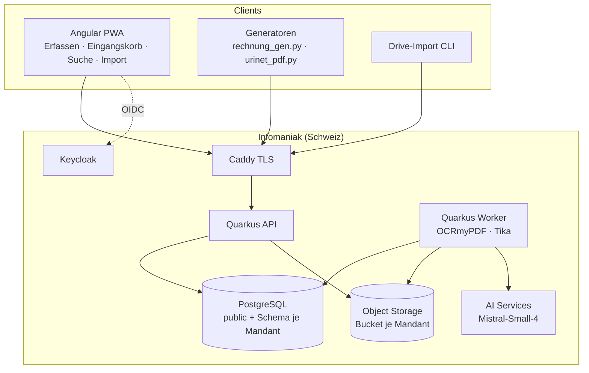
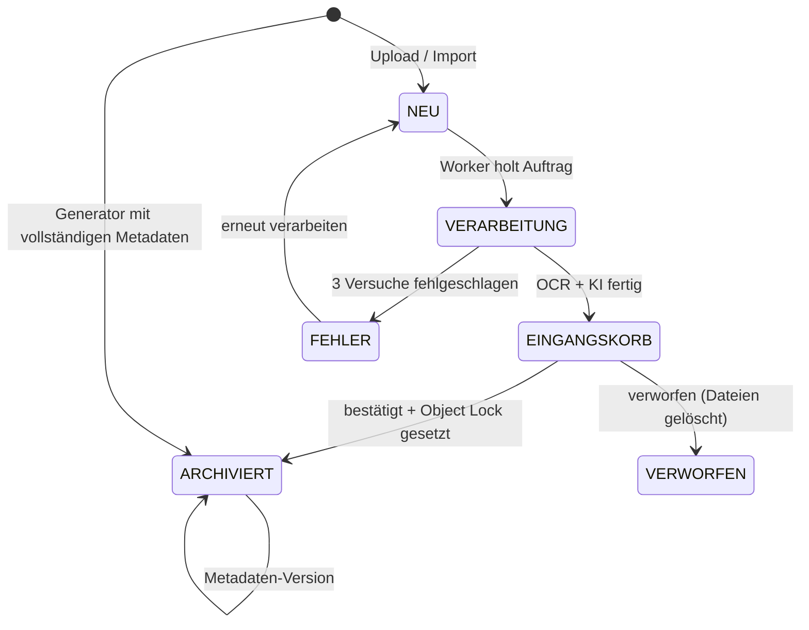
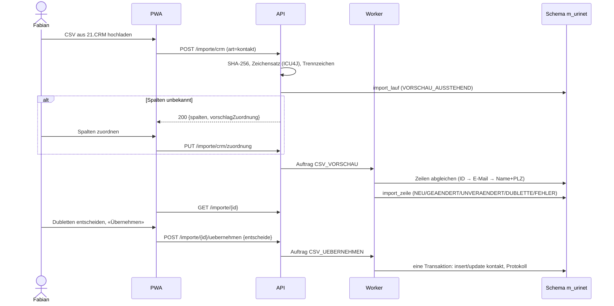

# Design Document — 01 Archiv-Kern

## Overview
Ein Quarkus-Dienst in zwei Laufarten: **API** (REST für Web-App, Handy-App, Generatoren) und
**Worker** (Verarbeitung aus der Auftragsschlange). Daten liegen pro Mandant in einem eigenen
PostgreSQL-Schema und einem eigenen S3-Bucket bei Infomaniak. Die Angular-PWA dient für
Erfassung, Eingangskorb, Suche, Import und Verwaltung.

Leitentscheide (ADRs in `docs/adr/`):
- ADR-001 Eigenbau statt Paperless-ngx (Konzept Variante B, Entscheid E2).
- ADR-002 Schema pro Mandant statt Mandantenspalte.
- ADR-003 Auftragsschlange in PostgreSQL statt Message-Broker.
- ADR-004 Zweistufige Ablage: `eingang/` ohne Sperre, `archiv/` mit Object Lock GOVERNANCE.
- ADR-005 Handy zuerst als PWA (Entscheid E3), Capacitor später.
- ADR-006 KI nur für Vorschläge; Bestätigung durch Menschen; Generatoren ohne KI.

## Architecture



API und Worker sind dasselbe Artefakt; `archiv.rolle=api|worker` schaltet REST-Endpunkte bzw.
den Auftrags-Poller ein. Das Worker-Image enthält zusätzlich `ocrmypdf`, `tesseract-ocr-deu`,
`img2pdf`, `libheif-examples`, `ghostscript`.

## Components and Interfaces

### Mandant (`mandant`)
- `MandantTenantResolver implements TenantResolver` (`@PersistenceUnitExtension`): liest `mandant` aus `SecurityIdentity` (OIDC-Claim oder API-Token-Principal). Ohne Mandant → `ForbiddenException`.
- Worker setzt den Mandanten über `MandantKontext.mit(mandant, () -> …)` (ThreadLocal + `@ActivateRequestContext`), der Resolver liest dort, wenn keine Identität vorhanden ist.
- `MandantProvisionierung`: legt Schema `m_<code>` an, führt Flyway (`db/mandant`) mit `schemas=m_<code>` aus, erstellt Bucket `urinet-archiv-<code>` mit `ObjectLockEnabledForBucket=true` und Versionierung, spielt Dokumentarten aus `seed/<code>/dokumentarten.json` ein.
- Beim Start migriert die API alle aktiven Mandanten (Flyway pro Schema).

### Sicherheit (`sicherheit`)
- Keycloak-Realm `urinet-archiv`; Benutzerattribut `mandant` als Token-Claim; Realm-Rollen `inhaber`, `mitarbeiter`, `treuhaender`, `geschaeftsstelle`; TOTP Pflicht.
- `ApiTokenAuthMechanism implements HttpAuthenticationMechanism`: `Authorization: Bearer ua_<id>_<geheimnis>`; Lookup über `<id>` in `public.api_client`, Argon2id-Vergleich; Principal mit `mandant` und Scope.
- `VertraulichkeitFilter`: hängt an jede Dokumentabfrage die Bedingung `vertraulichkeit <> 'PERSONAL' OR person_benutzer = :benutzer OR :istInhaber`.

### Dokument (`dokument`)
REST `DokumentResource` (alle Pfade unter `/api/v1`):

| Methode | Pfad | Zweck | Rollen |
| --- | --- | --- | --- |
| POST | `/dokumente` | Upload (multipart `dateien[]`, optional `zusammenfassen=true`, `hinweis`) → 202 `[{id, status}]` | inhaber, mitarbeiter, geschaeftsstelle |
| POST | `/dokumente/generator` | PDF + `metadaten` (JSON) → 201 oder 409 | API-Token `generator` |
| GET | `/dokumente` | Suche/Liste mit Filtern (Requirement 14) | alle |
| GET | `/dokumente/{id}` | Metadaten, Status, Versionen | alle |
| GET | `/dokumente/{id}/datei?variante=pdfa\|original` | 302 auf vorsignierte URL (5 Min.) | alle |
| GET | `/dokumente/{id}/vorschau?seite=1` | PNG-Vorschau (im Worker erzeugt) | alle |
| PATCH | `/dokumente/{id}` | Metadaten ändern; `If-Match`; bei `ARCHIVIERT` Feld `grund` Pflicht | inhaber, mitarbeiter, geschaeftsstelle |
| POST | `/dokumente/{id}/bestaetigen` | Eingangskorb → archiviert | inhaber, mitarbeiter, geschaeftsstelle |
| POST | `/dokumente/{id}/verwerfen` | `{grund}` | inhaber, geschaeftsstelle |
| GET | `/eingangskorb` | Status `EINGANGSKORB` | inhaber, mitarbeiter, geschaeftsstelle |

Statusmodell:



### Ablage (`ablage`)
- `AblageService` kapselt S3: `ablegenEingang(mandant, docId, variante, bytes)`, `archivieren(…)` (CopyObject `eingang/…` → `archiv/…`, HEAD mit `x-amz-checksum-sha256` bzw. erneutes Lesen und Hashen, danach `PutObjectRetention(mode=GOVERNANCE, retainUntil)`, dann Löschen in `eingang/`), `vorsignierteUrl(…, 5 min)`.
- Schlüssel: `eingang/<yyyy>/<docId>/original.<ext>`, `archiv/<yyyy>/<docId>/original.<ext>`, `archiv/<yyyy>/<docId>/pdfa.pdf`, `vorschau/<docId>/<seite>.png` (ohne Sperre, regenerierbar), `importe/<laufId>.csv`, `manifest/<yyyy-mm-dd>.json`.
- Bucket ohne Standard-Aufbewahrung (sonst wäre `eingang/` gesperrt); Sperre nur pro Objekt.
- Unbefristete Dokumente (Projektdokumente) erhalten eine Sperre von 10 Jahren, die bei Bedarf verlängert wird.

### Verarbeitung (`verarbeitung`)
- Tabelle `public.auftrag`; `AuftragPoller` (Quarkus Scheduler, alle 2 s) holt `LIMIT n FOR UPDATE SKIP LOCKED`, Parallelität `archiv.worker.parallel=2`.
- Auftragstypen Phase 1: `VERARBEITEN`, `KI_VORSCHLAG`, `ARCHIVIEREN`, `CSV_VORSCHAU`, `CSV_UEBERNEHMEN`, `MANIFEST`, `PRUEFLAUF`.
- `VERARBEITEN`: Typ per Tika-Detektor → HEIC→JPEG (`heif-convert`) → Bilder→PDF (`img2pdf`) → `ocrmypdf --output-type pdfa-2 --rotate-pages --deskew -l deu+eng [--skip-text]` → Text via `pdftotext` → Vorschaubilder (`pdftoppm -r 72`) → Folgeauftrag `KI_VORSCHLAG`.
- Wiederholung: `versuche < 3`, `nicht_vor = now() + 2^versuche Minuten`.

### KI (`ki`)
- `MetadatenExtraktor` als LangChain4j-`@RegisterAiService`, Antwort als Java-Record `MetadatenVorschlag` (JSON-Schema-Antwortformat; falls Infomaniak das nicht unterstützt → Spike-Ergebnis: JSON-Modus mit Validierung per Jackson + Bean Validation).
- Prompt (Deutsch): Rolle «Archivassistent für ein Schweizer KMU», Liste der Dokumentarten mit Beschreibung, Partner-Hinweis (Ordnerpfad, Absenderadresse), bis 5 Beispiele aus `ki_beispiel` (gleicher Partner, sonst gleiche Art), Text gekürzt auf 12'000 Zeichen (Anfang + Ende).
- `MetadatenVorschlag(String art, String titel, LocalDate datum, String partnerName, String partnerUid, String partnerIban, String partnerEmail, String belegnummer, Richtung richtung, BigDecimal betrag, String waehrung, LocalDate faelligkeit, List<String> tags, Map<String, Double> sicherheit)`.
- Nachbearbeitung: Belegnummer-Muster überschreiben `art`; Betrag auf 2 Stellen; Datum in der Zukunft > 1 Jahr → Sicherheit 0.
- `PartnerAbgleich`: exakte Treffer über E-Mail, UID (`CHE-xxx.xxx.xxx`), IBAN; sonst `similarity(name_normalisiert, :name) >= 0.6` (`pg_trgm`), bester Treffer; zwei Treffer mit Abstand < 0.1 → «unsicher».
- `KiVerbrauch` speichert Tokens (Ein/Aus) je Aufruf, Mandant, Zweck.

### Kontakt und Importe (`kontakt`, `importe`)
CSV-Import-Ablauf:



| Methode | Pfad | Zweck |
| --- | --- | --- |
| POST | `/importe/crm?art=kontakt\|verkaufschance` | CSV hochladen |
| GET/PUT | `/importe/crm/zuordnung?art=…` | gespeicherte Spaltenzuordnung |
| GET | `/importe/{id}` | Lauf mit Zählern und Zeilen (paginiert) |
| POST | `/importe/{id}/uebernehmen` | `{dublettenEntscheide: {zeile: "NEU"\|"ZUSAMMENFUEHREN:<kontaktId>"\|"UEBERSPRINGEN"}}` |
| GET | `/importe` | Liste der Läufe |
| GET | `/kontakte?q=` | Kontakte suchen (Partnerauswahl) |
| POST/PATCH | `/kontakte` | Kontakt manuell anlegen/ändern |

Normalisierung: Name klein, Umlaute → ae/oe/ue, «AG», «GmbH», «Verein» entfernt, Mehrfachleerzeichen; PLZ nur Ziffern; E-Mail klein und getrimmt.
Zuordnungsvorschlag: Spaltenüberschriften gegen Synonymliste (`Firma|Name|Nachname → name`, `PLZ|Postleitzahl → plz`, `E-Mail|Mail → email`, `ID|Nummer|Kontakt-Nr → crm_id` …) – endgültig nach Test-Export (K4).

### Suche (`suche`)
- Spalte `volltext_tsv tsvector GENERATED ALWAYS AS (setweight(to_tsvector('german', coalesce(titel,'')),'A') || setweight(to_tsvector('german', coalesce(partner_name,'')),'B') || setweight(to_tsvector('german', coalesce(volltext,'')),'C')) STORED`, GIN-Index.
- `websearch_to_tsquery('german', :q)`, Rang `ts_rank_cd`, Auszug `ts_headline` (max. 2 Fragmente).
- Filter als dynamische Kriterien (Panache/Criteria), alle Felder indexiert (`art`, `partner_id`, `datum`, `geschaeftsjahr`, `betrag`).

### Protokoll und Manifest (`protokoll`)
- `ZugriffProtokollInterceptor` (`@Protokolliert(aktion=…)`) an Resource-Methoden, schreibt asynchron in derselben Transaktion.
- Manifest-JSON: `{mandant, datum, vorher_sha256, eintraege:[{dokument, variante, sha256, s3_version}], anzahl}`; Signatur Ed25519 über die kanonische JSON-Form (sortierte Schlüssel); Schlüssel aus `ARCHIV_MANIFEST_KEY` (PKCS#8); optional RFC-3161-Token (`archiv.tsa.url`, z. B. ein Schweizer Anbieter oder FreeTSA – Entscheid offen).
- Prüflauf monatlich: liest jede Datei per S3, hasht stromweise, vergleicht.

### Frontend
- Routen: `/erfassen`, `/eingangskorb`, `/suche`, `/dokument/:id`, `/importe`, `/importe/:id`, `/verwaltung/dokumentarten`, `/verwaltung/protokoll`.
- Erfassen: `getUserMedia` (Rückkamera) mit Fallback `<input type="file" accept="image/*" capture="environment">`; Kantenerkennung und Entzerrung mit **jscanify** (OpenCV.js, als Web Worker, lazy geladen); Ausgabe JPEG 85 %, lange Kante 2'480 px (≈ 300 dpi für A4).
- Offline-Warteschlange: IndexedDB (`idb`), Service Worker Background Sync wo verfügbar; auf iOS Neuversuch beim Öffnen der App und bei `online`-Event.
- API-Client aus OpenAPI generiert (`openapi-generator`, typescript-angular).

## Data Models

### Schema `public`
```sql
mandant(code text pk, name text, schema_name text unique, bucket text, domain text,
        branding jsonb, aktiv bool, erstellt timestamptz)
auftrag(id bigserial pk, mandant text fk, typ text, nutzlast jsonb, status text,   -- OFFEN|LAEUFT|FERTIG|FEHLER
        versuche int default 0, nicht_vor timestamptz, fehler text,
        erstellt timestamptz, gestartet timestamptz, beendet timestamptz)
  index (status, nicht_vor)
api_client(id text pk, mandant text fk, name text, scope text, geheimnis_hash text,
           aktiv bool, erstellt timestamptz, zuletzt timestamptz)
```

### Schema je Mandant `m_<code>`
```sql
dokumentart(code text pk, name text, gruppen text[], pflichtfelder text[],
            zusatz_schema jsonb, vertraulichkeit text, aufbewahrung_jahre int null,  -- null = unbefristet
            aufbewahrung_ab text,   -- GESCHAEFTSJAHR | GUELTIG_BIS
            aktiv bool)

kontakt(id uuid pk, crm_id text unique null, typ text, name text, vorname text,
        name_normalisiert text, strasse text, plz text, ort text, email text, telefon text,
        uid text, iban text, kategorie text, quelle text, nicht_im_export bool,
        abaninja_uuid text null, erstellt timestamptz, geaendert timestamptz)
  index gin (name_normalisiert gin_trgm_ops), index (lower(email))

verkaufschance(id uuid pk, crm_id text, kontakt_id uuid fk, titel text, phase text,
               betrag numeric(12,2), datum date, import_lauf uuid)

dokument(id uuid pk, art text fk, titel text, datum date, eingang timestamptz,
         quelle text,            -- SCAN|UPLOAD|GENERATOR|DRIVE|EMAIL|ABANINJA
         partner_id uuid fk null, partner_name text, projekt text, tags text[],
         vertraulichkeit text,   -- NORMAL|INTERN|PERSONAL
         person_benutzer text null, status text, status_grund text,
         aufbewahren_bis date null, geschaeftsjahr int,
         sha256_original text, sha256_pdfa text, s3_original text, s3_pdfa text,
         s3_version_original text, s3_version_pdfa text, mime text, seiten int, groesse bigint,
         volltext text, volltext_tsv tsvector generated stored,
         ki_vorschlag jsonb, ki_sicherheit jsonb, hinweis text,
         zusatz jsonb,           -- freie Zusatzfelder gemäss dokumentart.zusatz_schema
         version int, erstellt_von text, erstellt timestamptz, geaendert timestamptz)
  unique (sha256_original)
  index gin(volltext_tsv), index(art), index(partner_id), index(datum), index(status)

dokument_finanz(dokument_id uuid pk fk, belegnummer text, richtung text,  -- EINNAHME|AUSGABE
                betrag numeric(12,2), waehrung char(3) default 'CHF', faelligkeit date,
                zahlstatus text null, bezahlt_am date null,   -- nur aus AbaNinja (Spec 02)
                qr_referenz text, konto text, abaninja_uuid text null)
  unique (belegnummer) where belegnummer is not null   -- je Art via Trigger/Check

dokument_vertrag(dokument_id uuid pk fk, gueltig_ab date, gueltig_bis date,
                 kuendigungsfrist text, naechste_frist date)

dokument_version(id bigserial pk, dokument_id uuid fk, version int, daten jsonb,
                 geaendert_von text, zeit timestamptz, grund text)

ki_beispiel(id bigserial pk, partner_id uuid null, art text, eingabe_auszug text,
            korrektur jsonb, zeit timestamptz)
ki_verbrauch(id bigserial pk, zweck text, modell text, tokens_ein int, tokens_aus int, zeit timestamptz)

import_zuordnung(art text pk, spalten jsonb, geaendert timestamptz)
import_lauf(id uuid pk, art text, dateiname text, sha256 text, zeichensatz text, trennzeichen char,
            zeilen int, neu int, geaendert int, unveraendert int, dubletten int, fehler int,
            status text,   -- VORSCHAU_AUSSTEHEND|ZUORDNUNG_NOETIG|VORSCHAU|UEBERNOMMEN|ABGEBROCHEN
            benutzer text, erstellt timestamptz, uebernommen timestamptz)
import_zeile(lauf_id uuid fk, nr int, daten jsonb, ergebnis text, kontakt_id uuid null,
             kandidaten uuid[], meldung text, primary key (lauf_id, nr))

zugriff_protokoll(id bigserial pk, zeit timestamptz, benutzer text, aktion text,
                  dokument_id uuid null, ip inet, details jsonb)
  -- Trigger: BEFORE UPDATE OR DELETE → RAISE EXCEPTION; Rolle der App hat nur INSERT/SELECT

manifest(datum date pk, sha256 text, vorher_sha256 text, anzahl int, s3_schluessel text,
         signatur text, tsa_token bytea null)
```

Generator-Metadaten (Beispiel, `POST /dokumente/generator`):
```json
{ "art": "AUSGANGSRECHNUNG", "titel": "Rechnung 2026-004 Wartung H1 2027",
  "datum": "2027-01-04", "partner": {"crmId": "K-1001", "name": "FC Schattdorf"},
  "finanz": {"belegnummer": "2027-001", "richtung": "EINNAHME", "betrag": "408.00",
             "waehrung": "CHF", "faelligkeit": "2027-02-03", "qrReferenz": "…"},
  "tags": ["Wartung"], "projekt": "FC Schattdorf Webseite" }
```

## Error Handling
- Alle Fehler als Problem Details (`type`, `title` deutsch, `status`, `detail`, `instance`, `fehlercode`).
- Fehlercodes: `MANDANT_FEHLT`, `DATEITYP_UNBEKANNT`, `DATEI_ZU_GROSS`, `DUBLETTE` (mit `vorhandenId`), `PFLICHTFELD_FEHLT` (mit Liste), `VERSION_KONFLIKT`, `BELEGNUMMER_VERGEBEN`, `CSV_UNGUELTIG`, `NICHT_ERLAUBT`.
- Worker: Ausnahmen werden im Auftrag (`fehler`) gespeichert; Dokumentstatus `FEHLER` erst nach dem dritten Versuch.
- KI nicht erreichbar → Dokument ohne Vorschlag in den Eingangskorb (nie blockieren).
- S3 nicht erreichbar beim Upload → 503 mit `Retry-After`; die PWA behält die Datei in der Warteschlange.

## Testing Strategy
| Ebene | Werkzeug | Schwerpunkt |
| --- | --- | --- |
| Unit | JUnit 5, AssertJ | Normalisierung, Belegnummer-Muster, Aufbewahrung, CSV-Erkennung, Manifest-Signatur |
| Integration | `@QuarkusTest`, Dev Services PostgreSQL + Keycloak, Testcontainers MinIO (Object Lock), WireMock (AI) | Endpunkte, Mandantentrennung (immer zwei Mandanten), Statusübergänge, Object Lock |
| Architektur | ArchUnit | Repositories nur über Service; kein Zugriff auf `public`-Tabellen aus Mandanten-Code ausser `auftrag`; keine `double`-Beträge |
| Worker | Testcontainer mit Worker-Image | OCR auf 5 Beispiel-PDFs/Fotos, PDF/A-Validierung mit veraPDF |
| KI-Qualität | `GoldenDatensatzIT` (manuell/Nightly, echter AI-Aufruf) | ≥ 45/50 korrekt (Gate Phase 0, danach Regression) |
| Frontend | Jest/Vitest, Playwright (mobile Viewport 375 px) | Erfassen mit Testbild, Offline-Warteschlange, Eingangskorb bestätigen in ≤ 2 Tipps |
| Betrieb | Restore-Probe (Skript) | Sicherung zurückspielen, Dokument öffnen, Prüflauf grün |

## Open Points
- Object Lock pro Objekt bei Infomaniak (Spike W0.2) – Rückfall: Bucket `archiv` mit Standard-Aufbewahrung und separater Bucket `eingang`.
- Strukturierte Antworten bei Infomaniak (Spike W0.3) – Rückfall: JSON-Modus + Validierung.
- Zeitstempeldienst RFC 3161: Anbieter wählen (Kosten, Schweiz).
- Spalten des 21.CRM-Exports (K4) – bestimmt die Synonymliste.
