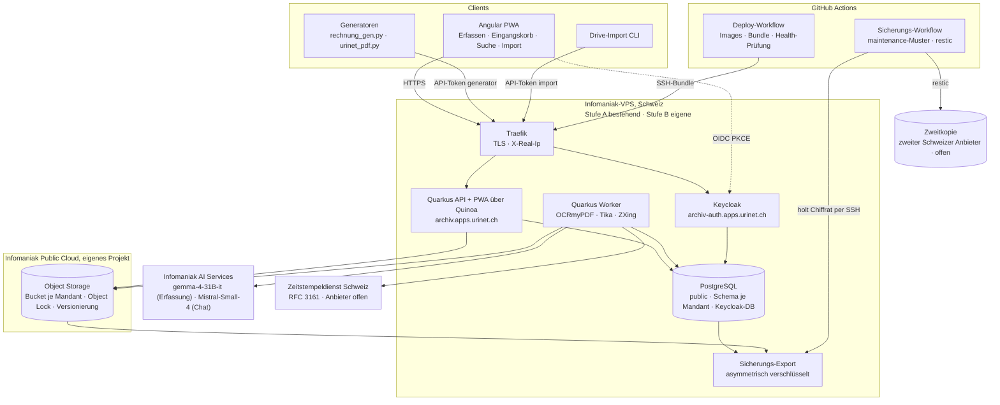
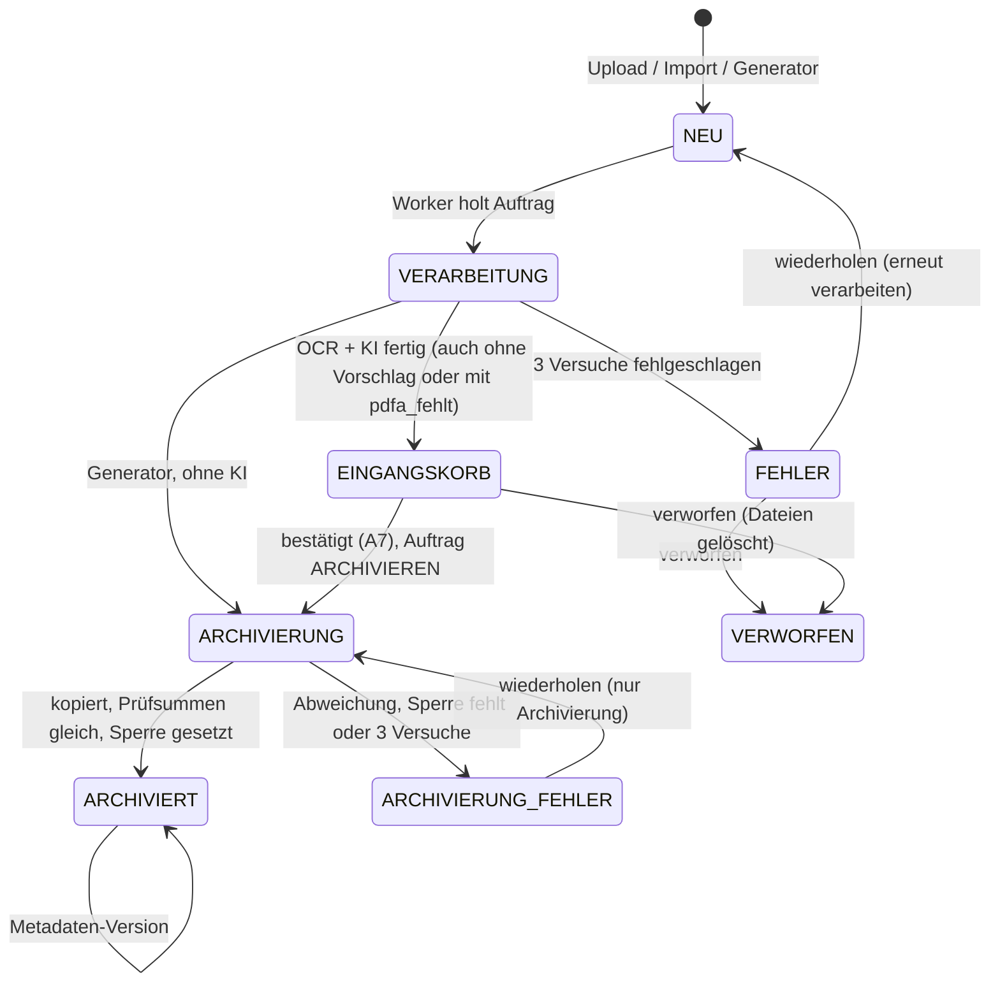
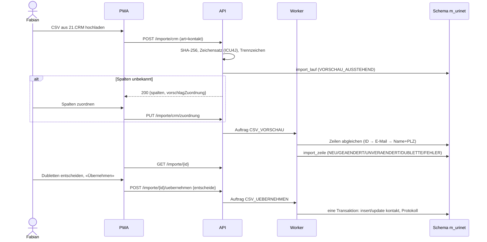

# Design Document — 01 Archiv-Kern

## Overview
Ein Quarkus-Dienst (Java 25) in zwei Laufarten: **API** (REST für Web-App, Handy-App, Generatoren
und Drive-Import; liefert die Angular-PWA über Quinoa im selben Artefakt aus) und **Worker**
(Verarbeitung aus der Auftragsschlange). Er läuft hinter Traefik, zuerst auf der bestehenden Infomaniak-VPS
(Stufe A, nur Testdaten), ab dem Wechsel vor der Übernahme in Welle 5 auf einer eigenen Infomaniak-VPS (Stufe B).
Daten liegen pro Mandant in einem eigenen PostgreSQL-Schema und einem eigenen Bucket im Infomaniak
Object Storage (eigenes Public-Cloud-Projekt). Die PWA dient für Erfassung, Eingangskorb, Suche,
Import und Verwaltung.

Nummern: «Req x.y» verweist auf `requirements.md`, «A1–A14» auf die Rechtematrix (Req 2.6; A15–A19 ergänzt Spec 04, Req 12.1),
«P1–P19» auf die Prüfentscheide in `docs/umsetzungsplan.md` (P20–P22 ergänzt Spec 04), «Konzept-Entscheid E1–E5» auf das Konzept.

Leitentscheide (ADRs in `docs/adr/`):
- ADR-001 Eigenbau statt Paperless-ngx (Konzept Variante B, Konzept-Entscheid E2).
- ADR-002 Schema pro Mandant statt Mandantenspalte; Schemaänderungen nur über Liquibase mit den Changelogs `db/public` (gemeinsame Tabellen) und `db/mandant` (je Mandant), Hibernate nur `validate` (Req 1.5, 1.7).
- ADR-003 Auftragsschlange in PostgreSQL statt Message-Broker.
- ADR-004 Zweistufige Ablage: `eingang/` ohne Sperre, `archiv/` mit Object Lock GOVERNANCE, gesperrt nur bei Arten mit `gesetzliche_pflicht` (P12).
- ADR-005 Handy zuerst als PWA (Konzept-Entscheid E3); keine native Hülle (D8 gestrichen, entschieden von Fabian am 09.11.2026: nur Web-App).
- ADR-006 KI nur für Vorschläge; Bestätigung durch Menschen; Generatoren ohne KI.
- ADR-007 Unveränderbarkeit (P2): Dokumente unter `archiv/` in GOVERNANCE statt COMPLIANCE, damit Fehlarchivierungen und Löschbegehren nach revDSG lösbar bleiben; Manifeste unter `manifest/` in COMPLIANCE (Req 6.11). Jedes Manifest trägt einen RFC-3161-Zeitstempel eines Schweizer Anbieters (Pflicht). Nach Spike 0.2 gilt Option B (entschieden 09.11.2026; ADR-007, Nachtrag 09.11.2026): Einen App-Schlüssel ohne `s3:BypassGovernanceRetention` gibt es im selben Projekt nicht; die Anwendung setzt den Bypass-Header nie und verkürzt keine Sperre (Req 6.5). GOVERNANCE schützt die Dokumente damit gegen Fehler der App und Versehen. Eine Manipulation mit gestohlenem App-Schlüssel verhindert es nicht; sie fällt über das gesperrte, zeitgestempelte Manifest und den Prüflauf auf (Req 15.5), und bereits gesicherte Dateien lassen sich aus der Zweitkopie wiederherstellen (ADR-008). Der Inhaber-Zugang (Schlüssel ausstellen, Korrekturen) liegt nur offline (Req 6.10).
- ADR-008 Sicherung (P4): Zweitkopie von Datenbanken und Bucket bei einem zweiten Schweizer Anbieter über den zentralen Sicherungs-Workflow (GitHub Actions, maintenance-Muster). Der Server verschlüsselt vorher asymmetrisch, der Runner sieht nur Chiffrat (Req 16.7, 16.8).
- ADR-009 Rollen eng nach Rechtematrix (P3, Req 2.6). Unsichtbare Dokumente antworten mit 404 vor 403, damit die Antwort nicht verrät, dass ein Dokument existiert.
- ADR-010 Plattform (P1, geändert 08.11.2026): Infomaniak-VPS mit Traefik, Deploy nur über GitHub Actions (SSH-Bundle, Health-Prüfung, Rollback), in zwei Stufen: Stufe A auf der bestehenden VPS (nur Test- und anonymisierte Daten, Speicherbudget, ohne Leistungsziele), Stufe B auf einer eigenen, grösseren VPS spätestens vor echten Belegen (Req 16.15–16.19). Keycloak bleibt (P5).
- ADR-011 Hexagonale Struktur je Fachbereich (`domain`, `application`, `adapter`) mit Driven Ports und Dev-Stubs für Ablage, KI, OCR und Integration, durch ArchUnit erzwungen (Req 16.13).
- ADR-012 Lokales Sprachmodell über LM Studio nur im Profil `lokal` auf dem Entwicklerrechner, nur an `localhost`; nie für Gate 0, Golden-Lauf, Abnahmen, CI oder Betrieb; Startprüfung der KI-Basis-URL (P19, Req 16.20–16.22).

## Architecture



API und Worker sind dasselbe Artefakt; `archiv.rolle=api|worker` schaltet REST-Endpunkte bzw.
den Auftrags-Poller ein. Aus einem Build entstehen zwei Images: `archiv` (API mit PWA) und
`archiv-worker` (zusätzlich `ocrmypdf`, `tesseract-ocr-deu`, `img2pdf`, `libheif-examples`,
`ghostscript`, `poppler-utils`). In Stufe A laufen beide Rollen in einem Container
(`archiv.rolle=api,worker`, Image `archiv-worker`, weil es die OCR-Werkzeuge enthält).

### Betrieb auf der VPS (Req 16.1, 16.4, 16.10, P1)
- `deploy/infomaniak/compose.yml` mit den Diensten `archiv-api`, `archiv-worker`, `archiv-db` (PostgreSQL 17 mit `pgvector`), `archiv-keycloak` und `archiv-sicherung` (täglicher Export, siehe «Sicherung»); in Stufe A ohne eigenen Dienst `archiv-worker` (siehe «Stufen»). Limits, `cap_drop: ALL`, `no-new-privileges` und numerische uid gemäss Compose-Policy (tech.md); die Fremd-Images werden als `archiv-db:<version>` und `archiv-keycloak:<version>` umgetaggt und im Infra-Repo der VPS eingetragen.
- Traefik-Labels nur an `archiv-api` und `archiv-keycloak`; nur diese beiden hängen zusätzlich am Netz «web» von Traefik. Datenbank, Worker und Sicherung hängen nur im eigenen internen Docker-Netz des Archivs. Die API ist nur über Traefik erreichbar (kein veröffentlichter Port), deshalb ist `X-Real-Ip` vertrauenswürdig.
- Router `archiv.apps.urinet.ch`: alle Pfade ausser `/q/*`, dazu ein eigener Router nur für `/q/health/live` (schlanker Health-Pfad ohne Details). `/q/health/ready` und `/q/metrics` bleiben im internen Netz für das Monitoring der VPS (Anbindung in Welle 5).
- Router `archiv-auth.apps.urinet.ch`: nur `/realms/` und `/resources/`; die Admin-Konsole ist nicht öffentlich.
- Deploy nur über `.github/workflows/deploy.yml`: `mvn verify`, Images bauen, Bundle (Images, `compose.yml`, Secret-Dateien aus GitHub-Secrets) per SSH an den Deploy-Befehl der VPS, danach Health-Prüfung über `/q/health/live` und die interne Readiness; schlägt sie fehl, Rollback auf das Vorgänger-Image. Weil Migrationen rückwärtskompatibel sind (Req 16.11), läuft das Vorgänger-Image auf dem neuen Schema.

### Stufen der Plattform (Req 16.1, 16.15–16.19, P1)
- **Stufe A** (Welle 1 bis zum Wechsel, bestehende VPS, Werte in `tech.md`): dieselbe `compose.yml` und derselbe Deploy-Workflow wie Stufe B; die stufenabhängigen Werte (ein App-Dienst statt zwei, Limits, Speicher-Einstellungen) liegen versioniert unter `deploy/infomaniak/`, nie von Hand auf dem Server.
  - `archiv-api` mit Image `archiv-worker` und `archiv.rolle=api,worker`; `archiv.stufe=A`; `archiv.worker.parallel=1`; OCRmyPDF seitenweise nacheinander (`--jobs 1`).
  - Speicherbudget: Summe der `mem_limit` aller Archiv-Dienste ≤ 700 MiB, `cpus` zusammen ≤ 0.75; JVM-Heap, `shared_buffers`/`work_mem` von PostgreSQL und der Heap von Keycloak knapp gesetzt. Die Werte sind Richtwerte und werden in Aufgabe 1.10 gemessen.
  - Nur Test- und anonymisierte Daten (Req 16.15); Leistungsziele gelten nicht (Req 16.16); Sicherung nur als Funktionstest (Req 16.19).
- **Stufe B** (eigene VPS, Grösse nach K5): `archiv-api` (`archiv.rolle=api`) und `archiv-worker` (`archiv.rolle=worker`) getrennt, beide mit `archiv.stufe=B`, Parallelität und Limits nach K5; hier gelten die Leistungsziele.
- **Wechsel** (Aufgabe 5.11, Req 16.17, 16.18): neue VPS nach dem Muster einrichten, Deploy-Ziel im Workflow umstellen (Host und Zugang nur als GitHub-Secrets), DNS beider Domains umstellen, Stufe B leer starten (Datenbanken und Realm-Benutzer der Stufe A werden nicht übernommen), Archiv-Dienste auf Stufe A entfernen, Leistungsmessung auf Stufe B.

### Secrets und Konfiguration (Req 16.9)
- Alle Secrets liegen als Dateien unter `/run/secrets/` (Compose `secrets:` mit `file:` aus dem Bundle), Quelle sind die GitHub-Secrets des Repos; nie `environment` oder `env_file`. Quarkus liest sie über die File-System-Config-Source (`smallrye.config.source.file.locations=/run/secrets`, Dateiname = Konfigurationsschlüssel). PostgreSQL nutzt `POSTGRES_PASSWORD_FILE`, Keycloak einen Einstiegs-Wrapper, der die Dateien liest.
- Dateien: `archiv_db_app` (DB-Rolle `archiv_app`), `archiv_db_owner` (DB-Rolle `archiv_owner`, nur für Liquibase), `keycloak_db`, `keycloak_admin`, `s3_app_zugang` (App-Schlüssel; hat technisch das Bypass-Recht, die Anwendung setzt den Bypass-Header nie, Req 6.5; ADR-007, Nachtrag 09.11.2026), `infomaniak_ai_token`, `archiv_manifest_key` (Ed25519, PKCS#8), `archiv_data_key` (AES-256-GCM für Zugangsdaten in der DB, ab Spec 02), `smtp_zugang`, `tsa_zugang` (nur falls der Anbieter einen verlangt).
- Nicht geheim: der öffentliche Sicherungsschlüssel (Empfänger der Export-Verschlüsselung) und der öffentliche Manifest-Schlüssel unter `docs/`.
- Weder auf dem Server noch in GitHub: der Inhaber-Zugang zum Public-Cloud-Projekt des Object Storage (Zugangsdaten, mit denen Schlüssel ausgestellt und Korrekturen ausgeführt werden; unter Option B tritt er an die Stelle des «einzigen Bypass-Schlüssels», weil jeder Schlüssel des Projekts bypassen kann; ADR-007, Nachtrag 09.11.2026) und der private Sicherungsschlüssel; sie liegen in den Notfallunterlagen (Req 6.10, 16.12). Manifest- und Datenschlüssel (`archiv_data_key`) liegen zusätzlich im Passwort-Manager.
- Nicht auf dem Server: der restic-Schlüssel; er liegt als GitHub-Secret des zentralen Sicherungs-Workflows und in den Notfallunterlagen (Req 16.2, 16.12).

## Components and Interfaces

### Mandant (`mandant`)
- `MandantTenantResolver implements TenantResolver` (`@PersistenceUnitExtension`): liest `mandant` aus `SecurityIdentity` (OIDC-Claim oder API-Token-Principal). Ohne Mandant → `ForbiddenException`.
- Worker setzt den Mandanten über `MandantKontext.mit(mandant, () -> …)` (ThreadLocal + `@ActivateRequestContext`), der Resolver liest dort, wenn keine Identität vorhanden ist.
- `MandantProvisionierung`: legt Schema `m_<code>` an, führt den Liquibase-Changelog `db/mandant/changelog.xml` mit `defaultSchemaName=m_<code>` aus, erstellt Bucket `urinet-archiv-<code>` mit `ObjectLockEnabledForBucket=true` und Versionierung (ohne Standard-Aufbewahrung) und setzt die Bucket Policy mit Deny auf `s3:BypassGovernanceRetention` (siehe «Ablage»), spielt die Dokumentarten aus `seed/<code>/dokumentarten.json` ein (für `urinet`: `backend/src/main/resources/seed/urinet/dokumentarten.json`, siehe «Stammdaten der Dokumentarten»).
- Beim Start führt die API mit der DB-Rolle `archiv_owner` zuerst `db/public`, dann `db/mandant` für jedes aktive Mandanten-Schema aus (nur neue Changesets); danach prüft Hibernate mit `validate` (Req 1.7). Der Worker migriert nie und meldet sich erst bereit, wenn der erwartete Changelog-Stand erreicht ist.
- Mandanten-Einstellungen in `public.mandant`: `geschaeftsjahr_ende` (Monat-Tag, Standard `12-31`, Req 9.6), `eigene_arten` (Arten, die der Mandant selbst ausstellt; `urinet`: `AUSGANGSRECHNUNG`, `OFFERTE`, `LOHNABRECHNUNG`, Req 8.9, 11.3), `kennungen` (eigene UID und IBANs, Req 7.5). Pflege über `GET/PATCH /mandant/einstellungen` (nur `inhaber`).

### Sicherheit (`sicherheit`)
- Keycloak-Realm `urinet-archiv` unter `archiv-auth.apps.urinet.ch`; Benutzerattribut `mandant` als Token-Claim; Realm-Rollen `inhaber`, `mitarbeiter`, `treuhaender`, `geschaeftsstelle`; TOTP Pflicht. Realm-Export ohne Secrets in `deploy/keycloak/realm-export.json`.
- Realm-Export (Stufe A und B, Aufgabe 1.2): keine Benutzer und keine Secrets (geprüft von `RealmExportTest`); Browser-Flow `browser-totp-pflicht` mit Passwort und TOTP als `REQUIRED`, `CONFIGURE_TOTP` als Standardaktion für neue Benutzer, Client `archiv-pwa` öffentlich mit PKCE S256 und ohne Direct Grant; Attribut `mandant` im Benutzerprofil nur für Admins sicht- und änderbar, Claim `mandant` über einen Attribut-Mapper.
- Test-Realm `deploy/keycloak/realm-test.json` (nur `dev` und Tests): der Export plus Testbenutzer je Rolle in den Mandanten `urinet` und `vhf-gsk` und der öffentliche Client `archiv-test` mit Direct Grant. Automatisierte Tests holen das Token über `archiv-test` mit Passwort und TOTP aus einem bekannten Test-Secret; TOTP bleibt damit auch in Tests Pflicht. `RealmExportTest` prüft, dass der Test-Realm ohne Testanteile dem Export gleicht.
- `ApiTokenAuthMechanism implements HttpAuthenticationMechanism`: `Authorization: Bearer ua_<id>_<geheimnis>`; Lookup über `<id>` in `public.api_client`, Argon2id-Vergleich; Principal `token:<id>` mit `mandant` und Scope. Scope `generator` erreicht nur `POST /dokumente/generator`, Scope `import` nur `POST /dokumente` (Quelle `DRIVE`); jeder andere Endpunkt antwortet 403 (Req 2.5).
- Lokale Clients (`tools/archiv_client.py`, `tools/drive_import`) lesen das Token aus einer Datei mit Rechten 600: Standard `~/.config/urinet-archiv/token`, anderer Pfad über `ARCHIV_TOKEN_DATEI`; nie das Token selbst aus einer Umgebungsvariable (tech.md Regel 7).
- `Berechtigung` (application) setzt die Rechtematrix (Req 2.6) um. Reihenfolge bei Endpunkten mit `{id}`:
  1. Dokument über `VertraulichkeitFilter` laden; fremder Mandant oder unsichtbar → 404 `NICHT_GEFUNDEN` (Req 1.4, 2.3).
  2. Recht der Aktion (A5–A10) prüfen → 403 `NICHT_ERLAUBT`.
  3. `If-Match` prüfen → 428 `VERSION_FEHLT` bzw. 412 `VERSION_KONFLIKT` (Req 10.4, 10.6).
  4. Status prüfen → 409 `STATUS_KONFLIKT`.
  5. Inhalt prüfen → 422.
  Fälle 1 und 2 werden mit Aktion `VERWEIGERT` protokolliert (Req 10.7). Endpunkte ohne Dokumentbezug (A1, A11–A14) prüfen per `@RolesAllowed` bzw. Scope.
- `VertraulichkeitFilter` hängt an jede Dokumentabfrage (Liste, Suche, Zähler, Einzelabruf) die Sichtbarkeit nach A2–A4. Ohne bestätigte Art wirkt `PERSONAL` (Req 2.21):

```sql
-- v_eff = case when d.bestaetigt is null then 'PERSONAL' else d.vertraulichkeit end
-- inhaber, geschaeftsstelle: keine Einschränkung
-- treuhaender (nur lesend, A2–A4):
d.bestaetigt is not null
-- mitarbeiter:
v_eff = 'NORMAL'
or (v_eff = 'PERSONAL' and (d.person_benutzer = :benutzer
                            or (d.bestaetigt is null and d.erstellt_von = :benutzer)))
```
- Eingangskorb (A5): `mitarbeiter` zusätzlich nur `d.erstellt_von = :benutzer` (Req 2.24); `treuhaender` 403 (Req 2.11).
- `vertraulichkeit` und `person_benutzer` ändern nur Aktion A8 (`PATCH`, `bestaetigen`) und die Generator-Metadaten (Req 2.23); ein `PATCH` mit diesen Feldern ohne A8 antwortet 403 als Ganzes.

### Dokument (`dokument`)
REST `DokumentResource` (alle Pfade unter `/api/v1`):

Rollen nach Rechtematrix (Req 2.6); `inhaber` und `geschaeftsstelle` haben A1–A10, A11–A14 nur
`inhaber`. Ändernde Aufrufe mit `{id}` verlangen `If-Match` (Req 10.4, 10.6).

| Methode | Pfad | Zweck und Antworten | Recht |
| --- | --- | --- | --- |
| POST | `/dokumente` | Upload (siehe unten) → 202 mit Ergebnis je Datei; 413, 415, 422, 503 | A1; Token `import` |
| POST | `/dokumente/generator` | PDF + `metadaten` (JSON) → 202, 200 (gleiche SHA-256), 409 `BELEGNUMMER_VERGEBEN`, 422 | Token `generator` |
| GET | `/dokumente` | Suche/Liste mit Filtern (Req 14), nur sichtbare | A2–A4 |
| GET | `/dokumente/{id}` | Metadaten, Status, Versionen, Warnungen; `ETag`; 404 | A2–A4 |
| GET | `/dokumente/{id}/datei?variante=pdfa\|original\|arbeitsfassung&nr=` | 302 auf vorsignierte URL der gespeicherten Versions-ID (5 Min.) | A2–A4 |
| GET | `/dokumente/{id}/vorschau?seite=1` | PNG-Vorschau (im Worker erzeugt) | A2–A4 |
| PATCH | `/dokumente/{id}` | Metadaten ändern; bei `ARCHIVIERT` `grund` Pflicht; 412, 428, 422 `ZUSATZ_UNGUELTIG` | A6 (Vertraulichkeit A8) |
| POST | `/dokumente/{id}/bestaetigen` | bestätigte Metadaten inkl. Vertraulichkeit → 202, Status `ARCHIVIERUNG`; 409 `STATUS_KONFLIKT` (nicht `EINGANGSKORB`), `BELEGNUMMER_VERGEBEN`, `FRIST_ABGELAUFEN`; 422 `PFLICHTFELD_FEHLT`; 412, 428 | A7 (+A8) |
| POST | `/dokumente/{id}/verwerfen` | `{grund}` → 204; 409 bei `ARCHIVIERUNG`, `ARCHIVIERUNG_FEHLER`, `ARCHIVIERT`; 412, 428 | A9 |
| POST | `/dokumente/{id}/wiederholen` | `FEHLER` → `NEU`, `ARCHIVIERUNG_FEHLER` → `ARCHIVIERUNG` → 202; sonst 409; 412, 428 | A10 |
| GET | `/eingangskorb` | Status `EINGANGSKORB`, `FEHLER`, `ARCHIVIERUNG_FEHLER`, neueste zuerst | A5 |
| GET | `/dokumentarten` | aktive und inaktive Arten (Auswahllisten) | alle Rollen |
| POST, PATCH | `/dokumentarten`, `/dokumentarten/{code}` | anlegen, ändern, `aktiv=false`; 422 `ZUSATZ_UNGUELTIG` bei ungültigem Schema | A11 |
| DELETE | `/dokumentarten/{code}` | 204; 409 `DOKUMENTART_IN_GEBRAUCH` | A11 |
| GET | `/protokoll?von=&bis=&benutzer=&dokument=` | Zugriffsprotokoll, paginiert (Req 10.5) | A13 |
| GET, POST, DELETE | `/api-tokens`, `/api-tokens/{id}` | Tokens anlegen (Geheimnis nur einmal angezeigt), auflisten, widerrufen | A14 |
| GET, PATCH | `/mandant/einstellungen` | Geschäftsjahresende, eigene Arten, Kennungen | wie A11 |

**Upload** (`POST /dokumente`, Req 3, 4.7):
- Multipart: `dateien[]` (Originale); von der Handy-App zusätzlich `arbeitsfassungen[]` in derselben Reihenfolge (Seite n ↔ Datei n); `zusammenfassen=true` (Handy immer); `hinweis` (Drive-Import: Ordnerpfad).
- Grenzen: 50 MB je Datei (413 `DATEI_ZU_GROSS`); Anfrage gesamt höchstens `archiv.upload.max-anfrage` (Startwert 500 MB, darüber 413 für die ganze Anfrage).
- Je Datei, vor der Antwort: in eine temporäre Datei streamen und dabei SHA-256 berechnen → Typ per Tika am Inhalt (415 `DATEITYP_UNBEKANNT`) → leer oder nicht lesbar (422 `DATEI_UNGUELTIG`) → Dublettenprüfung über den Index auf `dokument_datei` → `dokument_datei` schreiben, Ablage unter `eingang/` → Auftrag `VERARBEITEN`. Der Messpunkt von Req 3.2 liegt zwischen vollständig empfangener Anfrage und Antwort.
- Antwort 202, sobald mindestens eine Datei angenommen oder als Dublette erkannt ist (P8, Req 3.4, 3.8):

```json
[ {"datei": "scan1.pdf", "id": "…", "status": "NEU"},
  {"datei": "scan2.pdf", "status": "DUBLETTE", "vorhandenId": "…"},
  {"datei": "foto.heic", "status": "DUBLETTE", "meldung": "bereits vorhanden"},
  {"datei": "notiz.docx", "status": "ABGELEHNT",
   "fehler": {"status": 415, "fehlercode": "DATEITYP_UNBEKANNT", "detail": "…"}} ]
```
  `vorhandenId` fehlt, wenn das vorhandene Dokument für den Benutzer unsichtbar ist (Req 2.3). Sind alle Dateien abgelehnt, antwortet das Archiv mit dem Status der ersten Ablehnung als Problem Details und der Erweiterung `ergebnisse` (gleiche Liste).
- `zusammenfassen=true`: Die angenommenen Dateien bilden ein Dokument in der gesendeten Reihenfolge (alle Einträge tragen dieselbe `id`); Dubletten fallen heraus. Sind alle Originale Dubletten, entsteht kein Dokument; die Handy-App löscht den Eintrag (Req 4.5).

**Generator-Pfad** (`POST /dokumente/generator`, Req 11, P7):
1. Synchron vor der Antwort: Scope `generator`, PDF-Prüfung wie beim Upload, Metadaten gegen die Art: Pflichtfelder (422 `PFLICHTFELD_FEHLT` mit Liste, Req 11.6), `partner.crmId` bekannt (422 `PARTNER_UNBEKANNT`, Req 11.7), `vertraulichkeit` und `personBenutzer` nach Req 11.10, `zusatz` gegen `zusatz_schema` (422 `ZUSATZ_UNGUELTIG`).
2. Gehört die SHA-256 schon zu einem nicht verworfenen Dokument: 200 mit `{id, status}` des vorhandenen Dokuments, nichts Neues (Req 11.8).
3. Eigene Art und Belegnummer schon in `belegnummer_eigen` reserviert: 409 `BELEGNUMMER_VERGEBEN` (Req 11.3); der Client verschiebt die Datei nach `archiv-konflikt/` (Req 11.9).
4. Sonst: Dokument mit `quelle = GENERATOR`, `bestaetigt` gesetzt, Belegnummer reserviert, Auftrag `VERARBEITEN` mit `ohneKi = true` (Prüfsumme, PDF/A, Volltext, Vorschau, `aufbewahren_bis`) → Status `ARCHIVIERUNG`, Auftrag `ARCHIVIEREN` → `ARCHIVIERT`.
- **Antwort 202** `{id, status: "NEU"}` mit `Location`. Begründung: PDF/A und Archivierung laufen im Worker mit eigenen Zeitgrenzen; eine synchrone 201 nach Abschluss würde den Generator minutenlang blockieren und bei Zeitüberschreitung doppelte Sendungen auslösen. Der Client wertet 200 und 202 als Erfolg. Scheitert die spätere Verarbeitung, steht das Dokument in `FEHLER` bzw. `ARCHIVIERUNG_FEHLER` im Eingangskorb, und Req 16.5 alarmiert.

Statusmodell (Req 5, 6, 8):



- `bestaetigen` setzt `bestaetigt`, `bestaetigt_von`, `geschaeftsjahr`, `aufbewahren_bis`, reserviert bei eigenen Arten die Belegnummer und reiht `ARCHIVIEREN` ein, alles in einer Transaktion. Die bestätigten Metadaten bleiben bei `ARCHIVIERUNG_FEHLER` unverändert (Req 6.4, 6.8).
- Bestätigen eines Dokuments mit `pdfa_fehlt` verlangt `{ohnePdfa: true}` und archiviert nur Original und Arbeitsfassung (Req 5.9).
- Warnungen im Eingangskorb (Req 8.10): gibt es bei einem Fremdbeleg schon ein nicht verworfenes Dokument mit gleicher Belegnummer, gleichem Partner und gleicher Art, liefert `GET /dokumente/{id}` `warnungen: [{code: "BELEGNUMMER_BEKANNT", vorhandenId}]` (ohne ID, wenn unsichtbar); die Bestätigung bleibt erlaubt.
- Port `DokumentEreignisse` in `dokument/application` (Spec 04 ergänzt, umgesetzt in Spec 04, Aufgabe 14.1; Spec 04, Req 5.1, 15.1): `archiviert(id, art)` meldet der Handler `ARCHIVIEREN` beim Wechsel auf `ARCHIVIERT`, `geaendert(id, felder)` melden `PATCH` (auch A8) und jeder Statuswechsel, jeweils synchron in derselben Transaktion wie der Statuswechsel bzw. die Metadaten-Version. Grund: Asynchron ginge ein Folgeauftrag (z. B. `WISSEN_INGEST`) bei einem Absturz verloren, und andere Fachbereiche erreichen `dokument` nur über `application` (ADR-011).

### Ablage (`ablage`)
- `AblageService` (application) nutzt den Driven Port `AblagePort` mit dem Adapter `S3Ablage` (`adapter/out/s3`, App-Schlüssel aus `s3_app_zugang`; setzt nie `x-amz-bypass-governance-retention` und verkürzt keine Sperre, Req 6.5) und einem Dev-Stub im Dateisystem. Operationen: `ablegenEingang(mandant, docId, rolle, nr, stream)`, `archivieren(…)`, `loeschenEingang(…)` (alle Versionen), `sperreSetzen(…)`, `sperreVerlaengern(…)`, `vorsignierteUrl(schluessel, versionId, 5 min)`.
- `archivieren` (Auftrag `ARCHIVIEREN`, Req 6.3), je Datei (Originale, Arbeitsfassungen, PDF/A):
  1. CopyObject `eingang/…` → `archiv/…`, Versions-ID der Kopie speichern.
  2. SHA-256 vergleichen: `x-amz-checksum-sha256`, falls Infomaniak ihn liefert (Spike Object Storage, Aufgabe 0.2, Req 0.4), sonst die Kopie über ihre Versions-ID erneut lesen und hashen.
  3. Nur bei `gesetzliche_pflicht`: `PutObjectRetention(mode=GOVERNANCE, retainUntil)` und Kontrolle per `GetObjectRetention`.
  4. Erst wenn alle Dateien kopiert, geprüft und gesperrt sind: `dokument.archiviert = now()`, `sperre_bis`, Status `ARCHIVIERT` und in derselben Transaktion `DokumentEreignisse.archiviert(id, art)` (siehe «Dokument»); danach die `eingang/`-Objekte mit allen Versionen löschen (der Bucket ist versioniert, ein einfaches Löschen liesse Altversionen liegen).
- Abweichende Prüfsumme oder nicht gesetzte Sperre → sofort `ARCHIVIERUNG_FEHLER` ohne weiteren Versuch, Benachrichtigung an den Inhaber (Req 6.4); Netz- oder 5xx-Fehler → Wiederholung nach der Auftragsregel, nach 3 Versuchen ebenfalls `ARCHIVIERUNG_FEHLER`. Ein neuer Versuch übernimmt eine vorhandene, korrekte Kopie (gleiche SHA-256) statt erneut zu kopieren; eine fehlerhafte, ungesperrte Kopie löscht er über ihre Versions-ID, damit unter `archiv/` keine fremden Versionen entstehen (Req 15.10).
- `retainUntil`, Prüfung in dieser Reihenfolge: (1) Art ohne `gesetzliche_pflicht` → keine Sperre, Prüfsummen und Manifest gelten trotzdem (Req 6.12), auch wenn das Dokument unbefristet ist; (2) «Frist abgelaufen» → keine Sperre (Req 9.8); (3) unbefristet → heute + 10 Jahre, der Prüflauf verlängert (Req 6.9, 15.9); (4) sonst Ende des Tages `aufbewahren_bis` (Europe/Zurich, als UTC).
- Sperre bei Metadatenänderung (Req 9.7): Ergibt die Neuberechnung ein späteres `aufbewahren_bis`, verlängert `sperreVerlaengern` alle Dateien; ein früheres Datum ändert die Sperre nicht, `sperre_bis` bleibt, und der Konflikt wird mit Aktion `SPERRE_KONFLIKT` protokolliert. Wechselt die Art auf eine mit `gesetzliche_pflicht`, wird die Sperre jetzt gesetzt. Verlängern geht in GOVERNANCE ohne Bypass-Header, Verkürzen und Löschen nicht [T 3b, 3c]; die Anwendung setzt den Bypass-Header nie (Req 6.5; ADR-007, Nachtrag 09.11.2026).
- Verwerfen (Req 6.6): löscht alle Versionen unter `eingang/` und `vorschau/`, setzt `dokument_datei.status = 'VERWORFEN'` und protokolliert SHA-256 und Grund. Hat das Dokument eine Zeile in `belegnummer_eigen` (nur möglich bei Generator-Dokumenten, die schon beim Eingang reservieren und danach in `FEHLER` oder mit `pdfa_fehlt` im Eingangskorb landen), wird sie in derselben Transaktion gelöscht (Req 11.11).
- Schlüssel (`<yyyy>` = Jahr des Eingangs): `eingang/<yyyy>/<docId>/<nr>-original.<ext>`, `eingang/<yyyy>/<docId>/<nr>-arbeitsfassung.jpg`, `eingang/<yyyy>/<docId>/pdfa.pdf`, unter `archiv/<yyyy>/<docId>/` dieselben Namen, `vorschau/<docId>/<seite>.png` (ohne Sperre, regenerierbar), `importe/<laufId>.csv`, `manifest/<yyyy-mm-dd>.json` mit `.sig` und `.tsr`.
- Bucket ohne Standard-Aufbewahrung (sonst wäre `eingang/` gesperrt); Sperre nur pro Objekt.
- Bucket Policy mit Deny auf `s3:BypassGovernanceRetention` (entschieden von Fabian am 09.11.2026): `MandantProvisionierung` setzt sie auf jedem Mandanten-Bucket. Sie schützt nur gegen Versehen, ein Aufruf mit Bypass-Header scheitert [T 6c]; gegen einen gestohlenen Schlüssel schützt sie nicht, weil jeder Schlüssel des Projekts sie löschen oder überschreiben kann [T 6b–7g]. Eine Korrektur mit dem Inhaber-Zugang muss sie vorher entfernen.
- Endpunkt (Spike 0.2): Ceph-Dienst von Infomaniak, nicht das veraltete «S3 over Swift» (kein Object Lock). `quarkus.s3.endpoint-override=https://s3.gva2.infomaniak.cloud`, `quarkus.s3.path-style-access=true`, `quarkus.s3.aws.region=gva2`, `quarkus.s3.aws.credentials.type=static`; der Schlüssel kommt aus `s3_app_zugang` (siehe «Secrets und Konfiguration»). Einen Schlüssel ohne Bypass-Recht gibt es im selben Projekt nicht [T 6b–7g]; es gilt Option B (ADR-007, Nachtrag 09.11.2026; Open Points).

### Dokumentart und Aufbewahrung (`dokumentart`)
- `Aufbewahrung.berechne(art, belegdatum, eingang, geschaeftsjahr, gueltigBis, gjEnde)` ist reine Domain-Logik (JUnit-Tabellentests), Req 9.3:
  - Geschäftsjahr-Vorschlag: das Geschäftsjahr, in das das Belegdatum fällt, ohne Belegdatum das Eingangsdatum (Europe/Zurich); bezeichnet nach dem Kalenderjahr seines Endes. Beispiel GJ-Ende `06-30`: Beleg 15.08.2026 → GJ 2027.
  - `aufbewahrung_ab = GESCHAEFTSJAHR`: Ende des bestätigten Geschäftsjahres + `aufbewahrung_jahre` (Beleg 2026, GJ-Ende `12-31` → 31.12.2036).
  - `aufbewahrung_ab = GUELTIG_BIS`: `gueltig_bis` + `aufbewahrung_jahre`; ohne `gueltig_bis` unbefristet.
  - `aufbewahrung_jahre = null`: unbefristet, `aufbewahren_bis = null`.
  - Ergebnis vor heute: `frist_abgelaufen = true` (Req 9.8).
  - Testfälle: 29.02., GJ-Ende ungleich `12-31`, fehlendes Belegdatum, Vertrag ohne Ende, Änderung der Art.
- «Frist abgelaufen» (Req 9.8): Die erste Bestätigung antwortet 409 `FRIST_ABGELAUFEN`, das Dokument bleibt mit Kennzeichen im Eingangskorb. Der Inhaber bestätigt erneut mit `{fristAbgelaufenAkzeptiert: true}` (archiviert ohne Sperre) oder verwirft.
- Neuberechnung bei Änderung von Belegdatum, Art, Geschäftsjahr oder `gueltig_bis` (Req 9.7): siehe «Ablage».
- Zusatzfelder: `zusatz_schema` ist JSON Schema (Draft 2020-12). Validiert werden die Werte beim Speichern und das Schema selbst beim Anlegen einer Art; Fehler → 422 `ZUSATZ_UNGUELTIG` (Req 9.5). Pflichtfelder in Zusatzfeldern heissen `zusatz.<feld>`.
- Löschen einer Art mit Dokumenten (auch verworfenen) → 409 `DOKUMENTART_IN_GEBRAUCH`; erlaubt bleibt `aktiv = false` (Req 9.4).

#### Stammdaten der Dokumentarten (Req 9.2, P6)
Massgeblich ist der Seed `backend/src/main/resources/seed/urinet/dokumentarten.json`; die Tabelle
spiegelt ihn. `DokumentartSeedTest` liest die Tabelle zwischen den Markierungen und vergleicht sie
Feld für Feld mit dem Seed (Felder mit `_` am Anfang ausgenommen). [offen: Werte der 11 Dokumentarten
– Entscheid vor Welle 2]; bis dahin trägt der Seed `_entwurf`. Alle Arten `aktiv`;
`zusatz_schema` steht nur im Seed.

<!-- seed:dokumentarten:start -->
| Code | Name | Gruppen | Pflichtfelder | Vertraulichkeit | Jahre | ab | Pflicht |
| --- | --- | --- | --- | --- | --- | --- | --- |
| `AUSGANGSRECHNUNG` | Ausgangsrechnung | finanz | titel, datum, partner, belegnummer, richtung, betrag, waehrung, faelligkeit | INTERN | 10 | GESCHAEFTSJAHR | ja |
| `OFFERTE` | Offerte | finanz, frei | titel, datum, partner, belegnummer, betrag, waehrung | NORMAL | 10 | GESCHAEFTSJAHR | ja |
| `LIEFERANTENBELEG` | Lieferantenbeleg | finanz | titel, datum, partner, richtung, betrag, waehrung | INTERN | 10 | GESCHAEFTSJAHR | ja |
| `QUITTUNG` | Quittung / Spesen | finanz | titel, datum, richtung, betrag, waehrung | INTERN | 10 | GESCHAEFTSJAHR | ja |
| `LOHNABRECHNUNG` | Lohnabrechnung | finanz, frei | titel, datum, richtung, betrag, waehrung, zusatz.periode, zusatz.person | PERSONAL | 10 | GESCHAEFTSJAHR | ja |
| `VERTRAG` | Vertrag | vertrag | titel, datum, partner, gueltig_ab | PERSONAL | 10 | GUELTIG_BIS | ja |
| `VERSICHERUNG` | Versicherung | vertrag, finanz | titel, datum, partner, gueltig_ab | INTERN | 10 | GUELTIG_BIS | ja |
| `BEHOERDE` | Behörde | frei | titel, datum, partner | INTERN | 10 | GESCHAEFTSJAHR | ja |
| `BANK` | Bank | frei | titel, datum, partner, zusatz.periode_von, zusatz.periode_bis | INTERN | 10 | GESCHAEFTSJAHR | ja |
| `PROJEKTDOKUMENT` | Projektdokument | – | titel, projekt | NORMAL | unbefristet | – | nein |
| `KORRESPONDENZ` | Korrespondenz | frei | titel, datum, partner | INTERN | 10 | GESCHAEFTSJAHR | nein |
<!-- seed:dokumentarten:ende -->

Mit Aufgabe 2.1 erhalten Seed und Tabelle eine Spalte «Beschreibung» mit den Abgrenzungen zwischen den Arten (z. B. Sozialversicherungen AHV, IV, EO, FAK = `BEHOERDE`; UVG- und Krankentaggeld-Versicherer = `VERSICHERUNG`); sie fliesst in den KI-Prompt (entschieden von Fabian am 09.11.2026).

### Verarbeitung (`verarbeitung`)
- Tabelle `public.auftrag`; `AuftragPoller` (Quarkus Scheduler, alle 2 s) holt `LIMIT n FOR UPDATE SKIP LOCKED`, Parallelität `archiv.worker.parallel=2` (Stufe A: 1).
- Auftragstypen Phase 1: `VERARBEITEN`, `KI_VORSCHLAG`, `ARCHIVIEREN`, `CSV_VORSCHAU`, `CSV_UEBERNEHMEN`, `MANIFEST`, `PRUEFLAUF`.
- `VERARBEITEN`: Typ per Tika-Detektor → HEIC→JPEG (`heif-convert`) → Bilder→PDF (`img2pdf`; bei Handy-Erfassung aus den Arbeitsfassungen, Req 5.10) → `ocrmypdf --output-type pdfa-2 --rotate-pages --deskew -l deu+eng [--skip-text]` → Text via `pdftotext` (`dokument.volltext` behält `\f` als Seitentrenner von `pdftotext`; Seitenangaben und Auszugsprüfung der Wissensbasis beruhen darauf, Spec 04, Req 5.6) → Vorschaubilder (`pdftoppm -r 72`) → Swiss QR Code lesen (siehe «KI») → Folgeauftrag `KI_VORSCHLAG`, bei Generator-Dokumenten Status `ARCHIVIERUNG` und Auftrag `ARCHIVIEREN`.
- Digital signierte PDFs (Req 5.8): OCRmyPDF bricht ohne Freigabe ab; der Worker ruft es dann mit `--invalidate-digital-signatures` auf. Nur die PDF/A-Fassung verliert die Signatur, das Original bleibt unverändert.
- Keine PDF/A-Fassung möglich, z. B. verschlüsseltes PDF (Req 5.9): `pdfa_fehlt = true`, Fehlertext in `fehler`, Status `EINGANGSKORB`; den Text liest Tika, soweit möglich, und die KI läuft trotzdem.
- Zeitgrenzen je Auftragstyp (Req 5.6; Startwerte, konfigurierbar unter `archiv.auftrag.zeitgrenze.<typ>`, nach K5 zu prüfen):

| Typ | Zeitgrenze |
| --- | --- |
| `VERARBEITEN` | 10 min |
| `KI_VORSCHLAG` | 3 min |
| `ARCHIVIEREN` | 5 min |
| `CSV_VORSCHAU` | 5 min |
| `CSV_UEBERNEHMEN` | 10 min |
| `MANIFEST` | 15 min |
| `PRUEFLAUF` | 30 min je Teilauftrag (500 Dateien) |
| `WISSEN_INGEST` (Spec 04) | 3 min je Teilauftrag |
| `WISSEN_LINT` (Spec 04) | 3 min je Teilauftrag |
| `WISSEN_EMBEDDING` (Spec 04) | 10 min |
| `WISSEN_EMBEDDING_ALLE` (Spec 04) | 30 min je Teilauftrag (500 Seiten) |
| `WISSEN_EXPORT` (Spec 04) | 15 min |

- Externe Werkzeuge laufen per `ProcessBuilder` mit `waitFor(zeitgrenze)` und danach `destroyForcibly()`, Java-Teile mit `orTimeout`. Eine Überschreitung zählt als fehlgeschlagener Versuch.
- Lebenszeichen (Req 5.7): Der Worker schreibt während eines Auftrags alle 30 s `auftrag.lebenszeichen`. `AuftragAufraeumer` (jede Minute) setzt `LAEUFT`-Aufträge mit `lebenszeichen < now() - zeitgrenze(typ)` auf `OFFEN`, `versuche + 1`, `fehler = 'verwaist'`.
- Wiederholung (Req 5.4): insgesamt 3 Versuche; nach dem n-ten Fehlschlag `nicht_vor = now() + 2^n Minuten`. Nach dem dritten: Auftrag `FEHLER`, Dokument `FEHLER` (bei `VERARBEITEN`) bzw. `ARCHIVIERUNG_FEHLER` (bei `ARCHIVIEREN`). `KI_VORSCHLAG` setzt nie `FEHLER`: ohne Antwort geht das Dokument ohne Vorschlag in den Eingangskorb.
- `wiederholen` legt einen neuen Auftrag mit `versuche = 0` an: aus `FEHLER` `VERARBEITEN` (Status `NEU`), aus `ARCHIVIERUNG_FEHLER` nur `ARCHIVIEREN` (Status `ARCHIVIERUNG`, Req 6.8).
- Überwachung (Req 16.5): `Ueberwachung` prüft alle 15 Minuten Dokumente, die länger als 1 Stunde in `VERARBEITUNG`, `FEHLER` oder `ARCHIVIERUNG_FEHLER` stehen, fehlende oder ungültige Manifeste (Req 15.8) und das Alter des letzten Sicherungs-Exports. Je Befund geht genau eine E-Mail an den Inhaber, nur mit IDs und Status (Tabelle `alarm`). Den Fehlschlag des Sicherungs-Workflows meldet zusätzlich der Workflow selbst.

### KI (`ki`)
- `MetadatenExtraktor` als LangChain4j-`@RegisterAiService` ohne Chat-Memory (`NoChatMemoryProviderSupplier`; sonst vermischen sich Belege im selben Request-Kontext), Antwort als Java-Record `MetadatenVorschlag` im JSON-Schema-Antwortformat (`response-format=json_schema`, `strict-json-schema=true`). Infomaniak lehnt den JSON-Modus (`json_object`) ab; einen Rückfall gibt es nicht, ohne gültige Antwort gilt Req 7.1 (ohne Vorschlag in den Eingangskorb). Spike 0.3: `docs/spikes/infomaniak-ai.md`.
- Driven Port `KiPort` mit Adapter gegen Infomaniak AI Services und Dev-Stub (feste Antworten); in Tests WireMock.
- Modell der Erfassung (Gate 0, entschieden von Fabian am 09.11.2026): `archiv.ki.erfassung-modell=google/gemma-4-31B-it`, getrennt von `archiv.ki.chat-modell` (Chat Spec 02, Standard für `archiv.wissen.modell` in Spec 04), weil Gate 0 nur den Metadaten-Vorschlag misst. Aufrufparameter wie im Gate-Lauf: `temperature` 0, `top_p` 1, `presence_penalty` und `frequency_penalty` 0, `json_schema` mit `strict`. Ein anderes Erfassungsmodell oder andere Parameter gelten erst nach einem neuen Golden-Lauf (Req 0.3, 0.9). `archiv.ki.erfassung-modell` ist ein Modellname, keine URL, und gehört nicht zu den URL-Schlüsseln der Startprüfung. gemma-4-31B-it nimmt bei Infomaniak höchstens 100'000 Eingabe-Tokens an (Modellliste 09.11.2026). Im Gate-Lauf brauchte ein Beleg im Mittel rund 1'300 Eingabe-Tokens, als Text (12'000 Zeichen) wie als Bild (Prototyp: alle Seiten in einem Seitenbild, lange Kante höchstens 2000 px, `Seitenbild`); sendet das Produkt mehrere Seitenbilder einzeln, ist die Grenze mit Aufgabe 3.2 neu zu prüfen.
- Genau ein Aufruf je Beleg (Req 7.1). Prompt (Deutsch): Rolle «Archivassistent für ein Schweizer KMU», Liste der Dokumentarten mit Beschreibung und Standard-Vertraulichkeit, Partner-Hinweis (Ordnerpfad, Absenderadresse), Werte aus dem Swiss QR Code, bis 5 Beispiele aus der Vorauswahl, Text gekürzt auf 12'000 Zeichen (Anfang + Ende).
- Feldregeln im Prompt (Fabian, 09.11.2026):
  - `art`: Sozialversicherungen (AHV-Ausgleichskassen, IV, EO, FAK; frz. caisse de compensation, ital. cassa di compensazione) sind BEHOERDE, auch bei Rückerstattungen und Gutschriften; UVG- und Krankentaggeld-Versicherer sind VERSICHERUNG.
  - `betrag`: Bei Offerten das einmalige Total; wiederkehrende Beträge (pro Monat oder Jahr) zählen nicht.
  - `belegnummer`: «Antrag» gehört zu den Beschriftungen der Belegnummer (Antrags-ID, Antragsnummer, z. B. bei Behördenschreiben).
- Bildweg (Req 7.1): Ist das Original ein Bild (JPEG, PNG, HEIC/HEIF, TIFF; Typ am Inhalt erkannt wie Req 3.3, nie an der Endung), geht statt des OCR-Texts das Bild ans Modell, auch bei der Nachfrage (Req 7.3). OCR läuft trotzdem für Volltext und Swiss QR Code. Im Prototyp (Golden-Lauf) gehen die von OCRmyPDF gerenderten Seiten ans Modell. Das Produkt sendet die gerenderten Seiten des PDF nach Req 5.1; bei der Handy-Erfassung entsteht es aus der Arbeitsfassung (Req 4.7, 5.10), sonst aus dem Original, auch bei mehreren Bildern als ein Dokument (Req 3.5). Der Prototyp hat ebenso die von OCRmyPDF gerenderten Seiten gemessen (ohne Zuschnitt); die Gate-Kennzahlen sind damit auf das Produkt übertragbar (entschieden von Fabian am 09.11.2026).
- Transport-Wiederholungen steuert das Produkt bewusst (eigener Client, Auftragsregel Req 5.4), nicht über `quarkus.langchain4j.openai.max-retries`: Dort bedeutet 1 in LangChain4j 1.19.3 eine Wiederholung (zwei Requests bei Timeout oder 5xx), 0 lehnt Quarkus ab. Der Prototyp nutzt deshalb ein eigenes `ChatModel` mit `maxRetries(0)` (`KiModell`).
- `MetadatenVorschlag(String art, String titel, String datum, String partnerName, String partnerUid, String partnerIban, String partnerEmail, String belegnummer, Richtung richtung, BigDecimal betrag, String waehrung, String faelligkeit, String qrReferenz, Vertraulichkeit vertraulichkeit, List<String> tags, Sicherheit sicherheit)`; `Sicherheit` ist ein Record mit je einem `Double` pro Feld.
  Spike 0.3: LangChain4j bildet `LocalDate` als Objekt `{year, month, day}` und `Map` als leeres Objekt ab; das Modell liess das Datum dann meist leer und `sicherheit` immer. Deshalb Datumsfelder als ISO-Text (`@Description("… als ISO-Datum JJJJ-MM-TT")`), Umwandlung in `LocalDate` in der Nachbearbeitung (ungültig → leer, Sicherheit 0).
- `BeispielVorauswahl` (Req 7.9, P10), deterministisch vor dem Aufruf, ohne zweiten KI-Aufruf:
  1. Merkmale aus Volltext und QR-Code: IBAN (Regex, Prüfziffer mod 97), UID (`CHE-\d{3}\.\d{3}\.\d{3}`), E-Mail-Adressen, Kreditor-IBAN des QR-Codes, Belegnummer-Muster (structure.md).
  2. `ki_beispiel` mit einem dieser Merkmale, sortiert nach Anzahl übereinstimmender Merkmale und dann nach `zeit` absteigend, höchstens 5.
  3. Ohne Treffer: die 5 neuesten Beispiele.
  Test Req 7.10: Korrektur bei Partner X speichern, danach enthält der Aufruf für einen Beleg mit der IBAN von X dieses Beispiel (WireMock prüft den Request).
- `SwissQrLeser` (Req 7.11, P11): Seiten mit `pdftoppm -r 300` rendern, QR mit ZXing decodieren, nur Payloads mit Kopf `SPC`; liest IBAN, Betrag, Währung, Referenz und Zahlungsempfänger. Diese Werte gehen in den Prompt und ersetzen nach der Antwort die KI-Werte (Sicherheit 1.0).
- Nachbearbeitung:
  - Belegnummer-Muster setzen oder bestätigen `art` nur, wenn der Mandant Aussteller ist: Die Kreditor-IBAN des QR-Codes oder eine UID oder IBAN im Briefkopf gehört zu `mandant.kennungen` (Req 7.5, 7.12; Testfall Lieferantenrechnung `2026-123` bleibt `LIEFERANTENBELEG`).
  - Betrag auf 2 Stellen; Belegdatum strikt nach dem Eingangsdatum → Sicherheit 0, der gleiche Tag nicht (Prototyp-Regel R3, entschieden von Fabian am 09.11.2026; ersetzt «Datum mehr als 1 Jahr in der Zukunft → Sicherheit 0»; Fälligkeiten nicht betroffen).
  - Prototyp-Regel E1, entschieden von Fabian am 09.11.2026: Liefert das Modell den Betrag 0 und gibt es keinen Betrag aus dem Swiss QR Code, wird der Betrag leer (Sicherheit unverändert); ein QR-Betrag, auch 0.00, bleibt vorrangig (Req 7.11).
  - Prototyp-Regel E2, entschieden von Fabian am 09.11.2026: Nach Belegnummer-Muster und QR-Umstufung wird `LIEFERANTENBELEG` zu `QUITTUNG` (Art-Sicherheit 0.5, Vertraulichkeit der End-Art), wenn die rohe Art und die Art nach diesen Regeln `LIEFERANTENBELEG` sind, kein Swiss QR Code gelesen wurde, `partnerIban` leer und die Fälligkeit leer ist. Hat das Muster die Art gesetzt, greift E2 nicht (Req 7.12 unberührt).
  - Produkt-Regel A1 (Auflage Gate 0, Fabian, 09.11.2026): Die Sicherheit der Belegnummer wird auf höchstens 0.7 begrenzt, damit sie unter der Schwelle (Startwert 0.8) immer «bitte prüfen» zeigt; ausgenommen, die Belegnummer entspricht einem Muster des Mandanten und der Mandant ist nach der Regel oben (`mandant.kennungen`) Aussteller (Req 7.5); bei Fremdbelegen im Muster des Mandanten (Req 7.12, `2026-123`) gilt die Begrenzung. Grund: In der Realitätsprüfung waren 7 von 20 Belegnummern falsch, alle mit hoher Sicherheit. Die Regel senkt nur Sicherheiten und kann keinen neuen Fehler ab der Schwelle erzeugen; sie gehört nicht zum gemessenen Stand `nb-2026-11-09`.
  - Fehlt die Vertraulichkeit, gilt der Standard der vorgeschlagenen Art (Req 7.2).
- Felder unter `archiv.ki.schwelle` (Startwert 0.8, nach Req 0.9 angehoben) markiert der Eingangskorb mit «bitte prüfen» (Req 7.6). Die Schwelle wirkt auf die Sicherheit nach der Nachbearbeitung (Req 0.9, 7.6).
- Korrektur (Req 7.7): Jede vom Vorschlag abweichende Bestätigung speichert ein `ki_beispiel` mit den Merkmalen aus Schritt 1. Die Korrekturquote je Feld (korrigierte / bestätigte Vorschläge, gleitend 90 Tage) ist Kennzahl unter `/q/metrics` (Req 16.4).
- `PartnerAbgleich`: exakte Treffer über E-Mail, UID, IBAN; sonst `similarity(name_normalisiert, :name) >= archiv.abgleich.aehnlichkeit` (Startwert 0.6, `pg_trgm`), bester Treffer; zwei Treffer mit Abstand < 0.1 → «unsicher».
- `KiVerbrauch` speichert Tokens (Ein/Aus) je Aufruf, Mandant, Zweck.

**Erkenntnisse aus dem Golden-Lauf (Aufgabe 0.5, `docs/spikes/golden-ergebnis.md`; Abstimmungsteil, vor Gate 0):**
- `art` als Enum der Dokumentart-Codes im Schema statt `String`: Mit `String` lieferte das Modell auch Werte wie `AUSGABE`.
- Der Prompt markiert die `eigene_arten` des Mandanten und nennt Regeln für fremde Belege; trotzdem stuft das Modell
  Lieferantenrechnungen oft als `AUSGANGSRECHNUNG` ein. Prototyp-Regeln: Nennt der Swiss QR Code eine IBAN ausserhalb
  `mandant.kennungen`, ist der Mandant nicht Aussteller, auch wenn Kopf oder Fuss seine Kennung zeigen. Eigene Art,
  Mandant nicht Aussteller → Sicherheit der Art 0 («bitte prüfen»), auch ohne Swiss QR Code. Bei fremdem
  QR-Zahlungsempfänger wird `AUSGANGSRECHNUNG` oder `OFFERTE` zu `LIEFERANTENBELEG` mit Sicherheit der Art 0.5
  («bitte prüfen») und der Standard-Vertraulichkeit von `LIEFERANTENBELEG` (der Wert des Modells gilt dann nicht);
  `LOHNABRECHNUNG` wird nie umgestuft. Das Belegnummer-Muster ändert die Art weiterhin nicht (Req 7.12). Entscheid
  Fabian, 0.5-Nachschärfen.
- Der QR-Zahlungsempfänger ersetzt `partnerName` und `partnerIban` nur bei fremden Belegen; bei eigenen Belegen ist er der Mandant.
- «Briefkopf» wurde im Prototyp vereinfacht als «UID oder IBAN des Mandanten irgendwo im Volltext» geprüft. **Nur Prototyp,
  für Welle 3 nicht übernehmen:** Lieferanten und Behörden drucken oft UID oder MWST-Nummer des Kunden; dann gälte der
  Mandant fälschlich als Aussteller und das Belegnummer-Muster würde einen fremden Beleg umstufen (verboten nach Req 7.12).
  Massgeblich sind der Absenderblock (Briefkopf) bzw. der Zahlungsempfänger im Swiss QR Code. Seit 0.5-Nachschärfen
  prüft der Prototyp enger: Ein Swiss QR Code mit fremder IBAN hat Vorrang (Mandant nicht Aussteller); sonst zählt nur
  der QR-Zahlungsempfänger mit Mandanten-IBAN oder eine Mandanten-IBAN/UID im Kopf- oder Fussbereich einer Seite
  (erste und letzte 10 nicht leere Zeilen; Seiten mit bis zu 20 nicht leeren Zeilen zählen ganz, eine Mandanten-IBAN
  als Gutschriftskonto in kurzen Briefen schliesst den Mandanten als Aussteller daher nicht aus), nicht mehr im
  Fliesstext. `mandant.kennungen.ibans` muss auch die
  QR-IBANs des Mandanten enthalten; sonst gelten eigene QR-Rechnungen mit QR-IBAN als «nicht Aussteller», auch bei
  eigener UID im Kopf, und werden zu `LIEFERANTENBELEG` umgestuft.
- OCR: `-l deu+fra+ita+eng` (fremdsprachige Belege); das offizielle OCRmyPDF-Image enthält weder `ita` noch poppler,
  daher ein abgeleitetes, versioniertes Image (`spikes/golden-lauf/ocr/Dockerfile`). Rohfotos liefern über Tesseract
  kaum brauchbaren Text; ein Seitenbild direkt an Mistral-Small-4 (K1) war bei Fotos deutlich besser (der Gate-Lauf mit
  gemma-4-31B-it nutzt denselben Bildweg für Fotos).
- Die Sicherheit je Feld trennt richtig und falsch kaum (falsche Felder oft 0.9–1.0); das Modell antwortet trotz
  `temperature=0` zwischen Läufen unterschiedlich (gemessen mit Mistral-Small-4). Mit gemma-4-31B-it waren vier Läufe
  auf dem Abstimmungsteil fast gleich; im Abstimmungsteil wie im Prüfteil blieb je genau ein falsches Feld, eine
  Belegnummer mit hoher Sicherheit (Abstimmungsteil 1.0, Prüfteil ≥ 0.8; `docs/spikes/golden-ergebnis.md`).

**Normalisierung** (`gemeinsam`, gilt für Gate-Vergleich Req 0.7, Partner-Abgleich und CSV-Import):
- Name: Unicode NFKC, Kleinschreibung, `ä→ae`, `ö→oe`, `ü→ue`, `ß→ss`, übrige Akzente entfernt (`é→e`), `&` → `und`, Satzzeichen → Leerzeichen, Rechtsformen als ganzes Wort entfernt (`ag`, `gmbh`, `sa`, `sarl`, `sagl`, `kg`, `klg`, `verein`, `genossenschaft`, `stiftung`, `ltd`, `inc`), Mehrfachleerzeichen zusammengefasst, getrimmt.
- PLZ nur Ziffern; E-Mail klein und getrimmt; IBAN ohne Leerzeichen, gross.

#### Profil `lokal` (Req 16.20–16.22, ADR-012)
Nur für den Entwicklerrechner: Das Sprachmodell läuft in LM Studio (OpenAI-kompatibel). Der Adapter
hinter `KiPort` bleibt derselbe wie für Infomaniak, es wechseln nur Basis-URL und Modellname.
Dev Services, Ablage und OCR laufen ebenfalls nur auf dem Entwicklerrechner (Req 16.7).

```properties
# erbt von dev: Dev Services, Stubs für Ablage und Integration
%lokal.quarkus.config.profile.parent=dev
# Dev-Stub von KiPort für das Sprachmodell aus (Schalter per Konfiguration, nicht per Build-Profil)
%dev.archiv.ki.stub=true
%lokal.archiv.ki.stub=false
# echter OCR-Adapter (OCRmyPDF als lokales Docker-Image wie in Aufgabe 0.5), damit das
# Sprachmodell den echten Volltext erhält (Req 7.1)
%dev.archiv.ocr.stub=true
%lokal.archiv.ocr.stub=false
# LM Studio, Port beim Start ausdrücklich gesetzt (lms server start --port 1234)
%lokal.archiv.ki.basis-url=http://localhost:1234/v1
# Name aus lms load <model_key> --identifier archiv-lokal
%lokal.archiv.ki.chat-modell=archiv-lokal
%lokal.archiv.ki.erfassung-modell=archiv-lokal
```

- Start: `mvn quarkus:dev -Dquarkus.profile=lokal`. Kein Infomaniak-Token, keine Produkt-ID.
  Ist in LM Studio die Authentifizierung eingeschaltet, liegt deren Token nur als Datei vor (Regel 7).
- Embeddings und Reranker: Stub ohne Vektoren (Spec 02). Vektoren aus einem anderen Modell kommen nie
  in eine Datenbank, die mit Infomaniak-Vektoren arbeitet.
- Modell: Startwert Mistral Small 3.2 24B Instruct (GGUF, Katalog `mistralai/mistral-small-3.2`),
  Alternative Ministral 3 14B Instruct (`mistralai/ministral-3-14b`). GGUF statt MLX und kein
  Reasoning-Modell, weil dort `json_schema` teils ignoriert wird oder das JSON in
  `reasoning_content` landet (ADR-012). Lokales Modell für die Erfassung seit dem Wechsel auf gemma-4-31B-it:
  [offen: lokales Modell für die Erfassung – Entscheid vor Welle 3] (ADR-012, Nachtrag 09.11.2026).
- Antwortformat wie bei Infomaniak (`json_schema`, `json_object` lehnt LM Studio ab). Wie streng
  LM Studio `strict` durchsetzt (auch für nullable/`anyOf` im Schema von `MetadatenVorschlag`), ist
  nicht dokumentiert; Aufgabe 1.11 hält es im README fest, die Validierung nach Req 7.3 gilt unverändert.
- Bilder: Laut Doku des Python-SDK unterstützt der Server JPEG, PNG und WebP; für die OpenAI-API nicht
  dokumentiert. PNG oder JPEG senden (WebP-Data-URI-Fehler #1752); HEIC vorher wandeln (Verarbeitung).

**Startprüfung `KiBasisUrlPruefung`** (Adapter `ki`, `@Observes StartupEvent`, vor dem ersten KI-Aufruf):
- `archiv.ki.basis-url` und `archiv.ki.reranker-url` (Spike 0.3) als URI lesen; für Embeddings gilt
  die Prüfung, sobald Spec 02 eigene Schlüssel einführt. Zulässig sind:

| Profil | Schema | Host |
| --- | --- | --- |
| alle | `https` | `api.infomaniak.com` (Pfad aus der Kontoübersicht, nicht geprüft) |
| `lokal` | `http` | `localhost`, `127.0.0.1` (Port frei) |
| `test` (WireMock) | `http` | `localhost`, `127.0.0.1`, nur mit dem Port, den die WireMock-Testressource beim Start setzt; Port 1234 (LM Studio) immer abgelehnt |

- Ist der zugehörige Stub aktiv (`archiv.ki.stub=true`, z. B. in `dev`; Reranker in `lokal`), entfällt
  die Prüfung dieser URL; eine leere URL ist dann zulässig.
- Hosts werden klein geschrieben und exakt verglichen, ohne Suffix-Treffer
  (`api.infomaniak.com.example.org` ist abgelehnt); URIs mit Benutzerangabe (`user@host`) sind abgelehnt.
- Alles andere bricht den Start ab (Req 16.21); die Meldung nennt nur den abgelehnten Host und das
  aktive Profil.
- `lokal` zusammen mit `prod` bricht den Start ab (Req 16.22).
- Die Prüflogik ist eine reine Funktion (Profilnamen und URI als Eingabe) und wird als Unit-Test ohne
  aktives Quarkus-Profil `lokal` geprüft; die CI aktiviert `lokal` nie.
- `GoldenLauf` und `GoldenDatensatzIT` laufen nur per HTTPS gegen `api.infomaniak.com`, sonst Abbruch
  vor dem ersten Beleg (Req 16.22, umgesetzt in Aufgabe 0.5).

### Kontakt und Importe (`kontakt`, `importe`)
CSV-Import-Ablauf:



| Methode | Pfad | Zweck | Recht |
| --- | --- | --- | --- |
| POST | `/importe/crm?art=kontakt\|verkaufschance&vollexport=true\|false` | CSV hochladen; 422 `CSV_UNGUELTIG`, `CSV_LEER` | A12 |
| GET/PUT | `/importe/crm/zuordnung?art=…` | gespeicherte Spaltenzuordnung | A12 |
| GET | `/importe/{id}` | Lauf mit Zählern und Zeilen (paginiert) | A12 |
| POST | `/importe/{id}/uebernehmen` | `{dublettenEntscheide: {zeile: "NEU"\|"ZUSAMMENFUEHREN:<kontaktId>"\|"UEBERSPRINGEN"}}` | A12 |
| GET | `/importe` | Liste der Läufe | A12 |
| GET | `/kontakte?q=` | Kontakte suchen (Partnerauswahl) | A6 |
| POST/PATCH | `/kontakte` | Kontakt manuell anlegen/ändern | A12 |

Regeln des Abgleichs (Req 13), Normalisierung siehe «KI»:
- Kopfzeile: Hash der normalisierten Spaltennamen gegen `import_zuordnung.kopf_hash`; neu oder abweichend → Status `ZUORDNUNG_NOETIG` und Zuordnungsdialog (Req 13.2).
- Reihenfolge (Req 13.4): `crm_id` → `lower(email)` → (`name_normalisiert`, `plz`) exakt; ein exakter Treffer zählt als Treffer.
- «Mögliche Dublette» (Req 13.5): mehrere Treffer auf einer Stufe; Stufen widersprechen sich (z. B. `crm_id` → Kontakt A, E-Mail → Kontakt B); oder kein exakter Treffer, aber `similarity(name_normalisiert) >= archiv.abgleich.aehnlichkeit` (Startwert 0.6).
- Übernehmen (Req 13.6): Gefüllte CSV-Zellen gewinnen, leere Zellen überschreiben nichts; alles in einer Transaktion.
- Nur bei `vollexport=true` erhalten Kontakte mit `crm_id`, die im CSV fehlen, `nicht_im_export = true`; gelöscht wird nie (Req 13.7).
- Verkaufschancen (Req 13.9): Kontakt über die Spalte Kontakt-ID aus 21.CRM (`kontakt.crm_id`), Aktualisierung über `verkaufschance.crm_id`.
- «Fehlerhaft» (Req 13.3, 13.10), für alle Dateien: Spaltenzahl nach dem Parsen (RFC 4180) ≠ Kopfzeile oder `name` leer; die Zeile wird nicht übernommen und in der Vorschau gezählt.
- Ablehnung: keine Spalte für `name` (Profil «21.CRM»: `Name` oder `Organisation`) oder mehr als 10'000 Zeilen → 422 `CSV_UNGUELTIG` (Req 13.10); keine Datenzeilen → 422 `CSV_LEER` «keine Datenzeilen», kein Kontakt wird geändert oder gekennzeichnet (Req 13.11).

Profil «21.CRM» (K4, `docs/spikes/21crm-export.md`): Erkennt das Archiv die Kopfzeile des 21.CRM-Gesamtexports (`ADDRESS.csv`: Windows-1252, Semikolon, Felder nur bei Bedarf in Anführungszeichen nach RFC 4180, Datensätze mit LF, Spalte `Sekretär(in)` doppelt), schlägt der Zuordnungsdialog (Req 13.2) das Profil vor; nach einmaliger Bestätigung gilt es für den Mandanten wie jede gespeicherte Zuordnung. Regeln des Profils: `crm_id` = `GGUID`; `typ` aus `Kontakt ist eine Organisation`; `name` = `Organisation` bei Organisationen, sonst `Name`; `vorname` = `Vorname`; `name_normalisiert` bei Personen aus Vorname und Name; `strasse`/`plz`/`ort` aus den Feldern «(Geschäft)»; `email` gemäss Index `Standard-E-Mail` (1 Geschäft, 3 Privat, 5 Zentrale), sonst das erste gefüllte aus Geschäft, Zentrale, Geschäft 2, Privat; `telefon` gemäss `Standard-Telefon 1` (4 Geschäft, 10 Zentrale), sonst Geschäft, Zentrale, Mobil (Geschäft); Zeilen mit `Ist gelöscht = true` werden übersprungen; Zeitstempel `TT.MM.JJ HH:MM:SS` als Europe/Zurich. Verkaufschancen (`GWOPPORTUNITY.csv`): `crm_id` = `GGUID`, Kontakt über `ACCOUNTGUID`, `titel` = `Name`, `phase` = `Phase`, `betrag` = `Gesamt`, `datum` = `Beginn` [offen: Zuordnung der Verkaufschancen aus 21.CRM mit einem Nachexport mit Testdaten bestätigen – Entscheid vor Welle 4]. Die Zuordnung wird nach Spaltenposition gespeichert, weil Spaltennamen doppelt vorkommen können.

Zuordnungsvorschlag für andere CSV-Dateien: Spaltenüberschriften gegen Synonymliste (`Firma|Organisation|Name|Nachname → name`, `PLZ|Postleitzahl → plz`, `E-Mail|Mail → email`, `ID|GGUID|Nummer|Kontakt-Nr → crm_id` …).

### Suche (`suche`)
- Spalte `volltext_tsv tsvector GENERATED ALWAYS AS (setweight(to_tsvector('german', coalesce(titel,'')),'A') || setweight(to_tsvector('german', coalesce(partner_name,'')),'B') || setweight(to_tsvector('german', archiv_tags_text(tags)),'B') || setweight(to_tsvector('german', coalesce(volltext,'')),'C')) STORED`, GIN-Index. `archiv_tags_text(text[])` ist eine als `IMMUTABLE` deklarierte Hilfsfunktion (`array_to_string` ist nur `STABLE` und in generierten Spalten nicht erlaubt), Req 14.1.
- `websearch_to_tsquery('german', :q)`, Rang `ts_rank_cd`, Auszug `ts_headline` (max. 2 Fragmente).
- Belegnummer (Req 14.7): Entspricht `:q` exakt einer `dokument_finanz.belegnummer`, steht dieses Dokument vor den Volltexttreffern; Filter `belegnummer=` ist exakt.
- Filter als dynamische Kriterien (Panache/Criteria): Art, Partner, Zeitraum (Belegdatum), Betrag von–bis, Richtung, Tags, Status, Geschäftsjahr, Belegnummer (Req 14.2). Indizes: `dokument(art)`, `(partner_id)`, `(datum)`, `(geschaeftsjahr)`, `(status)`, `gin(tags)`, `dokument_finanz(betrag)`, `(richtung)`, `(belegnummer)`.
- Abschnitt «Wissen» (Spec 04 ergänzt, Spec 04, Req 9.4): Die Suchseite zeigt passende Wissensseiten mit Titel, Typ und Beschreibung in einem eigenen Abschnitt über den Dokumenttreffern; sie ruft dazu zusätzlich `GET /api/v1/wissensseiten?q=` auf, `GET /api/v1/dokumente?q=` bleibt unverändert.
- Jede Abfrage läuft durch `VertraulichkeitFilter` und den Mandanten-Kontext (Req 14.5). Leistungsziel 14.3 nur auf Stufe B (Req 16.16): [offen: Messbedingungen nach VPS-Grösse K5 – Entscheid vor Welle 5].

### Protokoll und Manifest (`protokoll`)
- `ZugriffProtokollInterceptor` (`@Protokolliert(aktion=…)`) an Resource-Methoden schreibt **synchron in derselben Transaktion** wie die Aktion. Scheitert das Schreiben, wird die Transaktion zurückgerollt und die Aktion nicht ausgeführt (Req 10.8). Bei Downloads wird geschrieben, bevor die vorsignierte URL ausgegeben wird.
- IP aus `X-Real-Ip` (von Traefik gesetzt, siehe «Betrieb auf der VPS»); fehlt der Header, bleibt `ip` leer.
- Protokollierte Endpunkte (Req 10.2, 10.7); Listen und Suche ohne Dokumentbezug werden nicht einzeln protokolliert:

| Aktion | Endpunkt bzw. Auslöser |
| --- | --- |
| `ERFASSEN` | `POST /dokumente`, `POST /dokumente/generator` |
| `ANZEIGEN` | `GET /dokumente/{id}`, `GET /dokumente/{id}/vorschau` |
| `HERUNTERLADEN` | `GET /dokumente/{id}/datei` |
| `AENDERN` | `PATCH /dokumente/{id}` |
| `BESTAETIGEN` | `POST /dokumente/{id}/bestaetigen` |
| `VERWERFEN` | `POST /dokumente/{id}/verwerfen` (mit SHA-256 und Grund) |
| `WIEDERHOLEN` | `POST /dokumente/{id}/wiederholen` |
| `EXPORTIEREN` | Jahresexport (`02-abgleich-chat`); OKF-Export der Wissensbasis (Spec 04, mit Export-ID und SHA-256) |
| `VERWEIGERT` | jede 403 oder 404 nach Req 1.4, 2.3 oder 2.6 an den obigen Endpunkten, an A11–A14 und an den Endpunkten der Wissensbasis (Spec 04), mit Fehlercode |
| `SPERRE_KONFLIKT` | Systemaktion bei Req 9.7 (altes und neues Datum) |
| `WISSEN_ANZEIGEN`, `WISSEN_ANNEHMEN`, `WISSEN_VERWERFEN`, `WISSEN_INGEST`, `WISSEN_LINT` | Endpunkte der Wissensbasis (Spec 04, design.md, «Zugriffsprotokoll»); `WISSEN_ANZEIGEN`, `WISSEN_ANNEHMEN`, `WISSEN_VERWERFEN` mit Seiten- bzw. Entwurfs-ID statt Dokument-ID, `WISSEN_INGEST` mit Dokument-ID |

- `zugriff_protokoll` und `dokument_version` sind INSERT-only: Trigger `BEFORE UPDATE OR DELETE → RAISE EXCEPTION`, und die DB-Rolle `archiv_app` hat auf beiden nur `INSERT` und `SELECT` (Req 10.3). Aufbewahrung: [offen: Aufbewahrungsfrist des Zugriffsprotokolls – Entscheid vor Welle 5].

**Manifest** (Req 15, P2):
- Lauf täglich um 03:30 Europe/Zurich (`@Scheduled(cron = "0 30 3 * * ?", timeZone = "Europe/Zurich")`) und einmal beim Start der API: je Mandant ein Auftrag `MANIFEST`.
- Der Auftrag erzeugt für jedes fehlende Datum D bis gestern ein Manifest, in Datumsreihenfolge, beginnend nach dem letzten vorhandenen bzw. beim Anlagedatum des Mandanten (Req 15.6). `manifest.datum` ist Primärschlüssel; ein vorhandenes Manifest wird nie neu erzeugt (idempotent).
- Fenster `[von, bis)`: `von` = `bis` des Vorgängers (erstes Manifest: `von = null`, `vorher_sha256 = null`), `bis` = Beginn von D+1 in Europe/Zurich. Die Tagesgrenzen kommen aus `ZonedDateTime`, Umstellungstage haben also 23 bzw. 25 Stunden; der Lauf um 03:30 liegt ausserhalb der Umstellungsstunde. Testfälle 29.03.2026 und 25.10.2026 (Req 15.7).
- Auch Tage ohne archivierte Dateien erhalten ein Manifest (Protokoll-Hash, lückenlose Kette).
- Inhalt (Req 15.1): alle Dateien (Originale, Arbeitsfassungen, PDF/A) der Dokumente mit `dokument.archiviert` im Fenster, dazu SHA-256 und Anzahl der Zeilen von `zugriff_protokoll` und `dokument_version` mit `zeit` im Fenster (Spec 04, Req 4.6 ergänzt unter `protokolle` die Tabellen `wissensseite_version` und `wissens_log`). Die Zeilen werden nach `id` sortiert, kanonisch serialisiert und gehasht.

```json
{ "mandant": "urinet", "datum": "2026-11-07", "von": "…Z", "bis": "…Z",
  "vorher_sha256": "…",
  "eintraege": [ {"dokument": "…", "variante": "original", "nr": 1, "sha256": "…", "s3_version": "…"},
                 {"dokument": "…", "variante": "pdfa", "nr": 1, "sha256": "…", "s3_version": "…"} ],
  "anzahl": 2,
  "protokolle": { "zugriff_protokoll": {"anzahl": 41, "sha256": "…"},
                  "dokument_version": {"anzahl": 3, "sha256": "…"} } }
```
- Kanonische Form nach RFC 8785 (JCS); Signatur Ed25519 mit `/run/secrets/archiv_manifest_key` (`.sig`); RFC-3161-Zeitstempel über SHA-256 von Manifest und Signatur (`.tsr`), **Pflicht** (Req 15.3). TSA nicht erreichbar → Wiederholung nach Auftragsregel; ohne Token gilt das Manifest als fehlend (Alarm Req 15.8). Anbieter: [offen: Schweizer TSA-Anbieter – Entscheid vor Welle 5].
- Startprüfung: Im Profil `prod` startet die API nicht ohne `archiv.tsa.url`, damit nie ohne Zeitstempel produktiv archiviert wird (Req 15.3).
- Ablage `manifest/<D>.json`, `.sig`, `.tsr` mit Object Lock im Modus COMPLIANCE (Req 6.11; Option B, ADR-007, Nachtrag 09.11.2026; Verlängern nach Req 15.9 bleibt möglich [T 4e]) bis zum spätesten `aufbewahren_bis` der enthaltenen Dateien; enthält es keine Datei mit Frist, 10 Jahre wie Req 6.9 (Req 15.4).
- Sperrmodus von `manifest/` per Konfiguration (Aufgabe 2.3; entschieden von Fabian am 09.11.2026): Standard COMPLIANCE. Ab Stufe B (Req 16.17; dort kommen echte Belege ins Archiv) gilt COMPLIANCE fest mit der Frist nach Req 15.4; API und Worker brechen den Start ab, falls dort ein anderer Modus oder eine kürzere Frist konfiguriert ist. Abweichen (GOVERNANCE oder kürzere Frist) dürfen nur Tests, die lokale Entwicklung und die Stufenwerte der Stufe A unter `deploy/infomaniak/` (nur Testdaten, Req 16.15), damit Test-Buckets löschbar bleiben (Req 6.11). Die Regel hängt nicht am Profil `prod`, weil Stufe A mit denselben Images, derselben `compose.yml` und demselben Deploy-Workflow läuft wie Stufe B. Die Stufe erkennt die Startprüfung am Konfigurationswert `archiv.stufe` (`A` | `B`) in den Stufenwerten unter `deploy/infomaniak/`; fehlt er, gilt `B`, damit COMPLIANCE im Zweifel erzwungen wird. Stufe A setzt ausdrücklich `archiv.stufe=A`, ebenso die Konfiguration der Tests und der lokalen Entwicklung.
- **Prüflauf** monatlich (Auftrag `PRUEFLAUF` in Teilaufträgen):
  - Je archivierte Datei `GetObject` mit der gespeicherten Versions-ID, SHA-256 stromweise, Vergleich mit Datenbank und Manifest (Req 15.5).
  - `ListObjectVersions(prefix = archiv/)`: Versionen ohne Eintrag in der Datenbank und Löschmarken sind Abweichungen (Req 15.10).
  - Sperren unbefristeter Dokumente und von Manifesten mit weniger als 12 Monaten Restlaufzeit: +10 Jahre (Req 15.9).
  - Bericht an den Inhaber, nur IDs.
  - Massgeblich ist SHA-256. Nach einer Wiederherstellung in einen neuen Bucket werden die Versions-IDs neu erfasst, die Manifeste bleiben gültig.

### Sicherung und Wiederherstellung (Req 16.2, 16.3, 16.8, P4)
- `archiv-sicherung` auf der VPS (täglich, vor dem Abholfenster): `pg_dump` der Archiv- und der Keycloak-Datenbank, Realm-Export, inkrementelle Kopie des Buckets (Originale, Arbeitsfassungen, PDF/A, Manifeste; neue Objekte seit dem letzten Export, mit Liste der Versions-IDs) und Manifest-Schlüssel. Den restic-Schlüssel hält der Server nicht (siehe «Secrets»). Alles wird asymmetrisch an den öffentlichen Sicherungsschlüssel verschlüsselt (z. B. `age`); der Server hält nur den öffentlichen Schlüssel.
- Der zentrale Sicherungs-Workflow (maintenance-Muster) holt den Export per SSH und schreibt ihn mit restic zur Zweitkopie ([offen: zweiter Schweizer Backup-Anbieter – Entscheid vor Welle 5]); Aufbewahrung pro App 30 Tages-, 12 Monats- und 10 Jahresstände. `backup-gate.sh` prüft zusätzlich: beide Dumps vorhanden, Bucket-Export vollständig (Anzahl Objekte = Einträge in der Datenbank).
- Restore-Probe, automatisiert und wiederkehrend ([offen: Rhythmus der Restore-Probe – Entscheid vor Welle 5]): Sie stellt in einer getrennten Umgebung in der Schweiz (Compose-Projekt `archiv-probe` auf der VPS, Probe-Bucket im Public-Cloud-Projekt) Datenbanken und Dateien wieder her, meldet einen Testbenutzer an, öffnet ein Dokument und endet mit grünem Prüflauf. [offen: ob die Restore-Probe im Probe-Bucket Sperren setzt – Entscheid vor Welle 5]; läuft die Probe mit den Stufenwerten der Stufe B (Sperrmodus von `manifest/` fest COMPLIANCE, Aufgabe 2.3), wären Manifeste dort (Req 6.11, Option B) bis zum Ablauf ihrer Sperre nicht löschbar. Offen ist, wie der private Sicherungsschlüssel zur Probe kommt, ohne dass der Runner Klartext sieht: [offen: Schlüsselweg der Restore-Probe – Entscheid vor Welle 5].
- Stufe A (Req 16.19): keine echten Daten, deshalb nur die Restore-Probe als Funktionstest, keine Aufbewahrungspflicht. Auch `archiv-probe` zählt zum Speicherbudget; während der Probe ruht der Archiv-Stack der Stufe A.
- Anleitung `docs/wiederherstellung.md`, einmal vollständig in einer Testumgebung durchgespielt (Req 16.3, Nachweis manuell).

### Frontend
- Routen: `/erfassen`, `/eingangskorb`, `/suche`, `/dokument/:id`, `/importe`, `/importe/:id`, `/verwaltung/dokumentarten`, `/verwaltung/protokoll`.
- Dokumentansicht `/dokument/:id` (Spec 04 ergänzt): Abschnitt «In der Wissensbasis verwendet» (Spec 04, Req 15.4) und Routenparameter `/dokument/:id?seite=n`, der das Dokument auf PDF-Seite n öffnet (Spec 04, Req 16.2).
- Auslieferung über Quinoa im API-Artefakt unter `archiv.apps.urinet.ch`; die API liegt unter `/api/v1`.
- Erfassen: `getUserMedia` (Rückkamera) mit Fallback `<input type="file" accept="image/*" capture="environment">`; Kantenerkennung und Entzerrung mit **jscanify** (OpenCV.js, als Web Worker, lazy geladen).
  - Original (Req 4.7, P13): die unbearbeitete Aufnahme, beim Fallback die Datei der Kamera, sonst das volle Videobild als JPEG 95 %.
  - Arbeitsfassung: Zuschnitt und Entzerrung, JPEG 85 %, lange Kante 2'480 px (≈ 300 dpi für A4). Erkennt jscanify keine Kanten, ist die Arbeitsfassung das ganze Bild (Req 4.3).
- Offline-Warteschlange (Req 4.4–4.6, 4.8): IndexedDB (`idb`), Eintrag mit Seiten (Original + Arbeitsfassung), `fehlversuche` und `zustand`. Senden bei `online`-Event, beim Öffnen der App und über Service Worker Background Sync, wo verfügbar.
  - 202, auch mit `DUBLETTE` → Eintrag löschen.
  - Netzwerkfehler oder 5xx bei `navigator.onLine === true` → `fehlversuche + 1`, nach 3 «fehlerhaft» mit manueller Wiederholung. Versuche im Offline-Zustand zählen nicht.
  - 4xx ausser 401 → sofort «fehlerhaft» mit der Meldung des Servers; 401 → neu anmelden, der Eintrag bleibt.
- Eingangskorb: Kennzeichen für `pdfa_fehlt`, «Frist abgelaufen», Warnung `BELEGNUMMER_BEKANNT` und «bitte prüfen»; bei `FEHLER` Fehlertext mit «erneut verarbeiten» und «verwerfen», bei `ARCHIVIERUNG_FEHLER` «Archivierung wiederholen» (Req 8.7). Aktionen ohne Recht werden nicht angezeigt; die API prüft trotzdem.
- API-Client aus OpenAPI generiert (`openapi-generator`, typescript-angular).

## Data Models

### Schema `public`
```sql
-- Liquibase-Changelog db/public
mandant(code text pk, name text, schema_name text unique, bucket text, domain text,
        branding jsonb,
        geschaeftsjahr_ende char(5) default '12-31',   -- MM-TT (Req 9.6)
        eigene_arten text[],    -- Arten, die der Mandant selbst ausstellt (Req 8.9, 11.3)
        kennungen jsonb,        -- {uid, ibans[]} des Mandanten (Req 7.5)
        aktiv bool, erstellt timestamptz)
auftrag(id bigserial pk, mandant text fk, typ text, nutzlast jsonb, status text,   -- OFFEN|LAEUFT|FERTIG|FEHLER
        versuche int default 0, nicht_vor timestamptz, fehler text,
        erstellt timestamptz, gestartet timestamptz, lebenszeichen timestamptz, beendet timestamptz)
  index (status, nicht_vor), index (status, lebenszeichen)
api_client(id text pk, mandant text fk, name text, scope text,   -- generator|import
           geheimnis_hash text, aktiv bool, erstellt timestamptz, zuletzt timestamptz)
```

### Schema je Mandant `m_<code>`
```sql
-- Liquibase-Changelog db/mandant
dokumentart(code text pk, name text, gruppen text[], pflichtfelder text[],
            zusatz_schema jsonb, vertraulichkeit text, aufbewahrung_jahre int null,  -- null = unbefristet
            aufbewahrung_ab text null,   -- GESCHAEFTSJAHR | GUELTIG_BIS; null bei unbefristet
            gesetzliche_pflicht bool not null,   -- Object Lock nur bei true (Req 6.3, 6.12)
            aktiv bool)

kontakt(id uuid pk, crm_id text unique null, typ text, name text, vorname text,
        name_normalisiert text, strasse text, plz text, ort text, email text, telefon text,
        uid text, iban text, kategorie text, quelle text, nicht_im_export bool,
        abaninja_uuid text null, erstellt timestamptz, geaendert timestamptz)
  index gin (name_normalisiert gin_trgm_ops), index (lower(email))

verkaufschance(id uuid pk, crm_id text unique, kontakt_id uuid fk, titel text, phase text,
               betrag numeric(12,2), datum date, import_lauf uuid)

dokument(id uuid pk, art text fk null, titel text, datum date, eingang timestamptz,
         quelle text,            -- SCAN|UPLOAD|GENERATOR|DRIVE|EMAIL|ABANINJA
         partner_id uuid fk null, partner_name text, projekt text, tags text[],
         vertraulichkeit text,   -- NORMAL|INTERN|PERSONAL; vor der Bestätigung wirkt PERSONAL (Req 2.21)
         person_benutzer text null,
         erstellt_von text,      -- Erfasser: Benutzer oder token:<id>
         status text,            -- NEU|VERARBEITUNG|EINGANGSKORB|ARCHIVIERUNG|ARCHIVIERUNG_FEHLER|ARCHIVIERT|FEHLER|VERWORFEN
         status_grund text, fehler text,
         bestaetigt timestamptz null, bestaetigt_von text null,
         geschaeftsjahr int, aufbewahren_bis date null, sperre_bis date null,
         frist_abgelaufen bool default false,
         archiviert timestamptz null,   -- Zeitpunkt der gesetzten Sperre bzw. des Wechsels auf ARCHIVIERT (Manifest)
         sha256_pdfa text null, s3_pdfa text null, s3_version_pdfa text null,
         pdfa_fehlt bool default false,  -- Req 5.9
         seiten int, volltext text, volltext_tsv tsvector generated stored,
         ki_vorschlag jsonb, ki_sicherheit jsonb, hinweis text,
         zusatz jsonb,           -- freie Zusatzfelder gemäss dokumentart.zusatz_schema
         version int, erstellt timestamptz, geaendert timestamptz)
  index gin(volltext_tsv), gin(tags), index(art), index(partner_id), index(datum),
  index(geschaeftsjahr), index(status), index(archiviert)

-- jede empfangene Datei (Req 6.1); PDF/A ist abgeleitet und steht in dokument
dokument_datei(dokument_id uuid fk, nr int,   -- Seite bzw. Reihenfolge
               rolle text,                    -- ORIGINAL | ARBEITSFASSUNG
               sha256 text, s3_schluessel text, s3_version text null,   -- Versions-ID nach der Archivierung
               mime text, groesse bigint, empfangen timestamptz,
               status text default 'AKTIV',   -- AKTIV | VERWORFEN, beim Verwerfen mitgesetzt
               primary key (dokument_id, rolle, nr))
  unique (sha256) where rolle = 'ORIGINAL' and status <> 'VERWORFEN'   -- Dublettenprüfung je Datei (Req 3.4)

dokument_finanz(dokument_id uuid pk fk, belegnummer text, richtung text,  -- EINNAHME|AUSGABE
                betrag numeric(12,2), waehrung char(3) default 'CHF', faelligkeit date,
                zahlstatus text null, bezahlt_am date null,   -- nur aus AbaNinja (Spec 02)
                qr_referenz text, konto text, abaninja_uuid text null)
  index(belegnummer), index(betrag), index(richtung)

-- Eindeutigkeit nur für eigene Arten je Mandant (Req 8.9, 11.3, P7); Fremdbelege nur Warnung (Req 8.10).
-- Reserviert beim Bestätigen bzw. beim Generator-Eingang. Bestätigte Dokumente sind nicht mehr verwerfbar
-- (Req 6.7); ein Generator-Dokument kann aber in FEHLER oder mit pdfa_fehlt im Eingangskorb landen. Verwerfen
-- löscht die Zeile in derselben Transaktion (Req 11.11). PATCH der Belegnummer ändert die Zeile ebenso.
belegnummer_eigen(art text, belegnummer text, dokument_id uuid fk unique,
                  primary key (art, belegnummer))

dokument_vertrag(dokument_id uuid pk fk, gueltig_ab date, gueltig_bis date,
                 kuendigungsfrist text, naechste_frist date)

dokument_version(id bigserial pk, dokument_id uuid fk, version int, daten jsonb,
                 geaendert_von text, zeit timestamptz, grund text)
  -- INSERT-only: Trigger BEFORE UPDATE OR DELETE → RAISE EXCEPTION; archiv_app nur INSERT/SELECT

ki_beispiel(id bigserial pk, partner_id uuid null, art text, eingabe_auszug text,
            korrektur jsonb, iban text null, uid text null, email text null, muster text null,
            zeit timestamptz)
  index(iban), index(uid), index(email), index(muster), index(zeit)
ki_verbrauch(id bigserial pk, zweck text, modell text, tokens_ein int, tokens_aus int, zeit timestamptz)
  -- zweck: Spec 04 ergänzt WISSEN_INGEST, WISSEN_LINT, WISSEN_EMBEDDING (Monatsbericht nach Zweck, Spec 03, 8.1;
  -- Monatsbudget der Wissensbasis, Spec 04, 13.6)

import_zuordnung(art text pk, spalten jsonb, kopf_hash text, geaendert timestamptz)
import_lauf(id uuid pk, art text, vollexport bool, dateiname text, sha256 text, zeichensatz text,
            trennzeichen char,
            zeilen int, neu int, geaendert int, unveraendert int, dubletten int, fehler int,
            status text,   -- VORSCHAU_AUSSTEHEND|ZUORDNUNG_NOETIG|VORSCHAU|UEBERNOMMEN|ABGEBROCHEN
            benutzer text, erstellt timestamptz, uebernommen timestamptz)
import_zeile(lauf_id uuid fk, nr int, daten jsonb, ergebnis text, kontakt_id uuid null,
             kandidaten uuid[], meldung text, primary key (lauf_id, nr))

zugriff_protokoll(id bigserial pk, zeit timestamptz, benutzer text, rolle text, aktion text,
                  dokument_id uuid null, ip inet null, details jsonb)   -- details: Grund, SHA-256, Fehlercode
  -- INSERT-only wie dokument_version

manifest(datum date pk, von timestamptz null, bis timestamptz, sha256 text,
         vorher_sha256 text null,   -- null nur beim ersten Manifest
         anzahl int, protokolle jsonb, s3_schluessel text, s3_version text,
         sperre_bis date, signatur text, tsa_token bytea not null)

alarm(schluessel text pk, erstmals timestamptz, gemeldet timestamptz, erledigt timestamptz null)
```

Generator-Metadaten (Beispiele, `POST /dokumente/generator`):
```json
{ "art": "AUSGANGSRECHNUNG", "titel": "Rechnung 2027-001 Wartung H1 2027",
  "datum": "2027-01-04", "vertraulichkeit": "INTERN",
  "partner": {"crmId": "K-1001", "name": "FC Schattdorf"},
  "finanz": {"belegnummer": "2027-001", "richtung": "EINNAHME", "betrag": "408.00",
             "waehrung": "CHF", "faelligkeit": "2027-02-03", "qrReferenz": "…"},
  "tags": ["Wartung"], "projekt": "FC Schattdorf Webseite" }
```
```json
{ "art": "LOHNABRECHNUNG", "titel": "Lohnabrechnung Oktober 2026", "datum": "2026-10-25",
  "vertraulichkeit": "PERSONAL", "personBenutzer": "<benutzername>",
  "finanz": {"richtung": "AUSGABE", "betrag": "…", "waehrung": "CHF", "konto": "5000"},
  "zusatz": {"periode": "2026-10", "person": "<name>"} }
```
`vertraulichkeit` und `personBenutzer` sind bei Arten mit Standard `PERSONAL` Pflicht; sonst setzt
das Archiv ohne Angabe den Standard der Art (Req 11.10).

## Error Handling
- Alle Fehler als Problem Details (`type`, `title` deutsch, `status`, `detail`, `instance`, `fehlercode`).
- Fehlercodes:

| HTTP | `fehlercode` | Wann |
| --- | --- | --- |
| 403 | `MANDANT_FEHLT` | kein gültiger oder inaktiver Mandant (Req 1.3) |
| 403 | `NICHT_ERLAUBT` | Rolle oder Token-Scope ohne Recht (Req 2.4–2.20) |
| 404 | `NICHT_GEFUNDEN` | fremder Mandant oder unsichtbar, vor 403 (Req 1.4, 2.3) |
| 409 | `STATUS_KONFLIKT` | Aktion im falschen Status (Req 6.7, 6.13, 8.8) |
| 409 | `BELEGNUMMER_VERGEBEN` | eigene Art, Belegnummer reserviert (Req 8.9, 11.3) |
| 409 | `FRIST_ABGELAUFEN` | Bestätigung mit Frist in der Vergangenheit (Req 9.8) |
| 409 | `DOKUMENTART_IN_GEBRAUCH` | Löschen einer benutzten Art (Req 9.4) |
| 412 | `VERSION_KONFLIKT` | `If-Match` passt nicht (Req 10.4) |
| 413 | `DATEI_ZU_GROSS` | Datei über 50 MB oder Anfrage über der Gesamtgrenze (Req 3.6) |
| 415 | `DATEITYP_UNBEKANNT` | Inhalt kein unterstützter Typ (Req 3.3) |
| 422 | `DATEI_UNGUELTIG` | leere oder beschädigte Datei (Req 3.7) |
| 422 | `PFLICHTFELD_FEHLT` | mit Liste der Felder (Req 8.3, 11.6) |
| 422 | `PARTNER_UNBEKANNT` | unbekannte `crmId` (Req 11.7) |
| 422 | `ZUSATZ_UNGUELTIG` | Zusatzfelder oder Schema ungültig (Req 9.5) |
| 422 | `CSV_UNGUELTIG`, `CSV_LEER` | Req 13.10, 13.11 |
| 422 | `KEINE_WISSENSQUELLE` | Ingest für ein Dokument einer anderen Art als `WISSENSQUELLE` (Spec 04, Req 5.7) |
| 422 | `ENTWURF_BEFUND` | Änderung der Wissensbasis mit Befund, mit Liste der Befund-Codes (Spec 04, Req 6.3) |
| 422 | `VERTRAULICHKEIT_ZU_TIEF` | Vertraulichkeit einer Wissensseite unter der berechneten Stufe (Spec 04, Req 6.8) |
| 422 | `VERTRAULICHKEIT_UNGUELTIG` | `PERSONAL` für eine Wissensseite gewählt (Spec 04, Req 6.8) |
| 422 | `ANALYSE_NICHT_MOEGLICH` | Analyse-Vorschlag aus einem Gespräch mit anderen Werkzeugen als den lesenden für Dokumente und Wissen (Spec 04, Req 12.4) |
| 428 | `VERSION_FEHLT` | ändernde Anfrage ohne `If-Match` (Req 10.6) |
| 503 | `SPEICHER_NICHT_ERREICHBAR` | Object Storage beim Upload nicht erreichbar, mit `Retry-After` |

- Eine Dublette ist kein Fehler, sondern ein Ergebnis je Datei (`status: "DUBLETTE"`, siehe «Upload»).
- Worker: Ausnahmen werden im Auftrag (`fehler`) gespeichert; Dokumentstatus `FEHLER` bzw. `ARCHIVIERUNG_FEHLER` erst nach dem dritten Versuch, bei Prüfsummen- oder Sperrfehlern sofort (Req 6.4).
- KI nicht erreichbar → Dokument ohne Vorschlag in den Eingangskorb (nie blockieren).
- S3 nicht erreichbar beim Upload → 503 mit `Retry-After`; die PWA behält die Datei in der Warteschlange und zählt das als Fehlversuch (5xx).
- Protokoll nicht schreibbar → Aktion wird zurückgerollt, 500 (Req 10.8).
- Logs, Benachrichtigungen und CI-Ausgaben enthalten nur IDs, Status und Fehlercodes, keine Dokumentinhalte, Beträge oder Personendaten (Req 16.7).

## Testing Strategy
Nachweis: jedes Kriterium ohne Vermerk «Nachweis: manuell [Fabian]», «Nachweis: Dokument» oder
«Nachweis: JUnit» als Cucumber-Szenario mit Tag `@req-<x.y>` (Req 16.14); Features unter
`backend/src/test/resources/features/<fachbereich>/`, je Datei auf Feature-Ebene genau ein Tag `@spec-NN`.
Testdaten im Repository sind ausschliesslich synthetisch (Req 16.7).

Reichweite der CI-Prüfung (Req 16.14, entschieden mit Aufgabe 1.1): Geprüft werden die Kriterien unter
`_Anforderungen_` abgehakter Aufgaben ab Welle 1; die Prüfung wächst mit jeder abgehakten Aufgabe. Optionale Aufgaben
(`O.n`) zählen nicht. Abgedeckt ist ein Kriterium durch ein `@req`-Tag oder einen Nachweis-Vermerk, jeweils innerhalb
derselben Spec. Die Kriterien der Welle 0 (u. a. 0.2, 0.7, 0.9) sind durch den Gate-Bericht nachgewiesen
(`docs/spikes/golden-ergebnis.md`, `docs/umsetzungsplan.md` Abschnitt 6).

Entwicklungsumgebung (Aufgabe 1.2): In `dev` und in Tests starten PostgreSQL 17 mit pgvector
(`pgvector/pgvector:0.8.7-pg17-trixie`) und Keycloak (`quay.io/keycloak/keycloak:26.8.2`, Realm aus
`deploy/keycloak/realm-test.json`) als Dev Services der Extensions, MinIO und Mailpit als Compose Dev Services aus
`backend/compose-devservices.yml` (Abweichung von «Testcontainers MinIO»: Compose deckt dev und Tests mit einer Datei
ab). MinIO veröffentlicht keine Images mehr auf Docker Hub; verwendet wird `cgr.dev/chainguard/minio` mit festem
Digest. Die Driven Ports `AblagePort`, `KiPort`, `OcrPort` (`verarbeitung`) und `IntegrationPort` (`integration`)
haben je einen Dev-Stub unter `adapter/out/stub/`; `adapter/out/<Name>Auswahl` wählt zur Laufzeit nach
`archiv.<port>.stub` (nur in `dev` an). Ohne Stub und ohne echten Adapter bricht die Auswahl ab; die Methoden und
Adapter folgen mit 2.3, 2.6, 3.2 und Spec 02/03. Readiness meldet DOWN, wenn die Datenbank nicht erreichbar ist
(Agroal) oder keine Datasource aktiv ist (`DatenbankBereitschaft`).

| Ebene | Werkzeug | Schwerpunkt |
| --- | --- | --- |
| Akzeptanz | Cucumber; Java-Runner mit REST-assured gegen `@QuarkusTest`, Browser-Szenarien mit Cucumber.js + Playwright | alle `@req`-Kriterien; Rechtematrix als Scenario Outline Rolle × A1–A14 (Req 2.6–2.20); Statusübergänge; Fehlercodes |
| Unit | JUnit (Jupiter 6, über die Quarkus-BOM), AssertJ | Normalisierung, Fristberechnung, Belegnummer-Muster, Swiss-QR-Parser, Beispielvorauswahl, CSV-Erkennung, Manifest-Fenster (Zeitumstellung), Kanonisierung und Signatur, `DokumentartSeedTest` |
| Integration | `@QuarkusTest`, Dev Services PostgreSQL + Keycloak, MinIO (Object Lock, Versionierung) und Mailpit als Compose Dev Services, WireMock (AI, TSA) | Mandantentrennung (immer zwei Mandanten), Dubletten-Index mit verworfenen Dokumenten, `belegnummer_eigen` (Generator-Dokument in `FEHLER` verwerfen, korrigiert neu senden → 202, Req 11.11), INSERT-only-Trigger, 404 vor 403, Protokoll in derselben Transaktion, Sperre setzen und verlängern, gesperrte Version ohne Bypass-Header weder löschbar noch verkürzbar, Manifest in COMPLIANCE auch mit Bypass-Header nicht löschbar (Test-Bucket ohne Bucket Policy, sonst greift deren Deny [T 6c]), kein S3-Aufruf der Anwendung sendet `x-amz-bypass-governance-retention` (Request-Interceptor, Req 6.5), Provisionierung setzt die Bucket Policy mit Deny auf `s3:BypassGovernanceRetention`, verwaiste Aufträge |
| Architektur | ArchUnit | Schichten `domain` → nichts, `application` → `domain`, `adapter` → `application`/`domain`; Fachbereiche nur über `application` (structure.md); kein Zugriff auf `public`-Tabellen aus Mandanten-Code ausser `auftrag`; keine `double`-Beträge; kein `System.getenv` für Secrets; keine Verwendung von `bypassGovernanceRetention` im Produktionscode (Testklassen ausgenommen, `ImportOption.DoNotIncludeTests`; ergänzend zum Request-Interceptor, Req 6.5) |
| Worker | Testcontainer mit Worker-Image | OCR auf 5 synthetischen PDFs/Fotos, signiertes und verschlüsseltes PDF, Arbeitsfassung als Quelle, Zeitgrenze, PDF/A-Validierung mit veraPDF |
| Leistung | Lastskript gegen Stufe B (K5-Grösse), Lauf in Aufgabe 5.11; in Stufe A nur Funktion (Req 16.16) | Req 3.2, 5.5 (p95), 14.3 (p95); [offen: Messbedingungen nach VPS-Grösse K5 – Entscheid vor Welle 5] |
| Speicherbudget Stufe A | Messung in Aufgabe 1.10 mit synthetischen Belegen | Spitzenverbrauch je Dienst gegen das Budget aus `tech.md`, Health und Speicher der anderen Apps (Req 16.18) |
| KI-Qualität | `GoldenDatensatzIT`, nur manuell gestartet, Daten aus `ARCHIV_GOLDEN_DIR` ausserhalb des Repos, echter AI-Aufruf | Bericht je Feld, getrennt nach Abstimmungs- (30) und Prüfteil (20); Gate ≥ 18/20 und Req 0.9 (Nachweis manuell) |
| Frontend | Vitest, Playwright (mobile Viewport 375 px) | Erfassen mit Testbild mit und ohne Kanten, Offline-Warteschlange (Dublette, 4xx, 5xx, offline), Eingangskorb bestätigen in ≤ 2 Tipps |
| Betrieb | Restore-Probe, automatisiert und wiederkehrend; in Stufe A nur als Funktionstest (Req 16.19) | Datenbanken und Dateien wiederherstellen, Anmeldung, Dokument öffnen, Prüflauf grün (Req 16.3) |

## Open Points
- ~~Object Lock pro Objekt, Schlüssel ohne Bypass-Recht, COMPLIANCE bei Infomaniak~~ geklärt im Spike Object Storage (Aufgabe 0.2, `docs/spikes/s3-object-lock.md`, Live-Tests 08.11.2026): Sperre pro Objekt mit Versionierung, GOVERNANCE und COMPLIANCE funktionieren, Objekte ohne Retention (`eingang/`) bleiben löschbar; der Rückfall mit getrennten Buckets entfällt damit. Einen Schlüssel ohne Bypass-Recht gibt es im selben Projekt nicht (jeder Schlüssel kann eine schützende Bucket Policy löschen), darum gilt Option B (entschieden 09.11.2026; ADR-007, Nachtrag 09.11.2026): GOVERNANCE für Dokumente unter `archiv/`, COMPLIANCE für `manifest/` (Req 6.11). `x-amz-checksum-sha256` wurde nicht geprüft (Antwort beim Upload mit `ChecksumCRC64NVME`); bis zum Nachweis mit dem Java SDK in Aufgabe 2.3 gilt der Rückfall aus «Ablage» (Kopie über die Versions-ID neu lesen).
- ~~Strukturierte Antworten bei Infomaniak~~ geklärt im Spike AI Services (Aufgabe 0.3): JSON-Schema funktioniert, JSON-Modus wird abgelehnt (`docs/spikes/infomaniak-ai.md`).
- [offen: VPS-Grösse K5 – Entscheid vor Welle 5] (Stufe B; früher, falls 1.10 abbricht oder 16.18 später eintritt); danach Messbedingungen für Req 3.2, 5.5, 14.3 und die Zeitgrenzen der Aufträge prüfen.
- Speicherbudget der Stufe A (700 MiB, 0.75 CPU) ist ein Richtwert; Messung und Ergebnis in Aufgabe 1.10.
- Testobjekte der Stufe A im Object Storage: Gesperrte Dokumente lassen sich ohne Bypass-Header nicht löschen [T 3b]; jeder Schlüssel des Projekts, auch der App-Schlüssel, hat technisch das Bypass-Recht [T 6b–7g], die Anwendung setzt den Header aber nie (Req 6.5; Option B, ADR-007, Nachtrag 09.11.2026). Manifeste liegen in COMPLIANCE und lassen sich bis zum Ablauf ihrer Sperre (Req 15.4) mit keinem Schlüssel des Projekts löschen, auch nicht mit Bypass-Header [T 4b/4c]; deshalb darf der Sperrmodus von `manifest/` auf Stufe A per Konfiguration abweichen (GOVERNANCE oder kürzere Frist, Req 6.11, Aufgabe 2.3; entschieden von Fabian am 09.11.2026). Gesperrte Dokumente in Test-Buckets lassen sich erst nach Entfernen der Bucket Policy mit Bypass-Header löschen (Korrektur mit dem Inhaber-Zugang, siehe «Ablage»). `MandantProvisionierung` legt `urinet-archiv-<code>` an. [offen: Bucket-Namen der Stufe A und Umgang mit gesperrten Testobjekten beim Wechsel – Entscheid vor Welle 1] (vor Welle 1, weil 1.9/1.10 auf Stufe A den ersten Mandanten samt Bucket anlegen). Vorschlag: In Stufe A eigene Test-Buckets, der produktive Bucket `urinet-archiv-urinet` entsteht erst in Aufgabe 5.4 auf Stufe B.
- [offen: Zuordnung der Verkaufschancen aus 21.CRM mit einem Nachexport mit Testdaten bestätigen – Entscheid vor Welle 4] (`docs/spikes/21crm-export.md`).
- [offen: Werte der 11 Dokumentarten – Entscheid vor Welle 2]; Entwurf im Seed mit Fragen unter `_fragen`.
- [offen: Schweizer TSA-Anbieter – Entscheid vor Welle 5].
- [offen: zweiter Schweizer Backup-Anbieter – Entscheid vor Welle 5].
- [offen: Rhythmus der Restore-Probe – Entscheid vor Welle 5]; [offen: Schlüsselweg der Restore-Probe – Entscheid vor Welle 5]; [offen: ob die Restore-Probe im Probe-Bucket Sperren setzt – Entscheid vor Welle 5] (siehe «Sicherung und Wiederherstellung»).
- [offen: Aufbewahrungsfrist des Zugriffsprotokolls – Entscheid vor Welle 5].
- [offen: Rechte der Geschäftsstelle A11–A14 – Entscheid in `03-zweiter-mandant`]; bis dahin 403.
- Löschfunktion (Req 9.9) und Wissensbasis: Konflikt «nur anfügende Seitenversionen vs. Löschung nach revDSG» (Spec 04, Req 15.5); die Spec zur Löschfunktion muss ihn lösen: [offen: Umgang mit Seitenversionen, die auf einem gelöschten Dokument beruhen (revDSG) – Entscheid in der Spec zur Löschfunktion].
- Startwerte zum Prüfen in Welle 1: Gesamtgrenze der Upload-Anfrage (500 MB), Ähnlichkeitsschwelle 0.6.
