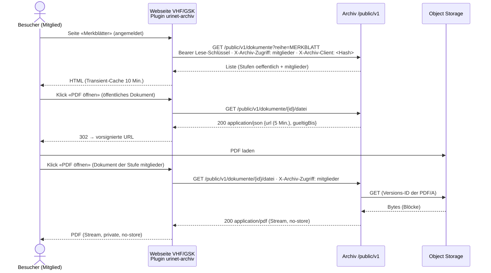
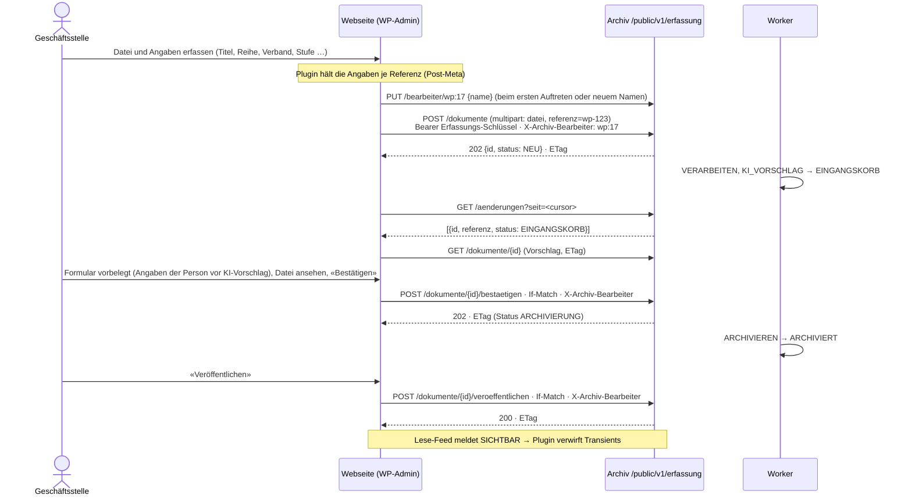

# Design Document — 03 Zweiter Mandant VHF/GSK

## Overview
Kein neuer Dienst: der bestehende Archiv-Dienst erhält einen Mandanten `vhf-gsk`, eine
öffentliche Schnittstelle `/public/v1` und ein WordPress-Plugin. Besucher sprechen nie direkt
mit dem Archiv; das Plugin ruft es serverseitig mit einem Webseiten-Schlüssel auf. Neue Teile folgen der
hexagonalen Gliederung aus `structure.md` (`integration/webseite` mit `domain`, `application`,
`adapter`; bisher `integration/wordpress`, geändert 13.11.2026, E-B); Schemaänderungen nur als neue Liquibase-Changesets.

Erweiterung 13.11.2026 (Entscheide E-A bis E-D, entschieden von Fabian am 13.11.2026; Leitentscheid
[ADR-014](../../../docs/adr/ADR-014-webseiten-schnittstelle.md)): Die öffentliche Schnittstelle wird zum
lesenden Teil der Webseiten-Schnittstelle, eines versionierten Vertrags für jede Webseite. Sie hat zwei Teile, die getrennte Schlüssel
erreichen: **Lesen** (`/public/v1`, Lese-Schlüssel, jede Seitenansicht; nur dieser Teil heisst «öffentliche
Schnittstelle», Glossar) und **Erfassung** (`/public/v1/erfassung`, Erfassungs-Schlüssel, nur Verwaltung durch die
Geschäftsstelle, sieht wie die Rolle `geschaeftsstelle`). Das WordPress-Plugin ist ein Nutzer dieses Vertrags.
Grundsätze:
- **Nur serverseitig.** CORS bleibt zu (Requirement 5.6); kein Schlüssel im Browser.
- **Das Archiv ruft nie hinaus.** Keine Webhooks, kein Abholen von URLs (kein SSRF); die Webseite fragt den
  Änderungs-Feed ab und sendet Dateien als Bytes.
- **Die Webseite meldet die Stufe, der Schlüssel begrenzt sie.** Das Archiv vertraut der gemeldeten Stufe nur bis zur
  höchsten Stufe des Schlüssels.
- **Gleiche Fachlogik wie die Web-App.** Die Erfassung ruft dieselben Application-Services wie `/api/v1` auf (Upload,
  Bestätigen, Ändern, Versionsprüfung, Protokoll); sie ist ein zweiter Eingang, keine zweite Logik.



Erfassen über die Webseite (Requirement 10):



## Components and Interfaces

### Mandant und Branding
- Seed `backend/src/main/resources/seed/vhf-gsk/dokumentarten.json` (Bulletin, Merkblatt, Protokoll, Jahresbericht; Gruppe `frei`; `zusatz_schema` mit `reihe`, `ausgabe`, `jahr`, `fachgebiet`, `zugriff`, `veroeffentlicht`; Aufbewahrung unbefristet; Standard-Vertraulichkeit und `gesetzliche_pflicht` [offen: je Art VHF/GSK – Entscheid vor Welle 10]). Ohne gesetzliche Pflicht keine Object-Lock-Sperre (Spec 01, 6.12).
  Spec 05 ergänzt (Spec 05, Req 1.6, 2.7, 3.1, 5.1; umgesetzt in Spec 05, Aufgabe 17.7, und Aufgabe 10.2): An die Stelle von `dokumentarten.json` tritt `seed/vhf-gsk/konfiguration.json`. Die Reihe ist die Dokumentart, das Zusatzfeld `reihe` entfällt; das Fachgebiet ist die Klassifikation `fachgebiet` (mehrere Werte je Dokument, `oeffentlich_filter`); `ausgabe` und `jahr` bleiben Zusatzfelder mit den Regeln `EINDEUTIG` und `FOLGE`; `zugriff` und `veroeffentlicht` sind reservierte Felder, deren Definition hier fest steht (Abschnitt «Reservierte Felder») und die die Konfiguration nicht anders definieren darf.
- Klassifikation `verband` (Requirement 1.6; vorgeschlagen 13.11.2026, entschieden mit dem Merge dieses PR): Werte `vhf` («VHF») und `gsk` («GSK»), mehrere Werte je Dokument, `suchfilter` und `oeffentlich_filter` ja, ohne KI-Vorschlag; ein gemeinsames Dokument trägt beide Werte. Öffentlich filterbar über `?verband=vhf` nach der Mechanik von Spec 05, 8.6; der Code `verband` ist kein fester Parameter (Liste unten).
- Stammdaten-Tabelle `vhf-gsk` (Spec 05 ergänzt, Spec 05, Req 6.7): Analog zu Spec 01 design.md, «Stammdaten der Dokumentarten», steht hier die Tabelle der Arten, Klassifikationen und Regeln von `vhf-gsk`, sobald ihre Werte entschieden sind (offener Punkt «je Art VHF/GSK» oben); ab dann vergleicht `KonfigurationSeedTest` den Seed Feld für Feld mit ihr. Die Klassifikationen `fachgebiet` und `verband` gehören in diese Tabelle.
- `WISSENSQUELLE` kommt nicht aus diesem Seed, sondern aus dem Seed-Teil `seed/_alle/dokumentarten-wissen.json` (Spec 04, 1.1); für `vhf-gsk` mit `zugriff` (Pflicht, Standard `mitglieder`) und `veroeffentlicht` (Standard `false`). Spec 05 ergänzt (Spec 05, Req 2.6): Diese Ergänzung für `vhf-gsk` kommt aus der Konfiguration von `vhf-gsk`, nicht aus dem mandantenunabhängigen Seed-Teil.
- Provisionierung wie Spec 01 (Changelog `db/mandant`, Bucket im Object-Storage-Projekt des Archivs, App-Schlüssel `s3_app_zugang`, der nie den Bypass-Header setzt, Spec 01, 6.5; Bucket Policy mit Deny auf `s3:BypassGovernanceRetention` wie in Spec 01, design.md «Ablage»); Schema und Bucket werden in Sicherung, Zweitkopie und Restore-Probe aufgenommen (Requirement 1.5).
- `mandant.branding` = `{name, logoUrl, primaerfarbe, domain}`; `GET /api/v1/branding?domain=` (öffentlich, nur Darstellung).
- Domain: [offen: Domain VHF/GSK – Entscheid vor Welle 10]; zusätzlicher Traefik-Router per Labels in `deploy/infomaniak/compose.yml`, Deploy nur über den GitHub-Actions-Workflow.
- Keycloak (`archiv-auth.apps.urinet.ch`): Client `archiv-vhf-gsk` mit Theme `vhf-gsk`; Benutzer der Geschäftsstelle mit Attribut `mandant=vhf-gsk`, Rolle `geschaeftsstelle` (Rechte nach Rechtematrix Spec 01, 2.6; A11 bis A14 offen, bis dahin 403; A19 der Wissensbasis 403, Spec 04, 12.1).
- KI-Prompt pro Mandant: Dokumentarten-Beschreibung und Fachgebiet-Liste aus dem Seed; Zugriffsstufe nicht Teil des Vorschlags. Spec 05 ergänzt (Spec 05, Req 8.1, 8.4, 8.9): Prompt und Antwortschema kommen aus der Konfiguration von `vhf-gsk` (Arten mit `ki_vorschlag = ja`, `ki_felder` `ausgabe` und `jahr`, Klassifikation `fachgebiet` mit KI-Vorschlag); `zugriff` und `veroeffentlicht` schlägt die KI nie vor; Vorschläge erst nach Abnahme und KI-Freigabe (umgesetzt in Spec 05, Aufgabe 18.1).

### Reservierte Felder
Massgebliche Definition für Spec 05, 2.7 (`Konfiguration.pruefen` vergleicht jede Art, die diese Felder führt, mit
dieser Tabelle; neu 13.11.2026, E-C):

| Feld | JSON-Typ | Werte | Standard | Pflicht | Gesetzt durch |
| --- | --- | --- | --- | --- | --- |
| `zugriff` | string | `oeffentlich`, `mitglieder`, `vorstand` (Ordnung in dieser Reihenfolge) | `mitglieder` | ja | nur eine Person (Web-App oder Erfassung), nie die KI (Requirement 3.3) |
| `veroeffentlicht` | boolean (JSON `true`/`false`, kein String) | `true`, `false` | `false` | ja | nur eine Person: in der Erfassung nur über Veröffentlichen/Zurückziehen (Requirement 10.5, 10.6; in `PATCH` und Bestätigen der Erfassung 400); in der Web-App über `PATCH`, wirksam erst durch den festen Filter (`ARCHIVIERT`) |

- Domain-Typ `Zugriffsstufe` (`integration/webseite/domain`) mit `OEFFENTLICH < MITGLIEDER < VORSTAND` und
  `bisUndMit()` → Liste der Codes; der Filter nimmt diese Liste, nie einen Wert aus der Anfrage.
- Keine Datenmigration nötig: Werte für `zugriff` gibt es erst ab Welle 10 (Spec 05, Wellen 17/18 vor Welle 10).

### Webseiten-Schnittstelle: Anmeldung, Schlüssel, Stufen (`integration/webseite`)
- Bisher `SiteKeyAuthMechanism` (Scope `wordpress`); geändert 13.11.2026 (E-B): Kein eigener Mechanismus. Webseiten-Schlüssel sind API-Tokens nach Spec 01, 2.5 (`ua_<id>_<geheimnis>`, Argon2id, `HashSperre`) mit den neuen Scopes `webseite-lesen` und `webseite-erfassung`; `ApiTokenAuthMechanism` meldet sie an. Die Identität trägt zusätzlich die Attribute `webseite` (Kennung) und `hoechste-stufe`.
- Scope-Bindung (Spec 03 ergänzt Spec 01, design.md, «Umsetzung (Aufgabe 1.5)», Scope-Bindung): Endpunkte der Webseiten-Schnittstelle tragen `@WebseitenZugang(LESEN|ERFASSUNG)` statt `@ErlaubtScope`; `ZugangFilter` lässt eine Identität mit Scope `webseite-*` nur an Methoden mit dem passenden `@WebseitenZugang` durch und jede andere Identität (OIDC, `generator`, `import`) an diesen Methoden nicht (403 `NICHT_ERLAUBT`, Protokoll `VERWEIGERT`). `EndpunktWaechterTest` erweitert: `@WebseitenZugang` nur unter `/public/`, jede Methode unter `/public/` trägt genau `@WebseitenZugang`, und die Regel für `@ErlaubtScope` bleibt unverändert (nur `POST` mit A1).
- Erfassungs-Schlüssel: `Berechtigung` wertet die Rechtematrix für die Rolle `geschaeftsstelle` aus und lässt zusätzlich nur die feste Positivliste `ERFASSUNG_ERLAUBT = EnumSet.of(A1, A2, A3, A4, A5, A6, A7, A8, A10)` zu (sonst 403), auch wenn eine spätere Spec der Geschäftsstelle A11 ff. gibt oder das Enum umsortiert wird (Requirement 10.8; geändert 13.11.2026, bisher `Aktion.ordinal` ≤ A10). `ErfassungRechteTest` (JUnit) prüft die Liste gegen 10.8 und dass jede Aktion darin in der Spalte `geschaeftsstelle` erlaubt ist. Sichtbarkeit wie `geschaeftsstelle` (A2 bis A4).
- Lese-Schlüssel: keine Rolle der Rechtematrix; Zugriff nur über den festen Filter unten.
- Header (Anfrage):

| Header | Teil | Bedeutung |
| --- | --- | --- |
| `Authorization: Bearer ua_…` | alle | Webseiten-Schlüssel |
| `X-Archiv-Zugriff: oeffentlich\|mitglieder\|vorstand` | Lesen | gemeldete Stufe; fehlt → `oeffentlich`; über der Stufe des Schlüssels → 403 `NICHT_ERLAUBT`; unbekannt → 400 (Requirement 5.9); gilt für Liste, Suche, Details, Datei, Filter, Umleitung und Chat; im Feed nicht beachtet (dort gilt die Stufe des Schlüssels) |
| `X-Archiv-Client: <SHA-256(IP + Tages-Salz)>` | Lesen (Chat) | Client-Hash für 6.4, von der Webseite berechnet |
| `X-Archiv-Bearbeiter: <Kennung>` | Erfassung | Kennung der Person auf der Webseite, `^[A-Za-z0-9._:@-]{1,64}$`; Pflicht bei jeder protokollierten Aktion; muss vorher über `PUT /erfassung/bearbeiter/{kennung}` gemeldet sein (Requirement 10.9, 10.12) |
| `If-Match: "<version>"` | Erfassung, ändernd | starkes ETag wie Spec 01 (`*`, `W/"…"` → 412) |

- Header (Antwort): `ETag` (Erfassung), `Retry-After` (429, 503), `Cache-Control: no-store` (alle, Requirement 15.4), `Deprecation`, `Sunset`, `Link: <…>; rel="successor-version"` (abgekündigte Version).
- Schlüsselverwaltung (Requirement 12; vorgeschlagen 13.11.2026, entschieden mit dem Merge dieses PR):
  - `archiv webseite schluessel erstellen <mandant> <webseite> lesen|erfassung --stufe oeffentlich|mitglieder|vorstand [--absender-pruefen]`: Schlüssel nur auf stdout, ID, Mandant, Webseite, Scope und Stufe auf stderr (wie `archiv token erstellen`). Erfassungs-Schlüssel erhalten die Stufe `vorstand` fest (die Geschäftsstelle sieht alle Stufen); die Angabe `--stufe` ist dort nicht erlaubt.
  - `archiv webseite schluessel rotieren <tokenId> --ueberlappung <ISO-Dauer>` (Standard `P7D`, höchstens `P30D`): neuer Schlüssel mit denselben Angaben; beim alten wird `gueltig_bis` gesetzt; danach 401.
  - Widerruf über `archiv webseite schluessel widerrufen <tokenId>` (Betreiber, auch für Mandanten ohne `inhaber`) bzw. `DELETE /api/v1/api-tokens/{tokenId}` (A14). `POST /api/v1/api-tokens` kennt nur `generator` und `import` (Schema-Enum), Webseiten-Scopes → 400.
  - Absender-Einschränkung (präzisiert 13.11.2026): Das Kommando setzt nur `absender_pruefen` in `api_client`; die Netze stehen je Webseite (Kennung, nicht Schlüssel-ID) in einer Datei der Betriebskonfiguration auf dem Server (nie im Repository, nie in Logs), die die API beim Start und bei jeder Änderung der Datei neu liest. Weil die Netze an der Webseite hängen, braucht eine Rotation nichts zu übertragen; die Rotation übernimmt `absender_pruefen`. Hat ein Schlüssel `absender_pruefen = true` und die Datei keinen Eintrag für seine Webseite, lehnt das Archiv jede Anfrage ab (geschlossen bei fehlender Konfiguration) und loggt die Schlüssel-ID. Geprüft wird gegen `X-Real-Ip` von Traefik (Spec 01, 10.2) erst nach erfolgreicher Schlüsselprüfung, damit die Antwortzeit nicht verrät, ob eine ID existiert (wie die Attrappe mit gleichem Weg und Timing in Spec 01 design.md, «Sperre gegen Erschöpfen des Heaps»); sonst 401 wie ein ungültiger Schlüssel.
  - Prüf-Cache (Requirement 12.8; vorgeschlagen 13.11.2026, entschieden mit dem Merge dieses PR; Spec 03 ergänzt Spec 01, 2.5, das bisher «kein Cache» vorsieht): Nach einer erfolgreichen Argon2id-Prüfung eines Schlüssels mit Scope `webseite-*` merkt sich `ApiTokenPruefung` im Speicher der API je Schlüssel-ID einen HMAC-SHA-256 des Geheimnisses (Schlüssel des HMAC zufällig je Prozessstart, nie gespeichert) mit Ablauf `archiv.webseite.pruef-cache` (Startwert `PT5M`). Jede Anfrage liest weiter die Zeile in `api_client` (`aktiv`, `gueltig_bis`, Mandant aktiv); nur der Argon2id-Vergleich entfällt bei einem Treffer. Darum wirken Widerruf, Ablauf und Sperre des Mandanten ab der nächsten Anfrage (12.5), auch wenn das Kommando in einem anderen Prozess läuft. Ein falsches Geheimnis trifft nie den Cache und nimmt den normalen Weg über die `HashSperre` (gleiches Timing wie heute). So können fremde Anfragen mit falschen `ua_…`-Werten die Plätze der `HashSperre` zwar belegen, die Webseite mit gültigem Schlüssel aber nicht aussperren (OWASP API4). Für `generator` und `import` bleibt es beim Spec-01-Verhalten ohne Cache. Restrisiko: Nach einem Neustart braucht die erste Anfrage der Webseite einen freien Platz (Open Points).
  - Leistung: Ohne Cache-Treffer rechnet eine Anfrage Argon2id einmal und teilt sich die Plätze der `HashSperre`; ist kein Platz frei, 503 `UEBERLASTET` mit `Retry-After: 1`, und das Plugin zeigt seine Meldung (7.5). Aufgabe 11.7 misst Trefferquote und Wartezeiten unter Last mit fremden Anfragen.

### Webseiten-Schnittstelle: Lesen (`/public/v1`, Lese-Schlüssel)

| Methode | Pfad | Zweck | Status |
| --- | --- | --- | --- |
| GET | `/public/v1/dokumente?reihe=&jahr=&<klassifikation>=&seite=&pro_seite=&sortierung=` | Liste veröffentlichter Dokumente bis zur Stufe | 200, 400, 401, 403, 429 |
| GET | `/public/v1/suche?q=&reihe=&jahr=&<klassifikation>=` | Hybridsuche (nur veröffentlicht, Zugriffsstufe); je Treffer `fundstelle {seite}`, soweit bekannt (Requirement 5.7) | 200, 400, 401, 403, 429 |
| GET | `/public/v1/dokumente/{id}` | Details (Felder unten) | 200, 400, 403, 404 |
| GET | `/public/v1/dokumente/{id}/datei` | Stufe `oeffentlich`: 200 `application/json` `{url, gueltigBis}` (5 Min.); Stufen `mitglieder`, `vorstand`: 200 `application/pdf` als Stream (Requirement 13) | 200, 400, 403, 404, 503 `SPEICHER_NICHT_ERREICHBAR` |
| GET | `/public/v1/filter` | Reihen (Code, Name) und Klassifikationen mit `oeffentlich_filter` samt Werten, nur soweit der feste Filter bis zur Stufe Dokumente liefert (Requirement 5.8) | 200, 400, 403 |
| GET | `/public/v1/umleitung?url=` | alte URL (4.3; Pfad ohne Schema und Host, normalisiert wie beim CSV-Import) → `{dokumentId}`, nur für Dokumente, die der feste Filter bis zur Stufe liefert (Requirement 5.10) | 200, 400, 403, 404 |
| POST | `/public/v1/chat` | `{frage, gespraechId?}` → SSE wie Spec 02, Werkzeuge eingeschränkt; Quellen mit `dokumentId`, Titel, Reihe, Ausgabe (Requirement 5.11) | 200, 400, 403, 429 `BUDGET` |
| GET | `/public/v1/aenderungen?seit=&max=` | Änderungs-Feed bis zur Stufe des Schlüssels (Requirement 14.1) | 200, 400, 410 |

Zusätzlich bei allen Endpunkten beider Teile (geändert 13.11.2026; `PublicVertragTest` gleicht diese Codes mit
`public-v1.yaml` ab): 401 `NICHT_ANGEMELDET` (Requirement 15.3), 403 `NICHT_ERLAUBT` (falscher Scope, 12.1),
429 `ZU_VIELE_ANFRAGEN` mit `Retry-After` (15.1; bei `/datei` auch 13.4), 503 `UEBERLASTET` mit `Retry-After: 1`
(volle `HashSperre`).

Antwortfelder der lesenden Endpunkte (Requirement 5.11; vorgeschlagen 13.11.2026, entschieden mit dem Merge dieses PR;
neue Felder sind additiv):

| Endpunkt | Felder |
| --- | --- |
| Liste (`eintraege[]`, dazu `seite`, `proSeite`, `gesamt`) | `id`, `titel`, `reihe {code, name}`, `ausgabe`, `jahr`, `datum` (Erscheinungsdatum, `dokument.datum`, kann fehlen), `klassifikationen` (nur mit `oeffentlich_filter`, je `{code, werte[{code, name}]}`), `zugriff`, `seiten` |
| Suche (`treffer[]`, dazu `degradiert`) | wie Liste, dazu `auszug` (ohne Dateinamen), `fundstelle {seite}` (kann fehlen), `rang` |
| Details | wie Liste, dazu `auszug` |
| Chat-Quellen (SSE-Ereignis `quellen`) | `dokumentId`, `titel`, `reihe {code, name}`, `ausgabe` |

Nie enthalten: Dateiname, Vertraulichkeit, Status, `veroeffentlicht`, Referenzen, Speicher-URLs (ausser der
vorsignierten URL von `/datei` bei Stufe `oeffentlich`) und URLs von Seiten der Webseite.

- Fester Filter in allen Abfragen (geändert 13.11.2026, E-C; bisher `(zusatz->>'zugriff'='oeffentlich' OR :mitglied)`): `status='ARCHIVIERT' AND vertraulichkeit='NORMAL' AND zusatz->>'veroeffentlicht'='true' AND zusatz->>'zugriff' = ANY(:stufen)` mit `:stufen = min(gemeldete Stufe, Stufe des Schlüssels).bisUndMit()` (Requirement 3.4, 3.6, 3.7, 5.3). `->>` liefert bei JSON-`true` den Text `'true'`; ein String `"true"` ist nach «Reservierte Felder» ungültig und wird von `ZUSATZ_UNGUELTIG` abgefangen.
- `/datei`: Der Medientyp der Antwort hängt von der Stufe des Dokuments ab; die Details liefern `zugriff`, damit die Webseite vorab weiss, was kommt. Die Variante ist die PDF/A-Fassung mit gespeicherter Versions-ID wie Spec 01, 14.6.
- Klassifikationen (Spec 05 ergänzt, Spec 05, Req 8.6; umgesetzt in Aufgaben 11.2 und 11.5): Die Liste filtert zusätzlich nach den Codes der Klassifikationen mit `oeffentlich_filter` (z. B. `?fachgebiet=bad`, `?verband=gsk`) und gibt nur diese Klassifikationen aus; der feste Sicherheitsfilter oben bleibt unverändert davor. Feste Parameter, die kein Klassifikations-Code sein dürfen: `q`, `reihe`, `jahr`, `ausgabe`, `seite`, `pro_seite`, `id`, `sortierung`, `gespraech_id`, `zugriff`, `veroeffentlicht`, `seit`, `max`, `referenz`, `groesse`, `status`, `url` (die letzten sechs ergänzt 13.11.2026, weil Feed, Umleitung und Erfassung sie im selben Vertrag nutzen; Spec 05 design.md führt dieselbe Liste).
- Fundstelle (Requirement 5.7; vorgeschlagen 13.11.2026, entschieden mit dem Merge dieses PR): Spec 03 ergänzt Spec 02, Aufgabe 6.3: `chunk` erhält `seite_von` und `seite_bis` (1-basiert), die der `Chunker` über `Seitentext.von(volltext)` aus Spec 04 design.md bestimmt; beide sind `null` ohne Seitentrenner (z. B. bei `pdfa_fehlt`) und wenn die Zahl der `\f`-Seiten nicht `dokument.seiten` entspricht (dieselbe Plausibilitätsprüfung wie Spec 04, sonst zeigte `#page=` auf eine falsche Seite). Umgesetzt mit Spec 02, Aufgabe 6.3 (Changeset 021, `Chunker`, `Seitentext` in `gemeinsam/domain`); für Aufgabe 11.13 bleiben `HybridSuche` und die Fundstelle. Spec 03 ergänzt Spec 02, Aufgabe 6.4: `HybridSuche` gibt je Dokument den besten Chunk mit; die öffentliche Suche liefert `fundstelle: {seite: seite_von}`. Treffer nur aus dem Volltext haben keine Fundstelle. Das Plugin verlinkt auf die Download-Route mit `#page=<n>`. Der Parameter `seite` bleibt die Blätterung; die PDF-Seite heisst im Vertrag immer `fundstelle.seite`.
- Dateiname (Spec 01 ergänzt, Req 3.13; Review #104): Suche, Details mit Auszug und öffentlicher Chat nutzen die Suche ohne Dateinamen (`mitDateiname=false`) und geben das Feld `dateiname` nicht weiter; das gilt für die ganze Webseiten-Schnittstelle einschliesslich Erfassung (Requirement 10.11). Diese Variante prüft über `ts_filter(volltext_tsv, '{a,b,c}')`, was den GIN-Index nicht nutzt; fehlt der Index oder Vorfilter aus Spec 02 (Aufgabe 7.1) noch, legt ihn Aufgabe 11.2 an (Spec 01, design.md, «Umsetzung 4.10»).
- `OeffentlicherChatAgent`: eigener `@RegisterAiService` mit `OeffentlicheWerkzeuge` (`dokumente_suchen`, `dokument_zeigen`), Systemprompt mit Verbandsname, Fachgebieten und Hinweis auf Geschäftsstelle; Gesprächsspeicher 6 Nachrichten. Die Werkzeuge erhalten `:stufen` aus der Anfrage, nie aus dem Prompt.
- Rate-Limit: 20 Fragen/h pro Client-Hash; Token-Budget pro Mandant und Monat aus `mandant_budget(monat, tokens_max, tokens_verbraucht)`. Die Wissensbasis führt ein eigenes Monatsbudget in `m_<code>` und belastet `mandant_budget` nicht, damit ein Ingest den Chatbot nicht sperrt und umgekehrt (Spec 04, 13.6). Dazu die Grenzen je Schlüssel (Abschnitt «Grenzen»).

### Webseiten-Schnittstelle: Erfassung (`/public/v1/erfassung`, Erfassungs-Schlüssel)
Neu 13.11.2026 (Requirement 10; entschieden von Fabian am 13.11.2026, E-A). Alle Endpunkte delegieren an dieselben
Application-Services wie `/api/v1` (Spec 01 design.md, Endpunkt-Tabelle); Reihenfolge der Prüfungen wie dort
(sichtbar 404 → Recht 403 → `If-Match` 428/412 → Status 409 → Inhalt 400/422).

| Methode | Pfad | Zweck | Aktion / Protokoll | Status |
| --- | --- | --- | --- | --- |
| POST | `/erfassung/dokumente` | `multipart/form-data`: `datei` (genau eine), `referenz` (Pflicht, `^[A-Za-z0-9._:-]{1,100}$`), `hinweis` (optional, ≤ 1'000 Zeichen) → 202 `{id, status, referenz}` mit `Location` und `ETag`; 200 bei gleicher Referenz und Datei oder bei Dublette (`dublette: true`, `id` nur, wenn sichtbar) | A1 / `ERFASSEN` | 202, 200, 400, 409 `REFERENZ_VERGEBEN`, 413, 415, 422, 503 `SPEICHER_NICHT_ERREICHBAR` |
| GET | `/erfassung/dokumente?referenz=` | Status zu einer Referenz der eigenen Webseite (nur Statusfelder: `id`, `referenz`, `status`, `fehlercode`, `version`); Referenz einer anderen Webseite → 404 | A2–A4 / keine (Liste) | 200, 400, 404 |
| GET | `/erfassung/dokumente?status=&reihe=&jahr=&veroeffentlicht=&q=&seite=&groesse=` | Liste der sichtbaren Dokumente wie Spec 01 `GET /dokumente` (Volltextsuche ohne Dateinamen, `groesse` 1–100), je Eintrag `id`, `titel`, `reihe`, `ausgabe`, `jahr`, `status`, `zugriff`, `veroeffentlicht`, `version`, `referenz` (nur eigene Webseite, sonst `null`) (Requirement 10.13; vorgeschlagen 13.11.2026, entschieden mit dem Merge dieses PR); `referenz` zusammen mit anderen Filtern → 400 | A2–A4 / keine (Liste) | 200, 400 |
| GET | `/erfassung/dokumente/{id}` | Status, Metadaten, Klassifikationen, KI-Vorschlag, `zugriff`, `veroeffentlicht`, `fehlercode`, `referenz` (nur eigene Webseite); `ETag` | A2–A4 / `ANZEIGEN` | 200, 400, 404 |
| GET | `/erfassung/dokumente/{id}/datei` | Stream wie Requirement 13 (PDF/A, solange sie fehlt das Original; nie eine URL), gleiche Plätze und Zeitlimits (Requirement 10.14; vorgeschlagen 13.11.2026, entschieden mit dem Merge dieses PR) | A2–A4 / `HERUNTERLADEN` | 200, 400, 404, 503 `SPEICHER_NICHT_ERREICHBAR` |
| GET | `/erfassung/eingangskorb?seite=&groesse=` | wie Spec 01 `GET /eingangskorb` (`groesse` 1–100) | A5 / keine | 200, 400 |
| GET | `/erfassung/dokumentarten` | aktive Arten mit Feldern und Klassifikationen (Formular der Webseite) | wie Stammdaten lesen | 200 |
| PUT | `/erfassung/bearbeiter/{kennung}` | `{name}` (1–200 Zeichen) → Eintrag im Benutzerverzeichnis, wenn neu oder Name geändert (Requirement 10.12; vorgeschlagen 13.11.2026, entschieden mit dem Merge dieses PR) | keine Aktion der Matrix / kein Protokolleintrag (das Verzeichnis selbst ist nur anfügend) | 204, 400 |
| POST | `/erfassung/dokumente/{id}/bestaetigen` | wie Spec 01 `POST /dokumente/{id}/bestaetigen`, `If-Match`; `dateiname` und `zusatz.veroeffentlicht` → 400 | A7 (A8) / `BESTAETIGEN` | 202, 400, 404, 409, 412, 422, 428 |
| PATCH | `/erfassung/dokumente/{id}` | wie Spec 01 `PATCH /dokumente/{id}`, `If-Match`; bei `ARCHIVIERT` `grund` Pflicht; ohne `person_benutzer`, `dateiname` und `zusatz.veroeffentlicht` (400) | A6 (A8) / `AENDERN` | 200, 400, 404, 409, 412, 422, 428 |
| POST | `/erfassung/dokumente/{id}/veroeffentlichen` | `veroeffentlicht = true`, nur `ARCHIVIERT`, `If-Match`; fester Grund «über Webseite veröffentlicht» | A6 / `AENDERN` | 200, 400, 404, 409, 412, 428 |
| POST | `/erfassung/dokumente/{id}/zurueckziehen` | `veroeffentlicht = false`, nur `ARCHIVIERT`, `If-Match`; fester Grund «über Webseite zurückgezogen» | A6 / `AENDERN` | 200, 400, 404, 409, 412, 428 |
| POST | `/erfassung/dokumente/{id}/wiederholen` | wie Spec 01 «erneut verarbeiten» bzw. Archivierung wiederholen, nur `FEHLER` und `ARCHIVIERUNG_FEHLER` (Requirement 10.8; vorgeschlagen 13.11.2026, entschieden mit dem Merge dieses PR) | A10 / wie Spec 01 | 202, 400, 404, 409 |
| GET | `/erfassung/aenderungen?seit=&max=` | Änderungs-Feed des Mandanten (Requirement 14.2) | keine | 200, 400, 410 |

(Pfade relativ zu `/public/v1`; zusätzlich die Codes für alle Endpunkte unter der Tabelle «Lesen». 400 bei fehlendem,
ungültigem oder nicht gemeldetem `X-Archiv-Bearbeiter` gilt für jede Zeile mit Protokoll, Requirement 10.9.)
- Kein `DELETE`, kein Verwerfen (Requirement 10.7, 10.8); ein `DELETE` beantwortet das Framework mit 405 (`ANFRAGE_UNGUELTIG` mit Status 405 nach Spec 01 design.md, Error Handling).
- Referenzen nur der eigenen Webseite: Jeder Zugriff auf `webseite_referenz` (Upload, Statusabruf, Liste, Details, Erfassungs-Feed) filtert auf `webseite` = Webseite des Schlüssels; fremde Referenzen erscheinen als `null` bzw. 404 (Requirement 9.4, 10.4).
- Hintergrundabrufe: Das Plugin fragt ohne angemeldete Person nur den Erfassungs-Feed und den Statusabruf über die Referenz ab; beide schreiben kein Protokoll und brauchen keinen Bearbeiter.
- Quelle `WEBSEITE` (Spec 03 ergänzt Spec 01, design.md, Upload, `quelle`): neues Changeset unter `db/mandant` erweitert den Check `dokument_quelle_ck`; bestehende Changesets bleiben unverändert.
- Grenzen des Uploads wie Spec 01 (`archiv.upload.max-datei` 50 MB, `Content-Length` Pflicht); die Datei geht wie beim Upload nach `archiv_arbeit` und in den Bucket, nie in den Heap.
- Idempotenz (Requirement 10.3; geändert 13.11.2026, bisher «der Primärschlüssel entscheidet»): Tabelle `webseite_referenz`; Ablauf in einer Transaktion, die als Erstes `pg_advisory_xact_lock` auf einen Hash von (Webseite, Referenz) setzt, noch vor dem Lesen der Referenz und vor der Dublettenprüfung (wie die Sperre auf die Prüfsumme in Spec 01): Referenz der eigenen Webseite suchen → vorhanden und Dokument nicht `VERWORFEN`: gleiche SHA-256 → 200, sonst 409 `REFERENZ_VERGEBEN`; vorhanden mit `VERWORFEN` oder nicht vorhanden: Upload wie Spec 01 (Dublettenprüfung per SHA-256, die verworfene Dokumente übergeht → 200 mit `dublette: true` und Bindung der Referenz an das vorhandene Dokument), dann Referenz einfügen bzw. neu binden. Ein zweiter gleichzeitiger Upload derselben Referenz wartet auf die Sperre, liest danach die Referenz und entscheidet nach denselben Regeln (gleiche Datei → 200, andere → 409). Die Abbildung von `DUBLETTE` (Spec 01, 202 mit Ergebnis je Datei) auf 200 mit `dublette: true` geschieht in der Erfassung, nicht im Upload-Service; `id` nur, wenn der Schlüssel das vorhandene Dokument nach Spec 01, 2.3 sehen darf, sonst bleibt die Referenz ungebunden.
- Protokoll (Requirement 10.9, 10.12; Spec 03 ergänzt Spec 01, 10.2 und 10.10): `benutzer = token:<id>`, `rolle = geschaeftsstelle`, neue Spalte `bearbeiter` mit `<webseite>/<Header-Wert>` (z. B. `vhf-gsk-web/wp:17`); dieselbe Kennung steht in der neuen Spalte `dokument_version.bearbeiter` der Fassung (Spec 01, 10.1) und als `benutzer` im Benutzerverzeichnis. `PUT /erfassung/bearbeiter/{kennung}` fügt dort `{benutzer: <webseite>/<kennung>, name, rolle: geschaeftsstelle, gueltig_von: jetzt}` ein, wenn die Kennung neu ist oder der Name abweicht; einen Austritt erfasst wie bei Benutzern ein neuer Eintrag mit «gültig bis» (Spec 01, 10.10). Logs nennen nur die Schlüssel-ID. Der Bearbeiter ist eine Angabe der Webseite; das Archiv kann sie nicht prüfen, die Webseite verantwortet sie mit ihrem Schlüssel (ADR-014, Folgen); die Zuordnung zur Person bleibt aber im Archiv, auch wenn die Webseite ihre Benutzer löscht.
- Fehlercodes im Status: `fehlercode` aus dem Feld `fehler` der Verarbeitung, nur als Code (z. B. `DATEI_UNGUELTIG`), nie Meldungstexte oder Ursachen.

### Dateiauslieferung und Stream
Neu 13.11.2026 (Requirement 13; entschieden von Fabian am 13.11.2026, E-D).
- `DateiAuslieferung` (application): in einer kurzen Transaktion Dokument mit festem Filter laden (sonst 404; in der Erfassung mit der Sichtbarkeit A2–A4), Versions-ID lesen und Protokoll `HERUNTERLADEN` schreiben (wie 5.4, gekürzte Client-IP; in der Erfassung mit Bearbeiter); die Transaktion endet vor dem ersten Byte (Requirement 13.8), damit ein Stream weder eine DB-Verbindung hält noch mit seiner Transaktion den Horizont des Änderungs-Feeds zurückhält → Stufe `oeffentlich` (nur Lesen): `AblagePort.vorsignierteUrl` (höchstens `PT5M`, Spec 01) → JSON; sonst Stream.
- Stream (Adapter `rest`): Quarkus REST mit `StreamingOutput` bzw. `Multi<Buffer>`; der S3-Client liefert einen `InputStream` der gespeicherten Versions-ID; Weitergabe in Blöcken von 64 KiB mit Gegendruck (Backpressure), nie `readAllBytes`. Antwort `Content-Type: application/pdf`, `Content-Length` aus den Objektdaten, `Cache-Control: no-store`, `Content-Disposition: inline` ohne Dateinamen (Spec 01, 3.12); kein `Range` in v1 (später additiv möglich).
- Begrenzung (Startwerte geändert 13.11.2026, bisher 4 gesamt, 2 je Schlüssel und `PT2M` Gesamtdauer): `archiv.webseite.streams-gesamt` (Startwert 8) und `archiv.webseite.streams-je-schluessel` (Startwert 8, gleich dem Gesamtwert, solange es eine Webseite gibt; sonst teilte eine Webseite mit einem Lese-Schlüssel alle Downloads ihrer Besucher auf zwei Plätze auf) als `Semaphore`, ohne Warten; kein Platz → 429 `ZU_VIELE_ANFRAGEN` mit `Retry-After: 5`. Weil das Plugin blockweise an den Browser durchreicht, hält ein langsamer Browser seinen Platz; darum zwei Zeitlimits: `archiv.webseite.stream-leerlauf` (Startwert `PT30S` ohne weitergegebenen Block) und `archiv.webseite.stream-zeitlimit` (Startwert `PT15M` Gesamtdauer, deckt 50 MB bei rund 0,5 Mbit/s). Abbruch durch den Client oder ein Zeitlimit schliesst den S3-Stream und gibt den Platz in `finally` frei (Requirement 13.7). Gegen eine Person, die mit vielen langsamen Downloads alle Plätze belegt, begrenzt das Plugin gleichzeitige Downloads je angemeldeter Person bzw. je Client-Hash (Startwert 2).
- Speicher: 8 × 64 KiB Puffer plus Verbindungen des S3-Clients; passt in das Speicherbudget der API in Stufe A (tech.md). Aufgabe 11.8 misst einen Fall «50 MB an einen langsamen Client». `DateiStreamTest` streamt eine Datei, die grösser ist als ein künstlich begrenzter Puffer, und prüft, dass nie mehr als ein Block gelesen, aber nicht weitergegeben ist.
- Storage nicht erreichbar → 503 `SPEICHER_NICHT_ERREICHBAR` mit `Retry-After` (Spec 01).

### Änderungs-Feed
Neu 13.11.2026 (Requirement 14; vorgeschlagen 13.11.2026, entschieden mit dem Merge dieses PR).
- Tabelle `webseite_aenderung` in `m_<code>`, befüllt von einem Trigger `AFTER INSERT OR UPDATE OR DELETE` auf `dokument`, wenn sich `status` oder `version` ändert bzw. die Zeile gelöscht wird (dann `stufe_nachher = null`, für ein späteres physisches Löschen nach Spec 01, 9.9), in derselben Transaktion. Grund für den Trigger statt Aufrufen im Code: Er erfasst jeden Weg (Web-App, Erfassung, Worker, Import), auch künftige.
- Der Trigger schreibt `stufe_vorher` und `stufe_nachher`: die öffentliche Stufe (`zusatz->>'zugriff'`), falls das Dokument vor bzw. nach der Änderung den festen Filter ohne Stufe erfüllt (`ARCHIVIERT`, `NORMAL`, `veroeffentlicht`), sonst `null`. `AenderungFeedTest` (JUnit) prüft für eine Matrix aus Status, Vertraulichkeit, `veroeffentlicht` und `zugriff`, dass Trigger und Java-Filter dasselbe ergeben.
- Lese-Feed: Einträge mit `stufe_vorher` oder `stufe_nachher` in `Stufe des Schlüssels.bisUndMit()`; «sichtbar» heisst im Folgenden: Stufe nicht `null` und in diesem Bereich. Art `SICHTBAR` (vorher nicht sichtbar, nachher sichtbar), `GEAENDERT` (vorher und nachher sichtbar), `NICHT_SICHTBAR` (vorher sichtbar, nachher nicht sichtbar, auch wenn die neue Stufe über dem Schlüssel liegt). Felder `{dokumentId, art, stufe, zeit}`, ohne Titel oder Inhalt; die Webseite holt Details bei Bedarf. `stufe` ist die tiefere der sichtbaren Stufen vor und nach der Änderung (präzisiert 13.11.2026, Requirement 14.1): Sie liegt so nie über dem Schlüssel, und ab ihr aufwärts liegt das Dokument in einem Cache der Webseite. Beispiel: Wechsel `oeffentlich` → `vorstand` ergibt für einen Schlüssel der Stufe `oeffentlich` oder `mitglieder` `NICHT_SICHTBAR` mit `stufe = oeffentlich` und für einen Schlüssel der Stufe `vorstand` `GEAENDERT` mit `stufe = oeffentlich`; Wechsel `mitglieder` → `vorstand` ergibt für einen Schlüssel `mitglieder` `NICHT_SICHTBAR` mit `stufe = mitglieder`. `AenderungFeedTest` und ein Szenario `@req-14.1` prüfen diese Fälle.
- Erfassungs-Feed: alle Einträge des Mandanten, Felder `{dokumentId, referenz, status, fehlercode, version, zeit}`; `referenz` nur aus `webseite_referenz` mit `webseite` = Webseite des Schlüssels, sonst `null` (Requirement 9.4, 14.2).
- Cursor: opak (Base64url), intern `(xid, id)`. Jeder Eintrag speichert `pg_current_xact_id()`; ein Abruf liefert nur Einträge mit `xid < pg_snapshot_xmin(pg_current_snapshot())` (alle älteren Transaktionen sind abgeschlossen), geordnet nach `(xid, id)`, ab dem Cursor. Grund: Eine fortlaufende Nummer allein genügt nicht, weil sie vor dem Commit vergeben wird und eine später committete kleinere Nummer sonst übersprungen würde (Requirement 14.3).
- Grenze des Cursors: Der Horizont `pg_snapshot_xmin` gilt für den ganzen Datenbank-Cluster. Eine lange offene Transaktion, auch eines anderen Mandanten (Import, Migration, Ingest der Wissensbasis), hält den Feed aller Mandanten an, bis sie endet; so lange greift das sofortige Verwerfen nach 7.9 nicht, und es bleibt die Cache-Dauer (7.4). Darum hält kein Stream eine Transaktion offen (13.8). `AenderungFeedTest` prüft einen Fall mit lang offener Transaktion (der Feed liefert danach lückenlos); die Betriebsüberwachung warnt, wenn der Horizont länger als `archiv.webseite.feed-stillstand` (Startwert `PT10M`) nicht vorrückt.
- Aufbewahrung `archiv.webseite.feed-aufbewahrung` (Startwert `P90D`), täglicher Auftrag `FEED_BEREINIGEN` löscht ältere Einträge und setzt `webseite_feed_stand.bereinigt_bis`; ein Cursor darunter → 410 `CURSOR_ABGELAUFEN`, die Webseite lädt ihren Bestand neu. Ohne `seit` liefert der Feed `{eintraege: [], cursor}` mit dem aktuellen Horizont.

### Vertrag und Versionierung
Neu 13.11.2026 (Requirement 11; entschieden von Fabian am 13.11.2026, E-B).
- Quelle des Vertrags ist die eingecheckte Datei `docs/schnittstelle/public-v1.yaml` (OpenAPI 3.1), getrennt von der
  App-Beschreibung `frontend/openapi/` (die Pfade unter `/public/` gehören nicht in den Angular-Client).
- `PublicVertragTest` (JUnit, ohne Netz): erzeugt die Beschreibung der Pfade unter `/public/v1` aus dem Code und
  vergleicht sie mit der Datei (Pfade, Parameter, Statuscodes, Schemas; Requirement 11.2).
- Herkunft der Beschreibung (präzisiert 13.11.2026): Die App-Beschreibung schliesst das Paket der Webseiten-Endpunkte
  über `mp.openapi.scan.exclude.packages` aus (wie heute `ch.urinet.archiv.probe`), damit `frontend/openapi/` und der
  Angular-Client unverändert bleiben. Den Vertrag erzeugt `PublicVertragTest` in einem eigenen Lauf ohne diesen
  Ausschluss, nur für `/public/` (Scanner von smallrye-open-api direkt auf dem Index oder ein Test-Profil); Aufgabe 11.6
  wählt den Weg.
- Nur additiv (Requirement 11.3; geändert 13.11.2026, bisher Teil von `PublicVertragTest`): Ein CI-Schritt im
  Build-Job, der die Git-Historie vollständig lädt (wie «Bestehende Liquibase-Changesets unverändert»), vergleicht die
  Datei mit ihrem Stand auf `origin/main` und bricht bei jeder nicht additiven Änderung ab (entfernte oder umbenannte
  Pfade, Felder oder Parameter, geänderte Typen, neue Pflichtparameter, entfernte Statuscodes, neue Werte in Enums, die
  nicht mit `x-erweiterbar: true` markiert sind). Grund: Die Jobs der Backend-Tests laden keine vollständige
  Historie, dort fehlte `origin/main`. Das Werkzeug (eigenes Skript oder z. B. `oasdiff breaking`) wählt Aufgabe 11.6.
- Erweiterbar markiert sind von Anfang an: `art` im Lese-Feed, `status` und `fehlercode` (neue Fehlercodes sind
  additiv), Klassifikationen.
- Hauptversion: Pfad-Präfix `/public/v<n>`; Abkündigung über `archiv.webseite.v<n>.sunset` (Datum); ab dann die Header
  `Deprecation`, `Sunset` und `Link` (Requirement 11.5). Parallelbetrieb mindestens 6 Monate (Requirement 11.4).
- Traefik: `/public/` läuft über einen eigenen Router mit eigener Drosselung je IP, damit die Seitenaufrufe einer
  Webseite (ein Server, eine IP) nicht unter die Grenze der App fallen; der Wert steht in `deploy/`, nicht hier.
- Umsetzung (Aufgabe 11.6, Vorstufe 14.11.2026; Entscheid Fabian vom 14.11.2026 «Neutrale Vorstufen jetzt»):
  - Weg für `/public/v1`: Quarkus REST registriert am Router nur `quarkus.rest.path` (`/api/v1`). `WebseitenRoute`
    (`integration/adapter/in/rest/webseite`) leitet jede Anfrage unter `/public/` vor der Anmeldung (Order -250, vor
    den Filtern der Anmeldung bei -200) per Vert.x-Reroute auf den internen Pfad `/api/v1/public/…` um; die Resources
    tragen `@Path("/public/v1/…")`. Danach gelten Anmeldung, HTTP-Rechte (`/api/*`), `ProblemAnmeldung`,
    `ProblemFehlerRoute` und `ProblemAbbildung` wie für die App, ohne Änderung der bestehenden Pfade. Der interne Pfad
    antwortet von aussen 404 `NICHT_GEFUNDEN`, schon vor der Anmeldung. `Cache-Control: no-store` und die Header der
    Abkündigung setzt derselbe Handler am Router für jede Antwort unter `/public/`, auch für Fehler vor der Resource.
    `quarkus.http.auth.permission` und `ProblemAnmeldung` nennen `/public/` zusätzlich, Quinoa ignoriert `/public`.
  - Paket: Die Regel der Schichten in `ArchitekturTest` verlangt `<fachbereich>.(domain|application|adapter)`; die
    Webseiten-Schnittstelle liegt darum wie `integration.domain.mail` unter `integration.domain.webseite` und
    `integration.adapter.in.rest.webseite`. `mp.openapi.scan.exclude.packages` schliesst beide Präfixe aus
    (`ch.urinet.archiv.integration.webseite` und `ch.urinet.archiv.integration.adapter.in.rest.webseite`, Unterpakete
    inbegriffen; `OpenApiAusschlussTest`).
  - Vertrag: `PublicVertragTest` beschreibt den Code mit dem Scanner von smallrye-open-api (`smallrye-open-api-jaxrs`
    als Testabhängigkeit, Version aus der Quarkus-BOM) auf einem Jandex-Index aller Klassen aus `src/main`, mit den
    Einstellungen `mp.openapi.*` der App ohne Ausschluss, ohne Quarkus-Start; die Datei liest derselbe Parser.
    Verglichen werden die Pfade unter `/public/` normalisiert (Parameter, Pflicht, Anfrage-Inhalt, Statuscodes, Schemas
    mit aufgelösten Referenzen; Antworten mit `$ref` über den Namen). Dazu Mindestprüfungen als OpenAPI 3.1 und jede
    Referenz `$ref` lokal und auflösbar. Die Fassung dieser Aufgabe hat `paths: {}`.
  - Nur additiv: eigenes Skript `.github/scripts/pruefe-vertrag.sh` mit `pruefe-vertrag.rb` (Ruby-Standardbibliothek,
    auf ubuntu-24.04 und macOS vorhanden; Python hat kein YAML in der Standardbibliothek), weil `x-erweiterbar` eine
    eigene Konvention ist. Fehlende oder unbekannte Basis und unlesbare Dateien → Exit 2, gelöschte Datei → Exit 1,
    Datei ohne Stand auf der Basis = erste Fassung. Selbsttest `pruefe-vertrag-test.sh` über `VertragPruefungTest`.
  - Abkündigung: `archiv.webseite.v<n>.sunset` (ISO-Datum; ungültig → Start bricht ab). `Sunset` = Tagesbeginn UTC als
    HTTP-Datum (RFC 8594), `Deprecation` = Sunset minus 6 Monate als `@<Unix-Sekunden>` (RFC 9745; Wahl dieser Aufgabe,
    die Spec nennt keinen Zeitpunkt), `Link: </public/v<n+1>>; rel="successor-version"`. Nach dem Sunset liefert das
    Archiv weiter aus (Abschalten ist ein Betriebsentscheid).
  - Offen: CI-Schritt «Vertrag nur additiv» im Build-Job (`.github/workflows/` nicht in dieser Aufgabe), Router für
    `/public/` mit eigener Drosselung in Traefik (`deploy/infomaniak/compose.yml`, Wert betrieblich); bis dahin läuft
    `/public/` über den Router der App.

### Grenzen
Startwerte (Requirement 15.1; vorgeschlagen 13.11.2026, entschieden mit dem Merge dieses PR), konfigurierbar unter
`archiv.webseite.*`, gemessen in Aufgabe 11.11:

| Grenze | Startwert | Antwort |
| --- | --- | --- |
| Anfragen je Lese-Schlüssel | 20/s, Spitze 100 (Token-Bucket) | 429 `ZU_VIELE_ANFRAGEN`, `Retry-After` |
| Anfragen je Erfassungs-Schlüssel | 5/s, Spitze 20 | 429 `ZU_VIELE_ANFRAGEN` |
| Uploads je Erfassungs-Schlüssel | 120 je Stunde | 429 `ZU_VIELE_ANFRAGEN` |
| Streams gesamt / je Schlüssel | 8 / 8 gleichzeitig (Leerlauf `PT30S`, Gesamtdauer `PT15M`) | 429 `ZU_VIELE_ANFRAGEN`, `Retry-After: 5` |
| Prüf-Cache für Webseiten-Schlüssel | `PT5M` je Schlüssel-ID (12.8) | – |
| Chat je Client-Hash | 20 Fragen/h (6.4) | 429 `ZU_VIELE_ANFRAGEN` |
| Chat-Budget je Mandant und Monat | `mandant_budget` (6.4) | 429 `BUDGET` |
| Feed | `max` ≤ 500 | 400 bei mehr |

Die Zähler liegen im Speicher der API (eine Instanz); nach einem Neustart beginnen sie neu. Mehrere Instanzen sind
nicht vorgesehen; kämen sie, brauchte es einen gemeinsamen Zähler (Open Points).

### WordPress-Plugin `wordpress/urinet-archiv-plugin`
Nutzer des Vertrags `public-v1` (geändert 13.11.2026, E-B): Das Plugin nutzt nur, was in `docs/schnittstelle/public-v1.yaml`
steht, und ignoriert unbekannte Felder (Requirement 11.6).
```
urinet-archiv-plugin/
├── urinet-archiv.php            Plugin-Header, Bootstrap
├── includes/
│   ├── class-einstellungen.php  Settings API (URL, Lese- und Erfassungs-Schlüssel verschlüsselt in wp_options, Cache-Dauer, Rollen für Mitglieder, Vorstand und Geschäftsstelle)
│   ├── class-client.php         wp_remote_get/post an /public/v1, Header, Problem Details, Transients
│   ├── class-shortcodes.php     urinet_archiv_liste, urinet_archiv_suche, urinet_chatbot
│   ├── class-dokumentseite.php  /urinet-archiv/dokument/{id}: Dokumentseite aus /public/v1/dokumente/{id}; Umleitung alter Links (301) über /public/v1/umleitung
│   ├── class-rest.php           eigene WP-REST-Route /wp-json/urinet-archiv/v1/chat (Proxy, Nonce)
│   ├── class-download.php       /urinet-archiv/datei/{id}: oeffentlich → 302 auf vorsignierte URL; sonst Stream blockweise durchreichen
│   ├── class-feed.php           WP-Cron: Änderungs-Feed abfragen, Transients verwerfen, Status der Erfassung nachführen
│   └── class-erfassung.php      WP-Admin für die Geschäftsstelle (nur mit Erfassungs-Schlüssel): Liste, Hochladen, Status, Datei ansehen, Bestätigen, Ändern, Veröffentlichen/Zurückziehen, Wiederholen
├── blocks/                      block.json je Block (Liste, Suche, Chatbot)
├── assets/chatbot.js            schlanker Chat ohne Framework, liest SSE über den WP-Proxy
└── languages/                   de_CH
```
- Zugriffsstufe (geändert 13.11.2026, E-C; bisher nur `mitglieder`): nicht angemeldet → `oeffentlich`; Rolle für Vorstand → `vorstand`; sonst Rolle für Mitglieder → `mitglieder`; sonst `oeffentlich`. Die höhere Stufe gewinnt.
- Schlüssel in `wp_options` mit `sodium_crypto_secretbox` und Schlüssel aus `wp-config.php` (`URINET_ARCHIV_KEY`).
- Caching: Transient-Schlüssel enthält Shortcode-Parameter und Zugriffsstufe (drei Stufen); auch `/filter` wird je Stufe zwischengespeichert. `class-feed.php` fragt den Lese-Feed alle 5 Minuten (Startwert) ab und verwirft bei jedem Eintrag die Transients von Liste, Suche und Filter ab der Stufe `stufe` des Eintrags aufwärts sowie die Details des Dokuments (Requirement 7.9, 14.1). Bei 410 verwirft es alle Transients.
- Dokumentseite (Requirement 5.11, 7.2; vorgeschlagen 13.11.2026, entschieden mit dem Merge dieses PR): Das Plugin bildet alle Links auf Dokumente selbst (`/urinet-archiv/dokument/{id}`), aus Liste, Suche, Chat-Quellen und Umleitung; das Archiv liefert nur `dokumentId`.
- Download (Requirement 7.8; geändert 13.11.2026, bisher wahlweise mit temporärer Datei): Das Plugin prüft vor dem Abruf, ob die Person die Stufe hat, und begrenzt gleichzeitige Downloads je Person bzw. Client-Hash (Startwert 2). Es reicht den Stream blockweise ohne Datei durch: Ausgabepuffer schliessen, Kopfzeilen setzen, dann ein cURL-Write-Callback (über den Hook `http_api_curl` der WP-HTTP-API oder direkt mit begründeter Ausnahme der Coding Standards), der jeden Block mit `echo` und `flush()` weitergibt. Die Variante `wp_remote_get(…, ['stream' => true, 'filename' => …])` ist ausgeschlossen, weil sie geschützte Dokumente ganz auf das Webhosting schriebe. Antwort an den Browser mit `Cache-Control: private, no-store` und einem Dateinamen aus dem Titel (nie dem Dateinamen des Archivs, den das Archiv nicht liefert). Bei 429 eine Meldung «Gerade sind viele Downloads aktiv – bitte in einer Minute nochmals versuchen.» Ein Plugin-Test prüft, dass Upload- und Temp-Verzeichnis nach einem Download leer bleiben.
- Erfassung (Requirement 7.10): eigener Admin-Bereich «Archiv» für die Rolle der Geschäftsstelle; Liste aus `GET /erfassung/dokumente` (auch Altbestand ohne Referenz); Formular aus `/erfassung/dokumentarten`; die Datei geht direkt aus dem PHP-Upload an das Archiv und wird danach gelöscht (nicht in die Mediathek); Referenz = `wp-<post-id>` bzw. eine beim Formular erzeugte UUID; Bearbeiter = `wp:<user-id>`, beim ersten Auftreten und bei geändertem Anzeigenamen über `PUT /erfassung/bearbeiter/{kennung}` gemeldet; `If-Match` aus dem zuletzt gelesenen `ETag`, bei 412 neu laden und die Person entscheiden lassen. Angaben beim Hochladen (Titel, Reihe, Klassifikationen, Stufe usw.) speichert das Plugin als Post-Meta je Referenz und belegt damit das Bestätigen vor, sobald der Feed `EINGANGSKORB` meldet (die Angaben der Person gehen dem KI-Vorschlag vor; übernommen werden sie erst mit dem Bestätigen durch die Person, Requirement 7.10). «Veröffentlichen» zeigt das Plugin erst, wenn der Feed `ARCHIVIERT` meldet. «Entfernen» = Zurückziehen. Fehlerfälle zeigt es mit «Wiederholen»; was Wiederholen nicht löst, verwirft die Geschäftsstelle in der Web-App, oder sie lädt eine korrigierte Datei unter neuer Referenz hoch.

### Mandantenverwaltung
- `MandantBericht` monatlich (Auftrag `MANDANT_BERICHT`): Speicher (S3-Listing-Summe), Dokumente, `ki_verbrauch` nach Zweck, Chat-Fragen; E-Mail an Betreiber.
- `MandantVollexport` (Auftrag `MANDANT_EXPORT`): wie Jahresexport, aber alle Jahre, Original + Arbeitsfassung (falls vorhanden) + PDF/A, `metadaten.json`, `metadaten.csv`. Spec 05 ergänzt (Spec 05 design.md, «Folgeänderungen»; umgesetzt in Aufgabe 12.2): je Dokument die Klassifikationen mit Code und Name und die Konfigurationsversion, dazu die aktuelle Konfigurationsdatei und alle Konfigurationsversionen des Mandanten.
- `MandantAbbau` (Kommando `archiv mandant abbauen <code> --nach-export <exportId>`): deaktivieren → nach 30 Tagen Schema droppen, Keycloak-Client löschen, Objekte ohne Sperre löschen (nie mit Bypass-Header, Spec 01, 6.5; gesperrte Objekte bleiben, Manifeste unter COMPLIANCE bis zum Ablauf ihrer Sperre), gesperrte auflisten; der Bericht nennt das Datum, an dem der letzte Sicherungsstand der Zweitkopie mit Daten des Mandanten ausläuft (Requirement 8.5). Ergänzt 13.11.2026: Das Deaktivieren sperrt auch alle Webseiten-Schlüssel des Mandanten wie jedes Token (403 `MANDANT_FEHLT`, umkehrbar, Spec 01 design.md, «Sicherheit»); widerrufen werden sie erst mit dem Löschen nach 30 Tagen.

## Data Models (neu)
```sql
-- public (Liquibase-Changelog db/public)
mandant_budget(mandant text, monat date, tokens_max int, tokens_verbraucht int, primary key (mandant, monat))
-- neues Changeset (nach 008-pg-trgm) für die Webseiten-Schlüssel, 13.11.2026:
api_client                                -- Spalten ergänzt
  + webseite text null                    -- Kennung der Webseite, Pflicht bei Scope webseite-*
  + hoechste_stufe text null              -- oeffentlich|mitglieder|vorstand, Pflicht bei Scope webseite-*
  + gueltig_bis timestamptz null          -- Ende der Überlappung nach Rotation (nimmt O.7 von Spec 01 teilweise vorweg)
  + absender_pruefen bool not null default false  -- Netze je Webseite in der Betriebskonfiguration, nicht in der DB
  check scope in ('generator','import','webseite-lesen','webseite-erfassung')   -- ersetzt den Check aus 003
  check (scope not like 'webseite-%') or (webseite is not null and hoechste_stufe is not null)
-- m_vhf_gsk (zusätzlich zu Spec 01/02; Liquibase-Changelog db/mandant)
alte_url(url text pk, dokument_id uuid fk)
oeffentliche_frage(id bigserial pk, frage text, quellen jsonb, tokens int, zeit timestamptz)  -- 90 Tage
-- jedes Mandanten-Schema (db/mandant, neue Changesets, 13.11.2026)
webseite_referenz(webseite text, referenz text, dokument_id uuid fk, sha256 text, erstellt timestamptz,
                  primary key (webseite, referenz))
webseite_aenderung(id bigserial pk, xid xid8 not null, dokument_id uuid, zeit timestamptz,
                   status text, version int, stufe_vorher text null, stufe_nachher text null)  -- 90 Tage, Trigger auf dokument
webseite_feed_stand(id int pk check (id = 1), bereinigt_bis xid8 null)
zugriff_protokoll + bearbeiter text null  -- <webseite>/<X-Archiv-Bearbeiter>; nur INSERT wie bisher (Spec 01, 10.3)
dokument_version + bearbeiter text null   -- dieselbe Kennung bei Fassungen aus der Erfassung (Spec 01, 10.1)
benutzer_verzeichnis                      -- keine neue Spalte; benutzer zusätzlich in der Form <webseite>/<bearbeiter> (Req 10.12)
dokument.quelle  -- Check um 'WEBSEITE' erweitert
-- Spec 02, chunk (im Changeset von Spec 02, Aufgabe 6.3; ist es schon ausgerollt, ein neues):
chunk + seite_von int null, seite_bis int null
```
Die Werte `zugriff` und `veroeffentlicht` bleiben in `dokument.zusatz` (keine eigene Spalte); ein Ausdrucksindex
`((zusatz->>'zugriff'))` mit Bedingung `status='ARCHIVIERT'` legt Aufgabe 11.2 an, falls die Messung ihn braucht.

## Error Handling
- Geändert 13.11.2026 (Requirement 15.2; bisher «Öffentliche Fehler ohne Details (`{"meldung":"Im Moment nicht verfügbar"}`)»): Alle Fehler der Webseiten-Schnittstelle sind Problem Details nach Spec 01 (`application/problem+json`, `type` `urn:urinet:archiv:fehler:<FEHLERCODE>`, `instance` mit Fehler-ID, feste deutsche Texte ohne Eingabewerte); Details nur im Server-Log mit Fehler-ID. 401 schreibt `ProblemAnmeldung` auch unter `/public/` (bisher nur `/api/`; Spec 03 ergänzt Spec 01 design.md, Error Handling).
- Budget erschöpft → HTTP 429 mit `fehlercode=BUDGET`, Plugin zeigt «Der Chatbot ist diesen Monat ausgelastet – die Suche funktioniert weiterhin.»
- Neue Fehlercodes (Spec 03). `FehlercodeSpecTest` vergleicht das Enum mit der Tabelle in Spec 01 design.md; darum trägt die Aufgabe, die einen Code einführt, ihn im selben PR dort ein (mit Verweis «Spec 03, Req x.y»), wie in Spec 05 design.md:

| HTTP | `fehlercode` | Wann | Aufgabe |
| --- | --- | --- | --- |
| 409 | `REFERENZ_VERGEBEN` | Referenz der Webseite gehört schon zu einer anderen Datei (Req 10.3) | 11.10 |
| 410 | `CURSOR_ABGELAUFEN` | Cursor älter als die Aufbewahrung des Feeds (Req 14.4) | 11.9 |
| 429 | `ZU_VIELE_ANFRAGEN` | Grenze je Schlüssel, je Client im Chat oder für Streams überschritten, mit `Retry-After` (Req 6.4, 13.4, 15.1) | 11.3 (sonst die zuerst gemergte von 11.8 und 11.11) |
| 429 | `BUDGET` | Token-Budget des Mandanten im Monat erschöpft (Req 6.4) | 11.3 |

- Bestehende Codes in neuer Lage: 403 `NICHT_ERLAUBT` für falschen Scope oder eine gemeldete Stufe über dem Schlüssel; 404 `NICHT_GEFUNDEN` für unsichtbare Dokumente (auch Stufe zu hoch); 503 `UEBERLASTET` bei voller `HashSperre`.
- Plugin: Problem Details → freundliche Meldung je Code (7.5), nie den `detail`-Text des Archivs an Besucher.

## Testing Strategy
Jedes Kriterium ohne Nachweis-Vermerk hat ein Cucumber-Szenario mit Tag `@req-<x.y>` (tech.md).

| Ebene | Schwerpunkt |
| --- | --- |
| Szenarien Backend (Cucumber) | Zugriffsstufen (drei Stufen, Kappung durch den Schlüssel, 403 bei zu hoher gemeldeter Stufe), `veroeffentlicht`, nie `INTERN`/`PERSONAL` öffentlich, Schlüssel eines Mandanten sieht nie den anderen, 404 statt 403, Rate-Limit, Budget, Rechte `geschaeftsstelle` nach Rechtematrix; Erfassung je Kriterium 10.x (Upload, Idempotenz mit zwei parallelen Uploads derselben Referenz, verworfene Referenz frei, Dublette mit und ohne Sichtbarkeit, Status, Liste, Datei ansehen, Bestätigen, Ändern mit 412/428, `veroeffentlicht` in `PATCH` → 400, Veröffentlichen/Zurückziehen, Wiederholen, kein Löschen und Verwerfen, Bearbeiter im Protokoll und im Benutzerverzeichnis, nicht gemeldeter Bearbeiter → 400); Schlüssel 12.x (Scope-Trennung, Rotation, Widerruf trotz Prüf-Cache, Absender, fremde Anfragen sperren die Webseite nicht aus); Stream 13.x (Medientyp, kein Dateiname, 429, Leerlauf); Feed 14.x (Arten, `stufe` beim Wechsel `oeffentlich` → `vorstand` und `mitglieder` → `vorstand`, 410, Stufe des Schlüssels, fremde Referenzen `null`); Lesen 5.8, 5.10, 5.11 (Filter und Umleitung bis zur Stufe, keine Seiten-URLs); Fehlerformat 15.x |
| JUnit | `PublicVertragTest` (11.2), `DateiStreamTest` (13.3), `AenderungFeedTest` (Trigger = Java-Filter; Cursor mit gleichzeitigen Transaktionen ohne Lücke; lang offene Transaktion; Löschen einer Zeile), `EndpunktWaechterTest` (`@WebseitenZugang`), `ErfassungRechteTest` (Positivliste nach 10.8), ArchUnit (kein HTTP-Client in `integration/webseite`, 14.5) |
| CI | Schritt «Vertrag `public-v1` nur additiv» im Build-Job (11.3) |
| Isolation | `MandantenIsolationIT` (Szenarien `@req-1.4`, `@req-9.1`, `@req-9.4`): urinet-Benutzer, vhf-gsk-Benutzer, Lese- und Erfassungs-Schlüssel beider Mandanten, Chat – Matrix aller Wege einschliesslich Erfassung, Stream, Feed und Referenzen; zwei Schlüssel desselben Mandanten mit verschiedenen Stufen |
| Sicherung | Restore-Probe stellt Schema und Bucket von `vhf-gsk` mit wieder her (Requirement 1.5) |
| Plugin | PHPUnit mit WP-Test-Suite (wp-env), Mock des Archivs nach `public-v1.yaml` (auch mit unbekannten Zusatzfeldern, 11.6); Cucumber.js + Playwright gegen wp-env: Liste, Suche (Fundstelle), Dokumentseite, Umleitung alter Links, Chatbot, Download (302 und Stream ohne Datei im Upload- und Temp-Verzeichnis, 429-Meldung), Gast vs. Mitglied vs. Vorstand, Feed verwirft Transients, Erfassung im WP-Admin |
| Sicherheit | OWASP API Top 10 Prüfliste, ZAP-Baseline gegen Staging; umfasst Erfassung (Upload ohne URL-Abruf, Massenzuweisung von `zugriff`/`veroeffentlicht`/`dateiname`, BOLA über `{id}` und `referenz`), Stream (Erschöpfung, Abbruch, langsame Clients), Feed, Filter und Umleitung, Stufe `vorstand`, Schlüssel-Trennung und Erschöpfung der Schlüsselprüfung durch fremde `ua_…`-Anfragen (Requirement 9.2, 12.8) |

## Open Points
- Entscheide vom 13.11.2026 (E-A bis E-D) stehen in `docs/umsetzungsplan.md`, Abschnitt 6; die mit «vorgeschlagen 13.11.2026» markierten Punkte gelten mit dem Merge dieses PR.
- Nicht Teil dieser Erweiterung (nicht spezifiziert):
  - Erschliessung der Bulletins bis auf Ebene Fachbericht (Titel und Seitenbereich je Fachbericht); heute liefert die Fundstelle nur die Seite des besten Abschnitts (5.7).
  - Aufbewahrung der öffentlichen Chat-Fragen: 30 oder 90 Tage (heute 6.5: 90 Tage).
  - Zeitpunkt: Die Webseite will die Suche schon in ihrer ersten Etappe (Dezember/Januar); diese Spec setzt Gate Phase 2 voraus. Bestimmt durch den Konzept-Entscheid E4 (nach dem 19.11.2026). Teilentscheid vom 14.11.2026 (Fabian, «Neutrale Vorstufen jetzt»): Die mandantenneutralen Teile 11.6 (Vertrag und Versionierung `/public/v1`) und 11.7 (Webseiten-Schlüssel) werden schon vor Gate Phase 2 und vor dem Zuschlag VHF/GSK gebaut, ohne Domain VHF/GSK, ohne Seed `vhf-gsk`, ohne Dateiauslieferung (11.8), Feed (11.9) und Erfassung (11.10); 11.1 und 11.8–11.13 sowie alles VHF-spezifische (Welle 10, 11.2–11.5, Welle 12) bleiben an Gate Phase 2, Zuschlag und E4 gebunden (tasks.md, Voraussetzungen).
- Verwerfen (A9) über die Erfassung: nicht angeboten, weil Verwerfen die Dateien unter `eingang/` löscht (Requirement 10.7, 10.8). Folge: Ein Dokument in `FEHLER`, das Wiederholen nicht behebt (z. B. beschädigte Datei), bleibt im Eingangskorb, bis die Geschäftsstelle es in der Web-App verwirft; eine korrigierte Datei kann sie über die Webseite unter neuer Referenz hochladen. Für diesen Fall bleibt die Web-App nötig; vorgelegt Fabian mit diesem PR.
- Begrenzung der Vertraulichkeit je Erfassungs-Schlüssel: Ein Erfassungs-Schlüssel sieht wie die Geschäftsstelle auch `INTERN` und `PERSONAL` (und Dokumente im Eingangskorb, die nach Spec 01, 2.21 als `PERSONAL` wirken). Eine Obergrenze je Schlüssel bräuchte eine Regel für den Eingangskorb.
- Schlüsselprüfung unter Last: Der Prüf-Cache (12.8) verhindert, dass fremde Anfragen die Webseite aussperren. Offen bleibt: Nach einem Neustart braucht die erste Anfrage der Webseite einen freien Platz der `HashSperre`, und fremde Anfragen können weiterhin die Tokens `generator` und `import` mit 503 treffen (wie heute, Spec 01). Eigene Plätze für `/public/` kosten je Platz rund 19 MiB Heap; Entscheid nach der Messung in Aufgabe 11.7.
- Gemeinsame Zähler für Grenzen und Prüf-Cache, falls die API je mit mehreren Instanzen läuft.
- Stillstand des Feeds durch lang offene Transaktionen (Abschnitt «Änderungs-Feed», Grenze des Cursors): bewusst hingenommen; dann gilt die Cache-Dauer der Webseite.
- Domain VHF/GSK (offen seit 2.2) bestimmt auch die Basis-URL im Vertrag.
