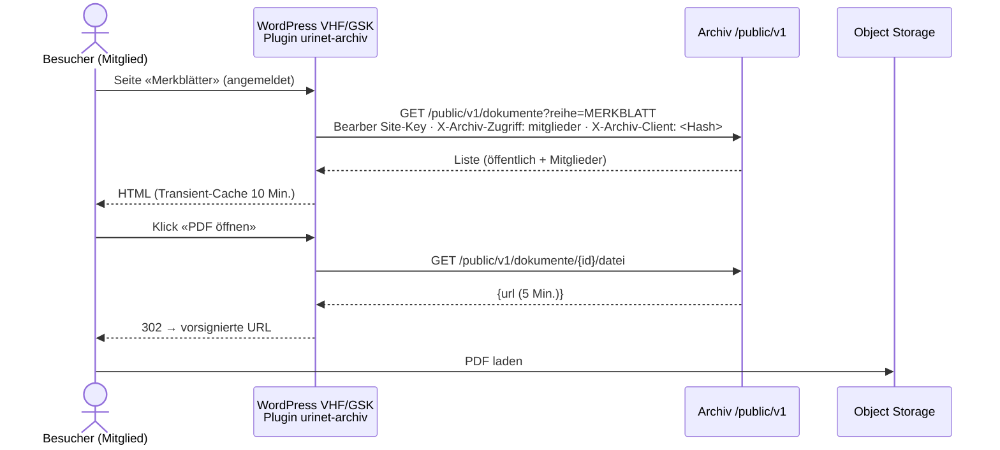

# Design Document — 03 Zweiter Mandant VHF/GSK

## Overview
Kein neuer Dienst: der bestehende Archiv-Dienst erhält einen Mandanten `vhf-gsk`, eine
öffentliche Schnittstelle `/public/v1` und ein WordPress-Plugin. Besucher sprechen nie direkt
mit dem Archiv; das Plugin ruft es serverseitig mit dem Site-Key auf.



## Components and Interfaces

### Mandant und Branding
- Seed `backend/src/main/resources/seed/vhf-gsk/dokumentarten.json` (Bulletin, Merkblatt, Protokoll, Jahresbericht; Gruppe `frei`; `zusatz_schema` mit `reihe`, `ausgabe`, `jahr`, `fachgebiet`, `zugriff`, `veroeffentlicht`; Aufbewahrung unbefristet).
- `mandant.branding` = `{name, logoUrl, primaerfarbe, domain}`; `GET /api/v1/branding?domain=` (öffentlich, nur Darstellung).
- Keycloak: Client `archiv-vhf-gsk` mit Theme `vhf-gsk`; Benutzer der Geschäftsstelle mit Attribut `mandant=vhf-gsk`, Rolle `geschaeftsstelle`.
- KI-Prompt pro Mandant: Dokumentarten-Beschreibung und Fachgebiet-Liste aus dem Seed; Zugriffsstufe nicht Teil des Vorschlags.

### Öffentliche Schnittstelle (`integration/wordpress`)
- `SiteKeyAuthMechanism` (API-Client Scope `wordpress`), Principal mit Mandant und Site-ID.
- Header `X-Archiv-Zugriff: oeffentlich|mitglieder` (vom vertrauenswürdigen WordPress-Server gesetzt, nur mit gültigem Site-Key beachtet), `X-Archiv-Client: <SHA-256(IP + Tages-Salz)>` für Rate-Limit.

| Methode | Pfad | Zweck |
| --- | --- | --- |
| GET | `/public/v1/dokumente?reihe=&jahr=&fachgebiet=&seite=` | Liste veröffentlichter Dokumente |
| GET | `/public/v1/suche?q=&reihe=` | Hybridsuche (nur veröffentlicht, Zugriffsstufe) |
| GET | `/public/v1/dokumente/{id}` | Details (Titel, Reihe, Ausgabe, Jahr, Fachgebiet, Auszug) |
| GET | `/public/v1/dokumente/{id}/datei` | `{url, gueltigBis}` (5 Min.) |
| POST | `/public/v1/chat` | `{frage, gespraechId?}` → SSE wie Spec 02, Werkzeuge eingeschränkt |

- Filter in allen Abfragen: `status='ARCHIVIERT' AND zusatz->>'veroeffentlicht'='true' AND (zusatz->>'zugriff'='oeffentlich' OR :mitglied)`.
- `OeffentlicherChatAgent`: eigener `@RegisterAiService` mit `OeffentlicheWerkzeuge` (`dokumente_suchen`, `dokument_zeigen`), Systemprompt mit Verbandsname, Fachgebieten und Hinweis auf Geschäftsstelle; Gesprächsspeicher 6 Nachrichten.
- Rate-Limit: 20 Fragen/h pro Client-Hash; Token-Budget pro Mandant und Monat aus `mandant_budget(monat, tokens_max, tokens_verbraucht)`.

### WordPress-Plugin `wordpress/urinet-archiv-plugin`
```
urinet-archiv-plugin/
├── urinet-archiv.php            Plugin-Header, Bootstrap
├── includes/
│   ├── class-einstellungen.php  Settings API (URL, Site-Key verschlüsselt in wp_options, Cache-Dauer, Mitglieder-Rolle)
│   ├── class-client.php         wp_remote_get/post an /public/v1, Header, Fehlerbehandlung, Transients
│   ├── class-shortcodes.php     urinet_archiv_liste, urinet_archiv_suche, urinet_chatbot
│   ├── class-rest.php           eigene WP-REST-Route /wp-json/urinet-archiv/v1/chat (Proxy, Nonce)
│   └── class-download.php       /urinet-archiv/datei/{id} → 302 auf vorsignierte URL
├── blocks/                      block.json je Block (Liste, Suche, Chatbot)
├── assets/chatbot.js            schlanker Chat ohne Framework, liest SSE über den WP-Proxy
└── languages/                   de_CH
```
- Zugriffsstufe: `is_user_logged_in() && user_can(…, <Mitglieder-Rolle>)` → `mitglieder`.
- Site-Key in `wp_options` mit `sodium_crypto_secretbox` und Schlüssel aus `wp-config.php` (`URINET_ARCHIV_KEY`).
- Caching: Transient-Schlüssel enthält Shortcode-Parameter und Zugriffsstufe.

### Mandantenverwaltung
- `MandantBericht` monatlich (Auftrag `MANDANT_BERICHT`): Speicher (S3-Listing-Summe), Dokumente, `ki_verbrauch` nach Zweck, Chat-Fragen; E-Mail an Betreiber.
- `MandantVollexport` (Auftrag `MANDANT_EXPORT`): wie Jahresexport, aber alle Jahre, Original + PDF/A, `metadaten.json`, `metadaten.csv`.
- `MandantAbbau` (Kommando `archiv mandant abbauen <code> --nach-export <exportId>`): deaktivieren → nach 30 Tagen Schema droppen, Keycloak-Client löschen, Objekte ohne Sperre löschen, gesperrte auflisten.

## Data Models (neu)
```sql
-- public
mandant_budget(mandant text, monat date, tokens_max int, tokens_verbraucht int, primary key (mandant, monat))
-- m_vhf_gsk (zusätzlich zu Spec 01/02)
alte_url(url text pk, dokument_id uuid fk)
oeffentliche_frage(id bigserial pk, frage text, quellen jsonb, tokens int, zeit timestamptz)  -- 90 Tage
```

## Error Handling
- Öffentliche Fehler ohne Details (`{"meldung":"Im Moment nicht verfügbar"}`); Details nur im Server-Log mit Korrelations-ID.
- Budget erschöpft → HTTP 429 mit `fehlercode=BUDGET`, Plugin zeigt «Der Chatbot ist diesen Monat ausgelastet – die Suche funktioniert weiterhin.»

## Testing Strategy
| Ebene | Schwerpunkt |
| --- | --- |
| Integration Backend | Zugriffsstufen, `veroeffentlicht`, Site-Key eines Mandanten sieht nie den anderen, 404 statt 403, Rate-Limit, Budget |
| Isolation | `MandantenIsolationIT`: urinet-Benutzer, vhf-gsk-Benutzer, Site-Key, Chat – Matrix aller Wege |
| Plugin | PHPUnit mit WP-Test-Suite (wp-env), Mock des Archivs; Playwright gegen wp-env: Liste, Suche, Chatbot, Download, Mitglied vs. Gast |
| Sicherheit | OWASP API Top 10 Prüfliste, ZAP-Baseline gegen Staging |
