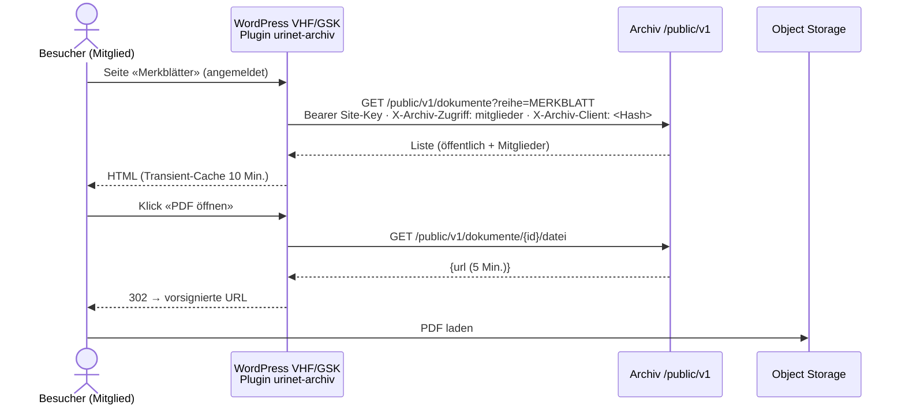

# Design Document — 03 Zweiter Mandant VHF/GSK

## Overview
Kein neuer Dienst: der bestehende Archiv-Dienst erhält einen Mandanten `vhf-gsk`, eine
öffentliche Schnittstelle `/public/v1` und ein WordPress-Plugin. Besucher sprechen nie direkt
mit dem Archiv; das Plugin ruft es serverseitig mit dem Site-Key auf. Neue Teile folgen der
hexagonalen Gliederung aus `structure.md` (`integration/wordpress` mit `domain`, `application`,
`adapter`); Schemaänderungen nur als neue Liquibase-Changesets.



## Components and Interfaces

### Mandant und Branding
- Seed `backend/src/main/resources/seed/vhf-gsk/dokumentarten.json` (Bulletin, Merkblatt, Protokoll, Jahresbericht; Gruppe `frei`; `zusatz_schema` mit `reihe`, `ausgabe`, `jahr`, `fachgebiet`, `zugriff`, `veroeffentlicht`; Aufbewahrung unbefristet; Standard-Vertraulichkeit und `gesetzliche_pflicht` [offen: je Art VHF/GSK – Entscheid vor Welle 10]). Ohne gesetzliche Pflicht keine Object-Lock-Sperre (Spec 01, 6.12).
  Spec 05 ergänzt (Spec 05, Req 1.6, 2.7, 3.1, 5.1; umgesetzt in Spec 05, Aufgabe 17.7, und Aufgabe 10.2): An die Stelle von `dokumentarten.json` tritt `seed/vhf-gsk/konfiguration.json`. Die Reihe ist die Dokumentart, das Zusatzfeld `reihe` entfällt; das Fachgebiet ist die Klassifikation `fachgebiet` (mehrere Werte je Dokument, `oeffentlich_filter`); `ausgabe` und `jahr` bleiben Zusatzfelder mit den Regeln `EINDEUTIG` und `FOLGE`; `zugriff` und `veroeffentlicht` sind reservierte Felder, deren Definition hier fest steht und die die Konfiguration nicht anders definieren darf.
- Stammdaten-Tabelle `vhf-gsk` (Spec 05 ergänzt, Spec 05, Req 6.7): Analog zu Spec 01 design.md, «Stammdaten der Dokumentarten», steht hier die Tabelle der Arten, Klassifikationen und Regeln von `vhf-gsk`, sobald ihre Werte entschieden sind (offener Punkt «je Art VHF/GSK» oben); ab dann vergleicht `KonfigurationSeedTest` den Seed Feld für Feld mit ihr.
- `WISSENSQUELLE` kommt nicht aus diesem Seed, sondern aus dem Seed-Teil `seed/_alle/dokumentarten-wissen.json` (Spec 04, 1.1); für `vhf-gsk` mit `zugriff` (Pflicht, Standard `mitglieder`) und `veroeffentlicht` (Standard `false`). Spec 05 ergänzt (Spec 05, Req 2.6): Diese Ergänzung für `vhf-gsk` kommt aus der Konfiguration von `vhf-gsk`, nicht aus dem mandantenunabhängigen Seed-Teil.
- Provisionierung wie Spec 01 (Changelog `db/mandant`, Bucket im Object-Storage-Projekt des Archivs, App-Schlüssel `s3_app_zugang`, der nie den Bypass-Header setzt, Spec 01, 6.5; Bucket Policy mit Deny auf `s3:BypassGovernanceRetention` wie in Spec 01, design.md «Ablage»); Schema und Bucket werden in Sicherung, Zweitkopie und Restore-Probe aufgenommen (Requirement 1.5).
- `mandant.branding` = `{name, logoUrl, primaerfarbe, domain}`; `GET /api/v1/branding?domain=` (öffentlich, nur Darstellung).
- Domain: [offen: Domain VHF/GSK – Entscheid vor Welle 10]; zusätzlicher Traefik-Router per Labels in `deploy/infomaniak/compose.yml`, Deploy nur über den GitHub-Actions-Workflow.
- Keycloak (`archiv-auth.apps.urinet.ch`): Client `archiv-vhf-gsk` mit Theme `vhf-gsk`; Benutzer der Geschäftsstelle mit Attribut `mandant=vhf-gsk`, Rolle `geschaeftsstelle` (Rechte nach Rechtematrix Spec 01, 2.6; A11 bis A14 offen, bis dahin 403; A19 der Wissensbasis 403, Spec 04, 12.1).
- KI-Prompt pro Mandant: Dokumentarten-Beschreibung und Fachgebiet-Liste aus dem Seed; Zugriffsstufe nicht Teil des Vorschlags. Spec 05 ergänzt (Spec 05, Req 8.1, 8.4, 8.9): Prompt und Antwortschema kommen aus der Konfiguration von `vhf-gsk` (Arten mit `ki_vorschlag = ja`, `ki_felder` `ausgabe` und `jahr`, Klassifikation `fachgebiet` mit KI-Vorschlag); `zugriff` und `veroeffentlicht` schlägt die KI nie vor; Vorschläge erst nach Abnahme und KI-Freigabe (umgesetzt in Spec 05, Aufgabe 18.1).

### Öffentliche Schnittstelle (`integration/wordpress`)
- `SiteKeyAuthMechanism` (API-Client Scope `wordpress`), Principal mit Mandant und Site-ID.
- Header `X-Archiv-Zugriff: oeffentlich|mitglieder` (vom vertrauenswürdigen WordPress-Server gesetzt, nur mit gültigem Site-Key beachtet), `X-Archiv-Client: <SHA-256(IP + Tages-Salz)>` für Rate-Limit.

| Methode | Pfad | Zweck |
| --- | --- | --- |
| GET | `/public/v1/dokumente?reihe=&jahr=&fachgebiet=&seite=` | Liste veröffentlichter Dokumente |
| GET | `/public/v1/suche?q=&reihe=` | Hybridsuche (nur veröffentlicht, Zugriffsstufe) |
| GET | `/public/v1/dokumente/{id}` | Details (Titel, Reihe, Ausgabe, Jahr, Fachgebiet, Auszug) |
| GET | `/public/v1/dokumente/{id}/datei` | `{url, gueltigBis}` (5 Min.) |
| POST | `/public/v1/chat` | `{frage, gespraechId?}` → SSE wie Spec 02, Werkzeuge eingeschränkt |

- Filter in allen Abfragen: `status='ARCHIVIERT' AND vertraulichkeit='NORMAL' AND zusatz->>'veroeffentlicht'='true' AND (zusatz->>'zugriff'='oeffentlich' OR :mitglied)` (Requirement 3.4, 3.6).
- Klassifikationen (Spec 05 ergänzt, Spec 05, Req 8.6; umgesetzt in Aufgaben 11.2 und 11.5): Die Liste filtert zusätzlich nach den Codes der Klassifikationen mit `oeffentlich_filter` (z. B. `?fachgebiet=bad`) und gibt nur diese Klassifikationen aus; der feste Sicherheitsfilter oben bleibt unverändert davor. Feste Parameter, die kein Klassifikations-Code sein dürfen: `q`, `reihe`, `jahr`, `ausgabe`, `seite`, `pro_seite`, `id`, `sortierung`, `gespraech_id`, `zugriff`, `veroeffentlicht`.
- Dateiname (Spec 01 ergänzt, Req 3.13; Review #104): Suche, Details mit Auszug und öffentlicher Chat nutzen die Suche ohne Dateinamen (`mitDateiname=false`) und geben das Feld `dateiname` nicht weiter. Diese Variante prüft über `ts_filter(volltext_tsv, '{a,b,c}')`, was den GIN-Index nicht nutzt; fehlt der Index oder Vorfilter aus Spec 02 (Aufgabe 7.1) noch, legt ihn Aufgabe 11.2 an (Spec 01, design.md, «Umsetzung 4.10»).
- `OeffentlicherChatAgent`: eigener `@RegisterAiService` mit `OeffentlicheWerkzeuge` (`dokumente_suchen`, `dokument_zeigen`), Systemprompt mit Verbandsname, Fachgebieten und Hinweis auf Geschäftsstelle; Gesprächsspeicher 6 Nachrichten.
- Rate-Limit: 20 Fragen/h pro Client-Hash; Token-Budget pro Mandant und Monat aus `mandant_budget(monat, tokens_max, tokens_verbraucht)`. Die Wissensbasis führt ein eigenes Monatsbudget in `m_<code>` und belastet `mandant_budget` nicht, damit ein Ingest den Chatbot nicht sperrt und umgekehrt (Spec 04, 13.6).

### WordPress-Plugin `wordpress/urinet-archiv-plugin`
```
urinet-archiv-plugin/
├── urinet-archiv.php            Plugin-Header, Bootstrap
├── includes/
│   ├── class-einstellungen.php  Settings API (URL, Site-Key verschlüsselt in wp_options, Cache-Dauer, Mitglieder-Rolle)
│   ├── class-client.php         wp_remote_get/post an /public/v1, Header, Fehlerbehandlung, Transients
│   ├── class-shortcodes.php     urinet_archiv_liste, urinet_archiv_suche, urinet_chatbot
│   ├── class-rest.php           eigene WP-REST-Route /wp-json/urinet-archiv/v1/chat (Proxy, Nonce)
│   └── class-download.php       /urinet-archiv/datei/{id} → 302 auf vorsignierte URL
├── blocks/                      block.json je Block (Liste, Suche, Chatbot)
├── assets/chatbot.js            schlanker Chat ohne Framework, liest SSE über den WP-Proxy
└── languages/                   de_CH
```
- Zugriffsstufe: `is_user_logged_in() && user_can(…, <Mitglieder-Rolle>)` → `mitglieder`.
- Site-Key in `wp_options` mit `sodium_crypto_secretbox` und Schlüssel aus `wp-config.php` (`URINET_ARCHIV_KEY`).
- Caching: Transient-Schlüssel enthält Shortcode-Parameter und Zugriffsstufe.

### Mandantenverwaltung
- `MandantBericht` monatlich (Auftrag `MANDANT_BERICHT`): Speicher (S3-Listing-Summe), Dokumente, `ki_verbrauch` nach Zweck, Chat-Fragen; E-Mail an Betreiber.
- `MandantVollexport` (Auftrag `MANDANT_EXPORT`): wie Jahresexport, aber alle Jahre, Original + Arbeitsfassung (falls vorhanden) + PDF/A, `metadaten.json`, `metadaten.csv`. Spec 05 ergänzt (Spec 05 design.md, «Folgeänderungen»; umgesetzt in Aufgabe 12.2): je Dokument die Klassifikationen mit Code und Name und die Konfigurationsversion, dazu die aktuelle Konfigurationsdatei und alle Konfigurationsversionen des Mandanten.
- `MandantAbbau` (Kommando `archiv mandant abbauen <code> --nach-export <exportId>`): deaktivieren → nach 30 Tagen Schema droppen, Keycloak-Client löschen, Objekte ohne Sperre löschen (nie mit Bypass-Header, Spec 01, 6.5; gesperrte Objekte bleiben, Manifeste unter COMPLIANCE bis zum Ablauf ihrer Sperre), gesperrte auflisten; der Bericht nennt das Datum, an dem der letzte Sicherungsstand der Zweitkopie mit Daten des Mandanten ausläuft (Requirement 8.5).

## Data Models (neu)
```sql
-- public (Liquibase-Changelog db/public)
mandant_budget(mandant text, monat date, tokens_max int, tokens_verbraucht int, primary key (mandant, monat))
-- m_vhf_gsk (zusätzlich zu Spec 01/02; Liquibase-Changelog db/mandant)
alte_url(url text pk, dokument_id uuid fk)
oeffentliche_frage(id bigserial pk, frage text, quellen jsonb, tokens int, zeit timestamptz)  -- 90 Tage
```

## Error Handling
- Öffentliche Fehler ohne Details (`{"meldung":"Im Moment nicht verfügbar"}`); Details nur im Server-Log mit Korrelations-ID.
- Budget erschöpft → HTTP 429 mit `fehlercode=BUDGET`, Plugin zeigt «Der Chatbot ist diesen Monat ausgelastet – die Suche funktioniert weiterhin.»

## Testing Strategy
Jedes Kriterium ohne Nachweis-Vermerk hat ein Cucumber-Szenario mit Tag `@req-<x.y>` (tech.md).

| Ebene | Schwerpunkt |
| --- | --- |
| Szenarien Backend (Cucumber) | Zugriffsstufen, `veroeffentlicht`, nie `INTERN`/`PERSONAL` öffentlich, Site-Key eines Mandanten sieht nie den anderen, 404 statt 403, Rate-Limit, Budget, Rechte `geschaeftsstelle` nach Rechtematrix |
| Isolation | `MandantenIsolationIT` (Szenarien `@req-1.4`, `@req-9.1`): urinet-Benutzer, vhf-gsk-Benutzer, Site-Key, Chat – Matrix aller Wege |
| Sicherung | Restore-Probe stellt Schema und Bucket von `vhf-gsk` mit wieder her (Requirement 1.5) |
| Plugin | PHPUnit mit WP-Test-Suite (wp-env), Mock des Archivs; Cucumber.js + Playwright gegen wp-env: Liste, Suche, Chatbot, Download, Mitglied vs. Gast |
| Sicherheit | OWASP API Top 10 Prüfliste, ZAP-Baseline gegen Staging |
