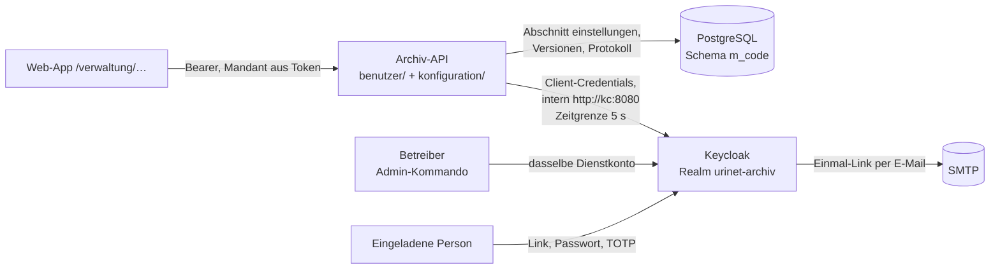

# Design Document — 06 Einstellungen, Benutzer und Berechtigungen verwalten

## Overview
Der Inhaber eines Mandanten pflegt in der Web-App (1) die Einstellungen seines Mandanten, (2) seine Benutzer und (3) deren
Rollen. Dieses Design legt fest, **wo jede Einstellung lebt** (drei Klassen), **wie die Benutzerverwaltung an Keycloak
angebunden ist** (Admin-REST-API mit eigenem, eng geschnittenem Dienstkonto; ADR-015) und **welche Regeln** verhindern, dass
daraus ein Weg für Rechteausweitung, Mandantenüberschreitung oder Kontoübernahme wird. Alles Bestehende bleibt massgebend:
Rollen und Rechtematrix (Spec 01, 2.2 und 2.6), Mandant nur aus dem Token (Regel 1), Protokolle anfügend (Regel 4),
Konfiguration je Mandant mit Versionen (Spec 05), Benutzerverzeichnis (Spec 01, 10.10).

Warum eine neue Spec und nicht eine Erweiterung von Spec 05: Spec 05 regelt die *fachliche Ordnung* eines Mandanten
(Dokumentarten, Klassifikationen, Regeln); Benutzer und Rollen sind Identität und Sicherheit, hängen an Keycloak und an
einem eigenen Bedrohungsmodell und haben keine Konfigurationsversionen. Gemeinsam ist nur die Mechanik der
Einstellungen (Abschnitt `einstellungen` der Konfiguration); die steht in Spec 05 und wird hier nur erweitert, nicht
nachgebaut. Spec 05 erhält dafür Verweise (Folgeänderungen), keinen Umbau.

## Architektur und Entscheid (ADR-015)

Keycloak bleibt Identitätsquelle (Benutzer, Zugangsdaten, TOTP, Rollen, Attribut `mandant`). Das Archiv ruft die
Admin-API nur über den Client `archiv-verwaltung` auf; die Mandantentrennung erzwingt das Archiv, indem es den Mandanten
aus dem Token nimmt und jeden Zielbenutzer vor jeder Aktion auf `mandant` prüft.

### Verglichene Alternativen
| Option | Vorteile | Nachteile | Entscheid |
| --- | --- | --- | --- |
| **A. Admin-REST-API mit eigenem Dienstkonto, Trennung im Archiv** | Keycloak bleibt Quelle (MFA, Passwort-Hashing, Einladung, Ereignisse); kein zweiter Identitätsspeicher; passt zum bestehenden Attribut `mandant`; kein Wegwerf-JVM mehr für Benutzer (spart bis 256 MiB Spitze auf Stufe A) | Das Dienstkonto kann technisch Benutzer **aller** Mandanten ändern; die Trennung hängt am Archiv-Code | **gewählt**, mit Härtung (Blast-Radius unten) |
| B. Keycloak «Organizations» je Mandant | eingebautes Mandantenmodell, Einladungsfluss, Anmeldung je Organisation | Admin-Rechte für Organisationen sind grob (voraussichtlich Realm-Ebene, in Aufgabe 19.1 zu prüfen); der Claim `mandant` (Regel 1) wird durch den Claim `organization` ersetzt, ein Benutzer kann in mehreren Organisationen sein (heute: genau ein Wert); Umbau von Realm, `AnmeldungMandantAdapter`, Tests und Spec 03, 2.3; zusätzliche Tabellen und Caches in Keycloak (400 MiB auf Stufe A) | abgelehnt; erneut prüfen ab drei Mandanten oder mit mandantenspezifischen Identity Providers |
| C. Gruppe je Mandant, Zugriff über feingranulare Admin-Rechte (FGAP v2) | Keycloak erzwingt die Trennung selbst, wenn ein Dienstkonto je Mandant besteht | Zweite Wahrheit neben dem Attribut `mandant` (Gruppe und Attribut können auseinanderlaufen); ein Dienstkonto je Mandant widerspricht Spec 03, 2.3 (keine mandantenspezifischen Clients) und vervielfacht Secrets; FGAP v2 ist komplex im Betrieb | abgelehnt; FGAP v2 nur als Härtung für die Rollenzuweisung (unten) |
| D. Nur Betreiber (heute: `kcadm.sh`) | kein neues Dienstkonto, kein neuer Angriffsweg | Betreiber als Engpass, Passwort im Terminal, kein Protokoll im Archiv, Fehlerrisiko von Hand | bleibt als Notfallweg und für den ersten Inhaber eines Mandanten |
| E. Admin-Konsole von Keycloak öffentlich, Inhaber als delegierter Admin | keine Eigenentwicklung | öffentliche Admin-Oberfläche (Spec 01 schliesst das aus), Inhaber erhält Realm-Rechte, kein Protokoll im Archiv, Mandantentrennung nur über FGAP | abgelehnt |
| F. Benutzerspeicher im Archiv (eigener Identity Provider) | volle Kontrolle | eigene Passwort-, MFA-, Reset-Logik; ADR-001 und Spec 01, 2.1 bleiben bei Keycloak | abgelehnt |

### Blast Radius: die Archiv-API wird kompromittiert
Wer die API übernimmt, hat die Datenbankrolle `archiv_app` (alle Mandanten-Schemas) und die S3-Schlüssel der Anwendung; die
Dokumente sind dann ohnehin lesbar. Das Dienstkonto fügt **neue** Möglichkeiten hinzu, die hier eingegrenzt werden:

| Möglichkeit mit dem Dienstkonto | Eingrenzung | Restrisiko |
| --- | --- | --- |
| Benutzer anlegen, auch mit Rolle `inhaber`, in jedem Mandanten | nur `manage-users`; Alarm bei jeder Vergabe von `inhaber` (6.7); täglicher Abgleich meldet jede Rolle `inhaber` ohne Vorgang im Protokoll (6.5); Keycloak-Admin-Ereignisse als zweite Spur (6.9) | Einbruch bleibt bis zum Alarm unbemerkt (höchstens Minuten bis 24 h) |
| Passwörter setzen, Zugangsdaten zurücksetzen, Benutzer übernehmen | das Archiv ruft `reset-password` nie auf (ArchUnit); technisch erlaubt `manage-users` es dennoch; Ereignisse (Admin-Ereignisse) und Abgleich erfassen Änderungen von Zugangsdaten | wie oben |
| Realm, Clients, Identity Provider, Authentifizierungsflüsse, Redirect-URIs ändern | **nicht möglich**: Dienstkonto ohne `manage-realm`, `manage-clients`, `manage-identity-providers`, `manage-authorization`, `realm-admin`; kein Zugang zum Realm `master` | keines |
| Sich selbst oder anderen Realm-Admin-Rechte geben | Rollenzuweisung (Realm-Rollen) auf die vier Archiv-Rollen begrenzen: Das Archiv sendet nur diese; Härtung mit feingranularen Admin-Rechten (FGAP v2, Recht `map-roles` nur auf diese vier Rollen), in Aufgabe 19.1 gegen Keycloak 26.8.2 zu prüfen (Ergebnis: FGAP begrenzt die Zuweisung nicht, solange `manage-users` gehalten wird, siehe «Umsetzung 19.1» und Open Points) | ohne FGAP v2: Archiv-Code ist die einzige Sperre, und das gilt derzeit auch mit FGAP v2 |
| Benutzer massenhaft löschen oder sperren (Verfügbarkeit) | Raten, Höchstzahl, Alarm (6.6, 6.7); Notfallweg Betreiber; Sicherung enthält die Keycloak-Datenbank (Spec 01, Plattform und Betrieb) | Wiederherstellung aus der Sicherung nötig |
| Geheimnis des Dienstkontos entwenden | nur Datei `/run/secrets/keycloak_verwaltung_secret`, kein Umgebungswert, nie im Log; Rotation über den definierten Weg (19.3, 21.5); Admin-API nur im internen Netz erreichbar, nicht öffentlich | wer den Container übernimmt, hat das Geheimnis |

Fazit: Der Zugewinn eines Angreifers ist begrenzt auf Persistenz und Sperren im Realm der Archiv-Benutzer. Der Betreiber
behält den Keycloak-Admin (Realm `master`, nur intern) als Notfallweg. Eine Härtung durch Signatur statt Secret
(`private_key_jwt`) bleibt eine spätere Option, solange die Secret-Datei-Konvention gilt.

### Speicherbedarf auf Stufe A
Keycloak läuft dort mit `mem_limit` 400 MiB und `-Xmx96m`. Option A belastet es nur durch einzelne Admin-Aufrufe
(Seiten von höchstens 50 Benutzern, höchstens 2 gleichzeitig). Die Anbindung im API-Container nutzt den JDK-HTTP-Client
und Jackson ohne Keycloak-Bibliothek (Heap-Zuwachs höchstens 4 MiB, Requirement 5.10). Die Wegwerf-Container mit
`kcadm.sh` (256 MiB) entfallen für Benutzer; das senkt die Spitze der VPS. Option B bräuchte zusätzliche Caches und
Tabellen in Keycloak, Option C je Mandant ein Dienstkonto samt Token-Caches; beides ohne Nutzen für zwei Mandanten.

## Inventar der Einstellungen
Stand: `application.properties` (Präfixe `archiv.*`), Umgebung und Compose, Konfiguration je Mandant (Spec 05),
`wissens_einstellung` (Spec 04), `public.mandant` und `public.mandant_budget` (Spec 01 und 03). Klassen: **(a)** im
Betrieb in der App änderbar, je Mandant, mit Versionen, Prüfung und Protokoll; **(b)** nur über Deployment oder
Konfigurationsdatei; **(c)** Geheimnis. `EinstellungsInventarTest` (Requirement 1.1) prüft die Präfixe dieser Tabelle gegen
`application.properties`. Einzelne Schlüssel in Klasse (a) gehen einem allgemeineren Präfix in Klasse (b) vor.

### Klasse (a): in der App änderbar (Einstellungskatalog)
| Einstellung | Heute | Grenzen und Standard | riskant | Recht | Begründung der Klasse |
| --- | --- | --- | --- | --- | --- |
| `geschaeftsjahrEnde` | `public.mandant`, Spec 05 | gültiges Datum `MM-TT`, Standard `12-31` | ja | A20 | betrifft nur den Mandanten; wirkt auf Fristen künftiger Bestätigungen, nicht auf Sperren (Regel 2); schon Teil der Konfiguration (Spec 05, 1.1) |
| `kennungen.uid`, `kennungen.ibans` | `public.mandant`, Spec 05 | UID im Format der UID-Nummer, höchstens 20 IBAN, Standard leer | nein | A20 | prägt den KI-Prompt über Hinweise; Personenbezug minimal; im Protokoll nur «geändert» (Spec 05, 1.3) |
| `branding.name` | `archiv.branding.mandanten.<code>.name` | 1 bis 60 Zeichen, ohne Steuerzeichen und Markup, Standard der Instanz | nein | A20 | nur Darstellung; **nicht** `public.mandant.name` (geht in den Prompt, an Gate 0 gebunden, bleibt (b)) |
| `branding.primaerfarbe` | `archiv.branding.mandanten.<code>.primaerfarbe` | `#rrggbb`, Kontrast zu `#05070c` mindestens 4.5:1, Standard `#eeb111` | nein | A20 | nur Darstellung; die bestehende Branding-Prüfung (`BrandingPruefung`) bleibt |
| `chat.aufbewahrungMonate` | `archiv.chat.aufbewahrung` (`P12M`, alle Mandanten) | ganze Zahl 1 bis 60, Standard 12 | ja, wenn kürzer | A20 | Datenschutz je Mandant (Fragen im internen Chat); eigene Daten des Mandanten |
| `webseitenChat.aufbewahrungTage` | `archiv.mandant.<code>.chat-aufbewahrung-tage`, Standard `archiv.webseite.chat.aufbewahrung-tage` | ganze Zahl 1 bis 365, Standard 90 (`vhf-gsk` 30, Spec 03, 6.5) | ja, wenn kürzer | A20 | Datenschutz je Mandant; Grenzen schon in Spec 03 |
| `wissen.budgetTokens` | `wissens_einstellung`, `archiv.wissen.budget-tokens` | 10'000 bis 5'000'000, Standard 600'000 | nein | A19 | Budget je Ingest des Mandanten; Obergrenze schützt die Kosten |
| `wissen.lintBudgetTokens` | `wissens_einstellung`, `archiv.wissen.lint-budget-tokens` | 10'000 bis 1'000'000, Standard 100'000 | nein | A19 | wie oben |
| `wissen.monatsbudgetTokens` | `wissens_einstellung`, `archiv.wissen.monatsbudget-tokens` | 100'000 bis 20'000'000, Standard 1'000'000 | ja, wenn über dem Doppelten des Standards | A19 | Kosten des Betreibers; Erhöhung braucht Bestätigung |
| `wissen.lintZeitplan` | `wissens_einstellung`, `archiv.wissen.lint-zeitplan` | Wochentag und Stunde (0 bis 23), Standard Sonntag 04:00 (Europe/Zurich) | nein | A19 | Zeitpunkt, keine Last-Grenze; freier Cron-Text bleibt (b), damit kein Mandant die Instanz mit Aufträgen belegt |
| Dokumentarten, Klassifikationen, Regeln, KI-Texte | Spec 05 | wie Spec 05 | wie Spec 05 | A11 | schon eigene Mechanik in Spec 05; die Seite verweist nur dorthin |

### Klasse (b): nur über Deployment oder Konfiguration
| Einstellung (Präfix) | Wo | Begründung |
| --- | --- | --- |
| `archiv.rolle`, `archiv.stufe`, `archiv.db.*`, `archiv.secrets.*`, `quarkus.*` | `application.properties`, Compose | bestimmen die Laufart und den Start; ein Fehler legt die Instanz still |
| JVM-Optionen, `mem_limit`, `cpus`, Traefik-Labels und Raten je Quelladresse, Netze | Compose, Infra-Repo | Speicherbudget der Stufen A und B; gilt für alle Mandanten gemeinsam |
| `archiv.ablage.*` (Bucket-Präfix, Sperrmodus, URL-Gültigkeit, Stub) | Konfiguration | Unveränderbarkeit nach GeBüV (ADR-007); darf kein Mandant lockern |
| `archiv.ki.*` (Basis-URL, Produkt-ID, Modelle, Reranker, Chat-Runden, Temperatur, Zeitgrenzen, Stubs) | Konfiguration | Datenstandort (Regel 6), Gate 0 und Golden-Lauf (Modellwechsel braucht neuen Lauf), Kosten |
| `archiv.tsa.*`, `archiv.manifest.*`, `archiv.prueflauf.*` | Konfiguration | Nachweis nach GeBüV, gemeinsame Dienste |
| `archiv.worker.*`, `archiv.auftrag.*` (Zeitgrenzen), `archiv.ocr.*`, `archiv.arbeit.*`, `archiv.upload.*`, `archiv.import.*`, `archiv.http.*`, `archiv.suche.*`, `archiv.export.*`, `archiv.abgleich.*`, `archiv.dokumentart.*` (Zeitgrenzen) | Konfiguration | Ressourcen und Schutz der Instanz (Speicherbudget, Zeitgrenzen); wirken auf alle Mandanten |
| `archiv.api-token.*`, `archiv.webseite.*` (Grenzen je Schlüssel, Streams, Absender-Datei, Rotation) und `archiv.webseite.chat.*` (Raten, Gespräche, Fenster) | Konfiguration und Betriebsdatei | Schutz vor Überlast und Missbrauch; ein Mandant darf seine eigene Grenze nicht anheben; Webseiten-Schlüssel legt und rotiert der Betreiber (Spec 03, 12.3) |
| `archiv.chat.*` (Raten je Benutzer, Gleichzeitigkeit, Aufräumzeit) | Konfiguration | Schutz der Instanz |
| `archiv.mail.*` (Postfach, Intervall, Ordner, Grössen) | Konfiguration | ein Postfach und ein Abrufer je Instanz (Spec 02) |
| `archiv.ueberwachung.*`, `archiv.oidc.waechter.*`, `archiv.kennzahlen.*`, `archiv.mandant.bericht.*` | Konfiguration | Betrieb und Alarmschwellen der Instanz |
| `archiv.adresse`, `archiv.integration.*` | Konfiguration | Instanzweite Adresse und Integrationsadapter; keine Mandanten-Einstellung |
| `archiv.wissen.*` | Konfiguration | Instanzweite Modelle und technische Grenzen; die oben einzeln genannten Startwerte der Klasse (a) sind ausgenommen |
| `archiv.benachrichtigung.empfaenger.<code>` | Umgebung `ARCHIV_ALARM_EMPFAENGER_<CODE>` | E-Mail-Adressen sind Personendaten und gehören nicht in unveränderliche Konfigurationsversionen; Umleiten der Alarme wäre ein Missbrauchsweg (Entscheid Fabian offen, Open Points) |
| `archiv.branding.mandanten.<code>.domain`, `…logo-url` | Konfiguration, Traefik | Domain ist DNS und Router; eine fremde Logo-URL wäre ein Tracking- und Phishing-Weg |
| `archiv.mandant.<code>.fristen.*`, `archiv.mandant.<code>.kennzahl.*`, `archiv.mandant.<code>.chat-hinweis` | Konfiguration | fachliche Werte und Hinweise; nicht Bestandteil des Einstellungskatalogs dieser Spec |
| `archiv.provisionierung.mandanten.<code>.verwaltungs-rollen` | Konfiguration | Rollensatz für einen neu angelegten Mandanten; wird vor der Provisionierung validiert und nicht über die Oberfläche geändert |
| `public.mandant.name`, `public.mandant.verwaltung_rollen`, `public.mandant_budget` (Monatsbudget öffentlicher Chat) | Datenbank, Admin-Kommando | Name geht in den Prompt (Gate 0); Rollensatz und Kostenhoheit gehören dem Betreiber; die Oberfläche zeigt Budget und Verbrauch nur lesend |
| `ki_freigegeben` | Admin-Kommando (Spec 05, 8.4) | gebunden an die Abnahme; nie über die Oberfläche |
| Rollen und Rechtematrix | Code (`Rechtematrix`) | Quelle der Wahrheit; Änderung ist ein Release mit Test |
| Realm-Konfiguration von Keycloak (Flows, TOTP, Passwort-Richtlinie, Clients, SMTP) | Realm-Export, `kcadm.sh` | Sicherheit des Zugangs; nur Betreiber |
| `archiv.verwaltung.*` (Zeitgrenzen, Raten, Gültigkeiten, Höchstzahl) | Konfiguration | Schutz vor Missbrauch der Verwaltung selbst (Tabelle unten) |

### Klasse (c): Geheimnisse (nie in der Oberfläche)
| Geheimnis | Datei unter `/run/secrets/` | Rotation |
| --- | --- | --- |
| Datenbank (`archiv_db_*`, `keycloak_db`), Keycloak-Admin (`keycloak_admin`) | siehe Spec 01 | GitHub-Secret, Deploy; Notfallunterlagen |
| S3-App-Schlüssel (`s3_app_zugang_*`) | Spec 01 | neuer Schlüssel im Projekt, GitHub-Secret, Deploy |
| KI-Token (`infomaniak_ai_token`), Zeitstempel (`tsa_zugang`) | Spec 01 | wie oben |
| Manifest-Schlüssel (`archiv_manifest_key`), Datenschlüssel (`archiv_data_key`) | Spec 01 | nur mit Plan (Schlüsselwechsel des Manifests, Neuverschlüsselung) |
| Postfach (`archiv_smtp_passwort`), SMTP von Keycloak (`keycloak_smtp_passwort`, neu) | Spec 01, diese Spec | Passwort im Postfach ändern, GitHub-Secret, Deploy |
| Google (`google_client_secret`) | Spec 01, O.8 | wie oben |
| **Dienstkonto (`keycloak_verwaltung_secret`, neu)** | diese Spec | Keycloak erzeugt ein neues Client-Secret (`kcadm.sh` im Wegwerf-Container), GitHub-Secret `KEYCLOAK_VERWALTUNG_SECRET`, Deploy; danach altes ungültig; Ablauf in `docs/` (Aufgabe 21.5); Keycloak kann zwei Secrets mit Überlappung führen (Secret-Rotation, in 19.1 prüfen) |
| API-Tokens, Webseiten-Schlüssel | nur Hash in der Datenbank (Spec 01, 2.5) | widerrufen und neu ausstellen (A14, Betreiber-Kommando) |
Die Oberfläche zeigt für kein Geheimnis einen Status; das Fehlen meldet nur die Startprüfung.

## Components and Interfaces
```
backend/src/main/java/ch/urinet/archiv/
  benutzer/                      (neu, hexagonal)
    domain/      Benutzer, Benutzerstatus, Vorgang, Antrag
    application/ BenutzerVerwaltung (Use Cases), Abgleich, StepUp, VerwaltungGrenzen
    adapter/in/rest/   BenutzerResource, RollenResource, AntragResource
    adapter/in/kommando/ InhaberEinladen, BenutzerAbgleichen   (Admin-Kommando, Spec 01, 1.3)
    adapter/out/keycloak/ KeycloakAdminAdapter (Port IdentitaetsDienst)
    adapter/out/persistence/ JdbcBenutzerStatus, JdbcVerwaltungAntrag, JdbcVorgangsSperre, JdbcTokenWiderruf
  konfiguration/                 (Spec 05, hier erweitert)
    domain/      Einstellungskatalog, Einstellung (Typ, Grenzen, Standard, Risiko, Recht), Auswirkung
    application/ EinstellungenVerwaltung (lesen, vorschau, aendern, zuruecksetzen)
    adapter/in/rest/ MandantEinstellungenResource (erweitert)
  sicherheit/                    (Spec 01, hier erweitert)
    domain/Rechtematrix, Aktion (A20–A23), RechteUebersicht, Vergaberegeln
    adapter/in/rest/ ZugangFilter (+ Token-Widerruf, Step-up), SicherheitsHeader
```
- `Vergaberegeln` bleibt bei `sicherheit.domain`, weil es die vorhandene Rolle und Rechtematrix direkt nutzt; so entsteht
  weder eine Abhängigkeit von `benutzer.domain` nach `sicherheit.domain` noch eine zweite Rangfolgen-Implementierung.
- **Port `IdentitaetsDienst`** (`benutzer/application`, driven): `benutzerSuchen(mandant, q, seite)`, `benutzerLesen(id)`,
  `anlegen(Benutzer, rolle)`, `aktualisieren(id, Aenderung)`, `rolleSetzen(id, rolle)`, `aktivieren(id, boolean)`,
  `einladen(id, aktionen, gueltigkeit)`, `sitzungenBeenden(id)`, `otpEntfernen(id)`, `sperreAufheben(id)`,
  `googleLoesen(id)`, `loeschen(id)`, `inhaberZaehlen(mandant)`. Ein Dev-Stub (Speicher) für Tests ohne Keycloak; der
  Adapter hat eine **Positivliste** der Aufrufe (Pfad und Methode); `KeycloakAdminPositivlisteTest` bricht ab bei jedem
  anderen Pfad, insbesondere `reset-password`, `impersonation`, `/clients`, `/identity-provider`, `/authentication`,
  `/components`, `/partial-import`, Rollen-Definitionen und `client-secret`.
- **Aufrufe an Keycloak** (Realm `urinet-archiv`): `POST /protocol/openid-connect/token` (Client-Credentials, Token bis
  30 Sekunden vor Ablauf wiederverwendet, ein Abruf gleichzeitig); `GET /admin/realms/…/users?q=mandant:<m>&max=50`,
  `GET/POST/PUT/DELETE …/users[/{id}]`, `GET/POST/DELETE …/users/{id}/role-mappings/realm`, `GET …/roles/{rolle}/users?briefRepresentation=false` (ohne den Parameter fehlen `attributes`; fehlt das Feld trotzdem, wird der Benutzer einzeln gelesen),
  `PUT …/users/{id}/execute-actions-email?lifespan=&client_id=&redirect_uri=`, `POST …/users/{id}/logout`,
  `GET/DELETE …/users/{id}/credentials[/{credId}]` (nur Typ `otp`), `GET …/users/{id}/federated-identity` (Liste, Filter auf `identityProvider = google`; unter `…/federated-identity/google` kennt Keycloak nur POST und DELETE), `DELETE …/users/{id}/federated-identity/google`,
  `GET/DELETE …/attack-detection/brute-force/users/{id}` (GET für die Anzeige und die Prüfung vor dem Entsperren;
  aus der Antwort wird nur `disabled` verwendet, keine IP protokolliert). Interne Adresse und Aussteller des Tokens sind in Aufgabe 19.1 zu
  prüfen (`KC_HOSTNAME` zeigt auf die öffentliche Adresse; für den internen Weg nötigenfalls
  `KC_HOSTNAME_BACKCHANNEL_DYNAMIC`).
- **Zeitgrenzen** (`archiv.verwaltung.keycloak.*`, Klasse (b)): Verbindung 2 s, Anfrage 5 s; zwei gleichzeitige Aufrufe
  (`Semaphore`, Wartezeit 200 ms, sonst 503 `UEBERLASTET`); Schreibaufrufe nie wiederholt; Leseaufrufe höchstens einmal nach
  200 ms; Schutzschalter nach 3 Fehlern in Folge innerhalb 30 s für 30 s (ohne Bibliothek, ein Zähler und ein Zeitstempel).
  Keine Ausnahme der Keycloak-Meldungen in Antworten oder Logs (Requirement 5.6).
  Nachbesserung Review PR 348: Für den Schutzschalter zählen nur Transportfehler, Zeitüberschreitungen, 5xx und 401/403 des
  Dienstkontos; andere 4xx (400, 404, 405) zählen nicht. 409 wird als `IdentitaetsDienst.KonfliktException` weitergereicht;
  der Anlagevorgang bildet ihn nach geklärtem Fehlerabschluss neutral auf `BENUTZER_EXISTIERT` ab. Bei 401 wird der gecachte Token verworfen, ein lesender Aufruf wird genau
  einmal mit neuem Token wiederholt. Die Kompensation in `anlegen()` umgeht den Schutzschalter (Wartezeit 2 s auf einen
  Platz); bei einem Fehler nach der Anlage meldet der Adapter die Zielkennung und ob die Entfernung bestätigt wurde in
  `AnlageException`; scheitert die Kompensation, hängt er ihren Fehler als Suppressed an diese Ausnahme.
  `VerwaltungVorgang` übernimmt die gültige Zielkennung in den Fehlerabschluss; eine nicht bestätigte Entfernung oder
  ungültige Kennung bleibt `UNKLAR`, auch wenn der Aufrufer die Kompensation als geklärt meldet. Eine bestätigte
  Entfernung allein beweist noch nicht, dass keine verspätete externe Wirkung eintrifft.
  `benutzerZaehlen` zählt alle nicht gelöschten Benutzer des Mandanten, auch deaktivierte, und prüft das
  Mandantenattribut nach jeder Keycloak-Antwort; bei fehlenden Attributen liest es die Einzelangabe nach.
  `rolleSetzen` holt die Zielrolle zuerst,
  fügt sie hinzu und entfernt erst danach die übrigen Archiv-Rollen. `verbindungPruefen` erzwingt einen echten Tokenabruf.
  Pfadwerte `.` und `..` (und `%2e`) werden abgelehnt. Offen (Kann): `aktualisieren`/`aktivieren` lesen und schreiben die
  volle Darstellung (Lost Update); die Vorgangssperre (19.6) serialisiert die Aufrufer.
- **Detail-Health:** Prüfung `identitaetsdienst` (Token holbar, Dienstkonto gültig); sie beeinflusst die Readiness der API
  nicht (Requirement 5.8).

### Vorgänge und Protokoll (Absicht und Abschluss)
Ein Vorgang mit Wirkung in Keycloak lässt sich nicht in der Datenbank-Transaktion zurückrollen. Darum:
1. Prüfungen in Reihenfolge: Anmeldung, Recht (A20 bis A23), Step-up, `If-Match`, Rate (aus dem Protokoll gezählt),
   Formregeln, Ziel im Mandanten (404), Eskalationsschutz (403), Statusautomat und letzter Inhaber (409).
2. Vorgangssperre des Mandanten holen (`public.verwaltung_vorgang`, ein Eintrag je Mandant, Ablauf nach 15 s); belegt:
   409 `STATUS_KONFLIKT`.
3. Transaktion 1: Protokolleintrag `phase=ANGEFRAGT` (mit `vorgangId`); Commit. Scheitert er: 500, Keycloak wird nicht
   aufgerufen (Spec 01, 10.8).
4. Aufrufe an Keycloak (mit Zeitgrenze); bei Fehler Kompensation (z. B. neu angelegten Benutzer entfernen).
5. Transaktion 2: Protokolleintrag `phase=ABGESCHLOSSEN` oder `FEHLGESCHLAGEN` (bzw. `UNKLAR`, wenn die Kompensation
   scheitert, ungewiss ist oder fehlt; `FEHLGESCHLAGEN` und `UNKLAR` tragen das `ziel` aus dem Ergebnis der Arbeit, bei
   der Anlage also den neuen Keycloak-`sub`), Benutzerverzeichnis (`ANLAGE`, `AUSTRITT`), `benutzer_status`, Antrag, Token-Widerruf.
   Die Kompensation meldet `GEKLAERT` nur, wenn der Ausgangszustand wiederhergestellt ist und keine verspätete externe
   Wirkung mehr eintreffen kann. Nur dann wird `FEHLGESCHLAGEN` mit Freigabe der Sperre transaktional geschrieben;
   bei Ungewissheit, Fehler oder Fristablauf bleibt der Vorgang `UNKLAR` gesperrt.
6. Die Sperre nach eindeutigem Abschluss freigeben; eine vor externer Wirkung vorbereitete Sperre läuft nach 15 s ab.
   Entscheid Fabian 21.11.2026: Ein ungeklärter Vorgang (`UNKLAR`) hält die Sperre bis zum Abgleich (19.13) oder bis
   ein Admin ihn klärt; bei `UNKLAR` wird alarmiert. Das weicht von der pauschalen 15-Sekunden-Grenze in Req 4.7 ab.
   Auch ein `ANGEFRAGT` ohne Abschluss bleibt gesperrt: Eine verspätete externe Wirkung kann noch eintreffen.
   Trifft ein erfolgreicher Abschluss nach Ablauf der Frist ein, wird er nicht als eindeutig abgeschlossen
   übernommen; die Datenbanktransaktion wird zurückgerollt und der Vorgang als ungeklärt behandelt.
   Die bestehende Überwachung meldet `UNKLAR` und abgelaufene `ANGEFRAGT`-Vorgänge je Mandant mit der Vorgangs-ID;
   bei gescheitertem Mailversand versucht sie es beim nächsten Takt erneut.
Der Abgleich (täglich, beim Start des Workers) findet Einträge `ANGEFRAGT` ohne Abschluss nach 5 Minuten, liest den
Zustand in Keycloak und schreibt den Abschluss `UNKLAR` mit Alarm; er ändert nie etwas in Keycloak.

Für den Protokollgrund sind ausschliesslich die festen Kategorien `SICHERHEIT`, `AUSTRITT`, `RECHTEAENDERUNG`,
`KORREKTUR` und `SONSTIGES` zulässig. So können Namen, E-Mail-Adressen und Geheimnisse nicht durch Freitext ins
append-only Protokoll gelangen. Die Kategorie muss beim Vorgang explizit gewählt werden; Freitext wird nicht
automatisch umgedeutet. Die Anbindung der Eingaben und Pflichtprüfung folgt mit den Verwaltungsendpunkten.

Bei der Anlage eines weiteren Inhabers mit mindestens zwei aktiven Inhabern entsteht zunächst ein Konto ohne
Archiv-Rolle und ein offener Antrag; die Bestätigung und Rollenvergabe folgen in 19.11. Auch dieses Konto kann seine
Einladung erneut erhalten, solange es im Status `EINGELADEN` ist. Bis 19.10 verweigert die Step-up-Schnittstelle
geschützte Aktionen; Tests ersetzen sie ausdrücklich. Eine bestätigte Entfernung nach einer unklaren Keycloak-Wirkung
genügt nicht für `GEKLAERT`; HTTP 202 gilt nicht als bestätigter Abschluss.
Bei einer E-Mail-Änderung werden für die Bestätigung an die neue und die Mitteilung an die bisherige Adresse zwei der
drei Mailplätze je Ziel reserviert. Auch angefragte Änderungen mit unklarem Ausgang zählen vorsorglich.
Eine reine Namensänderung trägt den technischen Vorgang `NAME_AENDERN`; bei einer gemeinsamen Änderung mit E-Mail
steht `EMAIL_AENDERN`. Das Protokoll nennt ausschliesslich die betroffenen Felder, nie deren Werte.

### Statusautomat
| Von \ Aktion | einladen | sperren | entsperren | deaktivieren | reaktivieren | löschen | Zugang zurücksetzen |
| --- | --- | --- | --- | --- | --- | --- | --- |
| `EINGELADEN` | erneut senden | ja | – | ja | – | – | ja |
| `AKTIV` | – | ja | – | ja | – | – | ja |
| `GESPERRT` | – | – | ja | ja | – | – | – |
| `DEAKTIVIERT` | – | – | – | – | ja (wird `EINGELADEN`) | ja, nach Frist | – |
`AKTIV` entsteht nur, wenn der Benutzer den Ablauf der Einladung beendet hat (Keycloak: keine erforderlichen Aktionen mehr
offen). Der Status ergibt sich aus Keycloak (`enabled`, erforderliche Aktionen, Zugangsdaten) und `benutzer_status`
(Art der Sperre, Grund, seit). Eine Sperre durch fehlgeschlagene Anmeldungen (Keycloak, 5 Fehlversuche) zeigt die
Verwaltung als «vorübergehend gesperrt»; «Entsperren» hebt sie auf (3.8).

### Token-Widerruf
`public.token_widerruf(benutzer, ab)`: Das Archiv setzt `ab` = jetzt nach der Wirkung in Keycloak (Requirement 4.9).
`ZugangFilter` lehnt nach der Rollenprüfung jedes Access-Token einer Benutzeranmeldung mit `iat` < `ab` mit 401
`NICHT_ANGEMELDET` ab; die Abfrage ist ein Primärschlüssel-Zugriff mit Zwischenspeicher von höchstens
`archiv.verwaltung.widerruf-cache` (Standard 3 s, höchstens 5 s). Zeilen älter als 1 Tag räumt der Worker ab (die
Lebensdauer des Access-Tokens beträgt 5 Minuten, Realm). Das Archiv liest `iat` aus dem JWT; API-Tokens sind nicht betroffen.

### Step-up (Requirement 7.2)
Erforderlich für: Benutzer anlegen, Rolle ändern, entsperren, reaktivieren, Zugang zurücksetzen, E-Mail ändern,
Google-Verknüpfung lösen, löschen, Antrag bestätigen (Vier-Augen), Änderung riskanter Einstellungen (mit Bestätigung) und das
Einspielen einer Konfigurationsdatei mit riskanten Änderungen. **Nicht** erforderlich (nur schützende oder umkehrbare
Richtung): Lesen, sperren, deaktivieren, Einladung erneut senden. `StepUp` liest den Claim `auth_time` des Access-Tokens
(Protokoll-Mapper im Client `archiv-pwa`, in 19.1 zu prüfen). Ist die Anmeldung älter als
`archiv.verwaltung.step-up-gueltigkeit` (Standard `PT5M`, höchstens `PT15M`) oder fehlt der Claim, antwortet das Archiv mit
401 `STEP_UP_NOETIG` und `WWW-Authenticate: Bearer error="insufficient_user_authentication", error_description="…", max_age="300"`
(Muster RFC 9470). Die App leitet mit `max_age=0` und `prompt=login` zu Keycloak; der Browser-Flow
`browser-totp-pflicht` verlangt dann Passwort und TOTP (der Cookie-Zweig greift bei `prompt=login` nicht; Nachweis im
Test gegen echtes Keycloak).
`StepUpMitAuthTime` prüft den Claim des Benutzer-JWTs; fehlende, ungültige, zukünftige oder zu alte Werte verlangen die
erneute Anmeldung. Die Gültigkeit muss in ganzen Sekunden positiv und höchstens 15 Minuten sein. `StepUpAusstehend`
bleibt als einfacher Testadapter verfügbar; der produktive `StepUpMitAuthTime` ist der `@DefaultBean`.

#### Umsetzung (Aufgabe 19.10, 22.11.2026)
- `StepUpMitAuthTime` liest `auth_time` aus dem JWT in der aktuellen `SecurityIdentity` und verwendet standardmässig
  `PT5M`; die Startkonfiguration lehnt Null, Teilsekunden und Werte über `PT15M` ab. `StepUpNoetig` liefert die bestehende
  RFC-9470-Antwort mit der konfigurierten `max_age`. Nicht-JWT-Zugänge werden mit `NICHT_ERLAUBT` abgewiesen.
- Der echte Keycloak-Test prüft einen abgelaufenen Token (401 samt `max_age`), einen alleinigen SSO-Cookie (weiterhin
  401) und `prompt=login`: der Browser verlangt Passwort und TOTP, danach erreicht der frische Token die Eingabeprüfung.
  Cucumber weist Mitarbeiter, API-Tokens und Webseiten-Schlüssel für die Benutzerverwaltung ab (Req 7.3, 7.9).
- Entscheid Fabian 22.11.2026 (#453): Für Req 7.2 genügt das erneuerte `auth_time` nach `prompt=login&max_age=0`;
  ein `amr`-Nachweis wird nicht verlangt.

### Passkey (Requirement 10)
Entscheid Fabian 21.11.2026: zusätzlicher Anmeldeweg, ersetzt Passwort und TOTP; Passwort plus TOTP bleibt; Admin setzt zurück;
Step-up per Passkey; Google unverändert. Der Browser-Flow des Realms bietet zusätzlich die Anmeldung mit Passkey (WebAuthn
passwordless, auffindbarer Schlüssel, Benutzerverifikation «required», Attestation «none», Unterstützung der Anmeldung per
Vorschlag im Feld Benutzername) und fällt auf `browser-totp-pflicht` (Passwort plus TOTP) zurück. Der unten dokumentierte
Spike prüft die verfügbaren Token-Claims; der Nachweis für die Anmeldeart beim Step-up bleibt offen. Die Einrichtung geschieht in
der Kontoverwaltung von Keycloak (Theme 20.8: deutsche Texte); das Archiv bekommt dafür keine eigene Oberfläche, nur Anzeige
(«Passkey eingerichtet», Anzahl) und die Admin-Aktion «Passkeys zurücksetzen» als Teil von «Zugang zurücksetzen» (REST,
Step-up, Protokoll ohne Gerätedaten). Der Adapter liest die Zahl über die Admin-API (Credentials des Benutzers, Typ
`webauthn-passwordless`) und löscht sie auf Anforderung; er gibt keine Schlüsselkennungen weiter. Die Relying-Party-ID ist die
Domain der App und eine Betriebsangabe (Platzhalter im Export). Tests: virtueller Authenticator gegen ein Wegwerf-Keycloak
(Einrichten, Anmelden, Step-up, Entfernen, Zurücksetzen); echte Geräte bei der Inbetriebnahme (Fabian).
Der End-zu-End-Nachweis des Step-up im Archiv-Backend folgt nach Aufgabe 19.10; Aufgabe 24.1 prüft die Token-Ebene.

#### Umsetzung (Aufgabe 24.1, 21.11.2026)
- Keycloak 26.8.2 bietet Passkeys im bestehenden `auth-username-password-form` mit bedingter UI an. Der anschliessende
  bedingte OTP-Teilfluss verlangt TOTP, wenn `webauthn-passwordless` nicht tatsächlich verwendet wurde. Passwort bleibt
  auch mit vorhandenem Passkey an TOTP gebunden; Direct Grant und Google-Flows bleiben unverändert. Ein synthetischer
  Spike prüfte Passwort und TOTP, Direct Grant mit und ohne TOTP sowie die Passkey-Anmeldung.
- Die Kontoverwaltung richtet einen auffindbaren Passkey über `webauthn-register-passwordless` ein und entfernt ihn über
  `delete_credential`; die Benutzerverifikation ist verpflichtend, Attestation `none`. Die Konto-Scope-Zuordnung
  ermöglicht die erforderlichen Kontofunktionen. Der Spike prüfte Einrichtung und Entfernung.
- Ein Access-Token nach Passkey-Anmeldung enthält `auth_time`, `acr=1`, aber keinen `amr`-Claim. Bei
  `prompt=login&max_age=0` wurde `auth_time` erneuert. `acr=1` identifiziert die Anmeldeart nicht; gemäss Entscheid
  Fabian 22.11.2026 (#453) genügt das erneuerte `auth_time` für Requirement 7.2, ein `amr`-Nachweis ist nicht verlangt.
- Die RP-ID wird aus der konfigurierten App-Basisadresse abgeleitet. Weil die Keycloak-Origin eine andere Origin ist,
  liefert die App `/.well-known/webauthn` mit der konfigurierten Keycloak-Origin; die Betriebsanleitung steht in
  `docs/passkey-related-origins.md`. Ein synthetischer Chromium-Spike bestätigte die Related-Origin-Konfiguration;
  echte Geräte und Betrieb bleiben Aufgabe 24.3.
- Der End-zu-End-Nachweis des Step-up im Archiv-Backend folgt nach 19.10, der Admin-Reset nach 24.2. Browser- und
  Keycloak-Integrationstests prüfen den exportierten Realm. Die Browser-Szenarien prüfen die Rücksetzung direkt über die
  Keycloak-Admin-API; für den Passwort-Rückfall nutzen sie einen isolierten Browser-Kontext ohne aktive Passkey-Sitzung.

### Abgleich
`Abgleich` liest die Benutzer des Mandanten (Seiten zu 50), gleicht mit `benutzer_status`, dem Benutzerverzeichnis und dem
Protokoll ab und meldet die Abweichungen nach Requirement 6.5 als `BENUTZER_ABWEICHUNG` (Code: `ROLLE_OHNE_VORGANG`,
`MEHRERE_ROLLEN`, `KEIN_MANDANT`, `MEHRERE_MANDANTEN`, `FREMDE_ROLLE`, `VORGANG_OFFEN`, `BENUTZER_FEHLT`). Er läuft im
Worker täglich 01:20 (`archiv.verwaltung.abgleich.zeitplan`, Europe/Zurich) und als Admin-Kommando (Requirement 9.2); er
verändert nie Keycloak.

## Einstellungen (Mechanik, Katalog, Schnittstelle)
**Eine Mechanik.** Der Abschnitt `einstellungen` des Konfigurationsabbilds (Spec 05) wächst um `branding`, `chat`,
`webseitenChat` und `wissen`; fehlt ein Wert, gilt der Standard des Katalogs.
```json
"einstellungen": {
  "geschaeftsjahrEnde": "12-31",
  "kennungen": { "uid": null, "ibans": [] },
  "branding": { "name": null, "primaerfarbe": null },
  "chat": { "aufbewahrungMonate": null },
  "webseitenChat": { "aufbewahrungTage": null },
  "wissen": { "budgetTokens": null, "lintBudgetTokens": null, "monatsbudgetTokens": null,
              "lintZeitplan": { "wochentag": null, "stunde": null } }
}
```
`null` heisst «Standard». Der Einstellungskatalog (`Einstellungskatalog`, Domain) ist die einzige Quelle: Er erzeugt den
Teil `einstellungen` von `konfiguration.schema.json` (`EinstellungskatalogSchemaTest` prüft, dass beide übereinstimmen),
die Prüfung in `Konfiguration.pruefen` (Pfad, Code, Meldung, wie Spec 05), die Vorschau (`Auswirkung`) und die Oberfläche.
Konfigurationsdatei, Export, Vergleich, Versionen, `If-Match`, Rundlauf und Protokoll `KONFIGURATION_AENDERN` gelten
unverändert; neu ist nur die Bestätigung riskanter Änderungen und die erweiterte Prüfung.

**Umsetzung 20.1:** Der erweiterte Abschnitt ist rückwärtskompatibel optional; fehlende Gruppen werden mit leeren
Werten gelesen. Das Abbild übernimmt die neuen Werte aus der zuletzt gespeicherten Konfiguration, auch wenn eine andere
Änderung eine Version erzeugt. Dateiimport und Seed übergeben die neuen Werte ausdrücklich. Wochentage im Abbild sind
ISO-Namen (`MONDAY` bis `SUNDAY`). Der Anzeigename folgt der bestehenden Zeichen-Positivliste des Brandings mit höchstens
60 Zeichen. Der Katalog stellt für Zahlen die Auflösung eigener Wert → bisheriger Startwert → Katalogstandard bereit.
Die Umstellung der Verbraucher und die Übernahme bisheriger Werte gehören zu 20.4; die offene Entscheidung zu
`wissens_einstellung` wird dadurch nicht vorweggenommen.

**Schnittstelle** (Erweiterung von `GET/PATCH /mandant/einstellungen`, Spec 01 und 05; die Form der bestehenden Felder
bleibt, neue Felder kommen flach dazu; die genaue Form legt Aufgabe 20.2 gegen den Stand von Spec 05, 17.3 fest):

| Methode | Pfad | Zweck | Recht |
| --- | --- | --- | --- |
| GET | `/mandant/einstellungen` | Katalog mit Werten, Block `betrieb` (nur lesen), `ETag` = Konfigurationsversion | A20 (je Gruppe A19, A11) |
| PATCH | `/mandant/einstellungen?bestaetigt=<schluessel,…>` | Änderung als JSON Merge Patch (RFC 7396, `null` = Standard); `If-Match` Pflicht; 409 `BESTAETIGUNG_NOETIG`, 412, 428, 422 `KONFIGURATION_UNGUELTIG`, 401 `STEP_UP_NOETIG` | A20 (je Gruppe A19) |
| POST | `/mandant/einstellungen/vorschau` | prüft und liefert die Auswirkung, ändert nichts | wie PATCH |
| POST | `/mandant/einstellungen/zuruecksetzen` | `{ "gruppe": … }` auf Standard oder `{ "version": n }` auf den Stand der `einstellungen.*` jener Version; neue Version, Quelle `APP` | A20 |
| GET, PUT | `/wissensbasis/einstellungen` | wie bisher (Spec 04), nach derselben Mechanik; `If-Match` mit der Konfigurationsversion | A19 |
| GET | `/konfiguration/versionen[/{n}]` | Verlauf; die Seite der Einstellungen zeigt nur `einstellungen.*`, Kennungen ohne Werte | A11 |

**Umsetzung (Aufgabe 20.2, 22.11.2026):** `GET /mandant/einstellungen` liefert `version`, `katalog[]` und `betrieb`;
Katalogeinträge enthalten Wert, Standard, Herkunft, Grenzen und Wirkung. Dokumentarten, Klassifikationen, Regeln und
KI-Texte bleiben bei ihren bestehenden A11-Schnittstellen. A19 wird zusätzlich beim Ändern der Wissensgruppe geprüft,
bei einer Rücksetzung auf eine historische Version vorsorglich ebenfalls. Vorschau und Änderung verwenden dieselbe
Risikoprüfung; die Vorschau verlangt keine Bestätigung und schreibt weder Version noch Protokoll. Die Bestätigung
`bestaetigt` nennt die riskanten Schlüssel kommasepariert; beim Dateiimport gelten dieselben Prüfung und Step-up,
beim Betreiberkommando dieselbe Bestätigung ohne Benutzer-Step-up. Schemafehler verdecken weder eine lesbare veraltete
Datei-Basisversion noch eine erkennbare unbestätigte riskante Einstellung. Für die Verwaltungsraten zählen
`KONFIGURATION_AENDERN`-Einträge nur, wenn mindestens ein Änderungspfad zu `einstellungen.*` gehört; Änderungen anderer
Konfigurationsbereiche verbrauchen keine Einstellungsrate.

Die 16-KiB-Grenze wird beim HTTP-Empfang auch ohne Inhaltslänge durchgesetzt. Fachliche Fehler nach erfolgreicher
Anmeldung und Mandantenprüfung tragen den aktuellen ETag; vor der Anmeldung oder Rechteprüfung sowie bei der frühen
413-Antwort wird keine Mandantenversion offengelegt. Bisherige Chat-Startwerte mit Tagen werden als ISO-Periode
angezeigt; ein bisheriger Cron-Zeitplan, der nicht einem einzelnen Wochentag und einer Stunde entspricht, wird mit
Hinweis statt eines erfundenen Katalogwerts angezeigt. Die Umstellung der Wissensschnittstelle und Verbraucher folgt in
20.3 und 20.4; bis dahin zeigt `betrieb` das bisher wirksame Wissensbudget.

**Auswirkung** (`Auswirkung`, Beispiele): kürzere Aufbewahrung: «Beim nächsten Aufräumlauf werden N Fragen gelöscht» (Zahl aus
der Datenbank, Text deutsch); `geschaeftsjahrEnde`: «Gilt für künftig bestätigte Dokumente; bereits archivierte Fristen und
Sperren bleiben»; Monatsbudget über dem Doppelten: «Mögliche Kosten bis CHF …» (Richtwert aus Spec 01, KI-Kosten). Die
Auswirkung ist reine Anzeige; die Prüfung entscheidet nie nach ihr.

**Wirkung im Betrieb.** Die Dienste lesen die Werte nicht aus `application.properties`, sondern über den Port
`MandantEinstellungen` (Spec 05) mit Zwischenspeicher nach Konfigurationsversion; der Wert aus der Eigenschaft ist der
Standard, bis die Migration ihn übernommen hat (Requirement 1.4, 1.5). Die Eigenschaften `archiv.chat.aufbewahrung`,
`archiv.mandant.<code>.chat-aufbewahrung-tage` und `archiv.branding.mandanten.<code>.{name,primaerfarbe}` bleiben als
Startwerte bestehen (kein Löschen, kein Bruch bestehender Umgebungen).

## Benutzer und Rollen (Schnittstelle)
Alle Pfade unter `/api/v1`; JSON; Fehler als Problem Details; Mandant nur aus dem Token; jeder Zielbenutzer wird auf
`mandant` geprüft (fremd oder unbekannt: 404 `NICHT_GEFUNDEN`).

| Methode | Pfad | Zweck | Recht | Step-up |
| --- | --- | --- | --- | --- |
| GET | `/rollen` | Rollen des Mandanten mit Beschreibung und Rechte-Übersicht je Rolle | A21 | nein |
| GET | `/benutzer?q=&seite=&groesse=` | Liste des Mandanten (höchstens 50) | A21 | nein |
| GET | `/benutzer/{id}` | Detail mit Status, TOTP, Google, `ETag` | A21 | nein |
| GET | `/benutzer/{id}/rechte` | Rechte-Übersicht aus der Rechtematrix | A21 | nein |
| POST | `/benutzer` | anlegen und einladen: `{benutzername, email, vorname, nachname, rolle}` → 201 | A22 und A23 | ja |
| PATCH | `/benutzer/{id}` | `{email, vorname, nachname}`; `If-Match` | A22 | ja bei E-Mail |
| PUT | `/benutzer/{id}/rolle` | `{rolle}`; `If-Match` | A23 | ja |
| POST | `/benutzer/{id}/einladung` | Einladung erneut senden | A22 | nein |
| POST | `/benutzer/{id}/sperren` | `{grund}` | A22 | nein |
| POST | `/benutzer/{id}/entsperren` | | A22 | ja |
| POST | `/benutzer/{id}/deaktivieren` | `{grund}` | A22 | nein |
| POST | `/benutzer/{id}/reaktivieren` | | A22 | ja |
| POST | `/benutzer/{id}/zugang-zuruecksetzen` | | A22 | ja |
| DELETE | `/benutzer/{id}/google-verknuepfung` | WO O.8 | A22 | ja |
| GET | `/benutzer/{id}/loeschvorschau` | Zahl Protokolleinträge und Dokumente mit Verweis | A22 | nein |
| POST | `/benutzer/{id}/loeschen` | `{grund}` | A22 | ja |
| GET | `/benutzer/antraege` | offene Anträge (Vier-Augen) | A21 | nein |
| POST | `/benutzer/antraege/{id}/bestaetigen`, `/ablehnen`, `/zurueckziehen` | durch einen zweiten Inhaber bzw. den Antragsteller | A23 | ja bei bestätigen |
Jede Methode trägt `@ErfordertAktion(Aktion.A2x)`; `EndpunktWaechterTest` erzwingt das und verbietet an diesen Pfaden
jeden Parameter `mandant`. Antworten tragen `Cache-Control: no-store`.

### Eskalationsschutz (`Vergaberegeln`, Domain, framework-frei)
- Vergebbar ist eine Rolle, die zum Satz des Mandanten (`verwaltung_rollen`) gehört und in der Rangfolge `inhaber`,
  `geschaeftsstelle`, `mitarbeiter`, `treuhaender` nicht über der Rolle des Akteurs steht; wer die Rolle `inhaber` hat,
  vergibt jede Rolle des Satzes. Wer keine A23 hat, vergibt nichts (A22 allein reicht nicht).
- Niemand ändert die eigene Rolle und sperrt, deaktiviert, löscht oder setzt sich selbst zurück; Passwort und TOTP pflegt jeder
  im Kontoportal.
- Die Rolle `inhaber` vergibt nur ein Inhaber, mit Step-up und Alarm-Mail; ab zwei aktiven Inhabern mit Bestätigung durch
  den zweiten (Antrag, `verwaltung_antrag`).
- Letzter Inhaber: Vor jedem Vorgang, der einen Inhaber entfernt, zählt das Archiv die aktiven Inhaber des Mandanten
  (Keycloak, gefiltert nach `mandant`) unter der Vorgangssperre.
- Rollen ausserhalb der vier und Benutzer mit solchen Rollen fasst das Archiv nicht an; es zeigt sie nicht als verwaltbar
  (Abweichung `FREMDE_ROLLE`).
- Das Attribut `mandant` setzt nur das Anlegen (aus dem Token des Akteurs) und nie wieder jemand über die Verwaltung.

### Einladung (Ablauf)
Anlegen → Rolle setzen → `execute-actions-email` mit `VERIFY_EMAIL`, `UPDATE_PASSWORD`, `CONFIGURE_TOTP`, `lifespan` 24 h,
`client_id=archiv-pwa`, Weiterleitung auf die App. Die Person erhält die E-Mail von Keycloak (Absender aus dem Realm), setzt
Passwort (Richtlinie 12 Zeichen) und richtet TOTP ein; erst danach ist sie `AKTIV`. Das Archiv sieht und speichert den Link nie.
Scheitert ein Schritt, kompensiert das Archiv (Requirement 3.7, 5.7). Ein Passwort «vergessen» gibt es nicht (Realm: kein
Zurücksetzen durch den Benutzer, `resetPasswordAllowed=false`); der Inhaber setzt den Zugang zurück (3.13).

### Löschen und Datenschutz (revDSG)
Deaktivieren ist der Standard; es entfernt keine Daten. Löschen entfernt nur den Keycloak-Benutzer (E-Mail, Namen,
Zugangsdaten, Verknüpfungen), nach Frist (30 Tage), Begründung und Step-up. Das Zugriffsprotokoll und das
Benutzerverzeichnis (Kennung, Benutzername, Rolle) bleiben, weil sie nach Art. 957 ff. OR und GeBüV Nachweis dessen sind,
wer Buchführungsbelege erfasst, geändert oder gesehen hat (Spec 01, 10.9) und nur Kennung und Benutzernamen enthalten (der
Anzeigename gelangt bewusst nicht ins Verzeichnis, Spec 01, 10.10). Verweise `erstellt_von` und `person_benutzer` bleiben.
**Pseudonymisierung** (Benutzername im Verzeichnis nach Ablauf ersetzen) wurde geprüft und ist hier **nicht** vorgesehen:
Sie widerspräche der Regel 4 (keine Pseudonymisierung vor der Löschfunktion, Spec 01, 9.9) und liesse sich nach dem Löschen
nicht mehr rückgängig machen; sie gehört zur Löschfunktion nach Ablauf der Aufbewahrung. Die Zuordnung der Rechtsgrundlagen
(Art. 6 und 32 revDSG, Aufbewahrungspflicht) ist keine juristische Prüfung; sie braucht die Bestätigung von Fabian bzw. des
Datenschutzberaters (Open Points). Ein gelöschter Benutzername wird nie wieder vergeben (Prüfung gegen das Verzeichnis), damit
ein neuer Benutzer nie als früherer erscheint.

## Realm-Änderungen (Keycloak, Betreiber)
Mit Aufgabe 19.2 (Export und Tests) und 19.3 (Stufe A, [Fabian]); bestehende Anmeldung und Benutzer bleiben unverändert:
1. Client `archiv-verwaltung`: vertraulich, Dienstkonto an, Standard-Fluss und Direct Grant aus, im Export kein Secret;
   Rollen des Dienstkontos `query-users`, `view-users`, `manage-users` (Client
   `realm-management`); keine weiteren. Härtung (FGAP v2, `map-roles` nur auf die vier Archiv-Rollen) nach dem Spike 19.1. Ergebnis des Spikes: FGAP wirkt nicht, solange `manage-users` gehalten wird (siehe «Umsetzung 19.1»; entschieden 20.11.2026: `manage-users` bleibt, Option (a)).
2. SMTP des Realms (Host, Port, Absender `archiv@urinet.ch`, Anzeigename «UriNet Archiv», Zugang als Secret
   `keycloak_smtp_passwort`); ohne SMTP kann Keycloak keine Einladung senden.
3. Passwort-Richtlinie `length(12) and notUsername and notEmail`.
4. Access-Token-Lebensdauer ausdrücklich 300 s; Lebensdauer von Aktions-Links des Admins 86'400 s
   (`actionTokenGeneratedByAdminLifespan`).
5. Ereignisse: `eventsEnabled`, `adminEventsEnabled` (ohne Objekt-Darstellung), Aufbewahrung 400 Tage (34'560'000 s); mit
   den Ereignissen von O.8 zusammen.
6. Anzeige: E-Mail-Texte und Theme auf Deutsch (Aufgabe 20.8); Benutzerprofil unverändert (E-Mail, Benutzername und
   `mandant` nur Admin).
7. `auth_time` im Access-Token von `archiv-pwa` (Mapper, falls nicht schon vorhanden).
8. Passkey-Anmeldeweg (Aufgabe 24.1, Requirement 10): Relying-Party-ID als Platzhalter im Export; Wert beim Einspielen (Betrieb).
Auf bestehenden Instanzen (Stufe A) legt Aufgabe 19.3 diese Änderungen einmalig per `kcadm.sh` im Wegwerf-Container an (der
Realm-Import wirkt nur beim ersten Start); der Export bleibt die Quelle für Stufe B.

## Data Models
`db/public` (neue Changesets, bestehende unverändert):
```
mandant:                + verwaltung_rollen text[] not null default '{inhaber,mitarbeiter,treuhaender}'
verwaltung_vorgang(mandant text pk, vorgang_id uuid, bis timestamptz,
                   phase text)  -- Vorgangssperre (Lease); phase VORBEREITET -> ANGEFRAGT -> gelöscht oder UNKLAR (Changeset 042)
token_widerruf(benutzer text pk, ab timestamptz)                                -- Zeile mit Upsert; Aufräumen nach 1 Tag
```
`db/mandant` je Mandant:
```
benutzer_status(benutzer text pk, art text check (art in ('GESPERRT','DEAKTIVIERT')), seit timestamptz,
                grund text check (Kategorie nach 4.4), von text)  -- Zeile entfällt beim Entsperren und Reaktivieren; Verlauf steht im Protokoll
verwaltung_antrag(id uuid pk, art text check (art in ('INHABER_ROLLE','LOESCHEN')), ziel text, rolle text null,
                  grund text, beantragt_von text, beantragt_am timestamptz, gueltig_bis timestamptz,
                  status text check (status in ('OFFEN','BESTAETIGT','ABGELEHNT','ABGELAUFEN','ZURUECKGEZOGEN')),
                  entschieden_von text null, entschieden_am timestamptz null)
benutzer_verzeichnis:   anlass erhält die Werte ANLAGE und UEBERNAHME (Check-Constraint per neuem Changeset)
zugriff_protokoll:      aktion erhält die Werte BENUTZER_ANLEGEN, BENUTZER_AENDERN, BENUTZER_LOESCHEN, ROLLE_ZUWEISEN,
                        BENUTZER_ANTRAG, BENUTZER_ABWEICHUNG (Check-Constraint per neuem Changeset, falls vorhanden)
```
Es gibt keine Tabelle mit E-Mail, Namen oder Zugangsdaten. `benutzer_status` und `verwaltung_antrag` enthalten nur
Kennungen (`sub`) und Gründe. Für neue Anträge und in `benutzer_status` sind nur die festen Kategorien zulässig;
vorhandene Anträge bleiben lesbar. Ein Verwaltungsendpunkt darf alte Freitexte nicht unmaskiert ausgeben.
Der Konfigurationsabbild-Abschnitt `einstellungen` steht oben.

## Error Handling (neue Codes)
Die Aufgabe, die einen Code einführt, trägt ihn im selben PR in die Tabelle in Spec 01 design.md («Error Handling») und ins
Enum `Fehlercode` ein (`FehlercodeSpecTest`); diese Spec ändert die Tabelle nicht selbst.

| Status | Code | Wann |
| --- | --- | --- |
| 401 | `STEP_UP_NOETIG` | Aktion mit Step-up, letzte Anmeldung zu alt oder `auth_time` fehlt (Requirement 7.2); mit `WWW-Authenticate` |
| 403 | `ESKALATION_VERBOTEN` | Rolle über der eigenen, nicht im Satz des Mandanten, eigene Rolle ändern, sich selbst sperren, deaktivieren, löschen oder zurücksetzen (Requirement 4.6) |
| 409 | `LETZTER_INHABER` | Vorgang liesse den Mandanten ohne aktiven Inhaber (Requirement 4.7) |
| 409 | `BENUTZER_EXISTIERT` | Benutzername oder E-Mail vergeben oder Benutzername je einer anderen Kennung zugeordnet; ohne Angabe des Felds (Requirement 3.4) |
| 409 | `BESTAETIGUNG_NOETIG` | riskante Einstellung ohne Bestätigung; mit `auswirkung` (Requirement 2.6, 2.10) |
| 502 | `IDENTITAETSDIENST_FEHLER` | Keycloak antwortet unerwartet (4xx, auch 401 oder 403 des Dienstkontos); löst Alarm aus (Requirement 5.6) |
| 503 | `IDENTITAETSDIENST_NICHT_ERREICHBAR` | Keycloak nicht erreichbar, Zeit überschritten, 5xx oder Schutzschalter offen; mit `Retry-After` (Requirement 5.5, 5.6) |
Bestehende Codes: 401 `NICHT_ANGEMELDET`, 403 `NICHT_ERLAUBT`, 404 `NICHT_GEFUNDEN`, 409 `STATUS_KONFLIKT`, 412
`VERSION_KONFLIKT`, 413, 415 `MEDIENTYP_FALSCH`, 422 `KONFIGURATION_UNGUELTIG`, 428 `VERSION_FEHLT`, 429
`ZU_VIELE_ANFRAGEN` (mit `grund = VERWALTUNG`), 503 `UEBERLASTET`.

## Bedrohungsmodell (Pflicht)
| Bedrohung | Szenario | Massnahme | Restrisiko | Nachweis |
| --- | --- | --- | --- | --- |
| Rechteausweitung | `mitarbeiter` oder Inhaber eines Mandanten erhöht sich oder andere über die eigene Rolle hinaus; Rolle `inhaber` unbemerkt vergeben | Rechtematrix A20 bis A23 nur `inhaber`; Eskalationsschutz (4.6); nur vier Rollen, nur Satz des Mandanten (4.3, 4.4); Alarm bei `inhaber` (6.7); Vier-Augen ab zwei Inhabern (4.11); Abgleich (6.5) | Inhaber vergibt Inhaber an Komplizen; sichtbar im Alarm und im Protokoll | `EskalationTest`, Szenarien 4.2 bis 4.7 |
| Mandantenüberschreitung | Inhaber von Mandant A sieht oder ändert Benutzer von Mandant B (ID-Raten, Suche, Einladung mit fremdem `mandant`) | `mandant` nur aus dem Token; Prüfung des Zielbenutzers vor jeder Aktion; Antwort 404; Filter nach jeder Keycloak-Antwort (5.9); Attribut `mandant` nie änderbar; UUID als ID | Namenskollision realm-weit (siehe Enumeration) | `VerwaltungIsolationIT`, `EndpunktWaechterTest` |
| Kontoübernahme über Einladungslinks | Link in fremdem Postfach, Link wiederverwendet, abgefangene Mail | Link einmal gültig, 24 h; nur an hinterlegte Adresse; Passwort und TOTP im selben Ablauf; Archiv kennt den Link nie; erneutes Senden begrenzt (3 in 24 h); Status «Einladung offen seit» | Wer das Postfach beherrscht, übernimmt den Zugang bis zum Ablauf; frühere Links bleiben bis zum Ablauf gültig | Szenario mit Mailpit, 3.2, 3.6, 7.4 |
| Übernahme über die E-Mail-Adresse | Inhaber-Sitzung gestohlen, Adresse eines Benutzers geändert, Zugang zurückgesetzt | Adresse nur durch die Verwaltung (Profil: Benutzer nicht), Step-up, Bestätigung der neuen Adresse, Mitteilung an die alte, Rate (3 Mails in 24 h), Alarm bei Häufung | gestohlene Sitzung nach Step-up (Passwort und TOTP gestohlen) | 3.13, 3.14, 7.2 |
| Fehlender zweiter Faktor | Verwaltungsaktion mit Sitzung ohne frische TOTP-Anmeldung; Benutzer ohne TOTP | TOTP für alle Anmeldungen (Spec 01, 2.1); Step-up mit `auth_time` und `prompt=login`; API-Tokens nie für die Verwaltung | `auth_time` stimmt nur, wenn Keycloak korrekt konfiguriert ist (Test gegen echtes Keycloak) | 7.2, 7.3, `ExportKeycloak` |
| Geheimnis des Dienstkontos | Secret im Log, Repository oder Umgebung | Secret-Datei, kein Umgebungswert, `SecretPruefung`, Log ohne Werte, Rotationsweg, Dienstkonto ohne Realm-Admin, interne Adresse | Container-Übernahme | 5.4, `RealmExportTest`, Rotationsprobe |
| Enumeration | Inhaber probiert Benutzernamen, um Mitglieder anderer Mandanten zu erkennen | Gleiche Antwort 404; `BENUTZER_EXISTIERT` ohne Feld und Mandant; Raten, Protokoll | Ja/Nein-Antwort für Namen im Realm bleibt für einen Inhaber ermittelbar | 7.5, 6.6 |
| Kosten und Überlast | Massenhaftes Anlegen, Mailflut, Keycloak-Aufrufe | Höchstzahl 25, 10 Anlagen je Stunde, 3 Mails je Benutzer in 24 h, 2 gleichzeitige Aufrufe, Zeitgrenzen, Schutzschalter, Body ≤ 8 KiB | begrenzt | 3.5, 5.5, 6.6, 7.6 |
| CSRF und Clickjacking | Fremde Seite löst Verwaltungsaktion aus oder blendet die Seite ein | Bearer-Token statt Cookie (kein CSRF); nur `application/json`; `frame-ancestors 'none'`, `X-Frame-Options: DENY`; `no-store` | Token im Speicher des Browsers (XSS) siehe Spec 01 | 7.7 |
| Protokollintegrität | Verwaltungsaktion ohne Spur, Protokoll nachträglich geändert | Absicht vor Wirkung (6.4); nur anfügend; Abgleich findet fehlende Abschlüsse; Rechte der DB-Rolle unverändert; Admin-Ereignisse von Keycloak als zweite Spur | Keycloak-Ereignisse liegen in einer Datenbank, die der Betreiber kontrolliert | 6.4, 6.8, `KeinLoeschpfadTest` |
| Ausfall oder Fehlverhalten von Keycloak | Zeitüberschreitung, halber Zustand, Wiederholungssturm | Zeitgrenzen, Kompensation, keine automatische Wiederholung von Schreibaufrufen, Schutzschalter, klare Fehler, Detail-Health | Vorgang `UNKLAR` bis zum Abgleich | 5.5 bis 5.8 |
| Missbrauch durch Betreiber-Kommando | Admin-Kommando umgeht Schutz | gleiche Formregeln, Protokoll `betreiber:<name>`, nur im Wegwerf-Container mit Secret-Dateien | Betreiber ist vertraut | 9.1 |

## Oberfläche (Frontend)
- Routen: `/verwaltung/einstellungen`, `/verwaltung/benutzer`, `/verwaltung/benutzer/:id`; Menüpunkte «Einstellungen» (A20 oder
  A19 oder A11, je nach Gruppe) und «Benutzer» (A21), nach Muster von Spec 01 («Die Oberfläche blendet nur aus, die API
  prüft»). Ein Benutzer ohne Recht sieht bei Direktaufruf die Standardseite «Nicht gefunden» (kein Rechte-Hinweis).
- Ordner `frontend/src/app/verwaltung/` (Einstellungen, Benutzer); Texte in `texte.de-CH.ts`; Komponenten standalone mit
  Signals und OnPush; Angular Material; 375 px, Karten statt Tabellen; Statusmeldungen als `role="status"`.
- Einstellungen: Gruppen als Abschnitte, je Feld Hilfetext, Grenzen, Standard, «wirksam ab», «auf Standard»; ein Knopf
  «Vorschau» zeigt die Auswirkung (`/vorschau`); riskante Änderungen öffnen den Dialog der Auswirkung; Verlauf mit Vergleich.
- Benutzer: Liste mit Status (Text und Symbol), Karte je Benutzer; Detail mit Rechte-Übersicht (gruppiert:
  Dokumente lesen, erfassen und bestätigen, Verwalten, Wissensbasis), Aktionen je nach Status, Hinweis auf API-Tokens. Dialoge nach
  Requirement 8.4; Löschen mit Eingabe des Benutzernamens.
- Fehlermatrix nach Requirement 8.5; `STEP_UP_NOETIG`: Weiterleitung zu Keycloak mit `max_age=0` und `prompt=login`, danach genau
  eine Wiederholung. Keine Offline-Warteschlange für Verwaltungsaktionen.

## Admin-Kommando (Ergänzung zu Spec 01, 1.3)
```
archiv mandant anlegen <code> [--name <name>] [--geschaeftsjahr-ende MM-TT] [--rollen <rolle,…>]
archiv mandant inhaber-einladen <code> --benutzer <name> --email <adresse> --vorname <v> --nachname <n> --wer <name>
archiv benutzer abgleichen <code> [--pruefen] [--json]
```
`mandant anlegen` bekommt nur die Option `--rollen` (Satz der vergebbaren Rollen, setzt `verwaltung_rollen`) und legt nie
einen Benutzer an. `inhaber-einladen` ruft denselben Anwendungsfall `BenutzerVerwaltung.anlegen` wie die API, mit Akteur
`betreiber:<name>` (ohne Eskalationsschutz und Step-up, mit Formregeln, Höchstzahl, Protokoll, Alarm); Ausgabe nur die
Benutzerkennung, nie ein Passwort oder Link. `abgleichen` siehe Requirement 9.2. Das Dienstkonto braucht in diesem Weg die Secret-Datei
`keycloak_verwaltung_secret` im Wegwerf-Container (Compose-Dienst `api`). Der Notweg `kcadm.sh` aus dem README bleibt bestehen,
wenn Dienstkonto oder SMTP nicht bereit sind.

## Migration und Inbetriebnahme
1. Realm-Änderungen und Dienstkonto auf Stufe A (19.3, [Fabian]); Realm-Export für Stufe B (19.2).
2. Migration der Datenbank (Changesets); Einstellungen: Werte aus Eigenschaften und `wissens_einstellung` in die Konfiguration
   (Version, Quelle `MIGRATION`), Verhalten unverändert (Requirement 1.5).
3. Abgleich für `urinet` (`archiv benutzer abgleichen urinet`): nimmt `fabian`, Mitarbeiter und Treuhänder in das
   Benutzerverzeichnis auf (`UEBERNAHME`) und meldet Abweichungen; Keycloak bleibt unverändert (21.2, [Fabian]).
4. Neue Mandanten: `mandant anlegen` → `inhaber-einladen`; die weiteren Benutzer lädt der Inhaber in der App ein.
5. Mandantenabbau (Spec 03, 8.3): Der Betreiber-Schritt «Mandant deaktivieren» deaktiviert zusätzlich alle Keycloak-Benutzer
   des Mandanten und beendet ihre Sitzungen (`archiv mandant benutzer-sperren <code>`); `MandantVerweigert` (403) wirkt ohnehin
   sofort. Nach der Frist von 30 Tagen löscht der Abbau die Keycloak-Benutzer des Mandanten; Protokoll und Benutzerverzeichnis
   werden zusammen mit dem Schema nach Spec 03, 8.3 und Spec 01, 10.9 behandelt. Die Namenssperre überlebt den Abbau (Req 3.4, Entscheid 21.11.2026, Weg A): Tabelle `benutzername_sperre(hash bytea primary key,
   erstellt timestamptz not null)` im Schema `public`; `hash` = HMAC-SHA-256 über den kleingeschriebenen Benutzernamen mit dem Salz
   `archiv.verwaltung.namenssperre-salz` (Secret-Datei, nie im Repo). Die Anlage schreibt den Eintrag in derselben Transaktion wie `ANLAGE`;
   die Prüfung liest zuerst die Sperrliste, dann Realm und Benutzerverzeichnis; der Mandantenabbau löscht die Tabelle nicht. Bestandsnamen
   werden mit einem Changeset aus dem Benutzerverzeichnis aller Mandanten eingetragen. Die Antwort 409 `BENUTZER_EXISTIERT` bleibt
   unverändert (kein Hinweis auf Quelle oder Mandant). Der Abgleich meldet Benutzer eines inaktiven Mandanten, die noch aktiv sind.
   - Umsetzung 19.7: Das Salz sind 32 zufällige Bytes, Base64-kodiert in der Secret-Datei `namenssperre_salz`. Die
     Datei muss dauerhaft erhalten bleiben; ein Austausch macht bestehende Sperren unprüfbar. `public.benutzername_sperre_status`
     enthält nur einen HMAC-Prüfwert des Schlüssels und markiert die abgeschlossene Bestandsmigration. Fehlt das Salz,
     bleibt das Changeset für den nächsten Start ausstehend; Anlegen und Mandantenabbau sind bis zur Migration gesperrt,
     der übrige Dienst startet weiter. Vor dem Löschen sichert der Abbau zusätzlich seither ins Verzeichnis aufgenommene
     Namen. Der Rollback belässt Sperrliste und Prüfwert, damit keine dauerhafte Sperre verloren geht. Die Pflichtprüfung
     im Deploy folgt mit der Bereitstellung der Datei in 19.3.
6. Rückfall: Die Verwaltung lässt sich abschalten (`archiv.verwaltung.aktiv=false`, Klasse (b)); Endpunkte antworten 404, Betrieb wie bisher
   per `kcadm.sh`.

## Testing Strategy
- JUnit ohne Quarkus: `Vergaberegeln`, `BenutzerStatusTest` (alle Paare), `EskalationTest` (vier Rollen als Akteur × vier als
  Ziel × vier als vergebene Rolle, auch selbst), `LetzterInhaberTest` (auch parallel), `RechteUebersichtTest` (jede Zelle
  gegen `Rechtematrix`), `EinstellungskatalogTest` (Grenzen, Standard, nur Klasse (a)), `EinstellungskatalogSchemaTest`,
  `EinstellungsInventarTest`, `VerwaltungProtokollTest` (kein Klartext), `KeycloakAdminPositivlisteTest`, `RollenGrenzeTest`,
  `KeinLoeschpfadTest` (erweitert), `SicherheitsHeaderTest`, `RealmExportTest` (Client, Rollen, Richtlinien, Ereignisse, kein
  Secret).
- Szenarien (Cucumber, `@spec-06`, `@req-<x.y>`) unter `features/verwaltung/`; Keycloak-Dev-Service mit dem Test-Realm (Dienstkonto
  ergänzt) und Mailpit (Dev-Service) für die Einladung; WireMock für Ausfälle von Keycloak (Zeitüberschreitung, 5xx, 401 des
  Dienstkontos, Schutzschalter).
- `VerwaltungIsolationIT`: zwei Mandanten (`urinet`, `vhf-gsk`), vier Rollen, alle Endpunkte der Verwaltung, auch
  Direktaufruf mit fremder ID, Suche, Protokoll, Antrag und Einladung.
- `ExportKeycloak` (Testcontainers): Dienstkonto hat nur die Rollen nach 5.2; Step-up mit `prompt=login` verlangt Passwort und
  TOTP; `auth_time` im Token; Lebensdauer 300 s.
- Browser (Playwright): Seiten ab 375 px, Dialoge, Fehlermatrix, `axe`; die Einladung bis zum Link nur im Test mit Mailpit.
- Migrationstest `EinstellungenMigrationTest` mit zwei Schemas; `BenutzerMigrationTest` (neue Changesets, Rollback).

## Folgeänderungen (in diesem PR nur als Verweise, Umsetzung in den Aufgaben)
| Wo | Änderung |
| --- | --- |
| Spec 01, requirements.md 2.6 | Absatz nach der Tabelle: Zeilen A20 bis A23 stehen in Spec 06, Requirement 4.1 (Tabelle bleibt unverändert; Test mit 19.5) |
| Spec 01, design.md | mit der jeweiligen Aufgabe: Fehlercodes (Tabelle), Aktionen (Tabelle Protokoll), `anlass`, Dienstkonto in «Sicherheit», Secret `keycloak_verwaltung_secret` in «Secrets und Konfiguration» |
| Spec 03, 3.5 | Entscheid der Rechte der Geschäftsstelle umfasst A20 bis A23 (Open Point) |
| Spec 04, design.md `/wissensbasis/einstellungen` | Nachtrag: nach Spec 06, 2.13 gleiche Mechanik wie die Konfiguration (entschieden 20.11.2026: ja) |
| Spec 05, requirements.md 7.6 und design.md | Verweis: `einstellungen.*` wächst nach Spec 06; Seiten der Verwaltung unter `/verwaltung/…` ergänzt Spec 06 (18.3 bleibt) |
| `tech.md` | Tag `@spec-06`; Dienstkonto und Secret `keycloak_verwaltung_secret` im Abschnitt Secrets |
| `docs/umsetzungsplan.md` | Zeile Spec 06, Wellen 19 bis 21 |
| `docs/adr/` | ADR-015 |
| README | Hinweis zu «Benutzer in Keycloak anlegen» (Notweg) mit Aufgabe 21.5 (bewusst nicht in diesem PR: eine Änderung an `README.md` erzwingt den vollen CI-Lauf statt «nur Spec») |

## Abgelehnte Optionen
- **Einzelne Rechte statt Rollen vergeben:** abgelehnt. Die Rechtematrix ist jede Zeile ein testbares Kriterium (ADR-009);
  frei kombinierte Rechte vervielfachen die Prüffälle (A1 bis A23 × Kombinationen), erschweren die Sicht «Was darf diese
  Person?» und öffnen einen Weg, sensible Rechte unbemerkt zu verteilen. Spätere Option: ein zusätzlicher Rollenname im
  Code mit eigener Matrix-Spalte, nie ein freies Recht.
- **Passwort oder Einmalpasswort über das Archiv anzeigen:** abgelehnt (heutiges Muster mit `kcadm.sh`): ein Passwort wäre
  im Browser, im Log und im Verlauf sichtbar.
- **Alarm-Empfänger in der Oberfläche (Klasse (a)):** zurückgestellt (Open Points); E-Mail-Adressen wären Personendaten in
  unveränderlichen Versionen. Möglich später als Verweis auf Benutzer statt Adresse.
- **Lesen früherer Versionen für alle Rollen:** abgelehnt; wie Spec 05, 7.2.
- **Benutzer-Import (CSV):** abgelehnt; Kosten und Missbrauch (Requirement 7.6), zwei bis drei Benutzer je Mandant.
- **Löschen ohne Frist oder mit Pseudonymisierung der Protokolle:** abgelehnt (siehe «Löschen und Datenschutz»).
- **Selbstregistrierung und «Passwort vergessen» durch den Benutzer:** bleiben aus (Spec 01).
- **Verknüpfen von Google-Konten durch das Archiv:** abgelehnt; es bräuchte die Google-Kennung `sub`; bleibt bei O.8.

## Open Points
- [entschieden 20.11.2026, Fabian: Empfehlung übernommen] Benutzerverwaltung im Mandanten `vhf-gsk` (kein Benutzer mit Rolle `inhaber`, Spec 03, 3.5;
  Requirement 4.1, Fussnote). Empfehlung: Betreiber verwaltet `vhf-gsk` per Admin-Kommando, A20 bis A23 für `geschaeftsstelle`
  403, bis Spec 03, 3.5 entscheidet.
- [entschieden 20.11.2026, Fabian: Empfehlung übernommen; Rechtsgrundlagen revDSG und GeBüV bestätigt Fabian oder der Datenschutzberater separat] Löschfrist 30 Tage und keine Pseudonymisierung der Protokolle (Rechtsgrundlagen revDSG und GeBüV
  durch Fabian oder den Datenschutzberater bestätigen). Empfehlung: 30 Tage, Deaktivieren als Standard, Pseudonymisierung
  nur mit der Löschfunktion (Spec 01, 9.9).
- [entschieden 20.11.2026, Fabian: ja] Einstellungen der Wissensbasis (A19) in die Konfigurationsversion überführen (Requirement 2.13).
  Empfehlung: ja, solange `PUT /wissensbasis/einstellungen` noch nicht umgesetzt ist (heute liest nur der Ingest die Tabelle
  `wissens_einstellung`); sonst Aufgabe 20.3 mit Migration.
- [entschieden 20.11.2026, Fabian: ja] Alarm-Empfänger und Monatsbudget des öffentlichen Chats bleiben beim Betreiber (Klasse (b)).
  Empfehlung: ja (Personendaten, Kostenhoheit).
- [entschieden 20.11.2026, Fabian: Option (a)] Rollenzuweisung des Dienstkontos: Requirement 5.2 verlangt `manage-users`, das die FGAP-Prüfung
  umgeht (Spike 19.1). Optionen: (a) `manage-users` behalten, der Archiv-Code ist die einzige Sperre auf die vier Archiv-Rollen
  (Ist-Stand, Realm-Export weist FGAP nicht aus); (b) `manage-users` durch feingranulare Rechte (FGAP v2 mit `manage`-Scope
  auf Benutzer und `map-role` auf die vier Rollen) ersetzen und Requirement 5.2 anpassen. Empfehlung: (a), solange (b) nicht
  gegen Keycloak 26.8.2 nachgewiesen ist.
- Aufgabe 19.1 klärt gegen Keycloak 26.8.2: feingranulare Admin-Rechte (`map-roles`) für das Dienstkonto, interne Adresse und
  Aussteller des Tokens, Rotation des Client-Secrets mit Überlappung, `auth_time` im Access-Token, Verhalten von
  `prompt=login` mit dem Cookie-Zweig des Browser-Flows, Aufruf `execute-actions-email` ohne vorhandenes Passwort.
- Grenzwerte (Katalog, Raten, Gültigkeiten) sind Vorschläge; sie gelten mit dem Merge dieses PR und sind Klasse (b), also ohne
  Codeänderung, nur per Konfiguration und Deploy anpassbar (`archiv.verwaltung.*`).

## Umsetzung 19.1 — Spike Keycloak 26.8.2

Der Dev-Service-Test bestätigt, dass der Issuer aus der Discovery-Antwort mit dem `iss`-Claim des Dienstkonto-Tokens
übereinstimmt. `GET /users?q=mandant:urinet` liefert nur Testbenutzer mit diesem Attribut; `GET /roles/inhaber/users`
liefert dagegen Inhaber aus beiden Testmandanten. Der Adapter muss daher weiterhin jede Antwort nach `mandant` filtern.
Das Dienstkonto erhält ein Token mit den direkt zugewiesenen Rollen `query-users`, `view-users` und `manage-users` sowie
der erwarteten `realm-management`-Audience. Im Test-Realm ist `view-users` zusammengesetzt und bringt zusätzlich
`query-groups` in den effektiven Token-Rollen mit.

Ein Aufruf der Admin-REST-API mit diesem Token (`GET /users?max=1`) antwortete zunächst mit HTTP 401, auch mit zusätzlich
zugewiesenem `realm-admin`. Ursache (Keycloak-Log, Test `KeycloakVerwaltungSpikeTest`): Keycloak 26.8 prüft die Audience der
Admin-API («Failed to verify identity token: Expected audience not available in the token»). Das Token braucht den Client-Scope
`kc-admin-api`, der die Audience `<Basis>/admin/realms/<Realm>` einträgt und den Scope `kc-admin-api` setzt. Der Scope ist im
Realm vorhanden, aber nicht Standard-Scope eines neuen Clients. Der Test weist beides nach: Ohne den Scope als Standard-Scope des
Dienstkontos antwortet die Admin-API mit 401, mit ihm mit 200. Die Vermutung eines Issuer-Fehlers ist damit widerlegt (der Issuer
stimmt). Folge für Aufgabe 19.2: Der Client `archiv-verwaltung` im Realm-Export muss `kc-admin-api` als Standard-Scope tragen
(`defaultClientScopes`), sonst scheitert jeder Aufruf des Adapters. Die Wirkung von FGAP ist weiterhin nur aus der Dokumentation
belegt, nicht durch einen Test.

Keycloaks [Dokumentation zu FGAP v2 für Version 26.8.2](https://github.com/keycloak/keycloak/blob/26.8.2/docs/documentation/server_admin/topics/admin-console-permissions/fine-grain-v2.adoc)
beschreibt `map-role` als Scope der Rollen-Ressource. Dieselbe Dokumentation hält fest, dass administrative RBAC-Rollen wie
`manage-users` die FGAP-Prüfung umgehen. Damit kann FGAP die Zuweisung auf die vier Archiv-Rollen nicht begrenzen, solange
Requirement 5.2 zugleich `manage-users` verlangt. Diese Rechtevorgaben widersprechen sich; bis zum Entscheid darf der
Realm-Export FGAP nicht als Begrenzung der Rollenzuweisung ausweisen.

Nicht nachgewiesen wurden die interne Compose-Adresse samt Backchannel-Issuer, überlappende Secret-Rotation, `auth_time`
in einem interaktiven Benutzertoken, `prompt=login` gegen den Cookie-Zweig und `execute-actions-email` ohne Passwort mit
`VERIFY_EMAIL`, `UPDATE_PASSWORD` und `CONFIGURE_TOTP`. Der Test-Realm führt keinen Browser-Flow- und SMTP-Nachweis aus;
diese Punkte bleiben vor der Realm-Änderung offen.

Stand Aufgabe 19.1: Nachgewiesen sind Mandantensuche, Rollenmitglieder, Issuer, Token-Rollen, die Ursache des 401 und der
erfolgreiche Dienstkonto-Aufruf. Offen sind interne Adresse und Backchannel, Secret-Rotation, `auth_time`, `prompt=login` und
`execute-actions-email`; dazu der Entscheid zu FGAP gegen `manage-users` (Open Points). Die Entscheide sind am 20.11.2026 gefallen (Open Points);
Aufgabe 19.2 beginnt mit den offenen Nachweisen oben.

## Umsetzung 19.2 — Realm-Export und Tests

Der Export enthält das Dienstkonto mit `kc-admin-api` und den drei vorgesehenen Rollen; der Test-Realm ergänzt SMTP
an Mailpit. Der importierte Export und der reguläre Dev Service senden eine Einladung ohne vorhandenes Passwort mit den
drei erforderlichen Aktionen. Der interaktive PWA-Test weist `auth_time` beim ersten Login und unverändert bei SSO nach;
`prompt=login` verlangt Passwort und TOTP und liefert danach eine neuere Authentifizierungszeit. Für die erneute Anmeldung
wartet der Test auf ein neues TOTP-Zeitfenster, weil Keycloak die Wiederverwendung desselben Codes ablehnt.
Ein synthetischer Test weist die Secret-Überlappung und den Widerruf sowie den internen Backchannel mit korrektem
Issuer nach; die konkrete Betriebsverdrahtung und die automatische Ablaufzeit bleiben als nachgelagerte
Betriebsnachweise für 19.3 offen (Entscheid Fabian 21.11.2026).

Redirect, Web-Origin und Logout-Redirect des PWA-Clients verwenden im Realm-Export `${ARCHIV_BASIS_URL}`. Keycloak
liest den nicht geheimen Wert beim Import aus der Umgebung; Compose reicht ihn aus der externen Bundle-Konfiguration
weiter. Der Start bricht bei fehlender oder ungültiger HTTPS-Basisadresse ab. `schreibe-env.sh` schreibt den Wert aus
`HOST_ARCHIV` in die `.env` des Bundles (Nachbesserung Review PR #385); der Workflow bleibt unverändert. Der Export
enthält kein Dienstkonto-Secret; Keycloak erzeugt beim Erstimport eines. Der Test weist nach, dass damit ein Token
bezogen werden kann. Das tatsächlich verwendete Secret wird erst in 19.3 ausserhalb des Imports gesetzt; `start.sh`
liest oder übergibt es nicht. Ein bereits importierter Realm wird durch den Startimport nicht aktualisiert;
die einmalige Aktualisierung ist in 19.3 nachgelagert (Entscheid Fabian 21.11.2026).

## Umsetzung 19.4 — Keycloak-Adapter

`KeycloakAdminAdapter` ist nur im Profil `prod` aktiv; Dev und Tests verwenden den speicherbasierten Stub. Der Adapter
nutzt den JDK-HTTP-Client, eine feste Positivliste aus Methode und Pfad sowie Antworten bis 1 MiB. Er cached das
Client-Credentials-Token bis 30 Sekunden vor Ablauf, begrenzt Verbindung und Anfrage gemäss Konfiguration und erlaubt
höchstens zwei gleichzeitige Aufrufe. Schreibaufrufe werden nicht wiederholt; Leseaufrufe nach Transportfehler oder 5xx
höchstens einmal nach 200 ms. Drei Fehler innerhalb 30 Sekunden öffnen den Schutzschalter für 30 Sekunden.

Die Admin-Basisadresse kommt im Profil `prod` aus `ARCHIV_KEYCLOAK_ADMIN_URL`; ohne URL oder Dienstkonto-Secret meldet
der Adapter den Dienst als nicht erreichbar, ohne einen Ersatz-Endpunkt zu verwenden. Das Dienstkonto-Secret wird nur
aus `keycloak_verwaltung_secret` gelesen und von `SecretPruefung` für `api` und `kommando` verlangt, sobald
`archiv.verwaltung.keycloak.basis-url` gesetzt ist (Hotfix 21.11.2026, Deploy-Lauf 44922011116: ohne Secret im Bundle
startete die API in Stufe A in Schleife; Secret und Adresse kommen erst mit 19.3 ins Deploy). Ohne Adresse startet die
API, die Benutzerverwaltung meldet bis 19.3 `IDENTITAETSDIENST_NICHT_ERREICHBAR`. Eine eigene
`@HealthGroup("detail")` prüft, ob ein Token geholt werden kann; sie gehört weder zur Liveness noch zur Readiness.
WireMock-Tests decken Mandantenfilter, Zeitüberschreitung, 5xx-Wiederholung, 401, Schreibaufruf ohne Wiederholung und
Schutzschalter ab.

## Umsetzung 19.9 — Token-Widerruf (22.11.2026)

Das Changeset `044-token-widerruf` ergänzt `public.token_widerruf(benutzer, ab)`. `JdbcTokenWiderruf` liest und setzt
den Zeitpunkt monoton; der Worker entfernt Einträge, die älter als einen Tag sind. Der `ZugangFilter` prüft
Benutzer-JWTs nach der Rollenprüfung anhand von `iat` und lehnt widerrufene Tokens mit 401 `NICHT_ANGEMELDET` ab.
API-Tokens und Webseiten-Schlüssel verwenden weiterhin ihre bisherigen Prüfpfade. Der lokale Cache ist standardmässig
drei Sekunden gültig und auf höchstens fünf Sekunden begrenzt.

Nach erfolgreicher Sperre, Deaktivierung, Zugangsrücksetzung und Aufhebung einer Google-Verknüpfung wird der Widerruf
gesetzt. Das synthetische Szenario prüft ein altes Token am REST-Filter; weitere Tests decken Cache-Ablauf,
monotones Upsert, Aufräumen und die Wirkung vor der Aktionsberechtigung ab.
Das Changeset legt die absichtlich beim Rollback erhaltene Tabelle mit `IF NOT EXISTS` an; ein Integrationstest prüft
Update → Rollback → Update sowie den Erhalt der Widerrufe und Constraints.

Die Anbindung nach Rollenwechsel und Löschen folgt mit 19.11 beziehungsweise 19.12, wenn diese Endpunkte umgesetzt
werden. Die Checkbox für 19.9 bleibt bis zu diesen Anbindungen offen.

## Umsetzung (Aufgabe 19.11, 22.11.2026)

Die Rechte-Übersicht liest die bestehende Rechtematrix. Bei keiner oder mehreren Archiv-Rollen meldet sie
`STATUS_KONFLIKT`; ein Rollenkonflikt lässt nur die Zuweisung einer eindeutigen Rolle zu. Der Rollenwechsel prüft
`If-Match`, Step-up, Eskalationsschutz und den letzten aktiven Inhaber unter der Vorgangssperre. Bei einer
Inhabervergabe ab zwei aktiven Inhabern entsteht stattdessen ein befristeter Antrag; nur ein anderer aktiver Inhaber
bestätigt ihn mit Step-up. Rollenzuweisungen widerrufen bestehende Tokens. Unsichere externe Teilwirkungen bleiben
`UNKLAR` und halten die Sperre. Alte Freitextgründe werden in Antragsantworten nicht ausgegeben.

Ein internes Ereignis kennzeichnet erfolgreiche Inhabervergaben; die Alarmzustellung folgt in 19.13. Die
Löschwirkung und die Bestätigung von Löschanträgen folgen in 19.12. Die Benutzeransicht liefert den Verweis und
Hinweis zu API-Tokens; die Anzeige in der Oberfläche folgt in 20.6/20.7.

## Umsetzung (Aufgabe 19.13, 23.11.2026)

Der Worker liest für den Abgleich den Realm seitenweise und ohne Personenangaben, bevor er je aktivem Mandanten den
Verwaltungsstand prüft. Er läuft beim Worker-Start und täglich um 01:20 Uhr Europe/Zurich, nicht auf Stufe P.
Abweichungen werden protokolliert und als Befunde im betroffenen Mandanten vorgemerkt. Ein ungeklärter Vorgang bleibt
bis zur Klärung gesperrt; ein späterer Abgleich allein schliesst ihn nicht ab.

Inhabervergaben und Schwellenübergänge werden mit dem Zugriffsprotokoll in derselben Transaktion als Alarm vorgemerkt.
Die Schwellen zählen das Protokoll im gleitenden Zehn-Minuten-Fenster unter einer mandantenbezogenen Transaktionssperre.
Eine endgültige 401- oder 403-Antwort des Dienstkontos wird unabhängig vom aufrufenden Vorgang vorgemerkt; bei einem
realmweiten Aufruf ohne Mandantenkontext für alle aktiven Mandanten. Der Überwachungstakt versendet die Mails.
`120-verwaltungsalarm-anspruch` ergänzt einen befristeten Versandanspruch; nach einem Prozessabbruch ist die Zustellung
erneut möglich. Ein Abbruch zwischen SMTP-Versand und Bestätigung kann eine zweite Mail auslösen, da SMTP keine atomare
Bestätigung mit der Datenbank bietet. Noch nicht zugestellte Abgleichbefunde bleiben auch bei zwischenzeitlicher
Behebung offen. Die Eingrenzung und Betriebsfolgen stehen in `docs/alarme.md`.

## Nachtrag Umsetzung (Aufgabe 20.2, 23.11.2026)

Bis zur Überführung in 20.3 zeigt der Katalog die tatsächlich wirksamen Wissenswerte aus `wissens_einstellung`,
deren Herkunft und die instanzweiten Standards; `betrieb` zeigt das bisher wirksame Wissensbudget. Die neue
Schnittstelle lehnt Wissens-Patches und Rücksetzungen der Wissensgruppe mit einem erklärenden Befund ab; Änderungen
bleiben über `/wissensbasis/einstellungen` möglich. Dateiimport und Rücksetzung auf eine historische Version werden
auch abgelehnt, wenn sie Wissenswerte ändern würden oder bestehende eigene Wissenswerte sonst als zurückgesetzt
erscheinen könnten. Vorschau, App, Dateiimport und Betreiberkommando quittieren damit keine noch unwirksame
Wissensänderung. Aufgabe 20.3 übernimmt die bestehenden Werte und hebt diese Übergangssperre mit der Umstellung der
Verbraucher auf.

## Umsetzung (Aufgabe 20.2, 23.11.2026)

Die REST-Prüfungen decken `If-Match` nun auch für Vorschau und Rücksetzung ab; eine Rücksetzung mit nicht vorhandenem
Versionsstand oder unbekanntem Feld wird über den HTTP-Vertrag geprüft. Der Test der Einstellungsgrenze verwendet eine
kleine Grenze und sendet echte PATCH-Anfragen. Der JDBC-Test erzeugt Konfigurationsprotokolle über denselben
Protokolladapter wie der Schreibweg, damit Änderungen am Protokollformat die Ratenprüfung nicht unbemerkt umgehen.

## Umsetzung (Aufgabe 20.6, 23.11.2026)

Die Benutzerseiten verwenden ausschliesslich die Lese-Endpunkte aus 19.7 und 19.11. Der Menüpunkt und beide Routen
verlangen A21; ohne Recht zeigt der Direktaufruf «Nicht gefunden». Liste und Detail verwenden Karten, die
Rechte-Übersicht zeigt die Ergebnisse und Fussnoten der API in vier Gruppen. Ein Rollenkonflikt verhindert das Laden
der Rechte. Anträge sind lesend sichtbar; die Aktionen folgen in 20.7. API-Tokens und Webseiten-Schlüssel werden
nicht über die Benutzerverwaltung ausgegeben; ein Hinweis verweist auf die separate Token-Verwaltung.

Suche und Blättern nutzen die durch den REST-Vertrag begrenzte Seitengrösse 50. Ein voller letzter Abschnitt kann
einen zusätzlichen Aufruf ergeben, weil der Vertrag keine Gesamtzahl liefert. Fehler bleiben sichtbar und sind
wiederholbar; nach einem Fehler beim Blättern wird dieselbe Seite erneut geladen. Der Browser-Nachweis nutzt
synthetische REST-Antworten; die serverseitigen Rechte und die Mandantentrennung prüfen die Tests von 19.7 und 19.11.
Der manuelle Nachweis auf dem Handy und die manuelle Beurteilung der Rechte-Übersicht bleiben bei 21.6.
