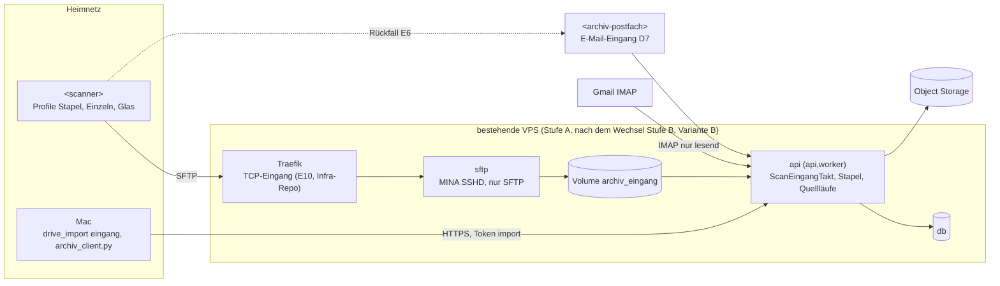
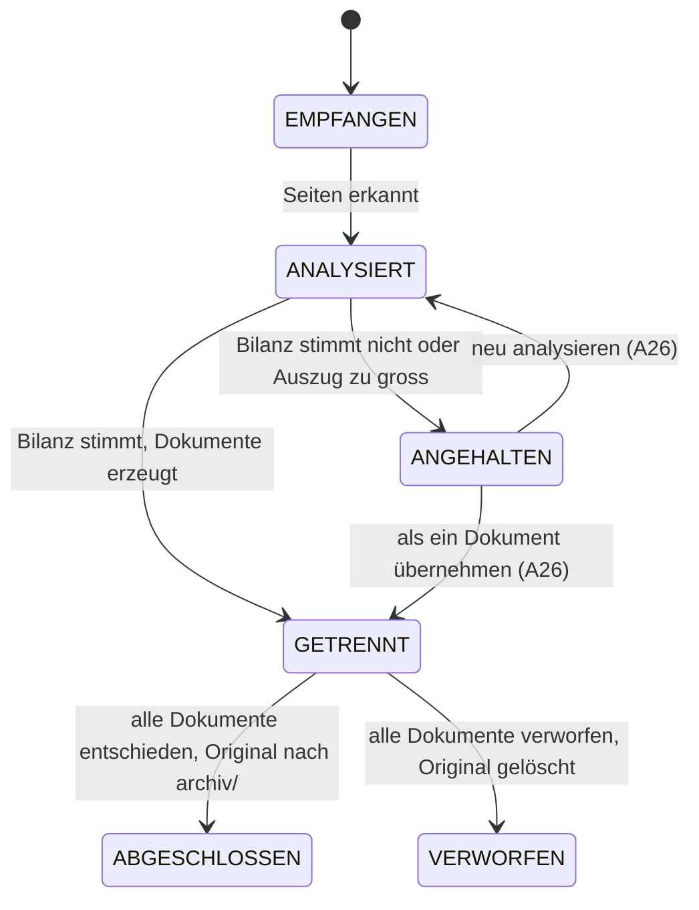

# Design Document — 09 Produktivimport

## Overview
Spec 09 ergänzt den bestehenden Archiv-Dienst (Quarkus, `api` mit Rolle `api,worker` in Stufe A) um einen neuen,
kleinen Dienst und erweitert sonst nur bestehende Module:

1. **Scan-Eingang**: eigener SFTP-Dienst `sftp` (Apache MINA SSHD, ohne Shell, ohne Root), vom Worker abgeholt (Fachbereich `stapel/`).
2. **Stapelverarbeitung**: QR-Trennblätter erkennen, Leerseiten entfernen, Stapel seitengenau in Dokumente trennen, Stapel-Original aufbewahren (`stapel/`).
3. **Quellen**: Quellenregister und Quellläufe (`importe/`, neben `import_lauf`), Gmail-Import über den bestehenden IMAP-Adapter (`integration/`), Mac-Eingang als Betriebsart des Drive-Import-Werkzeugs (`tools/drive_import`), Dateinamen-Regeln als Teil der Konfiguration (Spec 05), Nachlauf in `tools/archiv_client.py`.
4. **Qualität**: fachliche Dubletten mit Hauptfassung (`dokument/`), Vollständigkeitsbericht auf dem bestehenden Lückenbericht (`vollstaendigkeit/`), optional Scanqualität.
5. **Trennblatt-Generator** in der Web-App (`stapel/`, Seite `/trennblaetter`).

Grundsatz: Das Gerät liefert nur ein mehrseitiges PDF an ein festes Ziel. Alle Logik (Trennen, Leerseiten, OCR,
PDF/A, Erkennung) liegt im Archiv, wo sie getestet und versioniert ist. Jedes Dokument aus einem Stapel geht über
denselben Erfassungsweg wie ein Upload (`DokumentErfassen.imKontextErfassen`), damit SHA-256 zuerst, Dublettenprüfung,
Sichtbarkeit (Spec 01, 2.21), KI-Vorschlag und Eingangskorb unverändert gelten.

Neue Architekturentscheide (`docs/adr/`, Freigabe per Merge dieses Spec-PR):
- ADR-016 Scan-Eingang per SFTP in eigenem, gehärtetem Dienst auf Basis Apache MINA SSHD (E6; Rückfall E-Mail-Eingang oder Mac-Netzwerkordner).
- ADR-017 Trennung per QR-Trennblatt statt Leerseiten- oder Patch-Code-Trennung.
- ADR-018 Stapel-Original als eigenes Archivobjekt, Dokumente als seitengenaue Auszüge.
- ADR-019 Fachliche Dubletten mit Hauptfassung statt Löschen.

## Platzhalter
Das Repo ist öffentlich. Betriebs- und Geschäftsangaben stehen nur als Platzhalter; die Werte führt Fabian
ausserhalb jedes Repos. Agenten setzen keine Werte ein und raten keine; wo ein Wert gebraucht wird (Seed,
Konfiguration, Secret), liefert ihn Fabian in einer Aufgabe **[Fabian]** über die App, ein GitHub-Secret oder die
Konfiguration des Deploys.

| Platzhalter | Bedeutung | Wo gebraucht |
| --- | --- | --- |
| `<scanner>` | Modell und Firmware des Netzwerkscanners | Spike 27.3, Einrichtung 28.6, README des Dienstes `sftp` (dort nur «Netzwerkscanner») |
| `<scanner-ip>` | feste Adresse des Scanners im Heimnetz | Einrichtung 28.6 (nur am Gerät) |
| `<heim-adresse>` | öffentliche Adresse oder DNS-Name des Heimanschlusses (K6) | Freigabe im Infra-Repo (28.4) |
| `<sftp-host>`, `<sftp-port>` | Hostname und Port des Scan-Eingangs von aussen | Infra-Repo, Profil am Scanner |
| `<archiv-postfach>` | Adresse des E-Mail-Eingangs (Spec 02, Requirement 1) | Rückfall E6, Umstellung 30.2 |
| `<gmail-konto>`, `<gmail-label>` | Gmail-Konto und Label des Imports (K9) | Quelle `gmail`, Aufgabe 30.3 |
| `<quelle-bank>`, `<quelle-projekt>` | weitere Quellen (Kontoauszüge, Projektdokumente als PDF, E9) | Register, Unterordner des Mac-Eingangs |
| `<buchhaltung-downloads>` | Ordner mit den Belegen aus der Buchhaltungssoftware | Quelllauf 30.3 |
| `<alias-startwerte>` | Aliasse Altbestand-Nummer → heutige Belegnummer | Aliasse (11.3), Aufgabe 30.3 |
| `<startwerte-vollstaendigkeit>` | Beginn der Folgen und Startmonate (K11) | Konfiguration `urinet` (12.2) |
| `<erwartete-luecken>` | Lücken, die beim ersten Bericht zu begründen sind (K11) | Aufgabe 30.6 |
| `<generator-praefix>` | Dateinamen-Präfixe der eigenen Generatoren | Dateinamen-Regeln `urinet` |
| `<papierbestand>` | Umfang des Papierbestands 2026 (K8) | Planung 30.5 |

## Bestand (Kurzfassung)
Die vollständige Bestandsaufnahme mit Pfaden steht in `docs/spikes/09-bestandsaufnahme.md` (Requirement 0.1).
Für das Design massgeblich:

| Baustein | Stand | Folge für Spec 09 |
| --- | --- | --- |
| Upload mit SHA-256, Dublette als Ergebnis `DUBLETTE` (202, kein 409) | umgesetzt | Mac-Eingang wertet `status` je Datei aus, nicht einen 409 |
| Interner Erfassungsweg `DokumentErfassen.imKontextErfassen`, `korrespondenzErfassen` | umgesetzt | Stapel, Gmail nutzen ihn; kein neuer Erfassungsweg |
| `dokument.quelle` mit `SCAN, UPLOAD, GENERATOR, DRIVE, EMAIL, ABANINJA, WEBSEITE` | umgesetzt | neu nur `GMAIL` und `ORDNER` |
| Auftragsschlange `public.auftrag`, `AuftragTyp`, 3 Versuche | umgesetzt | neue Typen, gleiche Mechanik |
| PDFBox 3.0.8, ZXing 3.5.4 (Swiss QR), Angus Mail, GreenMail, Testcontainers | umgesetzt | keine neuen Bibliotheken ausser Apache MINA SSHD |
| E-Mail-Eingang D7 (`mail_eingang`, `integration_mail`, `ImapPostfach`, `MailTakt`) | umgesetzt | Gmail nutzt Adapter und Message-IDs; Rückfall E6 ohne neuen Dienst möglich |
| Datenschlüssel AES-256-GCM (`Datenschluessel`, Secret `archiv_data_key`) | umgesetzt | App-Passwort der Quelle `gmail` |
| Jahresexport, Chat-Werkzeug `vollstaendigkeit`, Lückenbericht `GET /berichte/luecken` | umgesetzt | Vollständigkeit baut darauf auf |
| Regeln `FOLGE`, `ERWARTET` (Spec 05), Seed `urinet` mit drei Regeln | umgesetzt | nur zwei Regeln `FOLGE` ergänzen |
| Drive-Import mit Trockenlauf und Token-Datei | umgesetzt | Mac-Eingang als Betriebsart; Prüfsummen-Abfrage neu |
| Token-Scopes `generator`, `import`, `webseite-lesen`, `webseite-erfassung` | umgesetzt | kein Scope `upload`; `import` wird erweitert |
| Benachrichtigung des Inhabers `InhaberBenachrichtigung` | umgesetzt | neue Anlässe Scan-Eingang |
| `belegnummer_alias`, `dokument_beziehung`, Hauptfassung, Textähnlichkeit, Quellläufe, Stapel, SFTP | fehlt | in dieser Spec |
| Compose: Dienste `api`, `db`, `kc`; kein `ports:`; Budget 2048 MiB und 1.5 CPU voll belegt | umgesetzt | E10 (Weg nach aussen) und E11 (Budget) vor dem Dienst `sftp` |
| Testmandant | fehlt | Probelauf in einem Mandanten `probe-scan` nach Spec 03, Muster Mandant anlegen |

## Architecture



## Components and Interfaces

### 1. Dienst `sftp` (`deploy/infomaniak/sftp/`, ADR-016)
OpenSSH scheidet aus: `ChrootDirectory` und der Benutzerwechsel brauchen Root und `CAP_SYS_CHROOT`/`CAP_SETUID`,
die Härtung verlangt aber `cap_drop: ALL`, uid ungleich 0 und verbietet `cap_add` (`DeployHaertungTest`, Compose-Policy
der VPS). Der Dienst ist darum ein kleines Java-Programm (eigenes Maven-Modul wie `tools/drive_import`, Java 25,
Image `archiv:sftp-…` nach dem Muster von `db` und `kc`) auf Basis Apache MINA SSHD:

- `SshServer` an einem Port über 1024 im Container (ohne Root), nur `SftpSubsystemFactory`; keine `ShellFactory`, keine `CommandFactory`, `RejectAllForwardingFilter`, Agent- und X11-Weiterleitung aus.
- Anmeldung nur `PublickeyAuthenticator` gegen die autorisierten Schlüssel je Benutzer aus der Secret-Datei `archiv_sftp_schluessel` (eine Zeile `scan-<mandant> <typ> <schlüssel>`); kein `PasswordAuthenticator`, kein Keyboard-Interactive. Host-Schlüssel aus `archiv_sftp_hostkey` (nur lesen, nie erzeugen).
- Wurzel je Benutzer über `VirtualFileSystemFactory` auf `/srv/eingang/scan-<mandant>`; die Unterordner `stapel`, `einzeln`, `glas` legt der Dienst beim Start an, `fehler` schreibt nur der Worker.
- Ein `SftpFileSystemAccessor` bzw. `SftpEventListener` lässt nur `open` zum Schreiben neuer Dateien, `write`, `close`, `stat`/`lstat` und, falls der Spike es verlangt, `rename` innerhalb desselben Unterordners zu; `remove`, `rmdir`, `mkdir`, `symlink`, `link`, `setstat` auf fremde Dateien und Lesen fremder Dateien werden mit `SSH_FX_PERMISSION_DENIED` abgelehnt (Requirement 1.4).
- Verfahren: Standard sind die sicheren Voreinstellungen von MINA SSHD (Ed25519/ECDSA, curve25519, AES-GCM/ChaCha20). Ältere Verfahren aus dem Spike (z. B. `ssh-rsa` mit SHA-1, `diffie-hellman-group14-sha1`) nur über eine ausdrückliche Liste im README und in der Konfiguration des Dienstes (Requirement 1.5).
- Sperre je Quelladresse: nach 5 Fehlschlägen in 10 Minuten 1 Stunde gesperrt; höchstens 4 gleichzeitige Sitzungen, Leerlauf-Zeitgrenze 2 Minuten, höchstens eine Datei von 200 MB je Sitzung (Requirement 1.6). Hinter einem TCP-Eingang von Traefik sieht der Dienst nur Traefik als Quelle; dann trägt die IP-Freigabe von Traefik die Begrenzung (E10).
- Log als JSON auf stdout: Anmeldung (Zeit, Benutzer, Quelladresse, Ergebnis) und je Datei Zeit, Benutzer, Unterordner, Grösse, Dateiname des Geräts (Requirement 1.7, Auslegung: der Name stammt vom Profil des Scanners und trägt nach 0.3 keinen Inhalt; der Worker loggt nur die Stapel-ID).
- Compose: Dienst `sftp`, `read_only`, `tmpfs` nur klein, `cap_drop: ALL`, `no-new-privileges`, uid/gid wie `api` (gemeinsame Gruppe für das Volume), Volume `archiv_eingang` (flüchtig wie `archiv_arbeit`, ohne Eintrag für die Sicherung: was dort liegt, ist noch nicht übernommen), Netz `archiv_intern`, Healthcheck über einen Port-Test im Container. Vorschlag Limits: `mem_limit` 96m, Heap 48m, `cpus` 0.1 (E11).
- Weg nach aussen (E10), Varianten: **(a)** TCP-Eingang `sftp` in Traefik im Infra-Repo (EntryPoint, Port in der Traefik-Compose, `ipAllowList` für `<heim-adresse>`, Router-Label `traefik.tcp.*` und neue Erlaubnis in `compose-policy.py`, ufw-Regel und Cloud-Firewall) – empfohlen, weil die App-Compose dann keinen Port veröffentlicht und die Prüfungen unverändert bleiben; **(b)** `ports:` im Dienst `sftp` – braucht Ausnahmen in `DeployHaertungTest`, `tools/pruefe_compose_konsistenz.py` und der Compose-Policy, und Docker umgeht ufw, nur die Cloud-Firewall filtert; **(c)** kein Eingang von aussen: Rückfall E6 (Scan per E-Mail an `<archiv-postfach>` oder Netzwerkordner auf dem Mac). Alles im Infra-Repo und in der Cloud-Firewall macht Fabian; kein Agent greift auf die VPS zu.
- Deploy-Workflow: Bau des Images und Schreiben der zwei Secret-Dateien brauchen eine Änderung an `.github/workflows/infomaniak-deploy.yml`. Agenten ändern Workflows nicht; die Umsetzungsaufgabe legt den Vorschlag als Patch unter `docs/betrieb/` ab (Muster `docs/betrieb/secretformate-workflow.diff`), Fabian übernimmt ihn.

Einrichtung am Scanner (Aufgabe 28.6, Fabian): Client-Schlüsselpaar am Gerät erzeugen, öffentlichen Schlüssel als
GitHub-Secret für `archiv_sftp_schluessel`, Host-Schlüssel des Dienstes im Profil hinterlegen, Ziel `<sftp-host>`,
Port `<sftp-port>`, Zielordner `/stapel`, `/einzeln`, `/glas`.

#### Umsetzung (Aufgabe 27.3, 28.11.2026)
- Modul `deploy/infomaniak/sftp/` (Artefakt `scan-eingang-sftp`, Hauptklasse `ScanEingang`): Apache MINA SSHD 2.20.1,
  BouncyCastle für Ed25519 (MINA SSHD kann Ed25519 sonst nicht lesen), `slf4j-simple` nur für Warnungen von MINA auf
  stderr; stdout gehört dem JSON-Log. Konfiguration über Umgebungsvariablen `ARCHIV_SFTP_PORT`, `ARCHIV_SFTP_WURZEL`,
  `ARCHIV_SFTP_HOSTSCHLUESSEL`, `ARCHIV_SFTP_SCHLUESSEL`, `ARCHIV_SFTP_AELTERE_VERFAHREN` (nur Pfade und Schalter,
  Standardpfade der Secret-Dateien `archiv_sftp_hostkey`, `archiv_sftp_schluessel`); Port unter 1025 und uid 0 brechen
  den Start ab. Die Datei des Host-Schlüssels darf mehrere Schlüssel enthalten (z. B. Ed25519 und RSA), falls das Gerät
  kein Ed25519 kann.
- Verfahren: Standard von MINA SSHD ohne die SHA-1-Verfahren, die MINA noch anbietet (`ssh-rsa`, `hmac-sha1`,
  `hmac-sha1-etm@openssh.com`); mit BouncyCastle kommen die hybriden Verfahren `mlkem768x25519-sha256` und
  `sntrup761x25519-sha512` dazu. Als «älter» gilt jedes Verfahren mit SHA-1, MD5, CBC, `arcfour`, `ssh-dss` sowie
  `ssh-rsa`; es kommt nur über die Liste hinzu, hinten angehängt; unbekannte Namen brechen den Start ab.
- Prototyp für den Spike: In der eigenen Wurzel sind alle SFTP-Operationen erlaubt und werden als Ereignis `sftp`
  protokolliert (Operation, Pfad in der Wurzel, Ergebnis), damit der Spike die nötigen Operationen (0.3) aus dem Log
  ablesen kann. Die Einschränkung nach 1.4 baut Aufgabe 28.2 nach dem Spike-Bericht. Weitere Ereignisse: `start` (mit
  den angebotenen Verfahren), `verfahren` (ausgehandelt oder bei fehlender Einigung das Angebot des Geräts),
  `anmeldung`, `datei` (Unterordner, Dateiname, Grösse), `stopp`. Bei abgelehnten Anmeldungen steht der Benutzer nur,
  wenn das Gerät einen Schlüssel versucht hat (MINA SSHD setzt den Namen sonst erst nach erfolgreicher Anmeldung).
- Szenarien: Das Backend übersetzt die Quellen des Moduls als Testquellen (`build-helper`, wie `tools/drive_import`)
  und startet den Dienst in `features/produktivimport/scan-eingang.feature` in-process (`ScanEingangSchritte`); MINA
  SSHD dafür im Test-Scope, `sshd-common` ausdrücklich, weil die Quarkus-BOM eine ältere Version verwaltet.
  `ScanEingangVersionTest` hält `sshd.version` in beiden Maven-Projekten gleich. Die Unit-Tests des Moduls laufen in der
  CI erst mit dem Patch `docs/betrieb/sftp-ci-dependabot.diff` (Schritt im Job «Build» und Einträge für Dependabot,
  Maven und Docker); Workflows ändert nur Fabian.
- Image: Basis wie die API (Temurin 25 JRE per Digest), uid 10001, Heap 48 MiB, `-XX:+UseSerialGC`. Lokal mit
  `--read-only`, `--cap-drop ALL`, `--memory 96m`, `--cpus 0.1` gestartet: nach Anmeldung und Upload rund 56 MiB belegt
  (Richtwert, Messung mit Compose in 28.3). Healthcheck, Compose und Deploy folgen in 28.2 bis 28.4.

### 2. Scan-Eingang im Worker (`stapel/`)
- `ScanEingangTakt` (Quarkus Scheduler, nur Rolle `worker`, Muster `MailTakt` mit `skipExecutionIf=VorMigrationUeberspringen`), alle 10 s: liest je konfiguriertem Mandanten `stapel/`, `einzeln/`, `glas/`; merkt sich je Datei Grösse und Änderungszeit; nach der Stabilitätszeit → `StapelEmpfang.annehmen(mandant, profil, pfad)`.
- Zuordnung Verzeichnis → Mandant nur aus der Konfiguration des Deploys (Requirement 2.8), nie aus dem Dateinamen.
- `StapelEmpfang.annehmen` (Port `ScanEingang` für Dateisystem, `AblagePort` für S3):
  1. Grösse und PDF-Kopf `%PDF` prüfen, mit PDFBox (`MemoryUsageSetting` mit Temp-Datei in `archiv_arbeit`) öffnen. Fehler → Datei nach `fehler/` mit `<name>.grund.txt`, Benachrichtigung über `InhaberBenachrichtigung` (nur Stapel-Kennung und Grund).
  2. SHA-256 berechnen, Ereignis `STAPEL_EMPFANGEN` ins Zugriffsprotokoll (vor allem anderen, tech.md Regel 3).
  3. Gibt es im Mandanten einen `stapel` mit gleicher Prüfsumme: protokollieren, Datei löschen, fertig (2.7).
  4. Hochladen nach `eingang/stapel/<stapelId>.pdf` (ohne Sperre), Zeile in `stapel` (Status `EMPFANGEN`), Datei löschen, Auftrag `STAPEL_ANALYSE`.
- Rückfall E-Mail (2.10): `integration_mail` erhält die Spalte `scanner_absender text[]`; `MailErfassen` gibt Anhänge dieser Absender an `StapelEmpfang.annehmen` statt an den Upload-Weg. Die Grösse begrenzt weiter `archiv.mail.max-groesse`.

### 3. Stapelverarbeitung (`stapel/`)



**`SeitenAnalyse`** (Auftrag `STAPEL_ANALYSE`, Domain ohne I/O, Adapter mit PDFBox und ZXing):
- PDF aus S3 in eine Temp-Datei, je Seite `PDFRenderer.renderImageWithDPI(i, 150, ImageType.GRAY)`, Bild nach der Seite freigeben (Requirement 2.9).
- QR: ZXing `QRCodeReader` mit `TRY_HARDER` und `POSSIBLE_FORMATS=QR_CODE`, zweiter Versuch invertiert; nur Inhalte mit Präfix `URINET-TRENN;` oder `URINET-ORDNER;` zählen (Swiss QR bleibt Inhalt, 3.1). Der bestehende `ZxingQrLeser` (Swiss QR) bleibt unverändert; beide teilen nur die Bibliothek.
- Leer: Rand je 5 % abschneiden, Anteil der Pixel mit Grauwert unter 160; unter dem Schwellwert des Mandanten → `LEER`. Seiten mit QR sind nie `LEER`.
- Ergebnis je Seite in `stapel_seite` (Typ, QR-Inhalt, Tintenanteil).

**`StapelTrenner`** (reine Funktion in `stapel/domain`, vollständig unit-getestet):
```
eingabe: profil, seiten[1..n] mit typ ∈ {INHALT, LEER, TRENN(art?), ORDNER(titel)}
ausgabe: dokumente[] mit seiten[], artHinweis?, ordnerHinweis?, ohneTrennblatt; bilanz

ordner = null; aktuell = neuesDokument(art=null, ordner=null, ohneTrennblatt = (profil == STAPEL))
fuer seite in seiten:
  wenn profil != STAPEL und seite.typ in {TRENN, ORDNER}: behandle wie INHALT, vermerke im Protokoll
  sonst wenn seite.typ == TRENN:
      schliesse(aktuell); aktuell = neuesDokument(art = seite.art, ordner = ordner, ohneTrennblatt = false)
  sonst wenn seite.typ == ORDNER:
      schliesse(aktuell); ordner = seite.titel; aktuell = neuesDokument(art = null, ordner = ordner, ohneTrennblatt = false)
  sonst wenn seite.typ == LEER: zaehle leer
  sonst: aktuell.seiten += seite
schliesse(aktuell)
schliesse(d): nur übernehmen, wenn d.seiten nicht leer
bilanz: inhalt + trenn + ordner + leer == n und jedes Dokument hat >= 1 Seite
```
- Aufeinanderfolgende Trenn- oder Deckblattseiten erzeugen so kein leeres Dokument; ein Trennblatt direkt nach einem Deckblatt übernimmt den Ordner-Hinweis und setzt die Art.
- Ein Trennblatt mit Art, die im Mandanten nicht aktiv ist: Art `null`, Meldung im Protokoll (3.4).

**`StapelDokumentErzeuger`** (Auftrag `STAPEL_TRENNEN`):
- Je Dokument neues `PDDocument`, Seiten mit `importPage` aus dem Original (verlustfrei, keine neue Rasterung); ist ein Auszug grösser als 50 MB → Stapel `ANGEHALTEN` (3.8).
- Erfassung über `DokumentErfassen.imKontextErfassen` mit `Erfasser(scan-<mandant>, quelle SCAN)`, ohne Dateinamen (2.5), Hinweis `{profil, artVorbelegt, ordner, stapel, seiten}`; die vorbelegte Art geht wie ein Art-Vorschlag des Uploads (Feld `art`) an den Erfassungsweg, nicht in den Prompt. Spalten `stapel_id`, `stapel_von`, `stapel_bis` am Dokument.
- Ein Auftrag je Stapel; bricht er ab, rollt er die Dokumente dieses Stapels zurück (Transaktion plus Aufräumen der `eingang/`-Objekte) und wiederholt nach `Wiederholung` (3 Versuche), danach `ANGEHALTEN` mit Meldung.
- Sichtbarkeit: Der Erfasser ist das technische Konto `scan-<mandant>`; unbestätigte Dokumente sehen damit nach Spec 01, 2.21 nur Rollen mit A7.

**`StapelAbschluss`** (hört auf die Statuswechsel `ARCHIVIERT` und `VERWORFEN` der Dokumente, Auftrag `STAPEL_ABSCHLUSS`):
- Alle entschieden und mindestens eines archiviert: Kopie nach `archiv/<jahr>/stapel/<stapelId>.pdf` über `AblagePort` (wie `S3Ablage.copyObject`), Prüfsummenvergleich, Sperre GOVERNANCE nur wenn ein archiviertes Dokument eine Art mit `gesetzliche_pflicht` hat, bis zum spätesten `aufbewahren_bis` dieser Dokumente; Löschen in `eingang/`, Status `ABGESCHLOSSEN`. Das Manifest nimmt das Objekt auf (`JdbcManifestDaten.eintraege()` erweitert um archivierte Stapel), der Prüflauf prüft es mit (5.6).
- Alle verworfen: Original löschen, Protokoll mit Prüfsumme, Status `VERWORFEN`.

**REST** (`StapelResource`, Aktionen A25, A26):

| Methode | Pfad | Zweck | Recht |
| --- | --- | --- | --- |
| GET | `/api/v1/stapel?status=` | Liste | A25 |
| GET | `/api/v1/stapel/{id}` | Protokoll mit Seiten und Dokumenten (nur IDs der für den Benutzer sichtbaren Dokumente) | A25 |
| GET | `/api/v1/stapel/{id}/seiten/{nr}/vorschau` | PNG, 72 dpi | A25 |
| POST | `/api/v1/stapel/{id}/neu-analysieren` | nur `ANGEHALTEN`, sonst 409 `STAPEL_STATUS` | A26 |
| POST | `/api/v1/stapel/{id}/als-ein-dokument` | nur `ANGEHALTEN`, sonst 409 `STAPEL_STATUS` | A26 |

### 4. Trennblatt-Generator (`stapel/`)
- `POST /api/v1/trennblaetter` (A1) mit `{"blaetter":[{"typ":"TRENN","art":null,"anzahl":10},{"typ":"TRENN","art":"QUITTUNG","anzahl":5},{"typ":"ORDNER","titel":"Versicherungen","anzahl":1}]}` → `application/pdf`; höchstens 100 Blätter je Anfrage.
- Je Blatt zwei A4-Seiten (Vorder- und Rückseite gleich): Überschrift «TRENNBLATT» bzw. «ORDNER», Art bzw. Titel in 36 pt, QR-Code 60 mm mittig (ZXing `QRCodeWriter`, Fehlerkorrektur M, Ruhezone 4 Module), unten «Beidseitig auf farbiges Papier drucken. Wiederverwendbar.»
- QR-Inhalte: `URINET-TRENN;v=1`, `URINET-TRENN;v=1;art=QUITTUNG`, `URINET-ORDNER;v=1;titel=Versicherungen%202026` (URL-kodiert, UTF-8).
- Schrift: eingebettete Schrift aus dem Image (PDFBox `PDType0Font`), damit Umlaute und Guillemets sicher sind.
- Frontend: Seite `/trennblaetter` in der Gruppe «Archiv» (Gestaltung nach `docs/oberflaeche/README.md`), Auswahl Art, Anzahl, Deckblatt-Titel; Download. Anleitung unter `frontend/public/anleitung/` (Spec 07, 7.5).

Umsetzung (Aufgabe 27.5, 28.11.2026):
- Fachbereich `stapel/`: `TrennblattCode` (Domain: QR-Inhalte, Prüfung des Titels, `lesen` für die Seitenanalyse in
  28.7), `TrennblattService` (Application: höchstens 100 Blätter, Arten nur aus den aktiven Dokumentarten des eigenen
  Mandanten über `DokumentartVerwaltung`), `PdfBoxTrennblattPdf` (Adapter mit ZXing und PDFBox), `TrennblattResource`.
- Titel: NFC, Leerraum aussen entfernt, höchstens 60 Unicode-Codepunkte. URL-Kodierung mit `URLEncoder` (UTF-8), das
  Leerzeichen als `%20` statt `+`; der Code enthält so nur ASCII, und `;`, `=`, `+` und `%` im Titel bleiben eindeutig.
  Fehlt der Titel oder ist er nach dem Kürzen leer, gilt ebenfalls 400 `TRENNBLATT_UNGUELTIG`. Alle übrigen
  Formfehler (Typ, Anzahl unter 1, mehr als 100 Blätter, unbekanntes Feld, Feld des anderen Typs, Art keine aktive
  Dokumentart des Mandanten) ergeben 400 `ANFRAGE_UNGUELTIG`. Der Körper wird streng gelesen (`StrengesJson`: keine
  doppelten Schlüssel, nichts nach dem JSON-Wert) und ist vor der Ressource auf 64 KiB begrenzt
  (`ProblemFehlerRoute`, 413 `DATEI_ZU_GROSS`); 100 Deckblätter mit je 60 als JSON-Escape geschriebenen Zeichen
  brauchen rund 39 KiB.
- `TrennblattCode.lesen` ist streng: Der Inhalt muss genau dem entsprechen, was `inhalt()` erzeugt; ungültiges UTF-8
  (z. B. `%FF`), unkodierte Trennzeichen (`=`, `+`, Leerzeichen), Hex in Kleinbuchstaben oder nicht NFC sind kein
  Trennblatt-Code.
- Schrift: Liberation Sans aus dem PDFBox-Artefakt (`org/apache/pdfbox/resources/ttf/LiberationSans-Regular.ttf`, SIL
  Open Font License), als Teilmenge eingebettet. Das Image bringt keine Schrift mit; statt eines neuen Pakets im
  Dockerfile dient die Schrift, die PDFBox ohnehin mitliefert (gleiche Wirkung wie «aus dem Image»). Damit das Blatt
  den Titel trägt (6.2), lehnt das Archiv einen Titel mit Zeichen, die die Schrift nicht enthält (z. B. Emoji,
  chinesische Schriftzeichen), ebenfalls mit 400 `TRENNBLATT_UNGUELTIG` ab (Auslegung zu 6.5, Review PR #747). Die
  Oberfläche prüft das schon bei der Eingabe mit den Unicode-Bereichen der Schrift (`schrift-abdeckung.ts`);
  `PdfBoxTrennblattPdfTest` vergleicht diese Bereiche mit der Schrift. Nur der Name einer Art kann noch Zeichen ohne
  Glyphe enthalten; sie erscheinen als «?», darunter steht der Code der Art.
- Seite: «TRENNBLATT» bzw. «ORDNER» in 22 pt, Aufschrift (Name der Art, «Ohne Art» oder Titel) in 36 pt, bei mehr als
  drei Zeilen in 30 bzw. 24 pt, beim Trennblatt mit Art darunter «Art <CODE>»; QR-Symbol 60 mm (ohne Ruhezone), Mitte
  15 mm unter der Seitenmitte, Ruhezone mindestens 4 Module weiss. Der QR-Code ist eine Vektor-Form (XObject), die alle
  Seiten eines Satzes zeichnen: 100 Blätter (200 Seiten) bleiben unter 512 KB. Der längste Titel (60 × «€», 60 × «ẞ»)
  bleibt bei 150 dpi lesbar. Erkenntnis für 28.7: Ein einzelner ZXing-`QRCodeReader` verfehlt bei 150 dpi einzelne,
  sonst einwandfreie Codes (z. B. 20 × «ж», 60 × «ẞ»); mit `QRCodeMultiReader` und zwei Binarisierern (wie
  `ZxingQrLeser`) werden alle gelesen.
- Protokoll: Das PDF wird nicht abgelegt und berührt kein Dokument, darum kein Eintrag `ERFASSEN`; `EndpunktWaechterTest`
  nimmt `POST /trennblaetter` von der Regel «A1 verlangt `ERFASSEN`» aus.
- Frontend: Menüpunkt «Trennblätter» in der Gruppe «Archiv» nach «Chat» (A1), Route mit `rechtGuard('A1')`;
  Hilfe-Abschnitt `erfassen-trennblaetter` («Trennblätter drucken») unter «Erfassen» mit A1 und Pfad `/trennblaetter`
  (Pflegeregel Spec 07, Req 7.5).
- Tests: `TrennblattCodeTest` (QR-Inhalte, URL-Kodierung von Umlauten, Guillemets und Trennzeichen, Titelgrenzen),
  `PdfBoxTrennblattPdfTest` (Rundlauf PDF → 150 dpi → ZXing, Kante, Fehlerkorrektur, Schrift eingebettet),
  `features/produktivimport/trennblaetter.feature` (`@req-6.1`, `@req-6.2`, `@req-6.3`, `@req-6.5`, A1 je Rolle),
  `trennblaetter-pwa.feature` (Browser mit Attrappe, axe, 375 und 1280 px hell und dunkel), Vitest `trennblaetter*.spec.ts`.
  Der Rundlauf mit einem Stapel (6.4) folgt mit 28.8.

### 5. Quellenregister und Quellläufe (`importe/`)
- Quellentypen: `GENERATOR`, `DRIVE`, `ORDNER`, `MAC_EINGANG`, `GMAIL_LABEL`, `CRM_CSV`, `SCAN`.
- Seed `urinet` (nur allgemeine Quellen, 10.2): `generatoren` (GENERATOR), `drive` (DRIVE), `mac-ordner` (MAC_EINGANG), `gmail` (GMAIL_LABEL, ohne Zugang), `crm-csv` (CRM_CSV, Lauf verweist auf `import_lauf`), `papier` (SCAN). Weitere Quellen (`<quelle-bank>`, `<quelle-projekt>`, `<buchhaltung-downloads>`) legt Fabian im Register an.
- Zuordnung von Uploads: Formularfeld `quelllauf` (ID) oder `quelle` (Code; der Server ordnet dem offenen Lauf zu oder legt einen Lauf `AUTOMATISCH` je Tag an). Scan-Eingang und Gmail setzen den Lauf intern. Kein eigener Header, damit `ZugangFilter` und OpenAPI unverändert bleiben.
- Zähler werden beim Erfassen serverseitig hochgezählt, fachliche Dubletten beim Entscheid. Trockenlauf: Werkzeuge rechnen SHA-256 lokal, fragen die Prüfsummen-Abfrage und melden die Zähler beim Abschluss.
- `dokument.quelle`: Mac-Eingang setzt `ORDNER` (über den Quelllauf, nicht über das Token), Gmail `GMAIL`.

| Methode | Pfad | Zweck | Recht / Scope |
| --- | --- | --- | --- |
| GET | `/api/v1/quellen` | Register mit letztem Lauf | A27 |
| PATCH | `/api/v1/quellen/{code}` | Status, Bemerkung, Konfiguration (`If-Match`) | A28 |
| PUT | `/api/v1/quellen/{code}/geheimnis` | App-Passwort setzen (verschlüsselt, nie zurückgegeben) | A28 |
| POST | `/api/v1/quellen` | Quelle anlegen | A28 |
| POST | `/api/v1/quellen/{code}/laeufe` | `{art: TROCKEN|ECHT}` → Lauf; bei `GMAIL_LABEL` startet der Worker den Lauf | A28, Scope `import` |
| POST | `/api/v1/quellen/laeufe/{id}/abschliessen` | Zähler und Meldungen (Trockenlauf), Abschluss | A28, Scope `import` |
| GET | `/api/v1/quellen/{code}/laeufe` | Läufe | A27 |
| POST | `/api/v1/dokumente/pruefsummen` | `{sha256:[…]}` (höchstens 1'000) → `{vorhanden:[…]}` ohne IDs | A1, Scope `import` |

`EndpunktWaechterTest` erlaubt `@ErlaubtScope` heute nur an `POST` mit A1 auf dem Pfad des Scopes; die
Quelllauf-Endpunkte brauchen eine ausdrücklich gelistete Ausnahme (Folgeänderung Spec 01, design.md).

### 6. Gmail-Import (`integration/`, Quelllauf in `importe/`)
- Konfiguration der Quelle: `{"host":"imap.gmail.com","port":993,"benutzer":"<gmail-konto>","label":"<gmail-label>","seit":"2026-01-01","ohneAnhang":false,"maxJeLauf":500}`; App-Passwort in `quelle.geheimnis` über `Verschluesselung` (wie `integration_mail.passwort_verschluesselt`).
- `ImapPostfach` erhält eine Betriebsart nur lesend: `Folder.open(Folder.READ_ONLY)`, Inhalte über `BODY.PEEK`, kein `copy`, kein `setFlags`, kein Verschieben (7.2). Der Test prüft die Flags vorher und nachher.
- Je Nachricht: Message-ID gegen `mail_eingang` (neue Spalte `herkunft` `POSTFACH|GMAIL_LABEL`), Anhänge filtern, Erfassung über `MailErfassen` mit Quelle `GMAIL`; Absender, Betreff, Datum als Hinweis wie D7.
- Auftrag `QUELLLAUF_GMAIL` mit Zeitgrenze und `maxJeLauf`; Netzwerkfehler → Lauf `ABGEBROCHEN`, ein neuer Lauf setzt dank Message-ID ohne Dubletten fort.

### 7. Mac-Eingang (`tools/drive_import`, Betriebsart `eingang`)
- Das Drive-Import-Werkzeug hat Token-Datei (`TokenDatei`), Client mit Wiederholung bei 429/503 und Ordner-Hinweis schon; der Mac-Eingang wird ein Unterbefehl desselben Jars statt eines neuen Werkzeugs: `eingang einrichten` (Ordner anlegen, launchd-Plist schreiben), `eingang starten` (von launchd aufgerufen), `eingang status`.
- Ordner `~/UriNet-Archiv-Eingang` liegt bewusst nicht in Schreibtisch, Dokumente oder Downloads (keine Datenschutzfreigabe von macOS nötig). Unterordner → Quelle laut `~/.config/urinet-archiv/eingang.properties` (`<unterordner>=<quellcode>`, sonst `mac-ordner`).
- Ablauf je Datei: stabil → `POST /api/v1/dokumente` (Teil `dateien` mit Dateiname, `hinweis` nur mit dem Unterordner, `quelle`) → `NEU` oder `DUBLETTE` → `hochgeladen/JJJJ-MM/`; 4xx ausser 429 oder `ABGELEHNT` → `fehler/` plus `<name>.grund.txt`; 429, 5xx, Netzfehler → liegen lassen.
- Ausgenommen: `hochgeladen/`, `fehler/`, versteckte Dateien, `.download`, `.crdownload`, `.part`.
- launchd: `~/Library/LaunchAgents/ch.urinet.archiv-eingang.plist` mit `RunAtLoad`, `KeepAlive`, Log unter `~/Library/Logs/`; Token nur aus der Datei mit Rechten 600 (tech.md Regel 7; das Werkzeug bricht bei weiteren Rechten ab wie heute).

### 8. Dateinamen-Regeln und Nachlauf
- Regeln je Mandant als neuer Abschnitt `dateinamenRegeln` der Konfigurationsdatei (Spec 05, Requirement 6, versioniert, Prüfung in `Konfiguration.pruefen`): `{nr, muster, art, felder:{belegnummer|periode|partner|person: gruppe}}`, erste passende gewinnt, ohne Gross-/Kleinschreibung, JDK-Regex mit Zeitgrenze.
- Anwendung nur für Dokumente mit Token-Scope `import` (Drive-Import, Mac-Eingang), beim Erfassen; das Ergebnis (Felder, Regel-Nr.) liegt am Dokument, damit Auftragsnutzlasten keinen Dateinamen tragen (Spec 01, 3.12). Der KI-Vorschlag übernimmt die Felder mit Sicherheit 1.0 und Herkunft `DATEINAME`; Prompt, Text und Bild bleiben unverändert.
- Beispiel-Regeln `urinet` (Präfixe als `<generator-praefix>`, Nummern nach den Mustern in `structure.md`): Ausgangsrechnung `^<generator-praefix>(\d{4}-\d{3})_(.+)\.pdf$`, Offerte `^<generator-praefix>(O-\d{4}-\d{3})_(.+)\.pdf$`, Lohnabrechnung mit Periode `(\d{4}-\d{2})`, Lieferantenbeleg `^(F\d{4})[_ ](.+)\.pdf$`, Altbestand `^(R\d{4})[_ ](.+)\.pdf$` (Belegnummer über Alias), Ausgangsrechnung ohne Präfix `^(\d{4}-\d{3})[_ ](.+)\.pdf$`.
- Partner-Hinweis: Binde- und Unterstriche werden zu Leerzeichen, danach der normale Partner-Abgleich (Spec 01, 7.4).
- `DateinamenAbgleich` nach der OCR: kommt die Belegnummer im Volltext nicht vor, Feld «bitte prüfen» (9.3).
- Aliasse: Tabelle `belegnummer_alias` (A11), Startwerte `<alias-startwerte>` pflegt Fabian.
- `archiv_client.py nachlauf --rechnungen <ordner> [--trocken] [--quelllauf <id>]`: liest die JSON-Dateien von `rechnung_gen.py`, ordnet sie den Feldern der Generator-Schnittstelle zu (genaue Zuordnung aus dem JSON-Format von `rechnung_gen.py`, das ausserhalb dieses Repos liegt; fehlt ein Feld, Abbruch mit Liste statt Raten) und sendet je PDF; 409 `BELEGNUMMER_VERGEBEN` und 200 (gleiche SHA-256) zählen als «schon vorhanden». Unterschied zu `--nachsenden`: `nachlauf` arbeitet auf dem Ausgabeordner, `--nachsenden` nur auf `archiv-ausstehend/`.

### 9. Fachliche Dubletten und Hauptfassung (`dokument/`, ADR-019)
- `DublettenPruefung` als Auftrag `DUBLETTEN_PRUEFUNG` nach `KI_VORSCHLAG` bzw. nach Annahme eines Generator-Dokuments; Kandidaten nur im selben Mandanten, Status nach 11.1.
  - `SICHER`: gleiche Art und gleiche Belegnummer nach Alias-Auflösung, Partner gleich oder auf einer Seite leer.
  - `WAHRSCHEINLICH`: gleicher Partner, gleiches Belegdatum, gleicher Betrag und Währung.
  - `MOEGLICH`: SimHash (64 Bit, Shingles aus 5 Wörtern des normalisierten Volltexts, mindestens 200 Zeichen) mit Hamming-Abstand höchstens 3 (entspricht der Schwelle 90 % in 11.2), nur gegen Dokumente gleicher Art oder gleichen Partners; Spalte `text_simhash` mit Index. `pg_trgm` bleibt für Kontakte.
- Rang der Quelle: `GENERATOR` 1, `EMAIL` und `GMAIL` 2, `ABANINJA`, `UPLOAD`, `DRIVE`, `ORDNER` 3, `SCAN` 4 (`WEBSEITE` gehört zu `vhf-gsk`, Rang 3).
- Entscheid `POST /api/v1/dubletten/{id}/entscheiden` mit `{aktion, grund}`:
  - `VERWERFEN` (A9): bestehender Ablauf «Verwerfen» (nur nicht archivierte Dokumente), Beziehung `DUBLETTE_VERWORFEN` protokolliert.
  - `FASSUNG`, `UNTERSCHRIEBEN`, `ANHANG` (A7): Beziehung anlegen, `hauptfassung=false`, Metadatenversion mit Grund; das Dokument wird normal bestätigt und archiviert.
  - `KEIN_DUPLIKAT` (A7): nur Status.
  - `HAUPTFASSUNG_WECHSELN` (A7): Flags tauschen, je eine Metadatenversion mit Grund.
  - Bereits entschieden → 409 `DUBLETTE_STATUS`.
- Bestätigen im Eingangskorb prüft offene `SICHER`-Dubletten → 409 `DUBLETTE_OFFEN`.
- Bestehende Abfragen filtern `hauptfassung = true`: `kennzahl`, `offene_posten`, `fristen` (Chat), Lückenbericht (`KonfigurierteLuecken`), Regel `EINDEUTIG` (eine verknüpfte Fassung mit gleicher Belegnummer verletzt sie nicht), Jahresexport (`belegliste.csv` nur Hauptfassungen, Beilagen unter `beilagen/`), Zähler der Suche.

### 10. Vollständigkeit (`vollstaendigkeit/`)
- Kein neuer Regeltyp: `VollstaendigkeitBericht` holt die Lücken über den bestehenden Lückenbericht (Port in `ki/application`, heute `KonfigurierteLuecken` und `LueckenberichtResource`) und ergänzt drei feste Prüfungen: Quellen (Register), Eingangskorb (leer), Stapel (keiner `ANGEHALTEN`).
- Konfiguration `urinet`: neue Regeln `offerte_folge` (`FOLGE`, `GESCHAEFTSJAHR`) und `lieferantenbeleg_folge` (`FOLGE`, `GESAMT`), Beginn und Startmonate der Regeln `lohnabrechnung_erwartet` und `bankbeleg_erwartet` aus `<startwerte-vollstaendigkeit>` (als neue Konfigurationsversion, Spec 05).
- `luecke_begruendung` (Regel, Geschäftsjahr, Schlüssel, Text, Benutzer, Zeit, zurückgezogen); `GET /api/v1/vollstaendigkeit?geschaeftsjahr=2026`, `PUT` und `DELETE /api/v1/vollstaendigkeit/{regel}/{jahr}/luecken/{schluessel}` (A29), protokolliert. Lückenschlüssel: Belegnummer bzw. `JJJJ-MM` plus Gruppe.
- PDF-Fassung mit PDFBox (Regel, Status, Lücken, Begründungen); im Jahresexport als `vollstaendigkeit.pdf` und `vollstaendigkeit.json`; Chat-Werkzeug `vollstaendigkeit` liest denselben Dienst.

### 11. Scanqualität (Option, `stapel/`)
- Effektive Auflösung je Seite: Breite des grössten Bildes in Pixeln geteilt durch Seitenbreite in Zoll; unter 290 dpi → Vermerk.
- Zeichen je Seite aus dem OCR-Ergebnis; unter 20 Zeichen auf einer nicht leeren Seite → «Seite prüfen».
- Vermerke in `dokument_seite_vermerk`, Anzeige im Eingangskorb.

## Data Models (neu, Liquibase `db/mandant`, nur neue Changesets)
```sql
create table stapel (
  id uuid primary key, profil text not null check (profil in ('STAPEL','EINZELN','GLAS')),
  eingang text not null check (eingang in ('SFTP','EMAIL')),
  sha256 text not null unique, groesse bigint not null,
  s3_schluessel text not null, s3_version text,
  seiten int, inhalt int, trenn int, ordner int, leer int, dokumente int,
  status text not null, bilanz_ok boolean, meldungen jsonb not null default '[]',
  quelle_lauf_id uuid, empfangen timestamptz not null, abgeschlossen timestamptz
);  -- bewusst ohne Dateinamen (Spec 01, 3.12)
create table stapel_seite (
  stapel_id uuid not null references stapel(id), nr int not null,
  typ text not null check (typ in ('INHALT','LEER','TRENN','ORDNER')),
  qr_inhalt text, tinte_anteil numeric(6,5),
  dokument_id uuid, seite_im_dokument int,
  primary key (stapel_id, nr)
);
alter table dokument
  add column stapel_id uuid references stapel(id),
  add column stapel_von int, add column stapel_bis int,
  add column quelle_lauf_id uuid,
  add column hauptfassung boolean not null default true,
  add column text_simhash bigint,
  add column dateiname_regel jsonb;                     -- Ergebnis der Dateinamen-Regel (Felder, Regel-Nr.)
-- dokument_quelle_ck: neues Changeset mit GMAIL und ORDNER (bestehende Werte bleiben)

create table quelle (
  id uuid primary key, code text unique not null, name text not null, typ text not null,
  konfiguration jsonb not null default '{}', geheimnis bytea,
  status text not null default 'OFFEN' check (status in ('OFFEN','LAEUFT','ABGESCHLOSSEN','LAUFEND')),
  bemerkung text, letzter_lauf uuid, version int not null default 0, geaendert timestamptz
);
create table quelle_lauf (
  id uuid primary key, quelle_id uuid not null references quelle(id),
  art text not null check (art in ('TROCKEN','ECHT','AUTOMATISCH')),
  status text not null check (status in ('LAEUFT','FERTIG','ABGEBROCHEN')),
  gefunden int not null default 0, neu int not null default 0, dublette_pruefsumme int not null default 0,
  dublette_fachlich int not null default 0, uebersprungen int not null default 0, fehler int not null default 0,
  import_lauf_id uuid,                                   -- CRM-CSV: Verweis auf import_lauf
  meldungen jsonb not null default '[]', benutzer text, gestartet timestamptz not null, beendet timestamptz
);
alter table mail_eingang add column herkunft text not null default 'POSTFACH';  -- POSTFACH | GMAIL_LABEL
alter table integration_mail add column scanner_absender text[] not null default '{}';
create table belegnummer_alias (art text not null, alias text not null, belegnummer text not null,
  erstellt_von text not null, zeit timestamptz not null, primary key (art, alias));

create table dublette (
  id uuid primary key, dokument_id uuid not null, kandidat_id uuid not null,
  stufe text not null check (stufe in ('SICHER','WAHRSCHEINLICH','MOEGLICH')),
  regel text not null, status text not null default 'OFFEN',
  entschieden_von text, aktion text, grund text, zeit timestamptz,
  unique (dokument_id, kandidat_id)
);
create table dokument_beziehung (
  id uuid primary key, von_id uuid not null, zu_id uuid not null,
  typ text not null check (typ in ('FASSUNG','UNTERSCHRIEBEN','ANHANG','DUBLETTE_VERWORFEN')),
  erstellt_von text not null, zeit timestamptz not null
);  -- nur INSERT; Aufheben als neue Zeile mit Gegenbuchung, damit die Herkunft nachvollziehbar bleibt
create table luecke_begruendung (regel_code text, geschaeftsjahr int, schluessel text, text text not null,
  benutzer text not null, zeit timestamptz not null, zurueckgezogen timestamptz,
  primary key (regel_code, geschaeftsjahr, schluessel, zeit));
create table dokument_seite_vermerk (dokument_id uuid, seite int, grund text, wert numeric,
  primary key (dokument_id, seite, grund));             -- Option Q3
```
`public.auftrag`: neue Typen `STAPEL_ANALYSE`, `STAPEL_TRENNEN`, `STAPEL_ABSCHLUSS`, `QUELLLAUF_GMAIL`,
`DUBLETTEN_PRUEFUNG` (Nutzlast nur IDs). `public.api_client.scope` bleibt unverändert. Jede Migration bleibt
rückwärtskompatibel (tech.md Regel 11); die neuen Spalten haben Standardwerte, alte Releases lesen sie nicht.

## Konfiguration (neu, Klasse (b) nach Spec 06, ausser Leer-Schwelle)
Die Schlüssel stehen hier ohne das Präfix «archiv» und ohne Code-Formatierung, bis sie im Code bestehen
(`EinstellungsInventarTest` prüft jeden Schlüssel mit diesem Präfix in `docs/` und `design.md` gegen den Code); die
Aufgabe, die einen Schlüssel einführt, setzt das Präfix davor und trägt ihn in Spec 06, design.md, «Inventar der
Einstellungen» ein.

| Schlüssel (ohne Präfix) | Standard | Zweck |
| --- | --- | --- |
| scan.mandanten | leer | Zuordnung Benutzerverzeichnis → Mandant, z. B. scan-urinet=urinet |
| scan.verzeichnis | /srv/eingang | Wurzel im Volume archiv_eingang |
| scan.takt | 10s | Takt des ScanEingangTakt (off in Tests) |
| scan.stabil | 30s | Stabilitätszeit (2.1) |
| scan.max-groesse | 200M | Grenze je Stapel (2.6) |
| scan.ignorieren | ^\..*, .*\.(tmp|part)$ | temporäre Namen (2.2) |
| stapel.render-dpi | 150 | Rasterung der Analyse |
| stapel.leer-rand | 0.05 | Rand der Leerseiten-Prüfung |
| stapel.leer-schwelle | 0.005 | Standard; je Mandant als Einstellung der Klasse (a) in Spec 06 (4.2) |
| dublette.simhash-abstand | 3 | Schwelle MOEGLICH |
| quelle.gmail.zeitgrenze | 15m | Zeitgrenze eines Laufs |
| qualitaet.aktiv | false | Option Q3 |

Dienst `sftp` (eigene Konfiguration, nicht im Backend): Port im Container, Benutzerwurzel, Sperre je Quelladresse,
Liste älterer Verfahren (leer).

Abhängigkeiten (Maven): neu nur Apache MINA SSHD (`org.apache.sshd:sshd-core`, `sshd-sftp`) im Modul des Dienstes
`sftp` und im Test des Backends (SFTP-Client); PDFBox, ZXing, Angus Mail und GreenMail bestehen.

## Error Handling (neue Codes, mit der Umsetzung in Spec 01, design.md, «Error Handling» nachgeführt)
| Code | HTTP | Wann |
| --- | --- | --- |
| `STAPEL_STATUS` | 409 | Aktion passt nicht zum Status des Stapels |
| `DUBLETTE_OFFEN` | 409 | Bestätigen bei offener Dublette `SICHER` |
| `DUBLETTE_STATUS` | 409 | Dublette ist schon entschieden |
| `QUELLE_LAEUFT` | 409 | Lauf startet, während ein Lauf der Quelle läuft |
| `QUELLE_ANMELDUNG` | 502 | Anmeldung bei Gmail scheitert |
| `TRENNBLATT_UNGUELTIG` | 400 | Titel zu lang oder mit Zeichen nach Spec 01, 3.10 |
Zu viele Prüfsummen (über 1'000) → bestehender Code `ANFRAGE_UNGUELTIG`.

- Scan-Eingang: defekte Datei → `fehler/` plus Grund, Benachrichtigung; der Takt läuft weiter.
- Stapelanalyse: Ausnahme → Auftrag bis dreimal wiederholen, danach `ANGEHALTEN` mit Meldung; Original bleibt unverändert.
- Gmail: Netzwerkfehler → Lauf `ABGEBROCHEN`; neuer Lauf ohne Dubletten (Message-ID).
- Mac-Eingang: nie Dateien löschen.
- Texte für Benutzer in Deutsch (Schweiz), mit Handlungsanweisung, ohne Stacktrace (product.md).

## Bedrohungsmodell (Scan-Eingang)
| Bedrohung | Massnahme |
| --- | --- |
| Anmeldeversuche aus dem Internet | nur Schlüssel, IP-Freigabe `<heim-adresse>` (E10), Sperre je Quelladresse, `MaxSessions` 4, Leerlauf 2 min |
| Ausbruch aus dem Eingang (Shell, Weiterleitung, Pfade) | keine Shell- und Command-Factory, Forwarding abgelehnt, virtuelle Wurzel je Benutzer, Accessor lehnt `..`, Links und fremde Dateien ab |
| Übernahme des Dienstes | Java-Prozess ohne Root, `cap_drop: ALL`, `read_only`, keine Secrets der API, nur Volume `archiv_eingang` und Netz `archiv_intern`; Ressourcengrenzen |
| Gestohlener Schlüssel des Scanners | kann nur Dateien in `stapel/`, `einzeln/`, `glas/` des eigenen Mandanten ablegen; jedes Dokument landet im Eingangskorb, nichts wird ohne Bestätigung archiviert; Schlüssel per Secret austauschbar |
| Bösartiges PDF (Zip-Bombe, sehr viele Seiten) | Grösse 200 MB, höchstens 300 Seiten je Stapel, Analyse seitenweise mit Temp-Dateien, Zeitgrenze des Auftrags; Verarbeitung im bestehenden Worker wie jeder Upload |
| Ältere SSH-Verfahren | nur im Dienst `sftp`, nur die Liste aus dem Spike, begründet; SSH der VPS unverändert |
| Fremder Mandant | Mandant nur aus der Zuordnung Verzeichnis → Mandant des Deploys (tech.md Regel 1) |

## Testing Strategy
| Ebene | Schwerpunkt |
| --- | --- |
| Unit | `StapelTrenner` tabellengetrieben (mindestens 15 Fälle: ohne Trennblatt, Trennblatt am Anfang, doppelseitige Trennblätter, Deckblatt plus Trennblatt, nur Leerseiten, Profil EINZELN mit versehentlichem Trennblatt, Bilanzfehler, inaktive Art); QR-Inhalte parsen; Leerseiten-Schwelle; Dateinamen-Regeln; SimHash; Rang der Quellen |
| Rundlauf | Trennblatt-Generator erzeugt PDF → Seiten in synthetischen Stapel mischen (PDFBox, auch gedreht und mit Swiss-QR-Seite) → Analyse erkennt alle Trennblätter und Arten |
| Integration | Dienst `sftp` im Test gestartet (MINA SSHD in-process bzw. Testcontainer mit dem Image) und Upload per MINA-Client → Takt übernimmt, Stapel getrennt, Dokumente im Eingangskorb; zwei Mandanten zur Trennung; GreenMail-IMAP: Nachrichten bleiben ungelesen, zweiter Lauf erzeugt nichts; WireMock für KI |
| Sicherheit | SFTP: Passwort und Keyboard-Interactive abgelehnt, Shell und Exec abgelehnt, Weiterleitung abgelehnt, Löschen, `mkdir`, Links, Lesen fremder Dateien und `..` abgelehnt; Härtung in `DeployHaertungTest`; Scope `import` erreicht nur die erlaubten Endpunkte; A25 bis A29 je Rolle |
| Dubletten | derselbe Beleg aus Gmail, Download und Scan: eine Hauptfassung, `kennzahl` und Lückenbericht zählen einmal, `EINDEUTIG` meldet nichts |
| Mac-Eingang | Temp-Ordner und WireMock: stabile Datei hochgeladen und verschoben, `ABGELEHNT` und 4xx nach `fehler/`, 429 und 5xx bleiben liegen, Token nie im Log |
| Abnahme | Probestapel nach 16.1 (synthetisch, mit generierten Trennblättern; als Fixture im Repo) und Probelauf am Gerät mit synthetischen Seiten |

Alle Fixtures sind synthetisch (wie `tools/golden_synth`); keine echten Belege, Namen oder Nummern.

## Folgeänderungen (in diesem PR nur als Verweise, Umsetzung in den Aufgaben)
| Wo | Änderung | Aufgabe |
| --- | --- | --- |
| Spec 01, requirements.md 2.5 | Scope `import` erlaubt zusätzlich Prüfsummen-Abfrage und Quellläufe (Spec 09, 10.9) | 27.1, umgesetzt in 29.1 |
| Spec 01, requirements.md 2.6 | Absatz nach der Tabelle: Zeilen A25 bis A29 stehen in Spec 09, Requirement 15.1 | 27.1 |
| Spec 01, requirements.md 3.11 und 3.12 | Verweis auf Dateinamen-Regeln (Spec 09, 9.1, 9.2) nach Entscheid E12 | 27.1 |
| Spec 01, requirements.md 15.1 | archivierte Stapel-Originale im Manifest (Spec 09, 5.6) | 27.1 |
| Spec 01, design.md | Fehlercodes (Tabelle), Auftragstypen, Protokoll-Ereignisse `STAPEL_*`, `DUBLETTE_*`, `QUELLE_*`, `LUECKE_*`, Ausnahme im `EndpunktWaechterTest` für Quellläufe, Secret-Dateien `archiv_sftp_hostkey`, `archiv_sftp_schluessel` | mit der jeweiligen Aufgabe |
| Spec 01, tasks.md 5.8 | Übernahme der Belege 2026 läuft über Spec 09, Welle 30 (16.7) | 27.1 |
| Spec 02, requirements.md 1.2 | Anhänge eines Scanner-Absenders als Stapel (Spec 09, 2.10), nur bei Rückfall E6 | 27.1 |
| Spec 02, requirements.md 3.1 und 3.6, 7.1 | nur Hauptfassungen; `vollstaendigkeit` nutzt den Vollständigkeitsbericht; Export mit `vollstaendigkeit.*` und `beilagen/` | 27.1 |
| Spec 05, requirements.md 5.1 und 5.4, 6 | `EINDEUTIG` und Lückenbericht nur über Hauptfassungen; Abschnitt `dateinamenRegeln` im Schema der Konfigurationsdatei | 27.1 |
| Spec 06, design.md «Inventar der Einstellungen» | neue Schlüssel, Leer-Schwelle als Klasse (a) | mit der jeweiligen Aufgabe |
| Spec 06, requirements.md 4.1 | Verweis auf A25 bis A29 | 27.1 |
| `RechtematrixSpecTest`, `rechtematrix.json`, Enum `Aktion` | Spec 09 als vierte Quelle | 27.2 |
| `tech.md` | Tag `@spec-09`; Dienst `sftp` unter «Plattform und Betrieb» (Erreichbarkeit, Netz, Compose-Policy nach E10, Budget nach E11); Regel «Das Archiv verwirft Dubletten nie selbständig» | 27.1 |
| `structure.md` | Ordner `.kiro/specs/09-produktivimport/`, Fachbereiche `stapel/`, `vollstaendigkeit/`, Modul `deploy/infomaniak/sftp/`, Feature-Ordner `features/produktivimport/`, Scope `import` | 27.1 |
| `product.md` | Phase «Produktivimport» mit Gates Probelauf und Abschluss | 27.1 |
| `docs/umsetzungsplan.md` | Zeile Spec 09, Wellen 27 bis 30 | dieser PR |
| `docs/adr/` | ADR-016 bis ADR-019 | dieser PR |
| `DeployHaertungTest`, `tools/pruefe_compose_konsistenz.py`, `.github/scripts/pruefe-speicherbudget.py` | Dienst `sftp`; Budget nach E11; bei E10 (b) Ausnahme für den Port | 28.3 |
| `.github/workflows/infomaniak-deploy.yml` | Image `sftp`, Secret-Dateien; nur Fabian, Vorschlag als Patch unter `docs/betrieb/` | 28.4 |
| Infra-Repo der VPS | TCP-Eingang, Compose-Policy, ufw, Cloud-Firewall (E10); Fremd-Image entfällt, eigenes Image `archiv:sftp-…` | 28.4 (Fabian) |
| Benutzeranleitung `frontend/public/anleitung/`, Hilfe-Katalog | Trennblätter, Stapel, Quellen, Dubletten, Vollständigkeit (Spec 07, 7.5) | mit der jeweiligen Oberflächen-Aufgabe |

## Abgelehnte Optionen
- **OpenSSH mit `ChrootDirectory`:** braucht Root und Capabilities, verletzt die Härtung und die Compose-Policy (siehe Abschnitt 1).
- **Fremd-Image SFTPGo:** läuft ohne Root, bringt aber Weboberfläche, Datenbank und viele Funktionen, die abgeschaltet und geprüft werden müssten; zusätzlich Eintrag im Infra-Repo. Ein kleiner eigener Dienst mit MINA SSHD ist im Java-Stack testbar und wird von Dependabot gepflegt.
- **Neuer Token-Scope `upload`:** der Scope `import` deckt genau `POST /dokumente`; eine zweite Rolle mit fast gleichen Rechten vergrössert `EndpunktWaechterTest` und die Verwaltung ohne Gewinn.
- **Token im macOS-Schlüsselbund:** widerspricht tech.md Regel 7 (Token-Datei mit Rechten 600); bleibt eine spätere Option per eigenem Entscheid.
- **Eigene Regeltypen `NUMMERNFOLGE`, `MONATLICH` für die Vollständigkeit:** `FOLGE` und `ERWARTET` aus Spec 05 decken sie ab; ein zweites Regelsystem würde auseinanderlaufen.
- **Eigene Tabelle `mail_import`:** `mail_eingang` hält die Message-IDs schon; eine Spalte `herkunft` genügt.
- **Header `X-Archiv-Quelle`:** Formularfelder genügen und ändern weder Filter noch CORS.

## Open Points
- E6: Übertragungsweg des Scanners (SFTP, Rückfall E-Mail-Eingang oder Mac-Netzwerkordner); Empfehlung SFTP nach erfolgreichem Spike 27.3, sonst E-Mail-Eingang (besteht schon).
- E7: **entschieden von Fabian am 28.11.2026** mit Variante B: Stichtag 01.01.2027, Bestand 2026 bis 31.01.2027 importiert (bisher «Richtwert 01.01.2027 … Richtwert 31.01.2027, abhängig vom Entscheid #731»).
- E8: private Zahlungsquittungen als Anhang zum Beleg (Aktion `ANHANG`).
- E9: Projektdokumente nur als freigegebene PDF (Quelle `<quelle-projekt>`).
- E10: Weg des Scan-Eingangs nach aussen, Varianten (a) bis (c) in Abschnitt 1; Empfehlung (a).
- E11: Speicherbudget Stufe A für den Dienst `sftp` (Budget 2048 MiB und 1.5 CPU sind heute voll belegt; Vorschlag +96 MiB und +0.1 CPU oder Abzug bei `api`), sonst greift Spec 01, 16.18.
- E12: Dateinamen-Regeln dürfen Vorschlagsfelder mit Sicherheit 1.0 setzen (Ergänzung zu Spec 01, 3.11 und 3.12; der Dateiname bleibt aus dem Prompt).
- E13: Seiten verworfener Dokumente bleiben im gesperrten Stapel-Original (ADR-018); Alternative: Stapel-Original nur bis zur Entscheidung aller Dokumente aufbewahren und danach durch die Auszüge ersetzen (schwächerer Nachweis der Trennung).
- Entscheid #731: Start mit Echtbelegen (Varianten A, B, C); bestimmt, wann und wo Welle 30 laufen darf. **Entschieden von Fabian am 28.11.2026: Variante B** – Welle 30 läuft auf der bestehenden VPS (Stufe B), nach den Gates aus Spec 01, Welle 31 (ADR-020). E11 (entschieden von Fabian am 28.11.2026: +96 MiB / +0.1 CPU für `sftp`, Budget 2144 MiB / 1.6 CPU; Eintrag oben mit PR #749) gilt auch für Stufe B (Spec 01, 16.30).
- K6 feste Adresse oder DNS-Name; K7 Verfahren des Geräts (Spike 27.3); K8 `<papierbestand>`; K9 Gmail-Zugang; K11 `<startwerte-vollstaendigkeit>` und Begründungen `<erwartete-luecken>`. K10 ist mit der Bestandsaufnahme erledigt.
