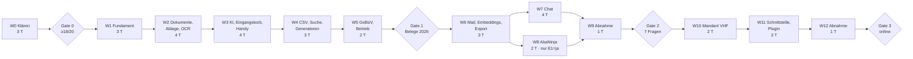

# UriNet Archiv — Umsetzungsplan

Stand 08.11.2026 · Grundlage: Konzept «UriNet Archiv — Konzept und Anforderungen» und die
Specs unter `.kiro/specs/`.

**Rund 35 Arbeitstage in 13 Wellen und 4 Phasen. Nach jeder Phase steht ein messbares Gate;
die nächste Phase beginnt erst, wenn es erfüllt ist.**

> **Freigegeben:** Spec 01 am 08.11.2026 (PR #1, Merge `c7b83f4`) mit der eingearbeiteten Prüfung
> (Entscheide P1–P18 in Abschnitt 6). Die Werte der Dokumentarten im Seed bleiben Entwurf bis
> vor Welle 2. Specs 02 und 03 sind noch nicht geprüft.

## 1. Aufbau der Spec

| Ordner | Inhalt | Wellen | Aufwand |
| --- | --- | --- | --- |
| `.kiro/steering/` | `product.md` (Warum), `tech.md` (Stack und Regeln), `structure.md` (Ordner, Namen) | – | – |
| `.kiro/specs/01-archiv-kern/` | Phase 0 + 1: 17 Requirements, Design, Aufgaben | 0–5 | ca. 19 Tage |
| `.kiro/specs/02-abgleich-chat/` | Phase 2: 13 Requirements, Design, Aufgaben | 6–9 | ca. 10 Tage |
| `.kiro/specs/03-zweiter-mandant/` | Phase 3: 9 Requirements, Design, Aufgaben | 10–12 | ca. 6 Tage |

Jede Spec folgt dem Kiro-Muster: `requirements.md` (User Stories + Akzeptanzkriterien in EARS),
`design.md` (Architektur, Schnittstellen, Datenmodell, Fehler, Tests), `tasks.md` (Aufgaben mit
Rückverweis `_Anforderungen: x.y_`). Umgesetzt wird nicht mit dem Werkzeug Kiro, sondern mit
Claude Code; Einstieg ist `CLAUDE.md`.

## 2. Crew und Rollen

| Rolle | Wer | Aufgaben |
| --- | --- | --- |
| Product Owner / Reviewer | Fabian | Requirements und Design per Merge freigeben, PRs prüfen und mergen, Gates abnehmen, Aufgaben **[Fabian]** |
| Backend-Agent | Claude Code (Spec-Aufgaben **[Backend]**) | Quarkus, Datenbank, Worker, KI |
| Frontend-Agent | Claude Code bzw. Joel (**[Frontend]**) | Angular-PWA, WordPress-Plugin |
| Infra-Agent | Claude Code (**[Infra]**), Fabian für Zugänge und Secrets | Docker, Infomaniak, Deploy-Workflow, Sicherung |
| QA | Claude Code (**[QA]**) + Fabian | Last-, Isolations-, Sicherheits- und Abnahmetests |

Joel eignet sich für klar abgegrenzte Frontend-Aufgaben (2.7, 3.6, 4.4, 4.6, 7.4, 11.4, 11.5),
jeweils mit Review durch Fabian.

## 3. Ablauf mit Claude Code

1. Das Repository `Urinet-ch/dokumentenmanagement` (angelegt 08.11.2026) enthält `.kiro/`, `docs/` und `CLAUDE.md`.
2. Claude Code liest `CLAUDE.md`; diese bindet die drei Steering-Dateien per `@`-Import ein (Ersatz für `inclusion: always`).
3. **Requirements freigeben:** Jede Fassung von `requirements.md` kommt als PR. Freigabe = Fabian merged den PR auf `main`.
4. **Design freigeben:** ebenso per PR – das ist der wichtigste Prüfpunkt (Architektur, nicht Syntax).
5. **Tasks wellenweise:** Jede Aufgabe einer Welle bearbeitet eine eigene Claude-Code-Sitzung auf eigenem Branch; Aufgaben derselben Welle laufen parallel nach Rolle. Fabian prüft und merged die PRs; die Welle ist abgeschlossen, wenn alle ihre Checkboxen in `tasks.md` auf `main` abgehakt sind.
6. Nach Welle 0, 5, 9 und 12 das Gate abnehmen und in Abschnitt 6 eintragen.
7. Erkenntnisse aus Spikes (Welle 0) per PR zurück in `design.md` schreiben, bevor Welle 1 startet.

Konventionen pro Aufgabe:
- Branch `feature/<spec>-<aufgabe>-<stichwort>`, z. B. `feature/01-2.6-ocr`.
- Commit mit Verweis auf das Kriterium als `req-<x.y>`: `feat(verarbeitung): OCR mit OCRmyPDF (req-5.1)`. `A1`–`A14` bezeichnen nur die Zeilen der Rechtematrix.
- PR-Beschreibung nennt die erfüllten Akzeptanzkriterien (`@req-x.y`) und die Tests dazu; Checkbox in `tasks.md` im selben PR abhaken.
- Änderungen an Requirements werden im PR ausdrücklich ausgewiesen, nie stillschweigend.
- Aufgabe gilt als erledigt, wenn die Definition of Done aus `tech.md` erfüllt ist.

Prüfungen (CI und Claude-Code-Hooks):
- **CI (GitHub Actions, Pflicht vor dem Merge):** `mvn verify` mit Cucumber, JUnit und ArchUnit; bestehende Liquibase-Changesets unverändert (nur neue Dateien unter `db/**`); OpenAPI und generierter Frontend-Client aktuell; jedes Akzeptanzkriterium hat ein Szenario mit `@req-x.y` oder einen Nachweis-Vermerk.
- **Claude-Code-Hooks (`.claude/settings.json` im Repo):** nach dem Bearbeiten einer Java-Datei die betroffenen Tests ausführen; Bearbeiten bestehender Changesets unter `db/**` blockieren; keine Secret-Dateien lesen oder schreiben.

## 4. Wellen, Abhängigkeiten und Aufwand

| Welle | Inhalt | Aufgaben | Parallel (Rollen) | Aufwand |
| --- | --- | --- | --- | --- |
| 0 | Golden-Datensatz, Spikes S3/AI, Test-Export 21.CRM, Prototyp, Stufe A vorbereiten (bestehende VPS) | 01: 0.1–0.7 | Fabian ∥ Backend ∥ Infra | 3 T |
| 1 | Gerüst, CI, Dev-Umgebung, Mandanten, Rollen, API-Tokens, Stammdaten Dokumentarten, Leitplanken, Deploy-Workflow, Stufe A einrichten und Speicherbudget messen, Profil lokal | 01: 1.1–1.11 | Infra ∥ Backend ∥ Fabian | 3 T |
| 2 | Dokumentarten, Datenmodell, S3, Upload, Aufträge, OCR, Frontend-Gerüst, Mindestversionen Handys | 01: 2.1–2.8 | Backend ∥ Infra ∥ Frontend ∥ Fabian | 4 T |
| 3 | Kontakte, KI-Vorschlag, Lernen, Bestätigen, Versionen, Eingangskorb, PWA | 01: 3.1–3.7 | Backend ∥ Frontend ∥ Fabian | 4 T |
| 4 | CSV-Import, Suche, Generator-Client, Drive-Import, Entscheide vor Welle 5 (inkl. K5) | 01: 4.1–4.9 | Backend ∥ Frontend ∥ Fabian | 3 T |
| 5 | Wechsel auf Stufe B, Protokoll, Manifest, Prüflauf, Produktion, Sicherung, Überwachung und Monitoring-Anbindung, Verfahrensbeschreibung, Übernahme, Notfallunterlagen | 01: 5.1–5.11 | Backend ∥ Infra ∥ Fabian | 2 T |
| 6 | E-Mail-Eingang, Embeddings, Hybridsuche, Jahresexport | 02: 6.1–6.5 | Backend ∥ Frontend ∥ Fabian | 3 T |
| 7 | Werkzeuge, Agent, SSE, Chat-Oberfläche | 02: 7.1–7.4 | Backend ∥ Frontend | 4 T |
| 8 | AbaNinja (nur E1 = ja) | 02: 8.1–8.6 | Backend ∥ Frontend | 2 T |
| 9 | Chat-Prüfliste und Abnahme | 02: 9.1 | Fabian ∥ QA | 1 T |
| 10 | AVV, Mandant VHF/GSK, Branding, Erfassung, Altbestand | 03: 10.1–10.6 | Backend ∥ Frontend ∥ Infra ∥ Fabian | 2 T |
| 11 | Öffentliche Schnittstelle, Chatbot, WordPress-Plugin | 03: 11.1–11.5 | Backend ∥ Frontend | 3 T |
| 12 | Bericht, Vollexport/Abbau, Isolation/Sicherheit, Einführung | 03: 12.1–12.4 | Backend ∥ QA ∥ Fabian | 1 T |
| | **Total** | | | **ca. 35 T** |

Die Tage sind Aufwand von Fabian (Steuern, Prüfen, manuelle Aufgaben) bei Umsetzung durch
Agenten; ohne Agenten ist mit etwa dem doppelten Aufwand zu rechnen.

## 5. Zeitplan (Richtwerte, Nebenerwerb)

| Zeitraum | Phase | Wellen | Gate |
| --- | --- | --- | --- |
| Nov–Dez 2026 | 0 Klären | 0 | ≥ 18/20 zurückgehaltene Belege korrekt |
| Jan–Apr 2027 | 1 Archiv-Kern | 1–5 | alle Belege 2026 im Archiv, Prüflauf grün |
| Mai–Jul 2027 | 2 Abgleich und Chat | 6–9 | 7 Beispielfragen + ≥ 18/20 richtig mit Quelle |
| ab Etappe 2 VHF/GSK | 3 Zweiter Mandant | 10–12 | VHF/GSK-Archiv online |

Plattform (P1): Wellen 1–4 laufen auf Stufe A (bestehende VPS, nur Testdaten). K5 fällt in Welle 4
(Aufgabe 4.9, Richtwert März 2027); Bestellung, Einrichtung und Wechsel auf Stufe B (Aufgabe 5.11)
liegen zu Beginn von Welle 5, vor der Übernahme der Belege 2026; bricht 1.10 ab oder tritt 16.18
später ein, rücken K5 und der Wechsel nach vorne.

Fixpunkte: Vorstandsentscheid VHF/GSK 19.11.2026 (bestimmt E4 und den Start von Phase 3);
Jahresabschluss 2026 (Phase 1 sollte vorher die Belege 2026 enthalten, sonst Abschluss 2026
noch klassisch).

## 6. Gates und Entscheide

| Gate / Entscheid | Wann | Kriterium / Frage | Ergebnis |
| --- | --- | --- | --- |
| Gate 0 | Ende Welle 0 | Golden-Datensatz 30 Belege zum Abstimmen, 20 zurückgehalten; ≥ 18/20 zurückgehaltene in Art, Datum, Partner, Betrag korrekt (Vergleichsregeln je Feld); höchstens 1 Fehler unter Feldern mit Sicherheit ab der Schwelle (≥, Startwert 0.8, nach Req 0.9 anheben); Spikes dokumentiert | **Zwischenstand 09.11.2026:** Abstimmungsteil (30 synthetische Belege), Prompt v3 `v3-24e40a6cf5ab`, OCR-Text: 123/150 Felder (82 %), 18/30 Belege mit Art, Datum, Partner, Betrag richtig (60 %; hochgerechnet auf den Prüfteil rund 12/20, Gate verlangt 18/20), 13 Fehler ≥ 0.8, kleinste Schwelle mit höchstens 1 Fehler 0.91 (Lauf 2026-11-09-0616; je nach Lauf 0.91 bis > 1.0 und 8–13 Fehler ≥ 0.8 bei gleichem Prompt v3, Laufschwankung golden-ergebnis.md Befund 6); Variante K1 (Bild): 134/150, 18/30, 12 Fehler ≥ 0.8 (`docs/spikes/golden-ergebnis.md`). Prüfteil: [offen: Gate-Lauf `--gate`, Fabian]. Realitätsprüfung: 0 bestätigte echte Belege. Spikes 0.2, 0.3, 0.4 dokumentiert (0.4 ohne Verkaufschancen, Nachexport vor Welle 4). Abnahme siehe Vorlage unten |
| E2 Eigenbau | Gate 0 | Eigenbau Quarkus/Angular bestätigen (Specs gehen davon aus) | **bestätigt von Fabian am 09.11.2026** |
| E3 PWA | Gate 0 | Handy zuerst als PWA (Specs gehen davon aus) | **bestätigt von Fabian am 09.11.2026** |
| K5 Server | vor Welle 5 (früher, falls 1.10 abbricht oder 16.18 später eintritt) | Grösse und Kosten der eigenen Infomaniak-VPS für Stufe B (P1) | [offen: VPS-Grösse K5 – Entscheid vor Welle 5] |
| E5 Papier | vor Welle 5 | Papieroriginale nach Scan vernichten? Verfahrensbeschreibung anpassen | [offen] |
| Gate 1 | Ende Welle 5 | Belege 2026 im Archiv, Prüflauf ohne Abweichung | [offen] |
| E1 AbaNinja Basic | vor Welle 8 | Abo Basic (CHF 21/Mt.)? Nein → Welle 8 entfällt | [offen] |
| Gate 2 | Ende Welle 9 | 7 Beispielfragen + ≥ 18/20 | [offen] |
| E4 VHF/GSK | nach 19.11.2026 | Archiv in Etappe 2 der Offerte O-2026-002 oder später | [offen] |
| Gate 3 | Ende Welle 12 | Archiv online, Geschäftsstelle veröffentlicht selbständig | [offen] |

**Abnahme Gate 0** (Vorlage, füllt Fabian aus)

Grundlagen: `docs/spikes/golden-ergebnis.md`, `docs/spikes/s3-object-lock.md`, `docs/spikes/infomaniak-ai.md`,
`docs/spikes/21crm-export.md`, ADR-007 (Nachtrag 09.11.2026). Kriterien: Req 0.3, 0.9, 0.10.

| Feld | Wert |
| --- | --- |
| Datum der Abnahme | [offen] |
| Prompt-Fassung und Hash im Gate-Lauf | [offen] (Abstimmungsteil zuletzt: v3 `v3-24e40a6cf5ab`) |
| Eingabe | [offen: OCR-Text oder K1 für Fotos] |
| Schwelle (Req 0.9, gilt für Req 7.6) | [offen] (Startwert 0.8; Abstimmungsteil: kleinste Schwelle mit höchstens 1 Fehler 0.91 im Lauf 2026-11-09-0616, je nach Lauf 0.91 bis > 1.0 – Laufschwankung, golden-ergebnis.md Befund 6) |
| Prüfteil: Belege mit Art, Datum, Partner, Betrag richtig | [offen] / 20 (Gate: ≥ 18; Hochrechnung aus dem Abstimmungsteil rund 12/20) |
| Prüfteil: Fehler mit Sicherheit ≥ Schwelle | [offen] (Gate: ≤ 1) |
| Realitätsprüfung (Req 0.10): bestätigte echte Belege | [offen] von 20 |
| Realitätsprüfung: Quote | [offen] |
| Gate 0 | [offen: bestanden / nicht bestanden] |

| Entscheid | Stand |
| --- | --- |
| Umstufung der Art bei eigener Art und fremdem QR-Zahlungsempfänger (statt nur Sicherheit 0) | **entschieden von Fabian am 09.11.2026**: ja – nur aus AUSGANGSRECHNUNG oder OFFERTE, nie aus LOHNABRECHNUNG (golden-ergebnis.md, Befund 3); Umsetzung im Prototyp (Aufgabe 0.5, nachschärfen) |
| K1: Bild an das Modell nur für Fotos, Volltext weiter per OCR | **entschieden von Fabian am 09.11.2026**: ja (golden-ergebnis.md, Befund 2; «nur Fotos» wird im Prototyp nachgemessen, Aufgabe 0.5) |
| Offerten: Betrag = einmaliges Total der Umsetzung | **festgelegt von Fabian am 09.11.2026** bei der Durchsicht der echten Belege (Bestätigung der Belege noch offen), für den Golden-Datensatz: der Betrag der Umsetzung zählt, eine monatliche Wartungsgebühr nicht. Verallgemeinerung auf alle Offerten bzw. Behördenschreiben und Übernahme in Prompt und design.md: **entschieden von Fabian am 09.11.2026** |
| Belegnummer bei Behördenschreiben | **festgelegt von Fabian am 09.11.2026** bei der Durchsicht der echten Belege (Bestätigung der Belege noch offen), für den Golden-Datensatz: bei einer EasyGov-Vollmacht ist die Antrags-ID die Belegnummer. Verallgemeinerung auf alle Offerten bzw. Behördenschreiben und Übernahme in Prompt und design.md: **entschieden von Fabian am 09.11.2026** |
| Abgrenzung BEHOERDE/VERSICHERUNG | **entschieden von Fabian am 09.11.2026:** Sozialversicherungen (AHV-Ausgleichskassen, IV, EO, FAK) sind BEHOERDE, auch bei Rückerstattungen und Gutschriften. UVG- und Krankentaggeld-Versicherer sind VERSICHERUNG (entschieden von Fabian am 09.11.2026). Regel kommt in Prompt und design.md «KI» (Aufgabe 0.5); Beschreibungsspalte in der Dokumentarten-Tabelle nur vorgeschlagen · [offen] |
| Object Lock: Option A / B / C (ADR-007, Nachtrag) | **entschieden von Fabian am 09.11.2026**: Option B (GOVERNANCE für Dokumente, COMPLIANCE für `manifest/`); Anpassung von Req 6.5 als eigener PR (alt → neu) |
| E2 Eigenbau | **bestätigt von Fabian am 09.11.2026** |
| E3 PWA | **bestätigt von Fabian am 09.11.2026** |
| D8 | **von Fabian am 09.11.2026:** einer Folge-Spec zuordnen, nicht streichen – [offen: Spec 02 oder 03] |
| Freigabe ADR-001 bis ADR-012 (per Merge) | [offen] |

Entscheide aus der Prüfung von Spec 01 (im Prüfbericht E1–E18; hier P1–P18, damit sie nicht
mit den Konzept-Entscheiden E1–E5 oben verwechselt werden). Alle **entschieden 08.11.2026, wie empfohlen**;
P1 am 08.11.2026 von Fabian **geändert** («Zuerst mit der vorhandenen VPS starten»); P19 am 08.11.2026 von Fabian
**ergänzt** (lokales Modell, eng begrenzt):

| Nr. | Thema | Entscheid | Noch offen |
| --- | --- | --- | --- |
| P1 | Zielplattform | **geändert 08.11.2026:** zwei Stufen mit gleichem Muster (Traefik, Bundle-Deploy, Compose-Policy) + Public-Cloud-Projekt nur für Object Storage (unverändert). **Stufe A** ab Welle 1 auf der bestehenden Infomaniak-VPS: nur Test- und anonymisierte Daten, Speicherbudget ≤ 700 MiB / 0.75 CPU (in Welle 1 gemessen, Aufgabe 1.10), API und Worker in einem Container, keine Leistungsziele, Sicherung nur als Funktionstest. **Stufe B** eigene, grössere Infomaniak-VPS: Wechsel (Aufgabe 5.11) spätestens vor echten Belegen (Übernahme/Produktion in Welle 5), früher bei Budgetüberschreitung oder wenn andere Apps der VPS leiden; Leistungsziele und Lasttests erst hier; K5 vor Welle 5. Bisher: eigene VPS ab Welle 1, K5 vor Welle 1 | [offen: VPS-Grösse K5 – Entscheid vor Welle 5] |
| P2 | Unveränderbarkeit | Object Lock GOVERNANCE, App-Schlüssel ohne Bypass, Bypass-Schlüssel offline beim Inhaber, RFC-3161-Zeitstempel Pflicht; Spike prüft Schlüssel ohne Bypass und COMPLIANCE, sonst COMPLIANCE mindestens für `manifest/` | [offen: Schweizer TSA-Anbieter – Entscheid vor Welle 5]; Spike 0.2 (08.11.2026): COMPLIANCE verfügbar, kein Schlüssel ohne Bypass-Recht im selben Projekt, damit gilt COMPLIANCE mindestens für `manifest/` (Req 6.11); Option B entschieden 09.11.2026 (ADR-007, Nachtrag 09.11.2026)  |
| P3 | Rollen | eng: `mitarbeiter` erfasst, liest `NORMAL` und eigene `PERSONAL`; nur `inhaber` bestätigt, ändert Vertraulichkeit, verwirft; `INTERN` nur `inhaber`/`treuhaender`; `treuhaender` liest `PERSONAL`; gilt für Mandant `urinet`, `geschaeftsstelle` (Mandant 2) nach Matrix; Matrix Rolle × Aktion in Req 2 | – |
| P4 | Sicherung Belegdateien | Datenbank (inkl. Keycloak, Realm) und Bucket; Zweitkopie bei zweitem Schweizer Anbieter; über GitHub Actions (Muster `maintenance`), Server verschlüsselt vorher asymmetrisch; Ausnahme in Req 16.7; Restore-Probe automatisiert inkl. Dateien und Anmeldung | [offen: zweiter Schweizer Backup-Anbieter – Entscheid vor Welle 5] |
| P5 | Anmeldung | Keycloak bleibt, auf der VPS aus P1, nach P4 gesichert | – |
| P6 | Dokumentarten | Tabelle aus dem Konzept als `backend/src/main/resources/seed/urinet/dokumentarten.json`, Test gegen die Tabelle, Attribut `gesetzliche_pflicht` | [offen: Werte der 11 Dokumentarten – Entscheid vor Welle 2] |
| P7 | Belegnummer | eindeutig je Mandant und Art nur bei eigenen Arten; Fremdbelege nur Warnung; Generator idempotent bei gleicher SHA-256 (200 + vorhandene ID), Konflikt → `archiv-konflikt/` | – |
| P8 | Dublette | Ergebnis pro Datei `DUBLETTE` mit `vorhandenId` (ohne Leserecht nur «bereits vorhanden»); PWA und Drive-Import werten als übertragen | – |
| P9 | Drive-Import | Token-Scope `import`; Office, `.eml`, ZIP in Phase 1 ausgeschlossen und gemeldet; PDF/A darf Signatur verlieren, sonst Original mit `pdfa_fehlt`; Import in den Eingangskorb | – |
| P10 | Korrekturbeispiele | deterministische Vorauswahl über IBAN, UID, E-Mail, Swiss-QR-Code, Belegnummer-Muster, sonst die 5 neuesten | – |
| P11 | Gate 0 | Vergleichsregeln je Feld, 30/20 aufgeteilt, ≥ 18/20, ≤ 1 Fehler bei Sicherheit ab der Schwelle (≥, Startwert 0.8, nach Req 0.9 anheben), Swiss-QR-Code deterministisch, Korrekturquote als Kennzahl, «genau 10» je Kategorie | – |
| P12 | Fristablauf | Löschfunktion später (erste Frist 2036); jetzt `gesetzliche_pflicht`, WORM nur bei «ja»; Sperrvermerk und Auskunft später | – |
| P13 | Handy-Original | Rohaufnahme als Original, Zuschnitt als Arbeitsfassung; ohne erkannte Kanten ganzes Bild | – |
| P14 | Rückverfolgung | Req 16 als «ohne Konzept-ID» gekennzeichnet | [offen: D8 einer anderen Spec zuordnen oder bewusst streichen – Entscheid vor Welle 1] (Aufgabe 0.6) |
| P15 | Domains | `archiv.apps.urinet.ch`, `archiv-auth.apps.urinet.ch` | – |
| P16 | Tests | BDD nach Blueprint: Cucumber-Features mit Tag `@req-x.y`, JUnit für Unit-Tests | – |
| P17 | Notfallzugang | versiegelte Notfallunterlagen ausserhalb des Systems (neues Kriterium in Req 16); Notfallablauf für den Treuhänder in der Verfahrensbeschreibung; bis Welle 5 | – |
| P18 | AVV KI | Spike AI Services hält Speicherung und Training fest; AVV unter `docs/vertrag/` | – |
| P19 | Lokales Modell (08.11.2026) | **neu 08.11.2026:** Profil `lokal` (ADR-012): Sprachmodell in LM Studio nur auf dem Entwicklerrechner, nur an `localhost`; erlaubt für Entwicklung, Prompt-Vorarbeit und echte Belege, die den Rechner nicht verlassen; nicht für Gate 0, Golden-Lauf, Abnahmen, CI, Stufe A/B und Produktion; Startprüfung der KI-Basis-URL (Req 16.20–16.22, Aufgaben 0.5 und 1.11); Startmodell Mistral Small 3.2 24B, weil Mistral Small 4 nicht belegt in 64 GB läuft; Embeddings und Reranker lokal als Stub; Ergebnisse kein Nachweis für Infomaniak | Durchsetzung von `strict` in LM Studio (nicht dokumentiert, in 1.11 prüfen und im README festhalten); Schema-Features (`anyOf`, #103) |

Offene Klärungen aus dem Konzept: K1 Bildeingabe (Spike AI Services, Aufgabe 0.3, Req 0.5), K2 Zeitbudget, K3 Treuhänder
(Aufgabe 5.7), K4 21.CRM-Export (Aufgabe 0.4), K5 Servergrösse und -kosten (vor Welle 5, siehe P1).

## 7. Risiken

| Risiko | Wirkung | Massnahme |
| --- | --- | --- |
| KI-Erkennung unter 18/20 | Phase 1 bringt weniger Zeitersparnis | Prompt und Beispiele verbessern; sonst Vorschläge nur für Art/Partner, Rest manuell |
| Object Lock pro Objekt nicht verfügbar | zweistufige Ablage nicht möglich | Rückfall: getrennte Buckets `…-eingang` (ohne Sperre), `…-archiv` (Standard-Aufbewahrung) und `…-ablage` für Arten ohne `gesetzliche_pflicht` (design.md) |
| Kein S3-Schlüssel ohne Bypass-Recht | GOVERNANCE schützt nicht vor der App | COMPLIANCE mindestens für `manifest/` (P2) |
| Zeitstempel nicht von Anfang an | Speicherzeitpunkt nicht belegbar, nicht nachholbar | TSA-Anbieter vor Welle 5 wählen, kein produktives Archivieren ohne Zeitstempel |
| Konto- oder Anbieterverlust | Totalverlust nach Papiervernichtung | Zweitkopie bei zweitem Schweizer Anbieter, Restore-Probe inkl. Dateien (P4) |
| Sicherung über Runner ausserhalb der Schweiz | Verstoss gegen Regel 6 | Server verschlüsselt asymmetrisch, Runner sieht nur verschlüsselte Daten |
| VPS zu klein (Stufe B) | Leistungsziele verfehlt, OCR blockiert API | Grösse nach K5 vor Welle 5, Limits je Dienst, Lastskripte aus 2.4, 2.6, 4.5 mit Nachweis auf Stufe B (5.11) |
| Stufe A reicht nicht oder belastet andere Apps | Archiv oder andere Apps der VPS instabil (Speicher, Health) | Speicherbudget mit Messung und Abbruchkriterium in 1.10, Prüfung nach jedem Deploy (1.9, Req 16.18); bricht 1.10 ab oder tritt 16.18 später ein, Archiv auf Stufe A stoppen, K5 und Wechsel (5.11) vorziehen |
| Echte Daten auf Stufe A | Belege, Personal- oder Lohndaten auf einer geteilten VPS ohne Reserven | nur Test- und anonymisierte Daten (Req 16.15); Übernahme 5.8 erst nach dem Wechsel 5.11 |
| Infomaniak ohne strukturierte Antworten / Tool Calling | Extraktor bzw. Chat aufwendiger | JSON-Modus + Validierung; Chat mit Apertus oder späterem Modell, Werkzeugauswahl per Klassifikation |
| Embedding-Dimension > 4'000 | kein HNSW-Index | anderes Modell (Qwen3-Embedding-8B) oder Dimension reduzieren |
| Zeitbudget im Nebenerwerb | Verzögerung | Wellen sind einzeln abschliessbar; Phase 2/3 verschiebbar ohne Folgen für Phase 1 |
| AbaNinja-API ändert sich | Abgleich bricht | Adapter gekapselt, Vertragstests, Tagesabgleich holt nach |

## 8. Laufende Kosten (Richtwerte)

| Posten | Kosten |
| --- | --- |
| Bestehende Infomaniak-VPS (Stufe A, Welle 1 bis zum Wechsel) | keine Zusatzkosten (bestehende VPS) |
| Eigene Infomaniak-VPS (Stufe B, ab Welle 5) | [offen: CHF __/Mt. – K5, Entscheid vor Welle 5] |
| Object Storage (Public-Cloud-Projekt) | nach Verbrauch, einige GB pro Jahr |
| Infomaniak AI Services | ca. CHF 1.50 pro 1'000 Chat-Fragen (Mistral), Erfassung ähnlich pro 1'000 Dokumente |
| Zweitkopie Sicherung (zweiter Schweizer Anbieter) | [offen: CHF __/Mt. – Anbieter, Entscheid vor Welle 5] |
| RFC-3161-Zeitstempel | [offen: CHF __/Mt. – TSA-Anbieter, Entscheid vor Welle 5] |
| AbaNinja Basic | CHF 21/Mt., nur bei E1 = ja |
